# `WeeklyStockSignals` (`trip_ema`) — Architecture

**Package:** `WeeklyStockSignals_v10` (codename `trip_ema`)
**Companion docs:** `01_FUNCTIONALITY.md` (what the system does) and `03_OPEN_ITEMS.md` (what hasn't been built)

This document explains *how the pieces are arranged and why*. It complements (but does not replace) `docs/ARCHITECTURE.md` in the repo, which carries the 14 invariants and is the canonical contract for code reviewers.

---

## 1. System context

The product is a multi-process, single-host service. The boundary against the outside world is small:

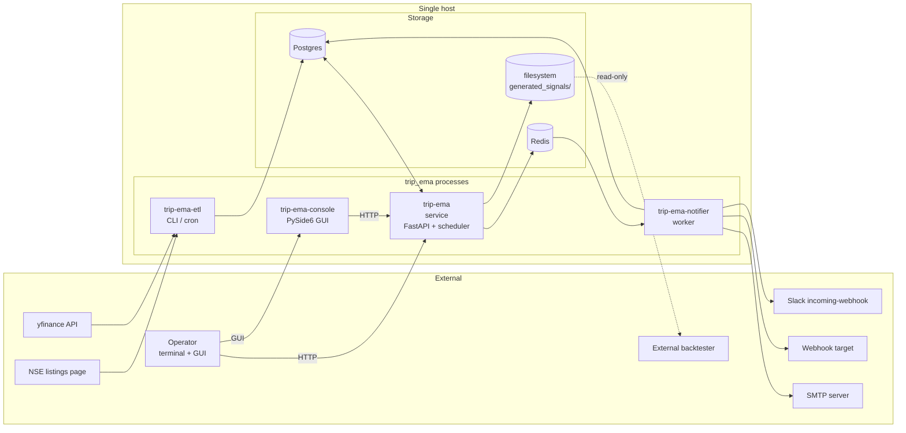

**Topology rationale.** Phase 11 invariant 3.14 says: the Engine, ETL, GUI, and Notifier are process-separated. The Engine and ETL never run in the same Python process (their startup imports are mutually heavy and their failure modes shouldn't entangle). The Notifier is its own process because circuit-breaker failure shouldn't kill the compute loop. The GUI is its own process so a crash there can't take down the service.

---

## 2. Layered module map

The codebase is layered. Lower layers may not import from higher layers; cross-cutting concerns belong in `api` or `scheduler`.

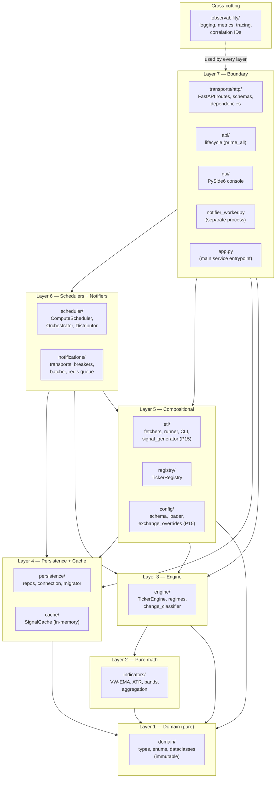

**Invariant 3.14 enforcement** is by import discipline (no cyclic dependencies, low-layer modules don't import from high-layer modules). A test (`tests/test_no_dead_island.py`) walks the import graph to catch new violations.

---

## 3. The four "actors" (running processes)

### 3.1 `trip-ema` main service

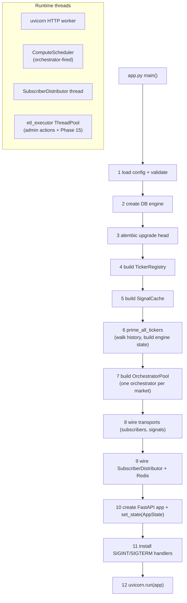

**One process.** Do NOT run uvicorn with `--workers N`. Multiple workers would mean multiple TickerRegistries, multiple SignalCaches, and multiple schedulers racing on the DB — they all assume single-writer.

### 3.2 `trip-ema-notifier` worker

A separate process that pops jobs off Redis and dispatches via transport. Lives in `trip_ema/notifier_worker.py`. The reasoning: a wedged SMTP server shouldn't slow down the compute loop, and a breaker-tripped transport shouldn't trip the main service's circuit.

### 3.3 `trip-ema-etl` CLI

Stateless. Each invocation opens the DB, does its work, exits. No background threads. Designed to be cron-driven.

### 3.4 `trip-ema-console` GUI

PySide6 application. Talks to the main service exclusively over HTTP (never directly to Postgres) so a single deploy point owns auth, validation, and write paths. (Phase 12 invariant.)

---

## 4. Data flow — live signal path

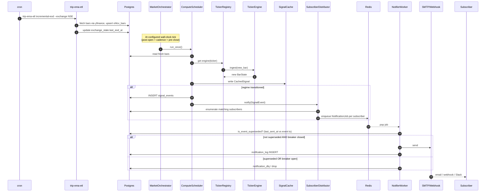

**Single-writer invariants.** Only `ComputeScheduler` writes to `SignalCache`. Only `ComputeScheduler` writes to `signal_events`. The notifier worker writes to `notification_log` (and DLQ); nothing else does. These are documented as invariants 3.2 and 3.10 in `docs/ARCHITECTURE.md`.

---

## 5. Data flow — Phase 15 backtest path

The backtest pipeline runs **fully outside** the live path. Different writes, different read patterns, no shared mutable state with the scheduler.

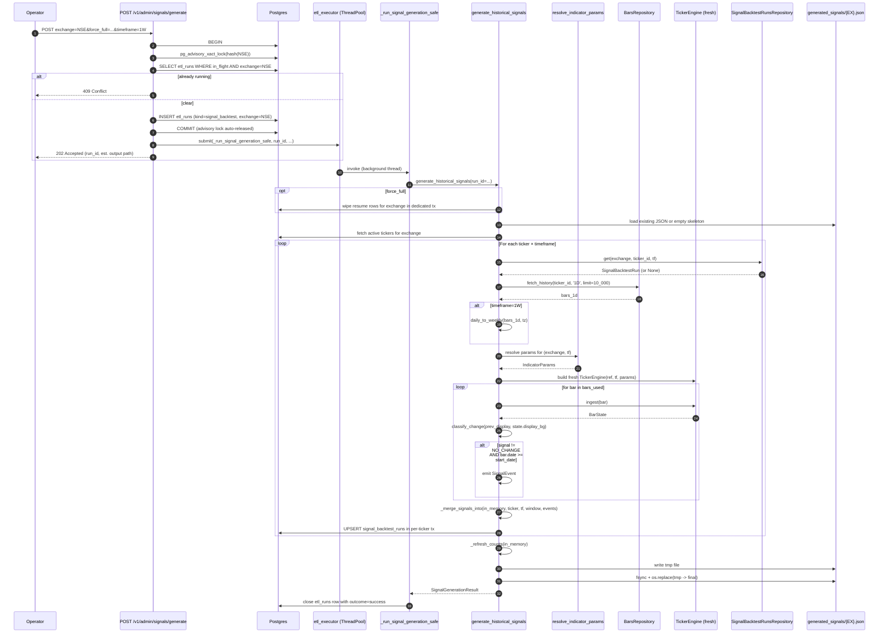

**Two key non-obvious design choices** in this flow:

1. **Lifecycle split.** The HTTP route opens the `etl_runs` row in the request thread (so the concurrent-run guard's SELECT sees it) and signals to the runner "don't open your own". The runner does the work; the wrapper closes the row. The asymmetric ownership is the price of having both a CLI path (runner opens *and* closes) and an HTTP path (route opens, runner runs, wrapper closes) without duplicating logic.

2. **Advisory lock around the guard.** Plain read-committed transactions don't serialize `SELECT then INSERT`. Two concurrent POSTs to the same exchange could each pass the guard. `pg_advisory_xact_lock(hash(exchange))` serializes them. The lock is auto-released at commit/rollback so there's no leak risk.

---

## 6. Persistence architecture

### 6.1 Schema topology

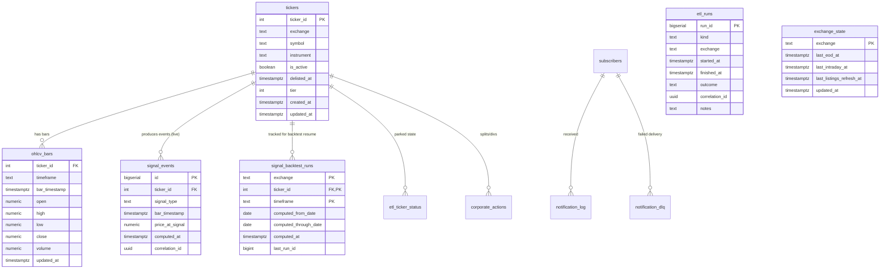

### 6.2 Migration topology

Phase 12 introduced **two parallel schema-management systems**: Alembic is canonical, but the legacy SQL migrator is kept byte-equivalent. A parity test (`tests/persistence/test_legacy_migrator.py`) asserts they produce identical schemas.

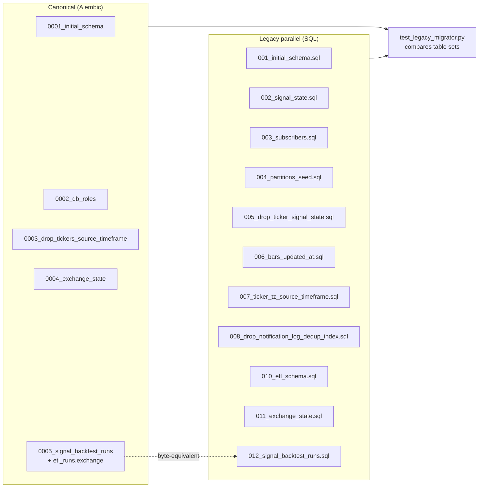

**Why two systems?** Phase 12 needed Alembic for the role-grant migrations (legacy SQL didn't support down-migration), but the legacy migrator's invariant was baked into the bootstrap script (`scripts/restart_service.sh` style deployment). Both run in parallel and the parity test catches drift.

### 6.3 Per-process least-privilege (Phase 12)

Three Postgres roles:

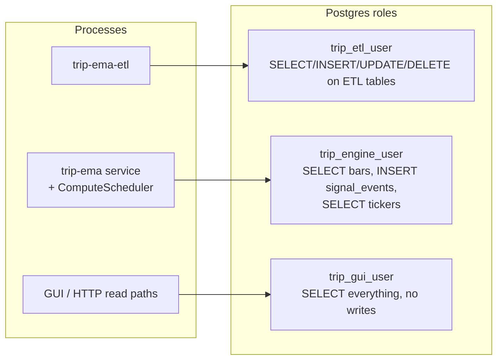

The `signal_backtest_runs` table (Phase 15a) follows this convention: `trip_etl_user` reads+writes (the signal generator runs as the ETL identity), `trip_engine_user` reads (for any future consumer), `trip_gui_user` reads (for the GUI's "last generated" panel).

---

## 7. HTTP transport architecture

### 7.1 Router decomposition

Each router owns a thematic slice of routes. They share a common `dependencies.py` module for auth + DB engine + executor + config injection.

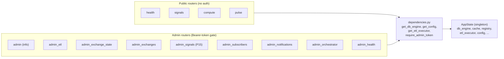

### 7.2 Async-action pattern

Admin endpoints that kick off heavyweight work follow a single pattern:

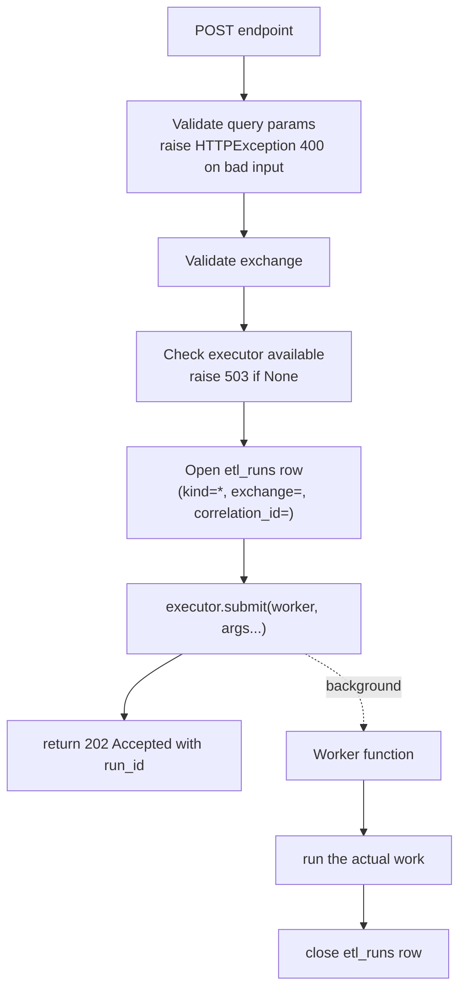

**Phase 15b's variation.** The `admin_signals/generate` route also acquires a `pg_advisory_xact_lock(hash(exchange))` inside the same transaction as the SELECT-then-INSERT pair. Other admin actions don't need this because they're either single-row writes or have weaker concurrency requirements; signal generation does because mid-flight uniqueness on `(exchange, in_flight=true)` matters.

### 7.3 Schema / response binding

All responses use Pydantic models in `trip_ema/transports/http/schemas.py`. FastAPI handles the serialization; ISO timestamps + tz-aware datetimes throughout.

---

## 8. GUI architecture

### 8.1 View / widget split

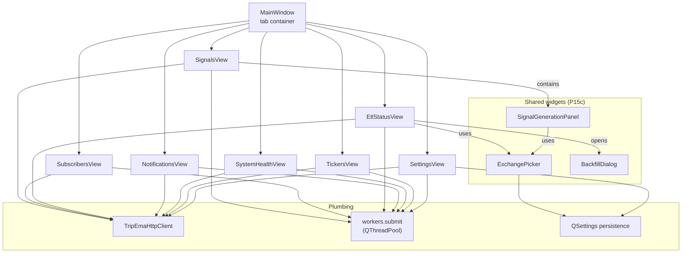

**Test architecture for the GUI.** Two test trees:

- `tests/gui/` — full PySide6 tests using `pytest-qt`. Cover view construction, widget behavior, signal/slot wiring.
- `tests/gui_pure/` — pure unit tests that don't need a `QApplication`. Cover the HTTP client and any other GUI-adjacent logic that can be tested without Qt.

The split exists because Qt teardown is fragile (Phase 12 invested heavily in stabilizing it via `conftest.py`'s `managed_widget` and `_drain_after_every_gui_test`). Where possible, logic is moved to `gui_pure/`.

### 8.2 Worker pattern

Every HTTP call from the GUI goes through `gui.workers.submit(callable)` which runs on `QThreadPool` and returns a worker with `finished` / `failed` signals. This keeps the Qt main thread responsive.

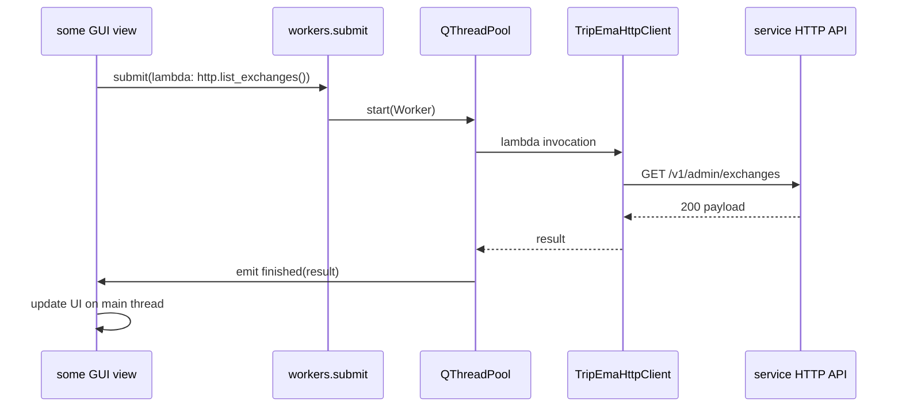

### 8.3 Exchange picker reuse (Phase 15c lesson)

The picker logic was duplicated/inlined in `EtlStatusView` before Phase 15c. When `SignalGenerationPanel` needed the same behavior, the picker was extracted to `widgets/exchange_picker.py`. The pattern: `QComboBox` + status hint + loading-sentinel + persistence via `QSettings` + `selection_changed` signal. EtlStatusView was refactored to use the same widget; the test `tests/gui/test_etl_status_view_exchange_picker.py` (18 tests) guards the refactor.

---

## 9. Cross-cutting concerns

### 9.1 Configuration

`config.yaml` is loaded via `trip_ema/config/loader.py` → validated by Pydantic models in `trip_ema/config/schema.py`. Environment-variable references (`password_env: "PG_PASSWORD"`) are resolved at load time.

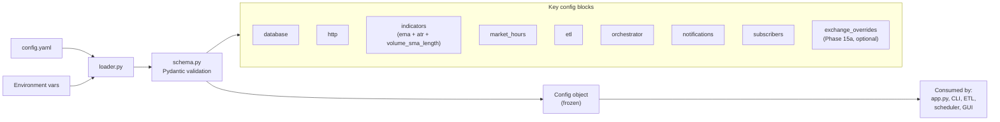

**Phase 15a added `exchange_overrides`** as an optional top-level block. The schema's `_validate_exchange_overrides` runs as a `model_validator` to reject unknown timeframes and unknown exchanges at config-load time, so the service either starts with a known-good config or fails clearly.

### 9.2 Correlation IDs

A correlation ID is a UUID minted at the start of a logical operation. It propagates through every log line, every DB write that has a correlation_id column, and every OpenTelemetry span.

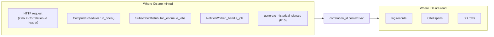

### 9.3 Observability stack

| Concern | Module | Output |
|---|---|---|
| Logging | `observability/logging_config.py` | Structured JSON to stdout (default) |
| Metrics | `observability/metrics.py`, `metrics_server.py` | Prometheus scrape on `/metrics` |
| Tracing | `observability/tracing.py` | OTLP / Zipkin compatible spans |
| Correlation | `observability/correlation.py` | Context-var propagation |

---

## 10. Test architecture

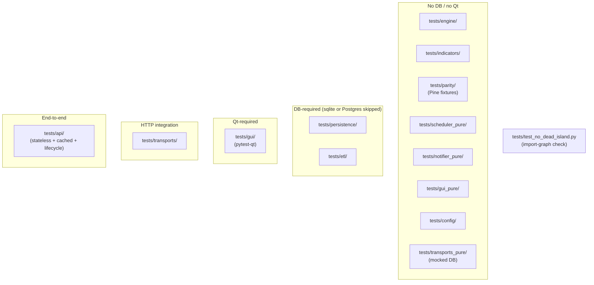

**Two pytest-qt tactics.** GUI tests use a `managed_widget` factory + `_drain_after_every_gui_test` autouse fixture (Phase 12 work) to handle deferred-deletion correctly. Some flaky tests (notably `tests/gui/test_signals.py` per the design doc) are `--deselect`-ed by convention; the design's expected count of "1138 + ~100 = 1238 passing" includes the deselect.

---

## 11. Deployment & operations

### 11.1 Single-host, single-process model

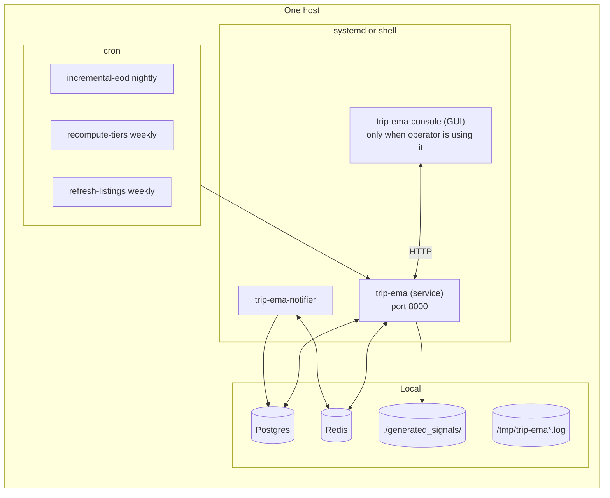

**Scripts.**

| Script | Purpose |
|---|---|
| `scripts/restart_service.sh` | Kill + restart `trip-ema`; poll `/healthz` until primed |
| `scripts/gui_start.sh` | Idempotent GUI launcher (skip if already running) |
| `scripts/smoke_test_fast.sh` / `_full.sh` | Health checks for CI / ops |
| `scripts/health_check.sh` | One-shot probe |
| `scripts/audit_dead_island.sh` | Run the import-graph invariant test |

### 11.2 What can't be horizontally scaled today

Invariants 3.2 (SignalCache), 3.6 (engine provisional/final), 3.10 (notification dedup) all assume one process. Running `uvicorn --workers N` would produce N caches that disagree.

The path to horizontal scaling, when needed, is leader-election or ticker-sharding — *not* naive process multiplication. Captured in `docs/ARCHITECTURE.md` §8.

---

## 12. Phase 15 architectural patterns to internalize

These are the patterns that Phase 15 either established or reinforced:

| Pattern | Where introduced / reinforced |
|---|---|
| **Per-ticker commit, not one big transaction** | `signal_generator._process_ticker_timeframe` commits `signal_backtest_runs` after each ticker. A mid-run kill leaves resume rows for committed tickers durable; the next run picks up cleanly. |
| **Asymmetric run_id lifecycle** | The runner accepts `run_id=None` (own the lifecycle) or `run_id=<int>` (caller owns the close). Lets one runner serve both CLI and HTTP. |
| **Advisory lock around concurrent-run guard** | First time this pattern appears; should be the template for any future `SELECT then INSERT` mutex pattern across processes. |
| **Atomic file write via temp + rename** | tmp file + fsync + `os.replace`. Generic enough to be reusable for any "single per-key file" pattern. |
| **In-memory merge with three-case semantics** | Add / replace / delete operations on a date-keyed dict, documented and tested explicitly. Reusable shape for any "recompute a window, preserve outside" use case. |
| **Reusable widget extraction** | The picker was inline in 14.6c, extracted in 15c so it could be reused in two views. Future tabs should consume widgets rather than reimplementing them. |
| **Endpoint audit as living documentation** | `docs/gui_endpoint_audit.md` documents the GUI-coverage status of every route. When a new route ships, the table must be updated in the same commit. |

---

## 13. Summary

The architecture is **layered, single-host, single-process for live computation**, with the backtest pipeline added as a parallel branch that consumes the same engine code but writes to its own storage (`signal_backtest_runs` table + JSON file). All cross-process boundaries are well-defined (Engine ↔ ETL ↔ GUI ↔ Notifier each a separate Python process). The HTTP API is the single integration point operators and the GUI use; nothing else talks directly to Postgres.

Phase 15's contribution to the architecture is small but principled: it introduces a parallel-output pipeline without disturbing the live path, encodes resume semantics into the persistence layer (`signal_backtest_runs`), demonstrates the asymmetric-lifecycle pattern for run rows, and reinforces the widget-extraction discipline for the GUI.

The system is intentionally **un-microserviced** for now. If horizontal scaling becomes a requirement, the next architectural conversation is leader-election or sharding, not splitting the service into N tiny processes.
