# `WeeklyStockSignals` (`trip_ema`) — Open Items, Improvements, and Enhancements

**Companion docs:** `01_FUNCTIONALITY.md` (what the system does) and `02_ARCHITECTURE.md` (how it's structured)

This document inventories **what's deliberately not done yet** and **what could be improved**. It is organized into:

1. Explicitly deferred to a named future phase (already designed)
2. Acknowledged gaps with stated workarounds
3. Architectural debt and risks
4. Quality / hardening opportunities
5. New capability frontiers
6. Operational / DX improvements

Each item lists what's missing, why it isn't done, and the rough shape of doing it.

---

## 1. Roadmap of explicitly deferred phases

The Phase 15 design (§10) names four follow-on phases. They're already scoped — the implementing conversation just hasn't happened yet.

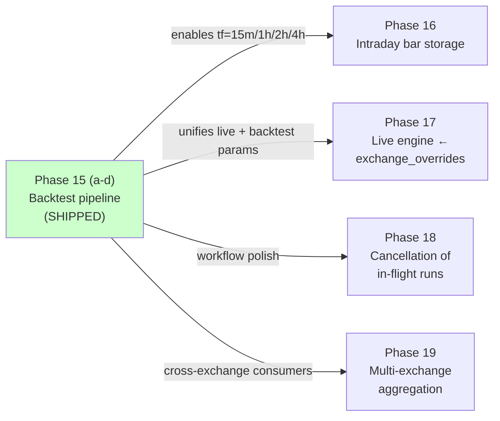

### 1.1 Phase 16 — Intraday bar storage and ingestion

**What's missing.** The `ohlcv_bars` table today is populated only with `timeframe='1D'`; `1W` is synthesized in-memory from daily via `daily_to_weekly`. The `Timeframe` enum already includes `15m`, `1h`, `2h`, but they have no producer. Backtest signal generation explicitly rejects these via `SUPPORTED_BACKTEST_TIMEFRAMES = {"1D", "1W"}`.

**Why deferred.** Storing intraday bars at NSE volume (~2,667 tickers × 26 bars/day for 15m) plus vendor-data-quality safeguards (yfinance intraday is known to be noisier than EoD) is its own design conversation. The Phase 15 design (D3) deferred this rather than expand scope.

**Rough shape of doing it.**

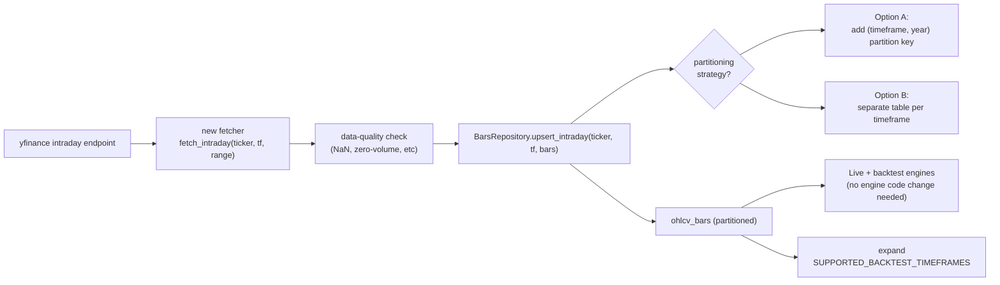

**Decision points needing review.**

| Question | Options |
|---|---|
| Partitioning | Add `timeframe` to the partition key vs. one table per timeframe. Table-per-tf is conceptually cleaner but doubles migrations work for any future schema change. |
| Retention | Keep intraday forever (storage cost) vs. roll up to higher tf after N days. |
| Backfill semantics | yfinance intraday has limited history (~60 days for 1h, ~7 for 15m). The backtest's "20 years of history" assumption only holds for 1D / 1W. The backtest schema's `counts.first_date` should reflect this; the operator doc should call it out. |
| Live ingest cadence | The orchestrator already supports intraday ticks. Do we ingest into `ohlcv_bars` before the engine runs, or rely on `ingest_provisional` and skip storage? |

**Test impact.** A fresh `tests/etl/test_intraday_fetcher.py` (~20 tests), parametrized parity tests over multiple timeframes (~10), and a backtest test that exercises `tf=1h` against synthetic bars. Likely 40-50 new tests.

### 1.2 Phase 17 — Live engine using `exchange_overrides`

**What's missing.** Today the live `ComputeScheduler` uses `config.to_indicator_params()` — the global block. Phase 15 introduced per-(exchange, timeframe) overrides used only by the backtest path (design D4, OOS-7). Live signals therefore **don't reflect operator-tuned parameters per exchange**.

**Why deferred.** Two production paths racing on the same configuration would be a regression risk; deliberately staged.

**Rough shape.**

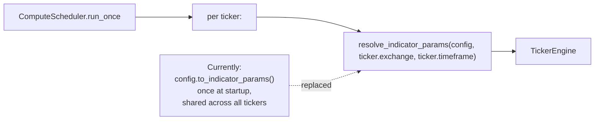

**Tricky bits.**

- The `TickerRegistry` builds engines at startup with a fixed `IndicatorParams`. Migrating means either (a) building engines lazily per-tick, or (b) tearing down and rebuilding engines when the config changes per-exchange. Option (b) is cleaner and aligns with the existing `Reprime` endpoint shape.
- A config change in `exchange_overrides` should trigger a live-engine recompute for affected (exchange, timeframe) combinations. The current "edit config + restart_service.sh" workflow is fine for v1 of Phase 17.
- Parity test: after Phase 17, a freshly run backtest for exchange X and a live engine for the same params must produce identical signals over the overlapping window. This becomes a regression suite.

### 1.3 Phase 18 — Cancellation of in-flight backtest runs

**What's missing.** A long backtest run that the operator regrets — say, they realized they pointed at the wrong exchange — has no clean cancellation path. The only options are: wait, or `kill -9` the worker thread (which leaves `etl_runs.outcome = NULL` until manually cleared).

**Why deferred.** Phase 15 design D9 explicitly punted this. Cancellation across DB + filesystem + thread is genuinely complex.

**Rough shape.**

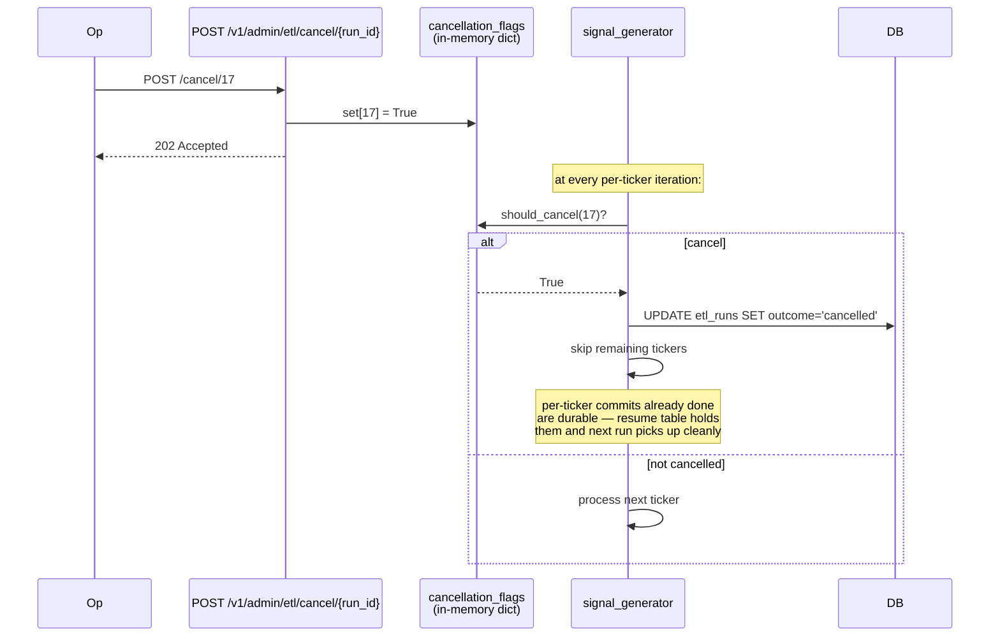

**Test surface.** Synthetic backtest that processes 5 tickers; cancel between tickers 2 and 3; verify (a) outcome='cancelled', (b) signal_backtest_runs has tickers 1 and 2 only, (c) a subsequent run finishes the remaining 3.

### 1.4 Phase 19 — Multi-exchange aggregation

**What's missing.** A consumer that wants a unified view of signals across NSE + BSE + NYSE has to read three files. Design D5 said one file per exchange; D7 noted that cross-exchange consumers are an explicit "later phase" need.

**Rough shape.** Decision: do we generate a fourth combined file (denormalized, three times the data), or have the consumer read three files and merge? Probably the latter (consumer-side merge), plus a small "manifest" file listing what exchanges have files and when they were last updated.

---

## 2. Acknowledged gaps with stated workarounds

The Phase 15d audit (`docs/gui_endpoint_audit.md`) catalogues 25 routes. Four are flagged ⏳ "deferred-with-reason." They're production-ready as CLI/curl but lack GUI ergonomics.

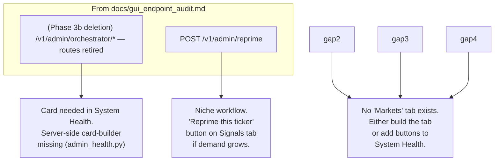

### 2.1 Orchestrator status card

**Current state (post-Phase-3b).** Endpoint deleted. RunScheduler + RunDispatcher own scheduling; inspect their state via `/healthz` (`run_scheduler_alive`, `run_dispatcher_alive`) or `/v1/admin/health-snapshot`'s Compute Scheduler card (backed by `compute_runs`).

**To close.** Add `_orchestrator_card(...)` builder in `trip_ema/transports/http/routes/admin_health.py` so the existing System Health tab picks it up automatically (the tab is card-driven; whatever cards the server returns get rendered). Open questions captured in the audit:

| Question | Default answer |
|---|---|
| Status thresholds (ok / warning / crit) | Paused = warning, gap-detected = crit, normal = ok |
| One card per market vs. one summary card | Summary card with "N markets running, M paused" + drill-in button |
| What goes in headline | Aggregate state + count |
| What goes in detail | Per-market state with next-tick timestamp |

### 2.2 Orchestrator actions (run-now / pause / resume)

**Current state.** No GUI surface. Audit defers these as niche.

**To close.** Either a new "Markets" tab (new file `trip_ema/gui/views/markets.py`) or a per-market button row inside the System Health card from §2.1. Trigger to revisit: an operator workflow conversation that says "I need to pause NSE while we investigate, then resume."

### 2.3 Reprime button

**Current state.** No GUI surface; curl-only.

**To close.** A "Reprime this ticker" button on the Signals tab next to the existing chart's ticker picker. Confirmation modal because reprime is destructive (it wipes the engine's accumulated state). Wired via the existing async-action pattern.

---

## 3. Architectural debt and risks

### 3.1 The single-process bottleneck

**What it is.** Invariants 3.2, 3.6, and 3.10 assume one process. `uvicorn --workers N` would break them silently.

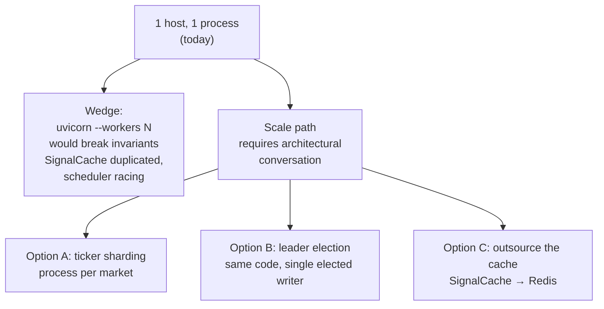

**Why it's debt.** A single host that handles NSE + BSE + NYSE during overlapping hours has CPU headroom on a modern box. But it's a known ceiling. If/when latency budgets tighten or markets multiply, the scheduler needs sharding.

**Recommended:** Don't preemptively redesign. *Do* add a startup assertion that detects `WEB_CONCURRENCY=N>1` or `uvicorn --workers N>1` and refuses to start, so the foot-gun is hard.

### 3.2 The two-system migrations (Alembic + legacy SQL)

**What it is.** Every schema change ships twice: once as an Alembic revision in `alembic_pkg/versions/`, once as a legacy SQL file in `migrations/legacy/`. Drift is caught by `tests/persistence/test_legacy_migrator.py`.

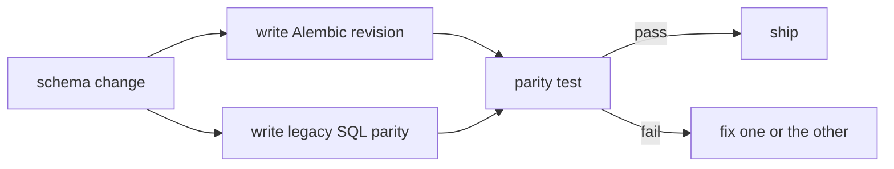

**Why it exists.** Phase 12 wanted Alembic for the role-grant work but the bootstrap deploy scripts ran the legacy migrator. Both have been maintained since.

**Cost.** Roughly 2× developer time per schema change. Phase 15a's table required ~120 lines in `0005_signal_backtest_runs.py` plus ~80 in `012_signal_backtest_runs.sql`. Worth it for safety but it's friction.

**Path to retire the legacy migrator.** Once `restart_service.sh` is updated to call `alembic upgrade head` (instead of the legacy migrator), the legacy files become dead code. Then delete in a single PR + update the parity test to a no-op or remove. Estimated effort: half a day.

### 3.3 The `etl_runs` row lifecycle asymmetry

**What it is.** `generate_historical_signals` can either own the etl_runs row (CLI path: opens + closes) or be a guest (HTTP path: caller opens, runner runs, wrapper closes). The two cases are flagged by `run_id is None`.

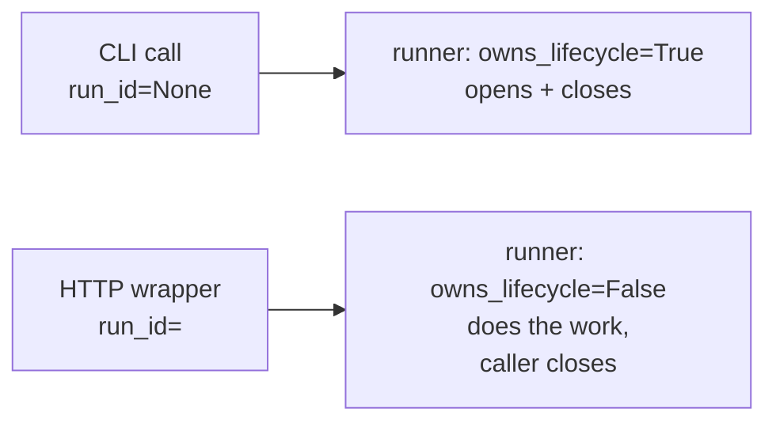

**Risk.** Future callers may forget which path they're on and double-close. Tests guard the contract (`test_passing_run_id_skips_open_but_still_closes`).

**Optional refactor.** Split into two functions: `generate_historical_signals_standalone(...)` (opens its own row) and `generate_historical_signals_async(run_id, ...)` (guest). Both delegate to a private `_do_generate`. Eliminates the `run_id=None` overload but doubles the public surface.

### 3.4 `Path.cwd()` for output directory

**What it is.** `trip_ema/etl/signal_generator.py::_DEFAULT_OUTPUT_DIR = Path("generated_signals")` and `admin_signals.py::_output_dir() = Path.cwd() / "generated_signals"`. Works because `scripts/restart_service.sh` does `cd "$REPO_ROOT"` before launching.

**Risk.** Someone runs the service from a different cwd (debugging, weird systemd unit, in-process testing) and the output file lands in the wrong place. Tests pass because they `chdir` to tmp.

**Fix.** Promote to a config field `etl.generated_signals_dir`. The route would consult `config.etl.generated_signals_dir` rather than `Path.cwd()`. Backward compat: default to `"generated_signals"` (relative to cwd) for installations that don't override.

### 3.5 No fsync on the containing directory

The atomic-write helper fsyncs the file but not the directory. POSIX guarantees the rename atomic; OS crash mid-rename leaves either old or new. But OS crash mid-fsync (data written, metadata not) could lose the new file's link. Comment at L851-855 of `signal_generator.py` flags this as a known boundary case.

**Fix.** Add `os.fsync(dir_fd)` after the rename. Marginal cost; closes the OS-crash hole. ~5 lines.

### 3.6 The "skip ticker if too little history" silence

When a ticker has fewer than 250 daily bars and is being force-fully recomputed, the runner silently skips it with a `logger.info`. The operator sees `tickers_skipped` count incremented but no list of which tickers.

**Fix.** Return a `skipped_tickers: list[str]` field on `SignalGenerationResult` and surface in the CLI summary line and HTTP-route response. ~10 lines + 2 tests.

---

## 4. Quality / hardening opportunities

### 4.1 Test coverage gaps

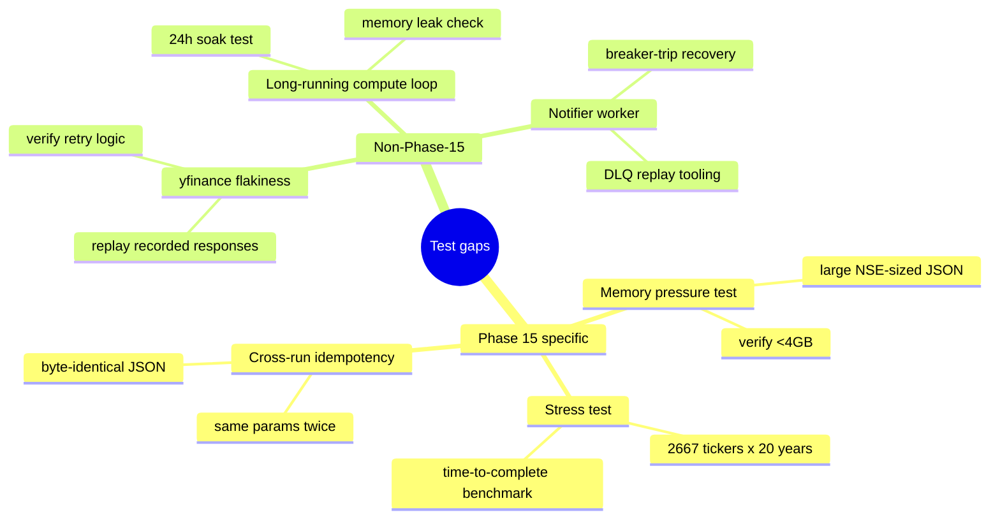

**Specific recommendations.**

| Gap | What to add |
|---|---|
| Backtest stress | One test that runs against a synthetic exchange of 1000 tickers × 5000 daily bars; asserts the run completes in <60s on CI hardware. Catches O(n²) regressions in the merge loop. |
| Cross-run idempotency | After a clean `force_full` then an immediate `force_full` again, the produced JSON files should be byte-identical (modulo `generated_at` and `generated_by_run_id`). Catches order-instability bugs. |
| Schema-version handling | When the JSON has an older `schema_version`, the runner should either upgrade or reject. Currently it ignores the version and merges in. Add a test + a guard. |
| HTTP 503 path | The 503 branch (executor None) is reachable per code review but probably untested. Verify and add a test. |
| Force-full while in-flight | A force-full request issued while a non-force-full run is in flight: the advisory lock should serialize but the user-visible behavior needs a doc + test. |

### 4.2 Configuration hardening

| Risk | Mitigation |
|---|---|
| `exchange_overrides` references a typo'd exchange | Already validated at config-load; ✅ |
| `exchange_overrides` for `1D` but engine config doesn't include a `1D`-compatible `volume_sma_length` | Today the override mirrors the global structure so this can't happen. Defensive test would help. |
| Operator deletes `generated_signals/{EX}.json` and runs incremental | Runner treats missing file as empty skeleton (intentional, documented). Worth a test asserting the recomputed window matches the resume row's `computed_through_date + 1d`. |
| `force_full=true` and resume row was missing for some tickers | Currently OK: missing row + force_full both mean "from earliest bar." No conflict. |

### 4.3 Logging improvements

The signal generator logs a lot at INFO when running 2,667 tickers — one log per ticker × timeframe. At DEBUG level there's even more.

**Recommendations.**

- Batch the per-ticker INFO into "processed N/M tickers" every 100 (existing `progress_callback` could plug into this).
- Add a structured log at run-completion with `tickers_processed`, `tickers_skipped`, `signals_emitted`, `signals_deleted_by_merge`, `duration_seconds` — one line for ops dashboards to grep.
- Currently the per-ticker log keys are dict-style, not `extra=`. Verify they're indexed in the JSON formatter.

### 4.4 Performance opportunities

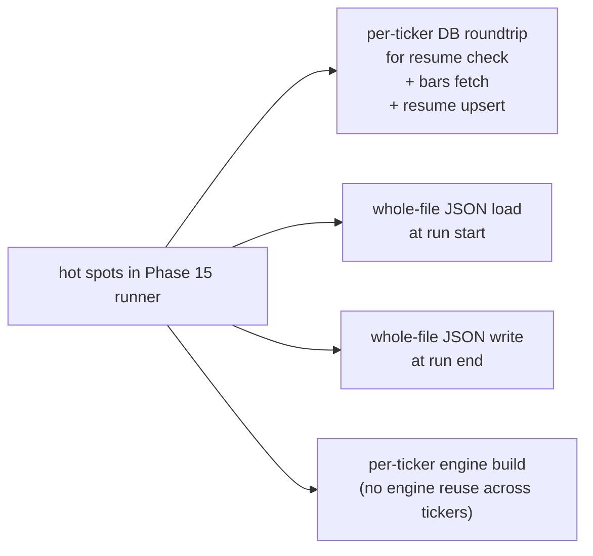

| Hotspot | Mitigation | Effort |
|---|---|---|
| **Per-ticker DB roundtrips** | Batch the resume check (one query for all tickers) at run start; build a dict in memory; consult during iteration. Same for the upsert at run end (one COPY rather than N INSERTs). | Medium; ~150 LOC + tests |
| **Whole-file JSON load** | Today works because NSE 1W is ~14MB. If a future exchange grows to >200MB, switch to `ijson` streaming for the load step. Design's escape-hatch already mentions this. | Medium-large; conditional on file size |
| **Whole-file JSON write** | Same as above for writes. Streaming write is more involved than streaming read. | Large |
| **Per-ticker engine instantiation** | Each `TickerEngine` build is cheap but allocates. Pooling isn't worth it. | Skip |

Even without optimizations, observed wall-clock for an NSE 1W incremental run is reportedly under 2 minutes per the design's reference numbers. Optimization is currently premature.

### 4.5 Concurrency hardening

The advisory lock serializes per-exchange. Two concurrent backtest requests for *different* exchanges run in parallel — fine and intentional. But the `etl_executor` is shared with the other admin actions (Run EoD, Run Intraday, etc.). If the operator fires a force-full backtest for NSE AND a Run EoD for NSE simultaneously:

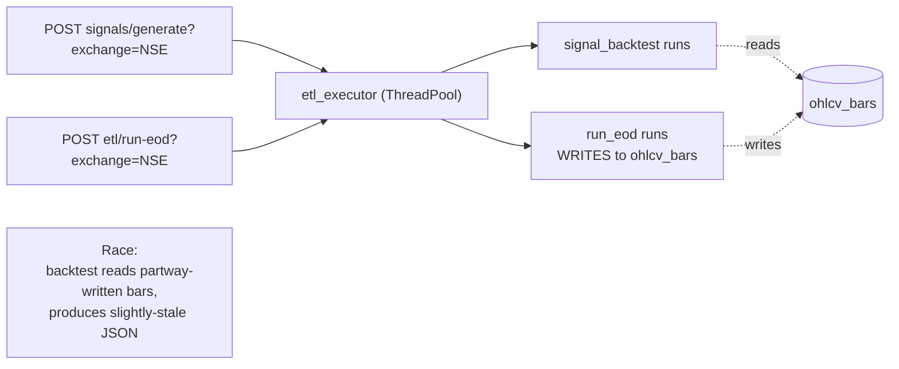

The race window is small (bars are upserted in a single transaction per ticker) but exists. Recommendations:

- Add an operator-doc note: "don't fire generate-signals during an in-flight EoD run."
- Or: extend the concurrent-run guard to block backtest if *any* ETL run for that exchange is in flight (not just other backtest runs). Trade-off: less concurrency, less surprise.

---

## 5. New capability frontiers

Things the system could grow into, prioritized by how much they'd unlock.

### 5.1 Backtest result diff / verification

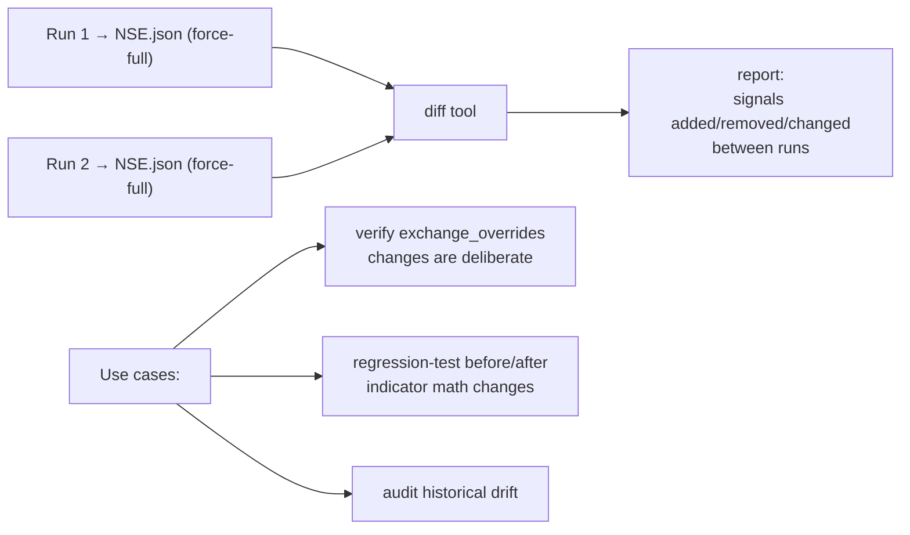

A `scripts/diff_signal_files.py` that takes two JSON files and prints structured diff. ~150 LOC. High value for the operator workflow.

### 5.2 Backtest execution (P&L) — explicitly OOS-6 but worth flagging

The Phase 15 output is a signal log. To turn it into P&L, an external backtester needs to:

- Define order-execution semantics (open-of-next-bar fill, slippage model, etc.)
- Define position-sizing
- Define cost model (brokerage, taxes)
- Walk the JSON, simulate

If a future operator workflow needs this in-tree, the natural shape is:

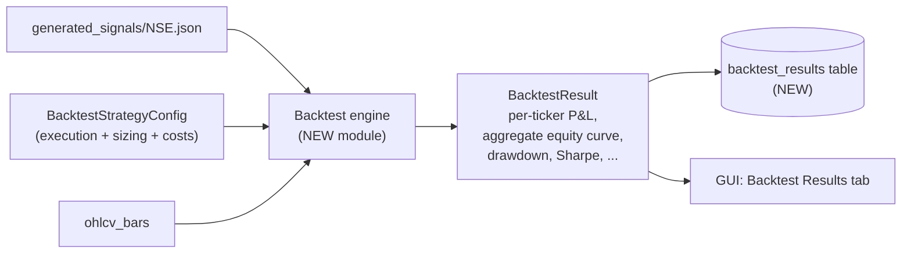

This is a substantial additional phase — multiple weeks. Worth doing only when the operator says "I want to see P&L" rather than today's "I want a signal log to feed my external backtester."

### 5.3 Notification surface for backtest completion

Today the operator polls `/generated` or watches the GUI panel refresh. A natural enhancement: when a backtest completes, send a notification (email/Slack) summarizing the run.

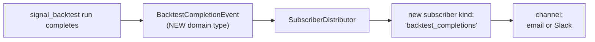

Small in surface but principled: turns "the operator has to watch" into "the operator gets pinged."

### 5.4 Multi-environment config (dev / staging / prod)

Today `config.yaml` is the one file. Operators on `Bangalore` (the user is) running both a dev box and a prod box have to maintain two files manually.

Common patterns: `config.{env}.yaml` with environment-variable resolution + base `config.yaml` inheritance, or twelve-factor-style env-var override. Either is fine; the current code is mid-way (env vars resolved for secrets).

### 5.5 Live signal export to external systems

The backtest pipeline produces JSON for an external backtester. The live signal pipeline produces `signal_events` rows that only the in-tree HTTP API can read. A natural extension: a live-signal export endpoint that streams signals as they happen (SSE or webhook fan-out).

`/v1/pulse/stream` is already an SSE endpoint; expanding it to include signal events is a small move.

### 5.6 Web UI alongside the desktop GUI

PySide6 is great for the operator but requires Python + Qt on the operator's machine. A small read-only web UI (FastAPI + Jinja or a tiny React SPA) for the status views (System Health, Signals chart) would let "the manager who doesn't have a dev env" peek.

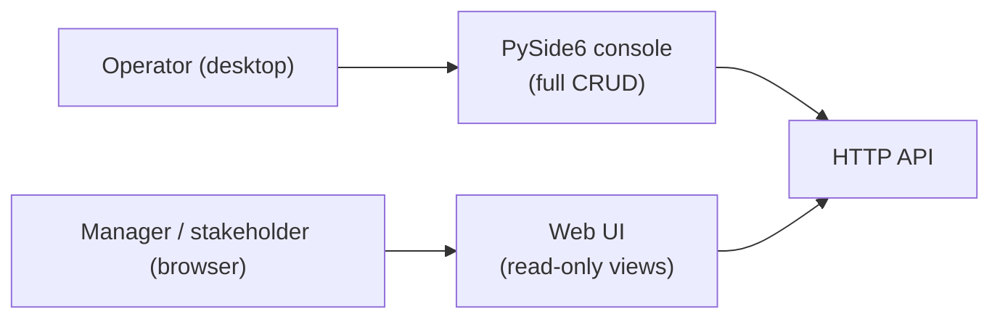

Effort: a week. Value: depends on how many non-operators want visibility.

---

## 6. Operational / DX improvements

### 6.1 Database housekeeping

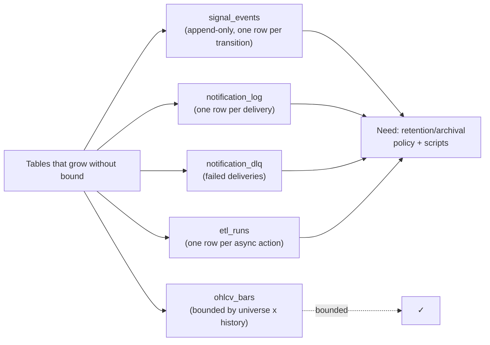

No archival or retention today. After a year of production, `signal_events` will have ~500k rows (small) but `notification_log` could be millions. A `scripts/archive_old_logs.sh` that moves rows older than N days to a cold table or just deletes them.

### 6.2 Backtest output retention

Same shape: `generated_signals/NSE.json` is overwritten each run. There's no "previous run" snapshot. If an operator does a force-full and regrets it, they can't roll back.

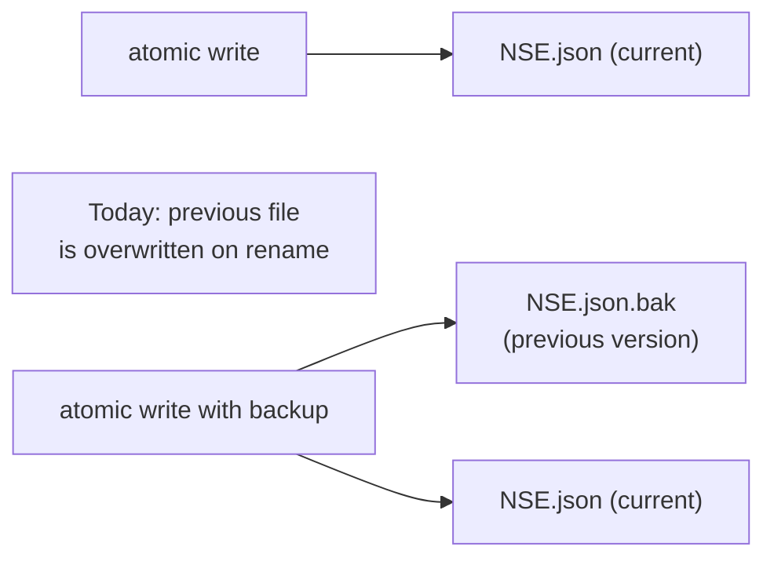

One-line change: rotate `NSE.json` → `NSE.json.bak` before the rename. Adds storage cost but gives a one-step rollback. Worth doing.

### 6.3 GUI: indicator-param tuning UI

The `exchange_overrides` block is operator-edited YAML today. A small GUI tab that exposes the block as a form-with-validation:

```
Exchange: [NSE ▼]   Timeframe: [1W ▼]

EMA stages:
  Med:     base [8 ] s1 [4 ] s2 [4 ] final [  ]
  Long:    base [15] s1 [4 ] s2 [4 ] final [3 ]
  Longest: base [28] s1 [7 ] s2 [5 ] final [3 ]
  Volume SMA length: [2]

ATR:
  Length [14]  inner [0.2]  mid [2.0]  outer [4.0]

[ Save ]    [ Save & Run backtest ]
```

Lives natively in the existing Settings tab, or as a new "Tuning" tab. The "Save & Run backtest" button posts to `/v1/admin/signals/generate?force_full=true` after persisting.

### 6.4 Better failure modes for the notifier worker

Today a DLQ row appears when the breaker is open. The operator finds out via the GUI's DLQ panel or by reading the worker log. A "DLQ has N entries that aren't draining" alert would be valuable.

Two paths:

- **Self-notification:** the worker emails the admin when DLQ depth exceeds a threshold (cute, but if the email transport is broken, it can't tell you about it).
- **Health-card surface:** `/v1/admin/health` returns a card showing DLQ depth. GUI System Health tab picks it up.

The second is cleaner — fits the existing card architecture.

### 6.5 Pre-commit hooks / linting

A quick `git grep -n 'print(' trip_ema/ | wc -l` would tell you whether there's a lurking discipline gap. Phase 12 added GitHub Actions CI. Augmenting with `ruff` + `mypy --strict` would catch many easy bugs.

### 6.6 Smaller items

| Item | One-liner |
|---|---|
| Logging — request-id propagation through GUI HTTP calls | The GUI doesn't pass `X-Correlation-Id`; adding it would join GUI clicks to service logs |
| GUI — keyboard shortcuts | No accelerator keys defined; `Ctrl+R` to refresh, `Ctrl+G` to generate, etc. |
| GUI — dark mode | Stylesheet is light-only; a setting toggle would help eye strain in long sessions |
| HTTP — OpenAPI tags + descriptions | FastAPI auto-generates OpenAPI; richer descriptions would make `/docs` more useful |
| HTTP — rate limiting | No rate limit on any endpoint; a runaway client could DOS the executor |
| CLI — colored output | argparse stdlib is plain; rich/click would add color and structured tables |
| CLI — bash completion | No shell completion for `--exchange` choices, etc. |
| docs — mkdocs build | `mkdocs.yml` exists; verify `mkdocs serve` works and produces a static site |
| docs — operator runbook | `scripts/operator_commands.md` is good; a parallel `runbook.md` for "what to do when X happens" would help on-call |
| docs — newcomer's `WALKTHROUGH.md` | "If you're new, read these 5 files in this order" — the README hints at this but doesn't deliver |

---

## 7. Prioritized recommendation matrix

To help pick what to do next, ranked by value × ease.

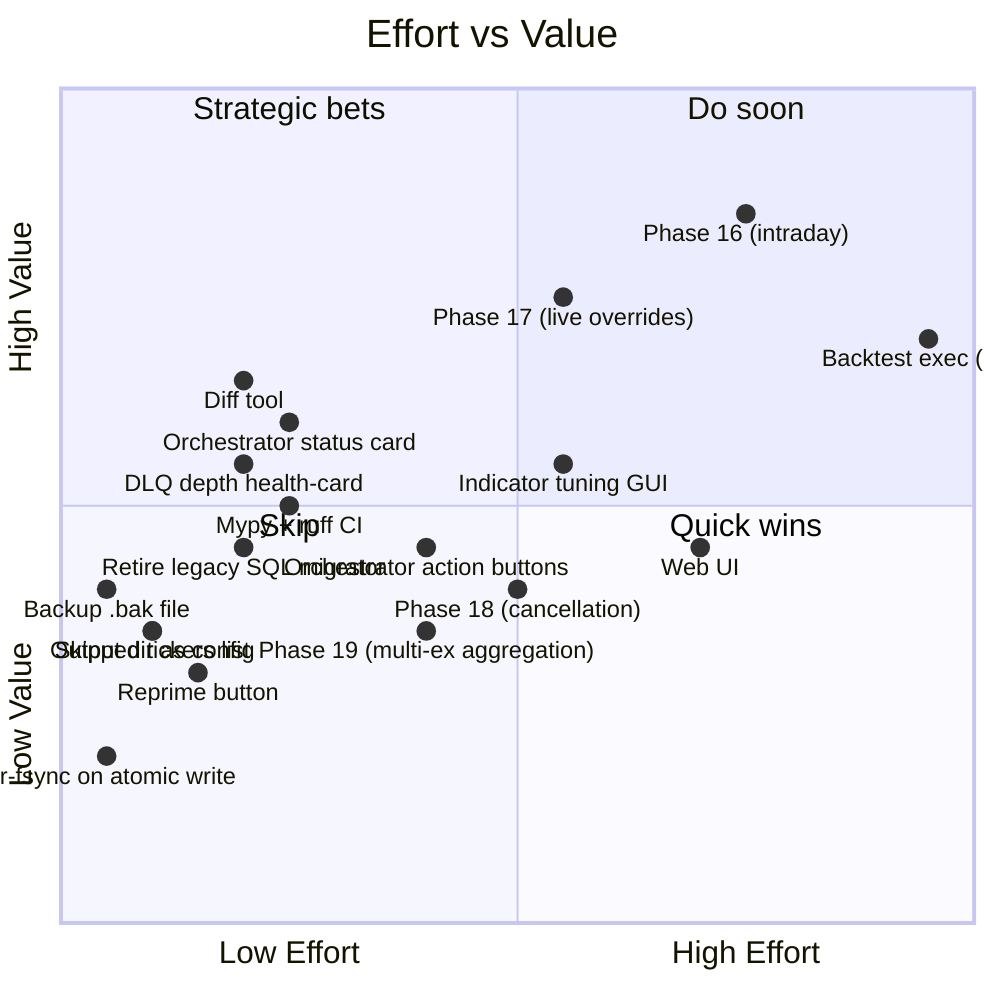

### Recommended first sweep (1-2 day each)

1. `os.fsync(dir_fd)` after rename (closes OS-crash hole — 5 LOC)
2. `NSE.json.bak` backup rotation (one-step rollback — 10 LOC)
3. Output dir as config field (`etl.generated_signals_dir` — 50 LOC + 2 tests)
4. `skipped_tickers` list in result (visibility — 20 LOC + 3 tests)
5. ruff + mypy in CI (catches a class of bugs — afternoon's work)
6. Retire the legacy SQL migrator (half a day; removes recurring 2× cost)

### Recommended next phase (1-2 week)

7. Phase 16 (intraday bar storage) — unblocks 4 new timeframes in the backtest
8. Diff tool (`scripts/diff_signal_files.py`) — high-value operator workflow

### Recommended longer arcs

9. Phase 17 (live engine using `exchange_overrides`) — closes the design's biggest deliberate gap
10. Backtest execution (P&L) — only if the operator workflow conversation explicitly demands it

---

## 8. Items deliberately NOT recommended

To save someone else the conversation:

| Item | Why not |
|---|---|
| Horizontal scaling (uvicorn --workers N) | Would break Invariants 3.2/3.6/3.10; the path is sharding or leader election, not naive worker counts |
| Streaming JSON output (per OOS-5) | NSE 1W is 14MB; the design's "use ijson if >200MB" escape hatch hasn't been triggered; premature |
| GUI restart-server button (per D11) | Brittle; server and GUI not co-deployed in general |
| Per-ticker indicator params (per OOS-2) | The math doesn't support per-ticker tuning meaningfully — params are universe-level, not name-level |
| Replacing yfinance with a paid feed | Out of scope; would require contract + reliability story; only worth it if yfinance proves unreliable enough to force the issue |
| Asyncio / FastAPI async routes for the existing sync code | Mostly cosmetic; the bottleneck is DB I/O and the executor model handles that; aren't gating any feature |
| Rewriting the engine in Rust / Cython | Pine parity is the constraint, not raw speed; the current Python is plenty fast for the universe size; would introduce a parity-test maintenance burden |

---

## 9. Summary

**What's missing in Phase 15 specifically:** nothing material. The design's F1-F12 and N1-N7 are all delivered. The four deferrals (D9 cancellation, OOS-1 intraday, OOS-7 live-engine overrides, D5/D7 multi-exchange aggregation) are documented and have named follow-on phases.

**Where the biggest near-term value sits:** Phase 16 (intraday timeframes), Phase 17 (live engine using overrides), and a small diff/verification tooling layer on top of Phase 15's JSON output.

**Where the architectural debt sits:** the two-migrations system, the `Path.cwd()` output-directory assumption, the silent skip on too-little-history tickers, and the lack of retention policies on append-only tables. None is dangerous today; all become friction at scale.

**Where the real expansions live:** a web UI for stakeholders, a backtest execution layer for P&L, and notifications for backtest completion. These are not gating anything; they're growth-path conversations.

The codebase as it stands is a complete, deliberate, well-tested product. The list above is the next bag of work, not a critique of what's there.
