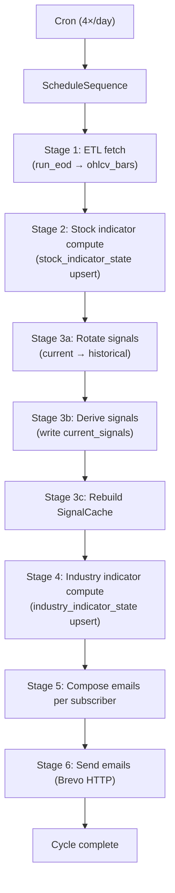
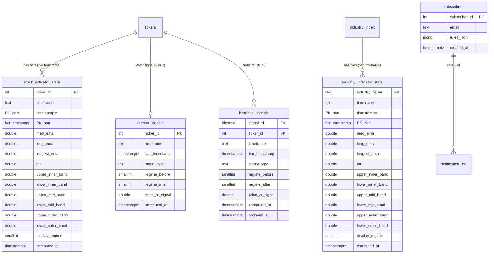
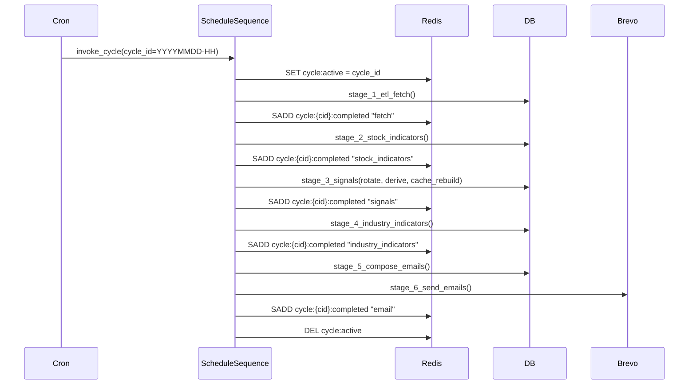

# Clean Pipeline Refactor — V1 Architecture Plan

**Project:** `WeeklyStockSignals` (`trip_ema`)
**Branch:** `architecture/clean-pipeline-v1` (to be created off `master`)
**Status:** Plan — pre-implementation
**Trigger context:** pre-production, no live subscribers yet, one-shot cutover acceptable
**Authors / owners:** Uddi + Claude

---

## 0. Vision and Non-Negotiables

**Scope note:** This plan delivers **V1**: the clean pipeline, replacing the two parallel paths with a single orchestrated cycle, deployed by Step 20. One follow-on (subscriber rules JSON) is documented in §9b as Step P2-A, to ship after V1 stabilizes. Date-range backfill is handled by the **existing** `generate_and_backfill_signals.py` CLI (refactored in Step 14 to write to `historical_signals`) — not a separate planned step.

The system has accreted two parallel pipelines that disagree on semantics:

- **Live tick path** (`generate_signals_in_live_production.py`) — computes EMAs/ATRs/regimes in memory, throws them away, emits signals with `ON CONFLICT DO NOTHING`.
- **Fundamentals batch path** (`run_indicator_state_for_ticker`, `run_signal_events_for_ticker`) — persists EMAs/ATRs/regimes but with an 80-day skip-if-recent guard, and `DELETE`-then-`INSERT`s signals (wiping history).

Neither matches the intended flow. We collapse them into one pipeline driven by a single orchestrator with strict separation of concerns.

### Non-negotiables

| # | Principle | Why |
|---|---|---|
| N1 | Stocks' EMAs/ATRs/regimes are persisted on every cycle, with the in-progress week/day overwriting | Fast reads for "Tickers" and "Signals" pages without recompute |
| N2 | Industries' EMAs/ATRs/regimes are persisted on every cycle, same overwrite semantics | Same |
| N3 | `current_signals` holds **this cycle's signals only** — one row per ticker that experienced a regime change in this cycle's compute. Most cycles: small table (< 100 rows). `ticker_id` is the PK. | Mirrors the "regime change this cycle" semantic exactly |
| N4 | `historical_signals` has no uniqueness constraint and is append-only | Full audit trail; rotation across cycles will produce intentional duplicates when the same bar is re-detected as a regime change |
| N5 | Rotation: at the start of each cycle's signal step, all `current_signals` rows move to `historical_signals` in one transaction | Atomic; no torn state |
| N6 | "Last N signals for ticker X" = SignalCache lookup; on hit take 1 from cache + N-1 from historical; on miss take N from historical. **No UNION across tables.** Historical query ordered by `bar_timestamp DESC, computed_at DESC` | Cache is small + fast; historical is one indexed query per ticker |
| N7 | SignalCache is rebuilt at the end of each cycle's signal step from `current_signals` — full atomic swap. Tickers not in `current_signals` are dropped from cache | Cache is "this cycle's signals," tiny, exact mirror of `current_signals` |
| N8 | One email per subscriber per cycle | Brevo costs scale per subscriber, not per signal |
| N9 | V1 email composition: dump all current_signals into one email per subscriber, no per-subscriber rules. Per-subscriber JSON rules ship as a Phase 2 follow-on (Step P2-A) | Don't block V1 on rule schema design; V1 has one subscriber anyway |
| N10 | Full regeneration is a separate, explicit action — never on the cycle | Cycle stays predictable and fast |
| N11 | Cycle stages run in strict order via a `ScheduleSequence` class — fetch → compute → signal-rotate → industry-compute → email | Reproducibility; no race conditions |
| N12 | ETL GUI provides atomic per-stage and full-pipeline ad-hoc buttons for the **current cycle only**. Date-range backfill uses the existing `generate_and_backfill_signals.py` CLI directly — no GUI for it | Keep the cycle-cadence GUI focused; backfill is an operator action, not a GUI workflow |

---

## 1. Target Architecture

### 1.1 High-level data flow



### 1.2 Schema (target)



**Key invariants encoded in the schema:**

- `stock_indicator_state.PRIMARY KEY = (ticker_id, timeframe, bar_timestamp)` — keeps `timeframe` for future Daily/Monthly support per Uddi's decision
- `industry_indicator_state.PRIMARY KEY = (industry_name, timeframe, bar_timestamp)`
- `current_signals.ticker_id` is the PRIMARY KEY — enforces "at most one current signal per ticker"
- `historical_signals.signal_id BIGSERIAL PRIMARY KEY` — no other uniqueness; duplicates expected
- No FK from `notification_log` to either signal table (denormalized — Step 10)

### 1.3 Schedule sequence (target)



Each stage asserts its predecessors are in `cycle:{cid}:completed` before running. If a stage is invoked out of order (e.g. operator manually triggers stage 5 without stage 3 done), it fails fast with a clear error.

### 1.4 Read paths (what reads what)

| GUI / API surface | Reads from | Notes |
|---|---|---|
| "Tickers" page — per-ticker latest EMAs/ATRs/regime | `stock_indicator_state` (latest row by bar_timestamp) | Primary source for the GUI's stock list; no SignalCache involved |
| "Industries" page — per-industry latest EMAs/ATRs/regime | `industry_indicator_state` | Same |
| "Last N signals for ticker X" | SignalCache → `historical_signals` fallback | If cache hit: 1 from cache + (N-1) from historical for ticker X, ordered `bar_timestamp DESC, computed_at DESC`. If cache miss: N from historical for ticker X. **No UNION.** |
| "Latest signal for ticker X" (single) | SignalCache → `historical_signals` fallback | Cache hit returns immediately; cache miss returns first row from historical for ticker X |
| Email composition (per cycle) | `current_signals` table directly | Composer reads this cycle's signals; no cache needed (cache is for ad-hoc HTTP queries) |

---

## 2. Open clarifications (resolved)

| ID | Question | Resolution |
|---|---|---|
| Q1 | What does `current_signals` hold? | **Interpretation A.** Holds signals that fired in THIS cycle (regime change detected by comparing the latest two bars). Empty after cycle start, small after derive step. Cache rebuilds from it; "last 5 for ticker X" = cache lookup + historical fallback (no UNION). |
| Q2 | Subscriber rules schema | **DEFERRED to Phase 2 (Step P2-A).** V1 email = dump all current_signals to each subscriber, no filtering. |
| Q3 | "Last N weeks to upsert per cycle" for incremental stock indicator path — what's N? | Default N=2 (in-progress week + most recent completed week, catches late corrections to last week's daily bars). Configurable. |
| Q4 | Should the orchestrator skip signal-derive for tickers whose latest `bar_timestamp` is older than X days (stale tickers)? | No skip by default. A delisted-but-still-active ticker that hasn't traded recently just has no regime change to detect. |
| Q5 | Phase 15 backtest pipeline — does it stay writing JSON files, untouched? | Yes. Independent. |
| Q6 | DLQ for email send failures — do we keep one, or fail loudly? | Fail loudly + log. No DLQ for V1. Pre-prod, one subscriber, low cost to retry next cycle. |
| Q7 | Dedup on read for "last N signals" — show all historical duplicates of the same bar/signal_type, or DISTINCT? | Dedup on read with `DISTINCT ON (bar_timestamp, signal_type) ... ORDER BY bar_timestamp DESC, computed_at DESC`. Audit trail in historical_signals keeps the raw emissions; the user-facing view deduplicates. |
| Q8 | Date-range / backfill mode for ETL GUI atomic buttons | **Out of scope for V1 atomic buttons.** Date-range backfill is handled by the existing `generate_and_backfill_signals.py` CLI (refactored in Step 14 to write `historical_signals`). The GUI atomic buttons in Step 16 cover only the current cycle. |
| Q9 | `generate_and_backfill_signals.py` currently uses rules A-F (band crossings + regime transitions). V1's cycle uses simpler regime-change-only detection. For date-range backfill: keep old rules (some inconsistency between cycle and backfill outputs) OR rewrite backfill to use regime-change-only (consistent but more sessions). | **Rewrite to consistent regime-change-only.** Folded into Step 14. Backfill and cycle now share the same signal-emission rule: regime[t] ≠ regime[t-1] → emit at bar t. |

---

## 3. Cross-cutting principles for every step

1. **Each step lands on the `architecture/clean-pipeline-v1` branch as a single commit.** No squashing. The commit message references this doc's step number.
2. **Each step is independently testable** — `pytest tests/ --deselect <flaky>` passes after the step lands.
3. **Tests deleted in a step are listed explicitly with rationale.** No silent deletions.
4. **New tests in a step cover the new code at ≥80% line coverage** for the new module. Existing modules' coverage doesn't degrade.
5. **Migrations are forward-only in production but have a working `downgrade()`** for the dev loop. Pre-prod, downgrade just drops the new tables.
6. **No removal of old code until its replacement is verified.** Old code may sit unused for several steps. Final demolition is Step 14.
7. **mypy + pyright clean after every step** — uses the existing `mypy.ini` + `pyrightconfig.json`.
8. **Each step includes a paste-ready git block at the end** in the format Uddi prefers.

---

## 4. Step-by-Step Plan

### Step 0 — Pre-flight

**Goal:** Safety net before any code changes.

**Tasks:**
1. Create branch: `git checkout master && git pull && git checkout -b architecture/clean-pipeline-v1`
2. Tag current HEAD: `git tag pre-v1-architecture && git push --tags`
3. Full DB backup: `pg_dump -Fc trip_ema > ~/backups/trip_ema_pre_v1_$(date +%Y%m%d_%H%M).dump`
4. Verify `redis-cli ping` returns `PONG`
5. Verify `pytest tests/ -x` is green on master (allowed exceptions: the 51 fakeredis `evalsha` skips + the GUI teardown flake — these are pre-existing)

**Files touched:** none (branch + tag only)

**Tests invalid:** none
**Tests new:** none

**Verification:** branch exists, tag exists, backup file > 100MB, redis up, master tests green.

**Commit:** none (pre-flight only).

---

### Step 1 — Migration 0020: create new tables alongside old

**Goal:** Introduce the four new tables. Old tables (`indicator_state`, `signal_events`) remain in place — they'll be dropped in Step 18 once everything writes to and reads from the new ones.

**Tasks:**

1. Create `alembic_pkg/versions/0020_clean_pipeline_tables.py`:
   - Create `stock_indicator_state` (no FK to industry; PK = `(ticker_id, timeframe, bar_timestamp)`)
   - Create `industry_indicator_state` (no FK to tickers; PK = `(industry_name, timeframe, bar_timestamp)`)
   - Create `current_signals` (PK = `ticker_id`; FK to tickers; CHECK constraints on signal_type and regime values)
   - Create `historical_signals` (PK = `signal_id BIGSERIAL`; FK to tickers; no other uniqueness; CHECK constraints same as current_signals)
   - Indexes:
     - `idx_stock_indicator_state_bar_ts` on `(bar_timestamp DESC)`
     - `idx_stock_indicator_state_ticker_bar` on `(ticker_id, bar_timestamp DESC)`
     - Same shape for `industry_indicator_state`
     - `idx_historical_signals_ticker_bar` on `(ticker_id, bar_timestamp DESC)`
     - `idx_historical_signals_bar_ts` on `(bar_timestamp DESC, computed_at DESC)`
   - Grants: `trip_etl_user` gets SELECT/INSERT/UPDATE/DELETE on all four; `trip_gui_user` gets SELECT on all four

2. Create matching legacy SQL: `migrations/legacy/024_clean_pipeline_tables.sql` (byte-equivalent — parity test will catch drift)

3. **No data copy yet.** The four tables are empty. Data lives in old `indicator_state` + `signal_events` until Step 18.

**Files touched:**
- `alembic_pkg/versions/0020_clean_pipeline_tables.py` (new)
- `migrations/legacy/024_clean_pipeline_tables.sql` (new)
- `migrations/legacy/README.md` (add row to migration index)
- `alembic_pkg/versions/README.md` (add row)

**Tests invalid:** none
**Tests new:**
- `tests/persistence/test_migration_0020.py` — verify tables exist, columns match spec, indexes exist, grants applied, CHECK constraints enforce values, no rows initially present
- Add row to `tests/persistence/test_legacy_migrator.py::test_alembic_legacy_parity` (auto-picks up new file)

**Verification:**
- `alembic upgrade head` succeeds; `alembic downgrade -1` succeeds; `alembic upgrade head` succeeds again
- `psql -c "\d stock_indicator_state"` shows expected columns + indexes
- `pytest tests/persistence/test_migration_0020.py -v` passes
- `pytest tests/persistence/test_legacy_migrator.py` passes

**Commit:**
```bash
git add alembic_pkg/versions/0020_clean_pipeline_tables.py \
        migrations/legacy/024_clean_pipeline_tables.sql \
        migrations/legacy/README.md \
        alembic_pkg/versions/README.md \
        tests/persistence/test_migration_0020.py
git commit -m "feat(schema): add 0020 — stock/industry indicator state + current/historical signals (Step 1)"
git push -u origin architecture/clean-pipeline-v1
```

---

### Step 2 — Repositories for new tables

**Goal:** Repository layer for the four new tables. Old `IndicatorStateRepository` and `SignalEventRepository` stay in place; new ones live alongside.

**Tasks:**

1. New file `trip_ema/persistence/stock_indicator_state_repo.py`:
   ```python
   class StockIndicatorStateRepository:
       def __init__(self, conn: Connection): ...
       def upsert_one(self, state: StockIndicatorState) -> None: ...
       def upsert_many(self, states: Sequence[StockIndicatorState]) -> int: ...
       def get_latest_for_ticker(self, ticker_id: int, timeframe: str) -> StockIndicatorState | None: ...
       def get_history_for_ticker(self, ticker_id: int, timeframe: str, *, limit: int | None = None) -> list[StockIndicatorState]: ...
       def get_at_or_before(self, ticker_id: int, timeframe: str, bar_timestamp: datetime) -> StockIndicatorState | None: ...
       def truncate(self) -> int: ...
       def archive_then_truncate(self, archive_path: Path) -> tuple[int, Path]: ...
   ```

2. New file `trip_ema/persistence/industry_indicator_state_repo.py`:
   - Same shape, keyed by `industry_name` instead of `ticker_id`

3. New file `trip_ema/persistence/current_signals_repo.py`:
   ```python
   class CurrentSignalsRepository:
       def insert(self, signal: SignalEvent) -> None:
           """INSERT into current_signals. Raises IntegrityError on
           ticker_id conflict — caller must rotate first."""
       def insert_many(self, signals: Sequence[SignalEvent]) -> int: ...
       def get_for_ticker(self, ticker_id: int) -> SignalEvent | None: ...
       def get_all(self) -> list[SignalEvent]: ...
       def truncate(self) -> int: ...
   ```

4. New file `trip_ema/persistence/historical_signals_repo.py`:
   ```python
   class HistoricalSignalsRepository:
       def insert_many(self, signals: Sequence[SignalEvent]) -> int: ...
       def archive_current(self) -> int:
           """INSERT INTO historical_signals SELECT * FROM current_signals.
           Returns row count moved. Does NOT truncate current_signals —
           caller does that as part of the same transaction."""
       def get_for_ticker(self, ticker_id: int, *, limit: int | None = None) -> list[SignalEvent]: ...
   ```

5. New file `trip_ema/persistence/signals_reader.py`:
   ```python
   class SignalsReader:
       """Read-side helper that combines SignalCache + HistoricalSignalsRepository.
       Pattern: cache lookup first; on miss/partial, fill from historical.
       NO UNION across current_signals + historical_signals — interpretation A
       resolution (see §2 Q1)."""

       def __init__(self, cache: SignalCache, historical_repo: HistoricalSignalsRepository): ...

       def get_last_n_for_ticker(self, ticker_id: int, *, timeframe: Timeframe, n: int = 5) -> list[SignalEvent]:
           """If cache has a snapshot for ticker_id: that's signal #1; fetch
           (n-1) most recent from historical for the ticker. If no cache hit:
           fetch n most recent from historical. Historical query is
           DISTINCT ON (bar_timestamp, signal_type) ORDER BY bar_timestamp DESC,
           computed_at DESC (deduplicated audit view; see §2 Q7)."""

       def get_latest_for_ticker(self, ticker_id: int, *, timeframe: Timeframe) -> SignalEvent | None:
           """Single-row variant: cache lookup; cache miss → most recent
           historical row for ticker."""
   ```

6. Domain types (`trip_ema/domain/`):
   - Add `StockIndicatorState` dataclass (replaces the polymorphic `IndicatorState`)
   - Add `IndustryIndicatorState` dataclass
   - Keep existing `SignalEvent` dataclass; both current and historical repos use it

**Files touched:**
- 5 new files in `trip_ema/persistence/`
- 2 new dataclasses in `trip_ema/domain/`
- `trip_ema/persistence/__init__.py` (export new repos)
- `trip_ema/domain/__init__.py` (export new dataclasses)

**Tests invalid:** none (old repos still in use)

**Tests new:**
- `tests/persistence/test_stock_indicator_state_repo.py` — upsert overwrites on conflict; get_latest returns most recent by bar_timestamp; truncate empties table; archive_then_truncate writes CSV/JSON
- `tests/persistence/test_industry_indicator_state_repo.py` — same shape
- `tests/persistence/test_current_signals_repo.py` — insert success; insert duplicate ticker_id raises IntegrityError; truncate empties
- `tests/persistence/test_historical_signals_repo.py` — insert_many; archive_current moves all rows; idempotent under empty current
- `tests/persistence/test_signals_reader.py` — cache hit gives 1+4 mix; cache miss gives 5 from historical; DISTINCT ON dedup; ordering by bar_timestamp DESC, computed_at DESC

**Verification:**
- `pytest tests/persistence/test_*_repo.py tests/persistence/test_signals_reader.py -v` all green
- mypy + pyright clean for new modules

**Commit:**
```bash
git add trip_ema/persistence/stock_indicator_state_repo.py \
        trip_ema/persistence/industry_indicator_state_repo.py \
        trip_ema/persistence/current_signals_repo.py \
        trip_ema/persistence/historical_signals_repo.py \
        trip_ema/persistence/signals_reader.py \
        trip_ema/persistence/__init__.py \
        trip_ema/domain/stock_indicator_state.py \
        trip_ema/domain/industry_indicator_state.py \
        trip_ema/domain/__init__.py \
        tests/persistence/test_stock_indicator_state_repo.py \
        tests/persistence/test_industry_indicator_state_repo.py \
        tests/persistence/test_current_signals_repo.py \
        tests/persistence/test_historical_signals_repo.py \
        tests/persistence/test_signals_reader.py
git commit -m "feat(persistence): repositories for new clean-pipeline tables (Step 2)"
git push
```

# Step 3 — OHLCV endpoint (audit + lock-in)

**Status:** Complete.

**What Step 3 was:** the first vertical slice in the clean-pipeline V1
refactor — "We have code that populates the base stock OHLCV's, which we
know is correct and works. Provide an endpoint for that. Test."

**What Step 3 actually did:**

A separation-of-concerns audit of `trip_ema/etl/runner.py` and its HTTP
exposure. The existing OHLCV path turned out to already satisfy the
architectural separation we wanted, so no new code shipped for the
OHLCV path itself. What shipped:

1. **Regression test** —
   `tests/etl/test_ohlcv_no_indicator_side_effects.py` codifies the
   invariant: running EoD / intraday / backfill writes to OHLCV-concern
   tables only (`ohlcv_bars`, `etl_runs`, `etl_ticker_status`,
   `exchange_state`, `corporate_actions`) and ZERO rows to
   indicator / signal / enrichment tables. Two complementary tests:
   - One integration test that runs `run_eod` with a stubbed yfinance
     source against a real DB, snapshots row counts before/after, and
     asserts indicator/signal tables stay flat.
   - One static-import test that asserts `trip_ema.etl.runner` does not
     import from `trip_ema.fundamentals`, `trip_ema.signals`,
     `trip_ema.indicators`, `trip_ema.regime`, `trip_ema.notifications`,
     `trip_ema.cache`, or `trip_ema.scheduler` — catching a class of
     regression where someone wires a hook from runner into a higher
     layer at module load time.

2. **No new endpoint.** The existing endpoints (already deployed,
   already tested, already wired to the GUI) ARE the OHLCV endpoints
   for the new pipeline:
   - `POST /v1/admin/etl/run-eod?exchange=NSE&lookback_days=N`
   - `POST /v1/admin/etl/run-intraday?exchange=NSE`
   - `POST /v1/admin/etl/backfill?exchange=NSE&start_date=YYYY-MM-DD&tier=N`
   Adding a `/v1/admin/v1pipeline/ohlcv-load` wrapper would have added
   only naming churn.

**Findings from the audit** (recorded here for posterity):

The OHLCV path writes to six concern-tables, all of which are correctly
scoped to "OHLCV ingestion and its operational metadata":

| Table | What is written | Why it's still OHLCV-concern |
|---|---|---|
| `ohlcv_bars` | The bars themselves | Core. |
| `etl_runs` | Run audit row | Operational metadata — "did the OHLCV pull succeed?" |
| `etl_ticker_status` | Per-ticker last-fetched / failure count | Operational metadata. |
| `exchange_state` | Last-EOD-at, last-intraday-at | Operational metadata. |
| `corporate_actions` | Divergence candidates flagged during reconcile | Data-quality signal about OHLCV data itself, not a downstream artifact. Co-located because divergence can only be detected during reconcile where stored and freshly-fetched bars are both in hand. |
| `parked.csv` (filesystem) | Ticker quality flag after N consecutive failures | Operational quality. |

Imports verified — `trip_ema.etl.runner` has zero coupling to higher
layers (no scheduler, no fundamentals, no signals, no notifications, no
cache, no regime, no engine, no indicators). Tests verified the same via
both runtime and static checks.

**What Step 3 deliberately did NOT do:**

- Did not create a `/v1/admin/v1pipeline/ohlcv-load` wrapper.
- Did not modify `etl/runner.py`. It works.
- Did not touch the `MarketOrchestrator`'s `fetch` step hookup. The
  orchestrator's three-step pipeline (`fetch → compute → distribute`)
  already injects fetch as a callable; Steps 4+ will replace the
  `compute` step with the new state and enrichment populators.
- Did not touch the industry-index-value fetching path. That's Step 6.

**Forward reference:**

Steps 4–5 build the new stock indicator state and enrichment populators,
each with its own admin endpoint at a fresh path (TBD — see Step 4).
Steps 7–8 do the same for industries. The OHLCV path stays as is and
shared between legacy + V1 pipelines.


---

### Step 3 — Pure compute primitive

**Goal:** Extract the EMA/ATR/regime trajectory computation into a single pure function. No I/O. This becomes the engine for Steps 4, 5, and the full-regen path.

**Tasks:**

1. New file `trip_ema/engine/trajectory.py`:
   ```python
   @dataclass(frozen=True, slots=True)
   class BarTrajectoryPoint:
       bar_timestamp: datetime
       open: float; high: float; low: float; close: float; volume: float
       med_ema: float; long_ema: float; longest_ema: float
       atr: float
       upper_inner_band: float; lower_inner_band: float
       upper_mid_band: float; lower_mid_band: float
       upper_outer_band: float; lower_outer_band: float
       display_regime: Regime
       is_warmed_up: bool

   def compute_trajectory(
       daily_bars: list[OHLCVBar],
       *,
       params: EngineParams = INDICATOR_DEFAULTS,
       week_anchor_tz: str = "Asia/Kolkata",
       synthetic_atr: bool = False,  # True for industry indices (single-value series)
   ) -> list[BarTrajectoryPoint]:
       """Aggregate daily → weekly, compute EMAs/ATRs/bands/regime
       trajectory across the full weekly history. Pure function."""
   ```

2. Internally calls existing primitives:
   - `daily_to_weekly` (existing)
   - `compute_indicator_series` (existing)
   - `compute_regime` walked across the series (existing per-bar function)

3. **No persistence in this module.** It returns the trajectory; callers persist.

**Files touched:**
- `trip_ema/engine/trajectory.py` (new)
- `trip_ema/engine/__init__.py` (export)

**Tests invalid:** none

**Tests new:**
- `tests/engine/test_trajectory.py` — parity vs Pine reference fixture; correct length matches weekly count; regime trajectory monotonic where expected; warmup correctly flagged; industry synthetic ATR mode

**Verification:** `pytest tests/engine/test_trajectory.py -v` passes; mypy + pyright clean.

**Commit:**
```bash
git add trip_ema/engine/trajectory.py trip_ema/engine/__init__.py \
        tests/engine/test_trajectory.py
git commit -m "feat(engine): compute_trajectory — pure EMA/ATR/regime walker (Step 3)"
git push
```

---

### Step 4 — `compute_and_persist_state` (stock + industry)

**Goal:** Per-series compute+persist primitives. Build on Step 3's pure function. These replace the Phase 1B runners' indicator paths.

**Tasks:**

1. New file `trip_ema/orchestrator/compute_state.py`:
   ```python
   def compute_and_persist_stock_state(
       conn: Connection,
       ticker_id: int,
       *,
       timeframe: Timeframe = Timeframe.WEEKLY,
       mode: Literal["incremental", "full"] = "incremental",
       n_weeks_to_upsert: int = 2,
       now: datetime | None = None,
   ) -> int:
       """Compute the full trajectory; upsert the last N weeks
       (incremental) or all weeks (full) into stock_indicator_state.

       Returns the number of rows upserted."""

   def compute_and_persist_industry_state(
       conn: Connection,
       industry_name: str,
       *,
       timeframe: Timeframe = Timeframe.WEEKLY,
       mode: Literal["incremental", "full"] = "incremental",
       n_weeks_to_upsert: int = 2,
       now: datetime | None = None,
   ) -> int:
       """Same shape; reads from industry_index_value; uses synthetic ATR."""
   ```

2. Internal flow:
   - Load daily bars (stocks) or industry_index_value rows (industries)
   - Call `compute_trajectory` (Step 3)
   - Slice last N points (incremental) or all (full)
   - Upsert via the new repo from Step 2
   - Wrap in caller's transaction (don't open/close inside)

3. **No 80-day skip guard.** The previous runner's guard is the bug.

4. **No signal emission.** This function only writes `stock_indicator_state` / `industry_indicator_state`.

**Files touched:**
- `trip_ema/orchestrator/__init__.py` (new package)
- `trip_ema/orchestrator/compute_state.py` (new)

**Tests invalid:** none yet (old `run_indicator_state_for_*` still exists; replaced in Step 13)

**Tests new:**
- `tests/orchestrator/test_compute_state.py`:
  - Incremental mode with N=2 writes exactly 2 rows for a stock with 100 weeks of history
  - Full mode writes all weeks
  - Re-running with same data is idempotent (no duplicates, same values)
  - Late correction to a daily bar 1 week ago is picked up by next incremental run
  - Industry mode reads from `industry_index_value`, writes synthetic ATR
  - now=None defaults to UTC now
  - Insufficient bars (< warmup) writes 0 rows, returns 0, does not raise

**Verification:** `pytest tests/orchestrator/test_compute_state.py -v` passes.

**Commit:**
```bash
git add trip_ema/orchestrator/__init__.py \
        trip_ema/orchestrator/compute_state.py \
        tests/orchestrator/test_compute_state.py
git commit -m "feat(orchestrator): compute_and_persist_state for stocks and industries (Step 4)"
git push
```

---

### Step 5 — `derive_signal_for_ticker_this_cycle`

**Goal:** Pure signal derivation: did this ticker's regime change in THIS cycle? Compare the latest two `stock_indicator_state` bars. Emit a signal only if they differ.

**Tasks:**

1. New file `trip_ema/orchestrator/derive_signals.py`:
   ```python
   def derive_signal_for_ticker_this_cycle(
       conn: Connection,
       ticker_id: int,
       *,
       timeframe: Timeframe = Timeframe.WEEKLY,
       now: datetime | None = None,
   ) -> SignalEvent | None:
       """Read the LATEST TWO stock_indicator_state rows for this
       (ticker, timeframe). Compare display_regime. If they differ,
       emit a SignalEvent at the latest bar. Otherwise return None.

       Returns None also when the ticker has fewer than 2
       indicator_state rows (warmup / new ticker)."""

   def derive_signals_for_all_active_stocks(
       conn: Connection,
       *,
       timeframe: Timeframe = Timeframe.WEEKLY,
       now: datetime | None = None,
   ) -> list[SignalEvent]:
       """Iterate active tickers; call derive_signal_for_ticker_this_cycle;
       drop Nones. Returns the list to bulk-INSERT into current_signals."""
   ```

2. Signal kinds mapping (unchanged from existing convention):
   - regime_before ≠ +1, regime_after = +1 → `BUY`
   - regime_before ≠ -1, regime_after = -1 → `SELL`
   - regime_before = +1, regime_after ≠ +1 → `EXIT_FROM_BUY`
   - regime_before = -1, regime_after ≠ -1 → `EXIT_FROM_SELL`

3. `computed_at` = `now` (defaults to UTC now). `bar_timestamp` = the latest bar (where the change is detected). `price_at_signal` = that bar's `close` from `ohlcv_bars`.

4. **No backward history walk.** Just the two latest bars. This is O(1) per ticker. The whole `derive_signals_for_all_active_stocks` is ~2,464 × 1 small query = fast.

5. **Same-bar re-detection is by design.** If cycle N's latest bar is bar B (regime changed at B) and cycle N+1's latest bar is still B (week not yet over, regime still changed at B), both cycles emit a signal at bar B. Cycle N+1's rotation moves cycle N's signal into historical; cycle N+1's derive then emits a fresh signal at B into current_signals. Historical accumulates a copy each cycle. Capped by N cycles per active bar.

**Files touched:**
- `trip_ema/orchestrator/derive_signals.py` (new)

**Tests invalid:** none yet

**Tests new:**
- `tests/orchestrator/test_derive_signals.py`:
  - Two latest bars with same regime → returns None
  - Two latest bars with regime BULLISH→BEARISH → returns SignalEvent with signal_type=SELL
  - Two latest bars with regime NEUTRAL→BULLISH → returns BUY
  - Two latest bars with regime BULLISH→NEUTRAL → returns EXIT_FROM_BUY
  - Ticker has only 1 indicator_state row (new ticker) → returns None
  - Ticker has 0 indicator_state rows → returns None
  - `derive_signals_for_all_active_stocks` skips delisted/inactive tickers
  - `derive_signals_for_all_active_stocks` returns list ordered by ticker_id (stable for testing)
  - Across two consecutive cycles where the SAME regime change is the latest in both, each cycle emits the same-bar signal independently (test of "re-detection by design")

**Verification:** `pytest tests/orchestrator/test_derive_signals.py -v` passes.

**Commit:**
```bash
git add trip_ema/orchestrator/derive_signals.py \
        tests/orchestrator/test_derive_signals.py
git commit -m "feat(orchestrator): derive_signal_for_ticker_this_cycle — O(1) per-ticker derivation (Step 5)"
git push
```

---

### Step 6 — Rotation primitive

**Goal:** Atomic move of `current_signals` → `historical_signals`.

**Tasks:**

1. New file `trip_ema/orchestrator/rotate_signals.py`:
   ```python
   def rotate_current_to_historical(conn: Connection) -> int:
       """In one transaction:
         1. INSERT INTO historical_signals (...) SELECT (...) FROM current_signals
         2. TRUNCATE current_signals

       Returns the number of rows moved. Atomic — either both
       operations land or neither does.
       """
   ```

2. Implementation note: use a single SQL statement chain inside the caller's connection — `INSERT ... SELECT` followed by `TRUNCATE`. The caller owns the transaction boundary.

3. `archived_at` on `historical_signals` is set by the INSERT (DB default `NOW()`).

**Files touched:**
- `trip_ema/orchestrator/rotate_signals.py` (new)

**Tests invalid:** none

**Tests new:**
- `tests/orchestrator/test_rotate_signals.py`:
  - 5 rows in current → after rotation: 0 in current, 5 in historical
  - Empty current → rotation returns 0, no rows touched in historical
  - Failure mid-rotation (force a constraint violation) → both tables unchanged
  - Two consecutive rotations: 5 rows then 5 rows → historical has 10 rows total
  - `archived_at` is populated on rotated rows (NOT NULL after the move)
  - `computed_at` is preserved verbatim from current → historical

**Verification:** `pytest tests/orchestrator/test_rotate_signals.py -v` passes.

**Commit:**
```bash
git add trip_ema/orchestrator/rotate_signals.py \
        tests/orchestrator/test_rotate_signals.py
git commit -m "feat(orchestrator): rotate_current_to_historical — atomic rotation (Step 6)"
git push
```

---

### Step 7 — SignalCache rework

**Goal:** Adapt the existing `SignalCache` to the new model. Atomic full rebuild from `current_signals` at the end of each signal stage. Keys are `ticker_id` (single-timeframe today; nested by timeframe when daily lands).

**Tasks:**

1. Modify `trip_ema/cache/signal_cache.py`:
   ```python
   class SignalCache:
       def rebuild_from(self, snapshots: Sequence[SignalSnapshot]) -> None:
           """Atomic swap: replace the internal dict with one built
           from `snapshots`. Tickers not in `snapshots` are dropped
           from the cache.

           Readers in flight during the swap see either the OLD
           snapshot dict or the NEW — never a torn intermediate."""

       def get_snapshot(self, ticker_id: int, timeframe: Timeframe) -> SignalSnapshot | None: ...
       def all_snapshots(self) -> list[SignalSnapshot]: ...
   ```

2. **Drop the `stale_since` concept entirely.** Under interpretation A, the cache holds only this-cycle's signals. A ticker that hasn't flipped recently simply isn't in cache — that's the answer. Stale-flagging was a B'-era concept.

3. Internal implementation:
   - Hold `_snapshots: dict[tuple[int, Timeframe], SignalSnapshot]`
   - `rebuild_from` builds a new dict locally, then under a single lock acquires + reassigns `self._snapshots = new_dict`
   - Reads do `self._snapshots.get(...)` — dict reassignment in CPython is atomic at the GIL boundary; readers either see old or new

4. Remove `update_signal_event` (the per-event write-through). Cache writes happen only via `rebuild_from`.

5. The cache stays serving the previous cycle's signals during the new cycle's derive step (between rotation and rebuild). After rebuild, cache reflects new cycle.

**Files touched:**
- `trip_ema/cache/signal_cache.py` (modified)
- `trip_ema/cache/__init__.py` (potentially)

**Tests invalid:**
- `tests/cache/test_signal_cache.py::test_update_signal_event_writethrough` and any test that exercises the per-event write-through path
- Any test asserting cache snapshot is updated as a side effect of `persist_signal_events` (this no longer happens)

**Tests new:**
- `tests/cache/test_signal_cache_rebuild.py`:
  - `rebuild_from([])` empties the cache
  - `rebuild_from([snap1, snap2])` populates exactly those keys
  - `rebuild_from` called twice replaces, doesn't accumulate
  - Concurrent reads during rebuild never return torn data (stress test with 100 reader threads + 10 rebuilder iterations)
  - Tickers in the prior cache but not in the new snapshot set are dropped

**Verification:** `pytest tests/cache/ -v` green; stress test passes.

**Commit:**
```bash
git add trip_ema/cache/signal_cache.py \
        tests/cache/test_signal_cache_rebuild.py
git rm tests/cache/test_signal_cache_writethrough.py  # if it exists
git commit -m "refactor(cache): SignalCache.rebuild_from — atomic full-replace from current_signals (Step 7)"
git push
```

---

### Step 8 — V1 email composer (simple, no rules)

**Goal:** One email per subscriber per cycle. Contents: every row in `current_signals`, enriched with ticker symbol, industry, latest EMAs/ATRs/regime from `stock_indicator_state`, and the per-stock `benchmark_stats` (existing) so the email is rank-ordered. **No per-subscriber rules in V1** — every subscriber gets the same body. Rule-driven personalization is **Step P2-A** (Phase 2 follow-on).

**Tasks:**

1. New file `trip_ema/notifications/compose_email.py`:
   ```python
   @dataclass(frozen=True, slots=True)
   class EmailBody:
       subject: str
       html: str
       plain_text: str
       signal_count: int   # for logging

   def compose_email(
       conn: Connection,
       cycle_id: str,
       now: datetime,
   ) -> EmailBody | None:
       """Read all rows from current_signals; enrich with ticker
       symbol, industry, stock_indicator_state.display_regime,
       stock_benchmark_stats (latest as_of_date) for rank_score;
       sort by rank_score DESC; format HTML + plain text.

       Returns None if current_signals is empty (no email sent).

       V1: the same EmailBody is sent to every subscriber. No
       per-subscriber filtering. Step P2-A introduces rules.
       """
   ```

2. Internal flow:
   - `SELECT * FROM current_signals` (typically < 100 rows)
   - For each row: enrich with `tickers.symbol`, `tickers.industry_name`, latest `stock_indicator_state` row, latest `stock_benchmark_stats` row
   - Compute `rank_score = 0.5 × RS_26w + 0.3 × industry_RS_26w + 0.2 × R²` (existing logic, reused — module level)
   - Sort by `rank_score DESC` (NULLs last)
   - Render HTML + plain-text body via Jinja2 templates

3. Subject line: `[trip_ema] {cycle_id} — {N} signals ({n_buys} BUY, {n_sells} SELL, {n_exits} EXIT)`

4. Templates:
   - `trip_ema/notifications/templates/email_body.html.j2`
   - `trip_ema/notifications/templates/email_body.txt.j2`
   - Both render a single table grouped by industry, with the signal type, ticker symbol, regime, price, and rank score columns

**Files touched:**
- `trip_ema/notifications/compose_email.py` (new)
- `trip_ema/notifications/templates/email_body.html.j2` (new)
- `trip_ema/notifications/templates/email_body.txt.j2` (new)
- `pyproject.toml` (add `jinja2` if not already present)

**Tests invalid:**
- Any existing `tests/notifications/test_email_composer.py` or similar that hard-codes the per-signal email shape (one email per signal). These get replaced.

**Tests new:**
- `tests/notifications/test_compose_email.py`:
  - `current_signals` empty → returns None
  - 5 signals → all 5 in the email, ordered by rank_score
  - Signals without benchmark_stats (NULL rank_score) → ordered last
  - HTML body well-formed (basic regex check + bs4 parse)
  - Plain text body has no HTML tags
  - Subject line counts match body
  - Industries grouped correctly in template output

**Verification:** `pytest tests/notifications/test_compose_email.py -v` passes.

**Commit:**
```bash
git add trip_ema/notifications/compose_email.py \
        trip_ema/notifications/templates/ \
        tests/notifications/test_compose_email.py \
        pyproject.toml
git commit -m "feat(notifications): V1 simple email composer (no rules) (Step 8)"
git push
```

---

### Step 9 — Email sender (Brevo, synchronous)

**Goal:** Replace the Redis-queued, per-signal notifier worker with a synchronous, per-subscriber Brevo call.

**Tasks:**

1. New file `trip_ema/notifications/send_email.py`:
   ```python
   @dataclass(frozen=True, slots=True)
   class SendResult:
       subscriber_id: int
       success: bool
       message_id: str | None   # Brevo's message identifier
       error: str | None
       sent_at: datetime

   def send_email(
       subscriber: Subscriber,
       body: EmailBody,
       *,
       brevo_client: BrevoHttpClient,
       now: datetime,
   ) -> SendResult:
       """One Brevo POST. Synchronous. Returns success or error.
       No retry — failures are recorded and the operator sees them
       in the next cycle's notification_log."""
   ```

2. `BrevoHttpClient` — already exists in the bundle per memory. Reuse.

3. Insert into `notification_log` after each send attempt (Step 10 handles the schema change).

**Files touched:**
- `trip_ema/notifications/send_email.py` (new)

**Tests invalid:**
- Tests for `notifier_worker.py` and its Redis-queue plumbing — those get deleted in Step 14. For now they continue to exist alongside but are unused by the new path.

**Tests new:**
- `tests/notifications/test_send_email.py`:
  - Success path: Brevo returns 201, SendResult.success=True, message_id populated
  - Brevo 4xx: SendResult.success=False, error contains the response body
  - Brevo timeout: SendResult.success=False, error="timeout"
  - notification_log row written on both success and failure paths
  - Use a mocked `BrevoHttpClient`; no real HTTP

**Verification:** `pytest tests/notifications/test_send_email.py -v` passes.

**Commit:**
```bash
git add trip_ema/notifications/send_email.py \
        tests/notifications/test_send_email.py
git commit -m "feat(notifications): synchronous per-subscriber Brevo send (Step 9)"
git push
```

---

### Step 10 — notification_log denormalization

**Goal:** Drop FK from `notification_log` to `signal_events`. Denormalize the signal identity fields directly into `notification_log` so rows survive even when their source signal moves from current_signals into historical_signals (and later, the old `signal_events` table is dropped entirely).

**Tasks:**

1. Migration `0022_notification_log_denormalize.py`:
   - Add columns: `signal_ticker_id INT`, `signal_timeframe VARCHAR(8)`, `signal_bar_timestamp TIMESTAMPTZ`, `signal_type VARCHAR(16)`, `signal_price DOUBLE PRECISION`
   - Backfill from existing FK: `UPDATE notification_log SET signal_ticker_id = se.ticker_id, ... FROM signal_events se WHERE notification_log.event_id = se.event_id`
   - Drop FK constraint `notification_log_event_id_fkey`
   - Drop column `event_id` (no longer needed)
   - Make the 5 new columns NOT NULL after backfill

2. Update `NotificationLogRepository` to write the denormalized columns.

**Files touched:**
- `alembic_pkg/versions/0022_notification_log_denormalize.py` (new)
- `migrations/legacy/026_notification_log_denormalize.sql` (new)
- `trip_ema/persistence/notification_log_repo.py` (modified)

**Tests invalid:**
- Any test asserting `notification_log.event_id` FK behavior

**Tests new:**
- `tests/persistence/test_notification_log_denormalized.py` — schema check, write paths

**Verification:** migration applies; backfill correct; pytest green.

**Commit:**
```bash
git add alembic_pkg/versions/0022_notification_log_denormalize.py \
        migrations/legacy/026_notification_log_denormalize.sql \
        trip_ema/persistence/notification_log_repo.py \
        tests/persistence/test_notification_log_denormalized.py
git commit -m "refactor(notification_log): denormalize signal identity, drop FK (Step 10)"
git push
```

---

### Step 11 — `CycleOrchestrator`

**Goal:** The single class that runs one full cycle end to end. Steps 1–10 are its building blocks.

**Tasks:**

1. New file `trip_ema/orchestrator/cycle_orchestrator.py`:
   ```python
   @dataclass
   class CycleResult:
       cycle_id: str
       started_at: datetime
       finished_at: datetime
       stages_completed: list[str]
       stocks_processed: int
       industries_processed: int
       signals_emitted: int       # rows written to current_signals
       signals_archived: int      # rows moved current → historical
       emails_sent: int
       emails_failed: int
       errors: list[tuple[str, str]]   # (stage_name, error_msg)

   class CycleOrchestrator:
       def __init__(self, db_engine, cache, brevo_client, config): ...

       def run_once(self, cycle_id: str, now: datetime) -> CycleResult:
           """Run the full cycle. Stages are sequential; per-ticker
           errors inside a stage are isolated; stage-level errors
           halt subsequent stages and record in CycleResult.errors."""
   ```

2. Stage breakdown inside `run_once`:
   ```
   stage_1_etl_fetch       → calls run_eod (existing)
   stage_2_stock_compute   → iterates active tickers; compute_and_persist_stock_state(mode=incremental)
   stage_3a_rotate         → rotate_current_to_historical
   stage_3b_derive         → derive_signals_for_all_active_stocks → CurrentSignalsRepository.insert_many
   stage_3c_cache_rebuild  → SignalCache.rebuild_from(current_signals)
   stage_4_industry        → iterates industries; compute_and_persist_industry_state
   stage_5_compose         → for each subscriber: compose_email_for_subscriber → list[EmailBody]
   stage_6_send            → for each (subscriber, body): send_email → notification_log
   ```

3. Reentrancy: a process-level lock prevents two `run_once` from overlapping. (Cron + ScheduleSequence already serializes, but defense-in-depth.)

4. Logging: each stage logs structured events with `cycle_id`, `stage_name`, `duration_s`, `outcome`.

**Files touched:**
- `trip_ema/orchestrator/cycle_orchestrator.py` (new)
- `trip_ema/orchestrator/__init__.py` (export)

**Tests invalid:** none yet (replaces compute_scheduler in Step 13)

**Tests new:**
- `tests/orchestrator/test_cycle_orchestrator.py`:
  - Full cycle with synthetic 10-ticker fixture → all stages complete, CycleResult has expected counts
  - Stage 2 raises mid-cycle → stage 3+ not run; CycleResult.errors populated
  - Per-ticker error in stage 2 → other tickers still processed; error recorded; stage 3 still runs
  - Reentrancy: second run_once concurrent with first → second returns immediately with `skipped=True`
  - End-to-end mini integration: 1 subscriber, 3 tickers, 1 with a regime change → 1 signal emitted, 1 email composed, 1 email sent

**Verification:** `pytest tests/orchestrator/test_cycle_orchestrator.py -v` passes.

**Commit:**
```bash
git add trip_ema/orchestrator/cycle_orchestrator.py \
        trip_ema/orchestrator/__init__.py \
        tests/orchestrator/test_cycle_orchestrator.py
git commit -m "feat(orchestrator): CycleOrchestrator — single-class end-to-end pipeline (Step 11)"
git push
```

---

### Step 12 — `ScheduleSequence` (Redis-coordinated)

**Goal:** A class that enforces stage ordering across separate cron invocations. Per Uddi's Option B + Redis coordination.

**Tasks:**

1. New file `trip_ema/scheduler/schedule_sequence.py`:
   ```python
   class ScheduleSequence:
       """Coordinates ordered execution of cycle stages across
       separate cron invocations. Each stage publishes a 'completed'
       message to Redis on success; downstream stages assert
       predecessor completion before running."""

       def __init__(self, redis_client, cycle_id_provider: Callable[[], str]): ...

       def begin_cycle(self) -> str:
           """Generate a cycle_id (e.g. '20260627-09') and SET in Redis.
           Cron's first stage calls this."""

       def assert_predecessor_completed(
           self,
           stage_name: str,
           predecessor_name: str,
           cycle_id: str,
           max_age_minutes: int = 60,
       ) -> None:
           """Raise if predecessor not in Redis SADD'd to the cycle's
           completed set, or if the cycle is older than max_age_minutes."""

       def mark_completed(self, stage_name: str, cycle_id: str) -> None: ...
       def end_cycle(self, cycle_id: str) -> None: ...
   ```

2. Cron invocation scripts (new files under `trip_ema/scheduler/stages/`):
   - `fetch_stage.py` — calls `ScheduleSequence.begin_cycle()` then `CycleOrchestrator.stage_1_etl_fetch`
   - `compute_stage.py` — asserts `fetch` completed; runs stages 2, 3a, 3b, 3c, 4
   - `email_stage.py` — asserts `compute` completed; runs stages 5, 6, ends cycle

3. Cron lines (operator config, not code):
   ```cron
   # 4 cycles per day: 09:00, 12:00, 15:00, 18:00 IST
   # Stages offset by 5 min within each cycle
   0,30 9,12,15,18 * * 1-5 cd .../WeeklyStockSignals && python -m trip_ema.scheduler.stages.fetch_stage  >> /tmp/trip-ema.log 2>&1
   5,35 9,12,15,18 * * 1-5 cd .../WeeklyStockSignals && python -m trip_ema.scheduler.stages.compute_stage >> /tmp/trip-ema.log 2>&1
   10,40 9,12,15,18 * * 1-5 cd .../WeeklyStockSignals && python -m trip_ema.scheduler.stages.email_stage >> /tmp/trip-ema.log 2>&1
   ```

   (Decision: 30-min offsets so fetch + compute + email each have 5-min budget — adjust after measuring.)

4. Redis keys:
   - `cycle:active` — current cycle_id (or unset between cycles)
   - `cycle:{cid}:started_at` — ISO timestamp
   - `cycle:{cid}:completed` — Redis SET of stage names

5. Failure mode: if `compute_stage` runs but `fetch` hasn't completed, `compute_stage` logs a clear error and exits non-zero. Cron's next iteration of `fetch_stage` starts a new cycle.

**Files touched:**
- `trip_ema/scheduler/schedule_sequence.py` (new)
- `trip_ema/scheduler/stages/__init__.py` (new package)
- `trip_ema/scheduler/stages/fetch_stage.py` (new)
- `trip_ema/scheduler/stages/compute_stage.py` (new)
- `trip_ema/scheduler/stages/email_stage.py` (new)
- `docs/operations/cron_config.md` (new — documents the cron lines, not code)

**Tests invalid:** none

**Tests new:**
- `tests/scheduler/test_schedule_sequence.py`:
  - begin_cycle generates monotonic cycle_ids
  - mark_completed adds to Redis SET
  - assert_predecessor_completed passes when predecessor done, raises when not
  - max_age_minutes enforces freshness (cycle 2 hours old → reject)
  - end_cycle clears active key
- `tests/scheduler/stages/test_fetch_stage.py` (etc.) — mocked CycleOrchestrator + Redis

**Verification:** `pytest tests/scheduler/ -v` passes; manually invoke `python -m trip_ema.scheduler.stages.fetch_stage` against a dev Redis, see expected Redis state.

**Commit:**
```bash
git add trip_ema/scheduler/schedule_sequence.py \
        trip_ema/scheduler/stages/ \
        docs/operations/cron_config.md \
        tests/scheduler/test_schedule_sequence.py \
        tests/scheduler/stages/
git commit -m "feat(scheduler): ScheduleSequence + per-stage cron entry points (Step 12)"
git push
```

---

### Step 13 — Refactor `ComputeScheduler` (or delete it)

**Goal:** The existing `ComputeScheduler` daemon thread (cadence-based, runs `generate_live_signal_for_ticker` per ticker) is now obsolete. Cron + ScheduleSequence owns scheduling. Decision: delete `ComputeScheduler` entirely.

**Tasks:**

1. Delete `trip_ema/scheduler/compute_scheduler.py`
2. Remove `ComputeScheduler` instantiation from `trip_ema/app.py` and the lifespan code
3. Remove `SignalCacheWriter`-style write-throughs from `persist_signals.py` (callback parameter still accepted for backward-compat? No — clean break; remove the parameter)
4. Update `/v1/admin/compute-now` HTTP route to invoke `CycleOrchestrator.run_once` directly (one-shot, manual cycle trigger; sets a special `cycle_id` like `manual-{ts}`)
5. Update `/healthz` to no longer check `compute_scheduler_alive` — instead check Redis for `cycle:active` freshness

**Files touched:**
- Delete `trip_ema/scheduler/compute_scheduler.py`
- `trip_ema/app.py` (lifespan changes)
- `trip_ema/transports/http/routes/compute.py` (rewire `/v1/admin/compute-now`)
- `trip_ema/transports/http/routes/health.py` (health card update)
- `trip_ema/signals/persist_signals.py` (drop `SignalCacheWriter` parameter, drop write-through call)

**Tests invalid:**
- `tests/scheduler/test_compute_scheduler.py` — entire file (the daemon thread is gone)
- `tests/transports/http/test_compute_now.py` — needs to be rewritten against `CycleOrchestrator`
- `tests/signals/test_persist_signals.py::test_writethrough_*` — write-through is gone
- `tests/signals/test_generate_signals_in_live_production.py` — entire file (the live-tick path is gone; Step 14 deletes the module too)

**Tests new:**
- `tests/transports/http/test_compute_now_v2.py` — `/v1/admin/compute-now` invokes CycleOrchestrator with cycle_id=manual-{ts}, returns 202 + cycle_id
- `tests/transports/http/test_health_card.py` — `/healthz` reads `cycle:active` from Redis

**Verification:** full pytest suite green (minus the deselected pre-existing flakes); HTTP smoke test against a dev service.

**Commit:**
```bash
git rm trip_ema/scheduler/compute_scheduler.py \
       tests/scheduler/test_compute_scheduler.py \
       tests/signals/test_generate_signals_in_live_production.py \
       tests/signals/test_persist_signals.py
git add trip_ema/app.py \
        trip_ema/transports/http/routes/compute.py \
        trip_ema/transports/http/routes/health.py \
        trip_ema/signals/persist_signals.py \
        tests/transports/http/test_compute_now_v2.py \
        tests/transports/http/test_health_card.py \
        tests/signals/test_persist_signals_v2.py
git commit -m "refactor(scheduler): delete ComputeScheduler; route compute-now through CycleOrchestrator (Step 13)"
git push
```

---

### Step 14 — Demolitions + backfill rewire

**Goal:** Remove all dead code now that the new pipeline is wired. Refactor `generate_and_backfill_signals.py` (the existing date-range backfill CLI) to write to `historical_signals` via the new repo, and to use regime-change-only detection consistent with Step 5 (resolving Q9).

**Backfill rewire (do this first, before the demolitions):**

1. In `trip_ema/signals/generate_and_backfill_signals.py`:
   - Replace the `walk_and_generate_events` rules-based logic (rules A-F: band crossings + regime transitions) with regime-change-only detection: walk the weekly trajectory, emit a SignalEvent whenever `regime[t] != regime[t-1]`. Same rule as Step 5's `derive_signal_for_ticker_this_cycle`.
   - Drop the `prev_state: PositionState` threading entirely (no longer needed — regime-change doesn't depend on prior position).
   - Replace `persist_signal_events(events, conn, ...)` call with `HistoricalSignalsRepository(conn).insert_many(events)`.
   - Drop the `SignalCacheWriter` parameter from `run_backfill_for_ticker` — backfill never writes the cache.
2. In `trip_ema/signals/__init__.py`:
   - Remove the `PositionState`, `SignalDecision`, `generate_signal`, `SignalCacheWriter` exports (only used by deleted code).
3. Keep `generate_and_backfill_signals.py` itself — it's the operator's date-range backfill tool. Its CLI entry point in `etl/cli.py` stays.

**Tests for the backfill rewire:**
- `tests/signals/test_backfill_rewire.py`:
  - Synthetic 100-week input, regime flips at weeks 20, 50, 80 → exactly 3 events emitted
  - Same input run twice → events appear twice in historical_signals (no dedup at insert time — that's the read-side concern per Q7)
  - No more rules-A-F band-position guards (a regime flip is the only thing that matters)

**Tests invalid for the backfill rewire:**
- `tests/signals/test_walk_and_generate_events.py` (all the rules A-F tests) — rules no longer apply
- Any test that exercises `prev_state` threading

**Modules to delete:**

| Module / file | Reason |
|---|---|
| `trip_ema/signals/generate_signals_in_live_production.py` | Replaced by `derive_signals.py` |
| `trip_ema/scheduler/subscriber_distributor.py` | Per-signal Redis enqueue is gone — emails are composed and sent inline by orchestrator |
| `trip_ema/notifier_worker.py` (whole separate process) | Same |
| `trip_ema/notifications/transports/*` (the email/webhook/slack transports keyed off Redis jobs) | Replaced by `send_email.py` |
| `trip_ema/fundamentals/runners.py::run_signal_events_for_ticker` | Old delete-then-insert path |
| `trip_ema/fundamentals/runners.py::run_signal_events_for_all_tickers` | Same |
| `trip_ema/fundamentals/runners.py::run_indicator_state_for_ticker` | Old runner with 80-day guard |
| `trip_ema/fundamentals/runners.py::run_indicator_state_for_industry` | Same |
| `trip_ema/fundamentals/runners.py::run_indicator_state_for_all_tickers` | Same |
| `trip_ema/persistence/fundamentals_repo.py::IndicatorStateRepository` | Polymorphic; superseded |
| `trip_ema/persistence/fundamentals_repo.py::SignalEventRepository` | Replaced by `CurrentSignalsRepository` + `HistoricalSignalsRepository` |
| `trip_ema/domain/IndicatorState` (polymorphic dataclass) | Superseded by stock + industry split |
| `trip_ema/fundamentals/signal_compute.py` | Old signal compute on the polymorphic table |
| `trip_ema/etl/cli.py` subcommands wrapping the above (`compute-indicator-state-ticker`, `compute-signal-events-ticker`, etc.) | Replaced by Step 17's regenerate CLI |
| `trip_ema/cache/signal_cache.py::update_signal_event` (write-through) | Replaced by `rebuild_from` |

**Tests to delete:**
- `tests/fundamentals/test_indicator_state_runners.py`
- `tests/fundamentals/test_signal_event_runners.py` (if it exists; A1 may have already deleted)
- `tests/scheduler/test_subscriber_distributor.py`
- `tests/notifications/test_notifier_worker.py`
- `tests/signals/test_generate_signals_in_live_production.py` (already deleted Step 13)
- Anything else that imports a deleted symbol

**Tasks:**
1. `git rm` the files
2. Update `__init__.py`s to remove exports
3. Update CLI entry points in `trip_ema/etl/cli.py` to remove deleted subcommands
4. Update `pyproject.toml` if `[project.scripts]` references the deleted worker entry point (`trip-ema-notifier` → delete)
5. Run mypy + pyright; fix any dangling imports
6. Run full pytest; remove broken tests

**Files touched:** lots of deletes; small modifications to `__init__.py` files; CLI rewiring.

**Tests invalid:** all listed above
**Tests new:** none in this step (demolition only)

**Verification:** `pytest tests/ -x` green; `mypy trip_ema/ tests/` clean; `pyright trip_ema/` clean.

**Commit:**
```bash
git rm trip_ema/signals/generate_signals_in_live_production.py \
       trip_ema/scheduler/subscriber_distributor.py \
       trip_ema/notifier_worker.py \
       trip_ema/notifications/transports/ \
       trip_ema/fundamentals/signal_compute.py \
       tests/fundamentals/test_indicator_state_runners.py \
       tests/scheduler/test_subscriber_distributor.py \
       tests/notifications/test_notifier_worker.py
# fundamentals/runners.py + cli.py + signal_cache.py + fundamentals_repo.py edited in-place
git add trip_ema/fundamentals/runners.py \
        trip_ema/fundamentals/__init__.py \
        trip_ema/persistence/fundamentals_repo.py \
        trip_ema/etl/cli.py \
        trip_ema/cache/signal_cache.py \
        trip_ema/domain/__init__.py \
        pyproject.toml
git commit -m "chore: demolish dead code from old pipelines (Step 14)"
git push
```

---

### Step 15 — GUI updates

**Goal:** GUI reads from the new tables; new "Full Regenerate" tab.

**Tasks:**

1. `trip_ema/transports/http/routes/signals.py`:
   - `/v1/signals/{exchange}/{symbol}/history` — read from `stock_indicator_state` for the chart data, `SignalsReader` (cache + historical fallback) for the last-N signals list
   - `/v1/signals/industry/{name}/history` — read from `industry_indicator_state`

2. `trip_ema/gui/views/signals.py` — chart consumes the new payload shape (likely no change if the HTTP wire format is preserved; verify).

3. `trip_ema/gui/views/tickers.py` (or wherever the Tickers tab lives) — reads from `stock_indicator_state` via a new `/v1/tickers/{ex}/{sym}/state` endpoint.

4. New GUI tab: **"Full Regeneration"** (`trip_ema/gui/views/full_regeneration.py`):
   - Two big buttons: "Regenerate Stock Indicator State" / "Regenerate Industry Indicator State"
   - Each button POSTs to a new admin endpoint (Step 17), shows progress via polling `/v1/admin/etl/status?run_id=...`
   - Confirmation modal: "This will TRUNCATE and rebuild. Backup will be archived to `~/archives/`. Continue?"

5. Update `/v1/admin/health` to expose new `cycle:active` Redis key status.

**Files touched:**
- `trip_ema/transports/http/routes/signals.py` (modified)
- `trip_ema/transports/http/routes/tickers.py` (potentially new)
- `trip_ema/transports/http/routes/admin_health.py` (modified)
- `trip_ema/gui/views/signals.py` (review)
- `trip_ema/gui/views/tickers.py` (modified or new)
- `trip_ema/gui/views/full_regeneration.py` (new)
- `trip_ema/gui/http_client.py` (add new endpoint methods)

**Tests invalid:**
- Any HTTP route test that asserts the polymorphic shape (i.e., reads `indicator_state` polymorphic columns)

**Tests new:**
- `tests/transports/http/test_signals_history_v2.py` — reads from `stock_indicator_state` for chart; SignalsReader for last-N signals
- `tests/transports/http/test_tickers_state.py`
- `tests/gui/test_full_regeneration_view.py`

**Verification:** GUI smoke test (manual); `pytest tests/transports/http/ tests/gui/ -v` passes.

**Commit:**
```bash
git add trip_ema/transports/http/routes/signals.py \
        trip_ema/transports/http/routes/tickers.py \
        trip_ema/transports/http/routes/admin_health.py \
        trip_ema/gui/views/signals.py \
        trip_ema/gui/views/tickers.py \
        trip_ema/gui/views/full_regeneration.py \
        trip_ema/gui/http_client.py \
        tests/transports/http/test_signals_history_v2.py \
        tests/transports/http/test_tickers_state.py \
        tests/gui/test_full_regeneration_view.py
git commit -m "feat(gui): read from new tables; add Full Regeneration tab (Step 15)"
git push
```

---

### Step 16 — ETL GUI atomic-control buttons (current cycle)

**Goal:** Add operator buttons on the ETL tab that let the user trigger the cycle (whole pipeline) or any single stage of it ad-hoc, all for the current cycle only. Date-range backfill is handled by the existing `generate_and_backfill_signals.py` CLI (refactored in Step 14), not by this GUI.

**Tasks:**

1. New HTTP endpoints (`trip_ema/transports/http/routes/admin_cycle.py`):
   - `POST /v1/admin/cycle/run-all` → 202 with `cycle_id=manual-{ts}`. Invokes `CycleOrchestrator.run_once(cycle_id)`. Async via `etl_executor`.
   - `POST /v1/admin/cycle/run-stage/{stage_name}` where `stage_name ∈ {etl_fetch, stock_compute, rotate_signals, derive_signals, cache_rebuild, industry_compute, compose_email, send_email}` → 202 with `run_id`. Invokes a single stage method on `CycleOrchestrator`.
   - `GET /v1/admin/cycle/status/{run_id}` → progress, stage status, errors.

2. Each per-stage endpoint returns a warning in the response if preconditions look stale (e.g. `stock_compute` invoked when last `etl_fetch` is older than 1 hour). Warning is informational; the call still runs.

3. New GUI controls on existing ETL tab (`trip_ema/gui/views/etl_status.py`):
   - Row 1: "Run full cycle now" (single big button)
   - Row 2 (collapsible "Atomic stages"): one button per stage (8 buttons), each with hover tooltip explaining what the stage does + its predecessor
   - Each button click → confirmation modal "Run {stage_name} now? (cycle_id=manual-{ts})" → POST → toast "Started" + run_id → background polling of status endpoint → toast on completion or error

4. **Atomic buttons are CURRENT-CYCLE ONLY.** The confirmation modal includes the fine-print: *"This runs the stage for the current cycle. For a date-range backfill, use the* `generate_and_backfill_signals.py` *CLI directly — that path writes to* `historical_signals` *and is the operator's tool for historical reconstruction."* No date-range pickers in the GUI.

5. The buttons are gated behind the admin bearer token, same as other admin endpoints.

**Files touched:**
- `trip_ema/transports/http/routes/admin_cycle.py` (new)
- `trip_ema/transports/http/app.py` (mount the new router)
- `trip_ema/orchestrator/cycle_orchestrator.py` (expose stage methods publicly — they should already be separate methods from Step 11; this step just ensures they're callable)
- `trip_ema/gui/views/etl_status.py` (extend with new button rows)
- `trip_ema/gui/http_client.py` (add 10 new endpoint methods: run_cycle, run_stage(name), get_cycle_status)

**Tests invalid:** none

**Tests new:**
- `tests/transports/http/test_admin_cycle.py`:
  - `POST /v1/admin/cycle/run-all` → 202, cycle_id starts with `manual-`
  - `POST /v1/admin/cycle/run-stage/stock_compute` → 202, calls only that stage
  - Invalid stage name → 400 with helpful error message
  - Stale-predecessor warning included in 202 response body
  - Unauthorized request → 401
- `tests/gui/test_etl_atomic_controls.py`:
  - "Run full cycle" button posts the right endpoint
  - Each per-stage button posts the right endpoint
  - Confirmation modal shown before POST
  - Toast shown on completion

**Verification:** `pytest tests/transports/http/test_admin_cycle.py tests/gui/test_etl_atomic_controls.py -v` passes; manual GUI smoke.

**Commit:**
```bash
git add trip_ema/transports/http/routes/admin_cycle.py \
        trip_ema/transports/http/app.py \
        trip_ema/orchestrator/cycle_orchestrator.py \
        trip_ema/gui/views/etl_status.py \
        trip_ema/gui/http_client.py \
        tests/transports/http/test_admin_cycle.py \
        tests/gui/test_etl_atomic_controls.py
git commit -m "feat(gui): ETL atomic-control buttons — run cycle or single stage (Step 16)"
git push
```

---

### Step 17 — Full regen CLI + HTTP

**Goal:** Explicit, gated regenerate paths for `stock_indicator_state` and `industry_indicator_state`.

**Tasks:**

1. New file `trip_ema/orchestrator/full_regeneration.py`:
   ```python
   def regenerate_stock_indicator_state(
       db_engine: Engine,
       *,
       archive_first: bool = True,
       archive_dir: Path = Path.home() / "archives",
       force: bool = False,  # without --force, prompt confirmation
   ) -> RegenerationResult: ...

   def regenerate_industry_indicator_state(...) -> RegenerationResult: ...
   ```

2. Internal: archive via `pg_dump --table=stock_indicator_state` to a timestamped file; TRUNCATE; iterate all active tickers calling `compute_and_persist_stock_state(mode='full')`.

3. CLI (`trip_ema/etl/cli.py`):
   ```bash
   trip-ema-etl regenerate-stock-indicator-state [--archive-first/--no-archive-first] [--force]
   trip-ema-etl regenerate-industry-indicator-state [--archive-first/--no-archive-first] [--force]
   ```

4. HTTP (`trip_ema/transports/http/routes/admin_regeneration.py`):
   ```
   POST /v1/admin/regenerate/stock-indicator-state?archive_first=true → 202 with run_id
   POST /v1/admin/regenerate/industry-indicator-state?archive_first=true → 202 with run_id
   GET  /v1/admin/regenerate/{run_id}/status → progress, % complete, ETA
   ```

5. Use the existing `etl_executor` ThreadPool for async execution; new `etl_runs.kind = 'regenerate_stock_state'` / `'regenerate_industry_state'`.

**Files touched:**
- `trip_ema/orchestrator/full_regeneration.py` (new)
- `trip_ema/etl/cli.py` (new subcommands)
- `trip_ema/transports/http/routes/admin_regeneration.py` (new)
- `trip_ema/transports/http/app.py` (mount the new router)
- `trip_ema/etl/types.py` (add new RunKind values)

**Tests invalid:** none

**Tests new:**
- `tests/orchestrator/test_full_regeneration.py` — archive then truncate then repopulate; integration with 10-ticker fixture
- `tests/etl/test_regenerate_cli.py` — argparse + entry point invocation
- `tests/transports/http/test_admin_regeneration.py` — 202 path, concurrent-run guard (no two regenerations of the same table at once)

**Verification:** pytest + manual CLI invocation.

**Commit:**
```bash
git add trip_ema/orchestrator/full_regeneration.py \
        trip_ema/etl/cli.py \
        trip_ema/etl/types.py \
        trip_ema/transports/http/routes/admin_regeneration.py \
        trip_ema/transports/http/app.py \
        tests/orchestrator/test_full_regeneration.py \
        tests/etl/test_regenerate_cli.py \
        tests/transports/http/test_admin_regeneration.py
git commit -m "feat(orchestrator): full regeneration CLI + HTTP for stock and industry indicator state (Step 17)"
git push
```

---

### Step 18 — Migration 0023: drop legacy tables

**Goal:** Final cleanup. Drop `indicator_state` (polymorphic), `signal_events` (the unified table). Both are no longer written or read.

**Pre-condition:** Run `grep -rln 'indicator_state\b\|signal_events\b' trip_ema/ tests/` — should show zero hits in `trip_ema/` and only test-deletion candidates in `tests/`. If any production code still references them, this step is blocked.

**Tasks:**

1. Migration `0023_drop_legacy_tables.py`:
   ```python
   DROP TABLE indicator_state CASCADE;
   DROP TABLE signal_events CASCADE;
   ```

2. Migration `0024_drop_signal_backtest_runs_industry`: if `signal_backtest_runs` had an industry path that referenced the dropped table, clean up. (Phase 15 was ticker-only, so likely no-op.)

**Files touched:**
- `alembic_pkg/versions/0023_drop_legacy_tables.py` (new)
- `migrations/legacy/027_drop_legacy_tables.sql` (new)

**Tests invalid:** none (anything still referencing was already deleted in Step 14)

**Tests new:**
- `tests/persistence/test_migration_0023.py` — table doesn't exist post-upgrade; downgrade recreates an empty version (best-effort; data is not recoverable)

**Verification:**
- `alembic upgrade head` succeeds
- `psql -c "\dt"` shows the new clean schema, no legacy tables
- `pytest tests/ -x` green

**Commit:**
```bash
git add alembic_pkg/versions/0023_drop_legacy_tables.py \
        migrations/legacy/027_drop_legacy_tables.sql \
        tests/persistence/test_migration_0023.py
git commit -m "feat(schema): drop legacy indicator_state and signal_events tables (Step 18)"
git push
```

---

### Step 19 — Documentation refresh

**Goal:** Update the three meta-docs and the operator runbook to reflect the new architecture.

**Tasks:**

1. Rewrite `docs/01_FUNCTIONALITY.md` — capability inventory now lists the orchestrator stages, not the old per-ticker live tick
2. Rewrite `docs/02_ARCHITECTURE.md` — layered module map updated; sequence diagrams replaced
3. Update `docs/03_OPEN_ITEMS.md` — Phase 16 (intraday) is now the next big arc; lead/lag analytics remain queued
4. Update `scripts/operator_commands.md` with new CLI flags + endpoints
5. Update `README.md` with the cron lines
6. Archive the old docs to `docs/legacy/`
7. Add `docs/architecture/CLEAN_PIPELINE_V1.md` — a permanent record of this refactor's design rationale

**Files touched:**
- 4 doc files modified
- `docs/legacy/` (new directory; old docs archived)
- `docs/architecture/CLEAN_PIPELINE_V1.md` (new — this very file, after refinements)

**Tests invalid:** none
**Tests new:** none

**Verification:** docs build clean (if mkdocs is wired); `grep -rn 'compute_scheduler\|signal_events\|generate_signals_in_live_production' docs/` returns zero hits.

**Commit:**
```bash
git add docs/
git commit -m "docs: refresh functionality, architecture, and operator docs for clean pipeline (Step 19)"
git push
```

---

### Step 20 — End-to-end smoke + cutover

**Goal:** Run the full new pipeline against a fresh DB state. Verify everything Uddi specified.

**Tasks:**

1. **Reset DB to clean state:**
   ```bash
   sudo -u postgres dropdb trip_ema
   sudo -u postgres createdb trip_ema
   alembic upgrade head
   ```

2. **Seed listings + initial backfill:**
   ```bash
   trip-ema-etl refresh-listings --exchange NSE
   trip-ema-etl backfill --exchange NSE --start 2009-01-01
   ```

3. **Full initial indicator state generation:**
   ```bash
   trip-ema-etl regenerate-stock-indicator-state --no-archive-first --force
   trip-ema-etl regenerate-industry-indicator-state --no-archive-first --force
   ```
   Expected: ~370k rows in `stock_indicator_state`, ~9k in `industry_indicator_state` (for 2009→today @ weekly).

4. **First cycle dry run:**
   ```bash
   # Manually trigger one full cycle through the orchestrator
   curl -X POST http://localhost:8000/v1/admin/compute-now \
        -H "Authorization: Bearer $TRIP_EMA_ADMIN_TOKEN"
   ```
   Expected:
   - `current_signals` populated with ~N rows (one per ticker that has ever had a regime change)
   - `historical_signals` initially empty (this is the first cycle)
   - SignalCache populated
   - Email composed and sent to the one subscriber

5. **Second cycle (proves rotation works):**
   ```bash
   curl -X POST http://localhost:8000/v1/admin/compute-now ...
   ```
   Expected:
   - `historical_signals` now has the N rows from the first cycle's `current_signals`
   - `current_signals` has the latest-per-ticker again (potentially same as before if no regime changes happened — that's fine)
   - Cache rebuilt

6. **Verify GUI displays correctly:**
   - Open `trip-ema-console`
   - "Tickers" tab shows the latest EMAs/ATRs/regimes per stock — fast (cached read)
   - "Signals" tab last-5-signals: cache hits for just-flipped tickers; cache misses fall through to `historical_signals` query, deduplicated by `DISTINCT ON (bar_timestamp, signal_type)`, ordered by bar DESC
   - "Full Regeneration" tab buttons work

7. **Verify cron + ScheduleSequence:**
   - Install the 12 cron lines (3 stages × 4 cycles)
   - Wait for next cycle window
   - Watch `/tmp/trip-ema.log` for stage transitions
   - Verify Redis keys `cycle:active`, `cycle:{cid}:completed`

8. **Final inspection:**
   - `psql -c "SELECT COUNT(*) FROM current_signals"` — sensible (≤ 2,464)
   - `psql -c "SELECT COUNT(*) FROM historical_signals"` — grows by ~N each cycle
   - `psql -c "SELECT COUNT(*) FROM notification_log WHERE sent_at > NOW() - INTERVAL '1 day'"` — 4 (one per cycle, one subscriber)

**Files touched:** none (verification only)

**Tests invalid:** none
**Tests new:** none in this step — but the smoke procedure itself should be captured as a checklist in `docs/operations/smoke_test.md`.

**Cutover:**
- Merge `architecture/clean-pipeline-v1` → `master`
- Tag `v1-clean-pipeline`
- Run final restart_service.sh with the new code

**Commit:** (after merge to master)
```bash
git checkout master
git merge --no-ff architecture/clean-pipeline-v1
git tag v1-clean-pipeline
git push origin master --tags
```

---

## 5. Risk register

| ID | Risk | Mitigation |
|---|---|---|
| R1 | Step 18 drops legacy tables — accidental data loss | Step 0's pg_dump backup; Step 17's archive-first default = true |
| R2 | Cron stages run out of order under clock skew | ScheduleSequence's `assert_predecessor_completed` blocks; `max_age_minutes` guards against zombies |
| R3 | SignalCache atomic swap races against concurrent reads | Step 7's design + stress test (100 reader threads × 10 swap iterations) |
| R4 | Brevo API down during email stage | `send_email` returns SendResult.success=False; logged; next cycle re-attempts (signals are idempotent per current_signals row, so no duplicates) |
| R5 | Step 11's orchestrator stage 2 takes > 30 minutes (compute lag) | Set cron stage offsets to 30 min instead of 5; measure first cycle's actual duration |
| R6 | Full regeneration via GUI button triggered accidentally | Confirmation modal in Step 15; HTTP route checks for concurrent run (`pg_advisory_xact_lock(hash(table_name))`) per Phase 15b pattern |
| R7 | mypy / pyright errors balloon during refactor | Run after every step; reject step if errors increase |
| R8 | Test coverage drops below current 1,964 passing | Step-by-step replacement; new tests land before old ones deleted |

---

## 6. What's explicitly NOT in this refactor

These stay as-is, even if related:

- **Phase 15 backtest pipeline** — `signal_backtest_runs`, `_atomic_write_json`, `generated_signals/{EX}.json` — untouched.
- **`benchmark_stats`** computation — untouched. Email composer reads it, doesn't write it. Benchmark runner remains a separate batch CLI.
- **`exchange_state`** tracking — untouched.
- **NSE listings sync** — untouched.
- **ETL parking / unparking** — untouched.
- **Fundamentals (`industry_fetch`, `shares_fetch`, `financials_fetch`)** — untouched.
- **Multi-exchange (NSE + BSE + NYSE) support** — Phase 19 territory, not this refactor.
- **Intraday timeframes** — Phase 16, parked.

---

## 7. Time budget (very rough)

| Step | Est. session count | Notes |
|---|---|---|
| 0 — Pre-flight | 0.25 | branch + backup |
| 1 — Migration 0020 | 1 | schema + parity SQL + tests |
| 2 — Repos (incl. SignalsReader) | 2 | 5 new repo files + tests |
| 3 — `compute_trajectory` | 1 | mostly extraction + tests |
| 4 — `compute_and_persist_state` | 1 | 2 functions + tests |
| 5 — `derive_signals` | 0.5 | simpler under interpretation A (O(1) per ticker) |
| 6 — Rotation | 0.5 | small primitive |
| 7 — SignalCache rework | 1 | atomic swap + stress test |
| 8 — V1 simple email composer | 1.5 | no rules; jinja + tests |
| 9 — Email sender | 1 | brevo + tests |
| 10 — notification_log denorm | 1 | migration + backfill |
| 11 — CycleOrchestrator | 2 | wiring + integration tests |
| 12 — ScheduleSequence | 2 | Redis coord + stage entry points |
| 13 — Refactor ComputeScheduler | 1 | delete + rewire |
| 14 — Demolitions | 2 | careful deletion + import cleanup |
| 15 — GUI updates (read paths + Full Regen tab) | 1.5 | new tab + endpoint rewire |
| 16 — ETL atomic-control buttons | 1.5 | per-stage endpoints + GUI buttons |
| 17 — Full regen CLI/HTTP | 2 | archive + truncate + repopulate |
| 18 — Drop legacy tables | 0.5 | migration |
| 19 — Doc refresh | 1 | rewrite 3 docs |
| 20 — Smoke + cutover | 1 | full E2E |
| **V1 Total** | **~24 sessions** | each ~1-2 hours |
| P2-A — Subscriber rules JSON | 2 | migration + pydantic + rules-aware composer + tests |
| **Phase 2 add-on** | **~2 sessions** | optional, after V1 ships |

---

## 8. Sign-off checklist (pre-merge to master)

- [ ] All 20 steps' tests pass: `pytest tests/ -x --deselect tests/gui/test_signals.py`
- [ ] mypy clean: `mypy trip_ema/ tests/` → 0 errors
- [ ] pyright clean: `pyright trip_ema/` → 0 errors
- [ ] Full migration round-trip: `alembic upgrade head && alembic downgrade base && alembic upgrade head`
- [ ] Smoke test (Step 20) passes manually
- [ ] One email actually arrives at `uddipan@gmail.com` from the smoke test cycle
- [ ] `psql` queries confirm row counts in all four new tables match expectations
- [ ] Legacy tables (`indicator_state`, `signal_events`) do not exist in DB after Step 18
- [ ] No grep hits in `trip_ema/` for deleted symbols
- [ ] `docs/` refreshed; no stale references to dead modules
- [ ] `restart_service.sh` works against the new code
- [ ] Cron lines installed and verified for one full cycle window

---

## 9. After cutover — Phase 16 and beyond

Once V1 lands, the open frontiers (from `03_OPEN_ITEMS.md`):

1. **Phase 16:** intraday timeframes (15m, 1h, 2h, 4h) — schema is ready (`timeframe` column kept in indicator_state keys for this reason)
2. **Lead/lag analytics workstream** (Uddi's pending arc): industry correlation pairs, regime events, transmission stats
3. **Web UI** for stakeholders (post-launch)
4. **Multi-exchange aggregation** (Phase 19)
5. **Backtest execution layer (P&L)** — orthogonal to this refactor

---

## 9b. Phase 2 follow-on (after V1 cutover)

Subscriber rules ships after V1 lands and the cycle has been running for a few weeks. It's scoped here so the V1 architecture leaves a clean hook for it.

### Step P2-A — Subscriber rules JSON

**Goal:** Add per-subscriber rule-driven email personalization. Same building blocks as the deferred old "subscriber rules" + "rules-aware composer" work, just delivered later when V1 is stable.

**Tasks:**

1. Migration adding `subscribers.rules_json JSONB NOT NULL DEFAULT '{}'::jsonb`
2. `trip_ema/notifications/subscriber_rules.py` — Pydantic model `SubscriberRules`:
   ```python
   class SubscriberRules(BaseModel):
       max_signals_per_mail: int = 100
       max_signals_per_industry_per_mail: int = 10
       max_buy_signals_per_mail: int = 50
       max_sell_signals_per_mail: int = 50
       max_exit_signals_per_mail: int = 50
       max_industries_covered_per_mail: int = 30
       tickers_whitelist: list[str] | None = None
       tickers_blacklist: list[str] | None = None
       industries_whitelist: list[str] | None = None
       industries_blacklist: list[str] | None = None
       market_cap_min_inr: float | None = None
       market_cap_max_inr: float | None = None
       signal_kinds: list[Literal["BUY","SELL","EXIT_FROM_BUY","EXIT_FROM_SELL"]] = [
           "BUY","SELL","EXIT_FROM_BUY","EXIT_FROM_SELL",
       ]
       # validator: whitelist + blacklist on same field is an error;
       # max_cap < min_cap is an error; extra='forbid'
   ```
3. `compose_email` signature changes:
   ```python
   def compose_email(
       conn: Connection,
       subscriber: Subscriber,   # NEW: per-subscriber
       cycle_id: str,
       now: datetime,
   ) -> EmailBody | None:
       # apply subscriber.rules to filter + cap signals before formatting
   ```
4. CycleOrchestrator stage 5 changes from "compose once" to "compose per subscriber"
5. GUI surface: a "Subscribers" admin tab with a JSON editor + live validation against the Pydantic schema

**Tests new:** rule validation, filter ordering, cap enforcement (per-industry, per-kind, total), HTML rendering still correct.

**Eventual goal (per Uddi):** rules become chargeable. Tier 1 sub-rules (e.g. "max 20 signals/mail, no whitelist") = free; richer rules (whitelists, market-cap filters, per-industry caps) = paid. Billing integration is out of scope here but the rule shape supports it.

---

## 10. Living document

This doc lives at `docs/architecture/CLEAN_PIPELINE_V1.md` after Step 19. Update as steps complete:

- After each step lands, edit this doc to mark `[Status: DONE — commit <hash>]` on the relevant section.
- If a step diverges from this plan, edit the plan in the same commit that diverges.
- After Step 20's cutover, freeze the doc as historical.

---
