# WeeklyStockSignals · `trip_ema`

**Weekly-chart trend signals for Indian equities, computed every trading day and delivered by email.**

`trip_ema` is a Python port of a TradingView Pine Script indicator — a volume-weighted **Triple EMA** ribbon with **ATR bands** and a three-state **regime** classifier — wrapped in a production service. It ingests NSE daily bars, recomputes the *weekly* chart of every listed instrument (~2,700 tickers) several times per session, detects regime flips (`BUY`, `SELL`, `EXIT_FROM_BUY`, `EXIT_FROM_SELL`), enriches each signal with industry, lead/lag and benchmark context, and emails a ranked digest to subscribers. A PySide6 desktop console sits on top for operations.


<sub>Rendered by <a href="scripts/render_readme_chart.py"><code>scripts/render_readme_chart.py</code></a> from <b>synthetic</b> prices, using the production functions (<code>compute_indicator_series</code>, <code>_compute_regime_series</code>, <code>DetermineSignal</code>). No market data is involved.</sub>

| | |
|---|---|
| **Language / runtime** | Python 3.12+ |
| **Service** | FastAPI + uvicorn, two background threads, subprocess-per-cycle |
| **Storage** | PostgreSQL (16–18), SQLAlchemy 2.0 Core, 56 Alembic revisions |
| **Data sources** | NSE listing archives, yfinance (`auto_adjust=False`), `nselib` corporate actions |
| **Delivery** | Brevo transactional-email HTTP API |
| **Console** | PySide6 + pyqtgraph |
| **Observability** | Structured logs, Prometheus, OpenTelemetry (all optional) |
| **Size** | ~70k LOC in `trip_ema/`, 245 test modules |
| **Version** | 0.12.0 |

> **Not investment advice.** This is a signal-generation and research platform. Signals are mechanical outputs of a technical indicator; nothing here claims they are profitable.

---

## Contents

1. [How it works, in one picture](#1-how-it-works-in-one-picture)
2. [The indicator](#2-the-indicator)
3. [Runtime architecture](#3-runtime-architecture)
4. [The live cycle](#4-the-live-cycle)
5. [Signal storage model](#5-signal-storage-model)
6. [Data ingestion and OHLCV correction](#6-data-ingestion-and-ohlcv-correction)
7. [Industry indices, lead/lag and enrichment](#7-industry-indices-leadlag-and-enrichment)
8. [Forward-walk labels (research layer)](#8-forward-walk-labels-research-layer)
9. [Notifications](#9-notifications)
10. [Operator console](#10-operator-console)
11. [HTTP API](#11-http-api)
12. [Database](#12-database)
13. [Installation and running](#13-installation-and-running)
14. [Backfill](#14-backfill)
15. [Testing and CI](#15-testing-and-ci)
16. [Repository layout](#16-repository-layout)
17. [Design invariants](#17-design-invariants)
18. [Status and roadmap](#18-status-and-roadmap)

---

## 1. How it works, in one picture

<sub>Source: [`docs/diagrams/01-system-overview.mmd`](docs/diagrams/01-system-overview.mmd)</sub>

On each scheduled tick the service starts **one subprocess** that fetches fresh bars, recomputes the indicator state for every stock and industry index, derives signals, and (after the close) enriches, labels and emails them. The HTTP service never computes signals itself. It schedules, serves and administers.

---

## 2. The indicator

### 2.1 Construction

Each of the three ribbon lines is a **volume-weighted, Hull-polished, multi-stage EMA**. It is a direct port of the Pine source, including Pine's NaN warm-up semantics (`trip_ema/indicators/vw_ema.py`, `trip_ema/fundamentals/indicator_primitives.py`).

<sub>Source: [`docs/diagrams/02-vw-ema-construction.mmd`](docs/diagrams/02-vw-ema-construction.mmd)</sub>

| Line | `base` | `s1` | `s2` | `final` |
|---|---:|---:|---:|---:|
| **Med** | 8 | 4 | 4 | — |
| **Long** | 15 | 4 | 4 | 3 |
| **Longest** | 28 | 7 | 5 | 3 |

**ATR** is Wilder's RMA of true range (length 14): NaN for bars 1…13, seeded from the SMA at bar 14, recursive after that. Three band pairs hug the *outer edges* of the ribbon:

```
upper_k = max(med, long, longest) + mult_k × ATR
lower_k = min(med, long, longest) − mult_k × ATR        mult = 0.2 (inner) · 2.0 (mid) · 4.0 (outer)
```

All parameters live in the `ema:` and `atr:` blocks of `config.yaml`.

### 2.2 Regime state machine

`trip_ema/regime/compute_regime.py` holds the single canonical implementation. Rules are evaluated top to bottom, and the first match wins:

<sub>Source: [`docs/diagrams/03-regime-state-machine.mmd`](docs/diagrams/03-regime-state-machine.mmd)</sub>

During warm-up, before all bands are finite, the classifier returns NEUTRAL.

### 2.3 From regime transitions to signals

`DetermineSignal` (`trip_ema/domain/determine_signal.py`) is the **only** place a signal is derived from a regime pair. It is total and never raises.

| Before → After | Signal |
|---|---|
| any → **BULLISH** | `BUY` (wins over `EXIT_FROM_SELL` on a BEARISH→BULLISH reversal) |
| any → **BEARISH** | `SELL` (wins over `EXIT_FROM_BUY` on a BULLISH→BEARISH reversal) |
| BULLISH → NEUTRAL | `EXIT_FROM_BUY` |
| BEARISH → NEUTRAL | `EXIT_FROM_SELL` |
| unchanged | `NO_CHANGE` (never persisted) |

### 2.4 Weekly chart, daily grain

Signals are computed on the **weekly** chart but **evaluated every trading day**. Each row of `stock_indicator_state` is *the weekly chart as it stands at the close of day D*, with the current week's bar still forming. A signal fires on day D when the weekly regime on D differs from D‑1.

<sub>Source: [`docs/diagrams/04-weekly-chart-daily-grain.mmd`](docs/diagrams/04-weekly-chart-daily-grain.mmd)</sub>

That is why every signal table carries two date columns: `signal_date` is the trading day the signal fired, and `bar_timestamp` is the IST-Monday week anchor that all days of the week share. **Filter on `signal_date`.**

---

## 3. Runtime architecture

### 3.1 Processes and threads

<p align="center"></p>

<sub>Source: [`docs/diagrams/05-processes-and-threads.mmd`](docs/diagrams/05-processes-and-threads.mmd)</sub>

* **Single process, single writer.** Do not run uvicorn with `--workers N`. The scheduler, dispatcher and cache assume one owner.
* **One cycle at a time, globally.** The `update_run_in_progress` row (unique per exchange) plus a backfill check means a cycle never overlaps another cycle or a running backfill.
* **Cancellation is clean.** The cycle subprocess installs a SIGTERM handler, so a force-reset still closes its `compute_runs` row as cancelled.

### 3.2 When ticks fire

`trip_ema/scheduler/tick_planner.py` resolves each exchange's `tick_schedule:` into four instants per trading day, skipping weekends and holidays (python-`holidays` plus `configs/nse_holidays_2026.yaml`). The `mid_session` tick sits at the midpoint between the last open-anchored tick and the first close-anchored tick.

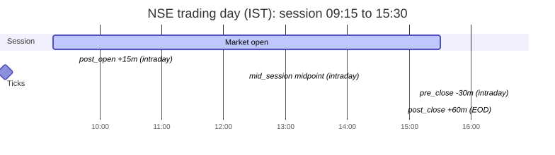
<sub>Source: [`docs/diagrams/06-tick-schedule.mmd`](docs/diagrams/06-tick-schedule.mmd)</sub>

`post_close` is the only **EOD** tick. The other three are **intraday**. The kind decides what the cycle writes (§5) and whether the EOD-only stages run (§4).

---

## 4. The live cycle

`trip-ema-etl cycle --exchange NSE --kind eod` is the unit of work, whether the dispatcher spawns it or an operator runs it by hand. It is implemented in `trip_ema/etl/cli.py::cmd_cycle` and `trip_ema/orchestrator/recompute_market.py`.

<p align="center"></p>

<sub>Source: [`docs/diagrams/07-live-cycle-stages.mmd`](docs/diagrams/07-live-cycle-stages.mmd)</sub>

A stage error halts the remaining stages and is recorded on the `compute_runs` row (`failed_stage`, `error_message`). A failure on one ticker or one industry inside a stage is isolated and does not halt the stage. Each stage publishes its live name to `compute_runs.current_stage`, so the console can show progress even for scheduler-driven runs whose stdout it can't read.

### 4.1 One scheduled tick, end to end

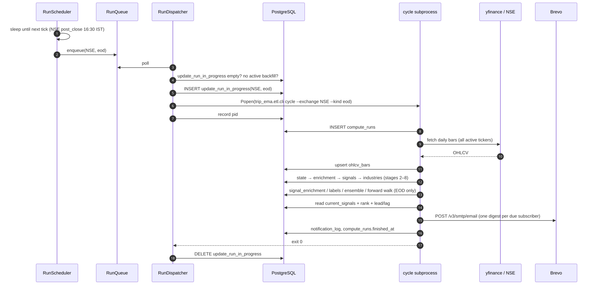
<sub>Source: [`docs/diagrams/08-live-cycle-sequence.mmd`](docs/diagrams/08-live-cycle-sequence.mmd)</sub>

---

## 5. Signal storage model

Three tables, three different questions. All are written atomically by `trip_ema/orchestrator/process_day.py`, so derivation and both writes share one transaction.

<sub>Source: [`docs/diagrams/09-signal-storage.mmd`](docs/diagrams/09-signal-storage.mmd)</sub>

| Mode | `historical_signals` | `current_signals` |
|---|---|---|
| `intraday` | never written (the day isn't final) | upsert flips + delete non-flips |
| `eod` | delete day D, insert flips | upsert flips + delete non-flips |
| `backfill` | delete day D, insert flips | only when D is today |

`current_signals` is refreshed with row-level upsert and delete, **not** `TRUNCATE`, so readers in the console and API never hit an `ACCESS EXCLUSIVE` lock.

---

## 6. Data ingestion and OHLCV correction

### 6.1 Universe and fetch

* **Listings:** `trip-ema-etl refresh-listings --exchange NSE` pulls the NSE equities and ETF archives and syncs `tickers`. Renames are tracked through ISIN continuity (`symbol_history`).
* **Tiers:** a weekly recompute ranks tickers by 30-day average traded value. Tier 1 is the top 200, tier 2 the next 500, tier 3 the rest. Tiers only decide **fetch order**. Every cycle fetches the full universe.
* **Parking:** three consecutive fetch failures park a ticker (`etl_ticker_status`). Unpark it from the console or with `trip-ema-etl unpark`.

### 6.2 Seam correction against authoritative corporate actions

yfinance is fetched with `auto_adjust=False`, which gives split-adjusted but dividend-unadjusted bars. Splits and bonuses can still leave **seams** in the series, i.e. unadjusted legs spliced to adjusted ones. Before any indicator is computed, `trip_ema/backfill/ohlcv_correction_stage.py` reconciles every affected ticker against `nselib`'s NSE corporate-action feed (`nse_corporate_actions`):

<p align="center"></p>

<sub>Source: [`docs/diagrams/10-ohlcv-seam-correction.mmd`](docs/diagrams/10-ohlcv-seam-correction.mmd)</sub>

`data/nse_corporate_actions.csv` is committed as an offline fallback snapshot. Any fallback path must report the snapshot's export date, so that bars are never silently reconciled against stale data. Design notes: [`docs/01_ohlcv_correction_design.md`](docs/01_ohlcv_correction_design.md), [`docs/nselib_source.md`](docs/nselib_source.md).

---

## 7. Industry indices, lead/lag and enrichment

<sub>Source: [`docs/diagrams/11-industry-leadlag.mmd`](docs/diagrams/11-industry-leadlag.mmd)</sub>

Every signal gets a feature row in `signal_enrichment`:

* signed, polarity-adjusted distance to each EMA in ATR(10/15/20/30/40) units, plus 75 band-membership flags
* `seq_in_week` and `seq_in_consec_weeks` (causal repeat counters)
* `data_is_valid` and `bars_available`, so long-period ATR families aren't trusted before there is enough history

On top of that it gets the ensemble confirmation features and benchmark statistics (`stock_benchmark_stats`: β, α, R², relative strength over short/medium/long windows). Specs: [`docs/enrichment_features_spec.md`](docs/enrichment_features_spec.md), [`docs/leadlag-analytics-design.md`](docs/leadlag-analytics-design.md).

---

## 8. Forward-walk labels (research layer)

When a position **closes** (an `EXIT_FROM_*` signal), its window becomes final and the EOD cycle labels it in `signal_labels`. Each label is a 1:1 child of the signal's enrichment row.

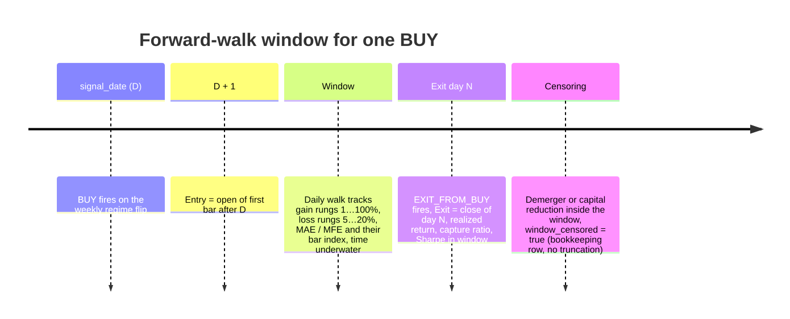
<sub>Source: [`docs/diagrams/12-forward-walk-window.mmd`](docs/diagrams/12-forward-walk-window.mmd)</sub>

The window yields 21 gain rungs and 6 loss rungs (including 7½% and 12½%). Each rung gets a hit boolean and a `bars_to_*` integer, with −1 as the "never hit" sentinel. There are also excess returns versus industry and market, ATR-normalised excursions, and in-window slope and volatility. The forward walk fans out across tickers on the shared threaded `fan_out` primitive (`trip_ema/fundamentals/parallel.py`). Each ticker's failure is isolated. Spec: [`docs/02_signal_forward_walk_labels_spec.md`](docs/02_signal_forward_walk_labels_spec.md).

Backfill a range with `trip-ema-etl forward-walk --exchange NSE [--tickers …]`.

---

## 9. Notifications

<sub>Source: [`docs/diagrams/13-notifications.mmd`](docs/diagrams/13-notifications.mmd)</sub>

* Subject line: `[trip_ema] <cycle_id> — N signal(s) (b BUY, s SELL, e EXIT)`
* Subscribers set a cadence in multiples of 15 minutes, from 15 to 1,440. A "Test notification" button sends a one-off email through the configured transport.
* The Brevo key lives in `secrets/brevo.yaml` (gitignored; template in `secrets/brevo.yaml.example`). Without it, the notify stage is skipped and the cycle still succeeds.
* A Redis-backed queue, DLQ endpoints and circuit-breaking transports still exist in `trip_ema/notifications/`, but the V1 cycle sends directly and does not need them.

---

## 10. Operator console

`trip-ema-console` is a desktop client.

* **Administrative writes** go through the admin HTTP API: subscribers, listings and tier refreshes, unparking, and force-resetting a stuck run.
* **Manual cycles and backfills** are launched as local `trip-ema-etl` subprocesses (QProcess). Their stdout drives the live stage list.
* **Table views** read Postgres directly and read-only, optionally as `trip_gui_user`.

Without `TRIP_EMA_ADMIN_TOKEN` the console starts in read-only mode, with write buttons disabled.

| Tab | What it does |
|---|---|
| ⚙ **ETL Status** | Run history, live stage progress (for local runs and scheduler-driven runs alike), parked tickers, tier counts; start a cycle or backfill, reset a stuck run |
| 📊 **Tickers** | Searchable universe with per-ticker signal history; CSV export; jump to chart |
| 📈 **Signals** | pyqtgraph chart: candles, three EMAs, ATR bands, regime fill, signal markers, volume pane, crosshair OHLC; 1Y/3Y/5Y/10Y/All ranges; industry-index charts |
| 👥 **Subscribers** | CRUD over subscribers, filters and cadence; test send |
| 🔔 **Notifications** | Recent `notification_log` entries, colour-coded by signal |
| ❤ **System Health** | Status cards polled every 10 s: universe, ETL freshness, scheduler, cache, queue, recent events |
| ⚙ **Settings** | GUI preferences (`QSettings`, never `config.yaml`); read-only config viewer; timestamped config backup |

The console also has a backtest dialog, a market-trend dialog, industry panels and a signal-generation panel.

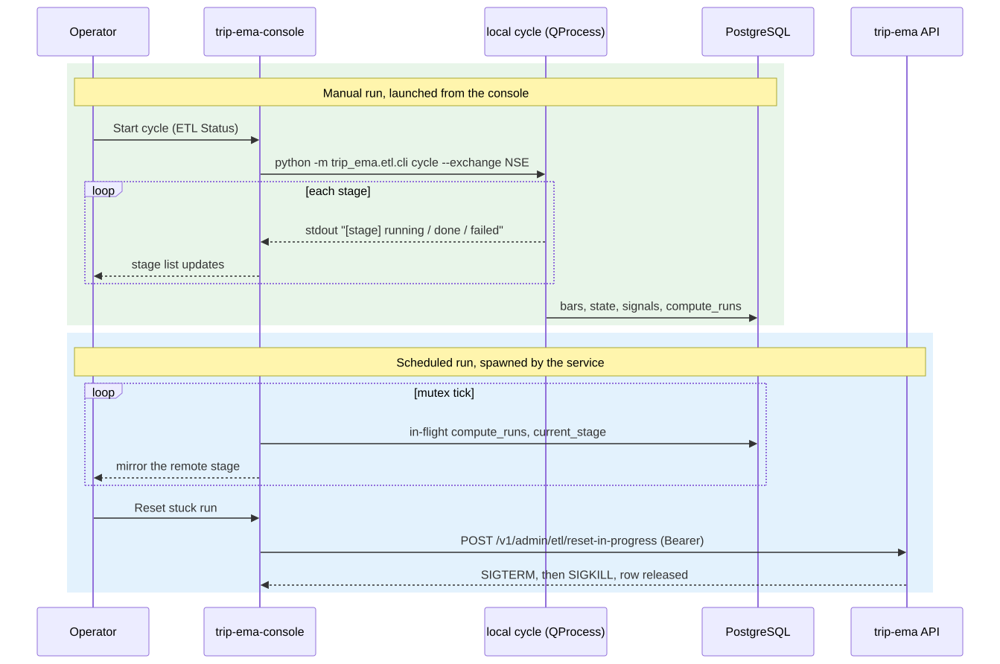
<sub>Source: [`docs/diagrams/14-console-interactions.mmd`](docs/diagrams/14-console-interactions.mmd)</sub>

---

## 11. HTTP API

Default `http://0.0.0.0:8000`. Admin routes require `Authorization: Bearer $TRIP_EMA_ADMIN_TOKEN`. They return **503** if the token env var is unset, **401** if the header is missing, and **403** if the token is wrong.

| Group | Endpoints |
|---|---|
| **Health** | `GET /healthz` · `GET /readyz` |
| **Signals** | `GET /v1/signals/{exchange}/{symbol}/history` · `GET /v1/signals/industry/{industry_name}/history` · `POST /v1/compute` |
| **ETL / runs** | `POST /v1/admin/etl/{enqueue-run, run-intraday, run-eod, backfill, backfill-shares, refresh-listings, recompute-tiers, unpark-all, reset-in-progress}` · `GET /v1/admin/etl/{status, parked, queue-snapshot}` |
| **Exchanges** | `GET /v1/admin/exchanges` · `GET /v1/admin/exchange-state[/{exchange}]` |
| **Signals admin** | `POST /v1/admin/signals/generate` · `GET /v1/admin/signals/generated` · `POST /v1/admin/compute-now` · `GET /v1/admin/stale-tickers` |
| **V1 pipeline (manual recompute)** | `POST /v1/admin/v1pipeline/{stock-indicator-state, stock-indicator-enrichment, industry-index-value, industry-indicator-state, industry-indicator-enrichment}` |
| **Subscribers** | `GET/POST /v1/admin/subscribers` · `GET/PATCH/DELETE /v1/admin/subscribers/{id}` · `PUT /v1/admin/subscribers/{id}/filters` |
| **Notifications** | `GET /v1/admin/notifications/recent` · `GET /v1/admin/notifications/dlq` · `POST …/dlq/{job_id}/replay` · `DELETE …/dlq/{job_id}` |
| **Health snapshot** | `GET /v1/admin/health-snapshot` |
| **Fundamentals** | industry (get, refresh, override), shares, quarterly financials, market cap, industry indices (list, constituents, values, build, compute): all under `/v1/fundamentals/…` |

FastAPI's interactive docs are at `/docs` while the service is running.

---

## 12. Database

PostgreSQL, managed exclusively by **Alembic** (`alembic_pkg/versions/0001…0056`). Migrations run at service start, and a failed migration is fatal. Core relationships:

<sub>Source: [`docs/diagrams/15-er-diagram.mmd`](docs/diagrams/15-er-diagram.mmd)</sub>

Run bookkeeping tables: `compute_runs` (PK `compute_run_id`), `etl_runs`, `backfill_runs` (PK `run_id`), `update_run_in_progress`, `pipeline_phase_status`, `exchange_state`, `fundamentals_run`.

**Optional least-privilege roles** (migration `0002_db_roles`):

<sub>Source: [`docs/diagrams/16-db-roles.mmd`](docs/diagrams/16-db-roles.mmd)</sub>

Enable them with a `database.roles:` block. See [`docs/operator/db-roles.md`](docs/operator/db-roles.md).

---

## 13. Installation and running

### 13.1 Prerequisites

* Python ≥ 3.12, PostgreSQL ≥ 16 (developed on 18)
* A Brevo account with a verified sender (only needed to send email)
* Linux recommended. The console also needs the usual Qt runtime libraries.

### 13.2 Install

```bash
git clone https://github.com/UBags/WeeklyStockSignals.git
cd WeeklyStockSignals
python3.12 -m venv .venv && source .venv/bin/activate
pip install -e ".[all,test]"          # service + ETL + GUI + migrations + observability + tests
```

| Extra | Pulls in |
|---|---|
| *(core)* | pydantic, SQLAlchemy, psycopg2, FastAPI, uvicorn, PyYAML, redis |
| `etl` | yfinance, pandas, requests, holidays |
| `gui` | PySide6, pyqtgraph |
| `migrations` | alembic |
| `observability` / `tracing` / `tracing-otlp` | prometheus_client / OpenTelemetry |
| `gui-build` | PyInstaller (standalone console binary) |

### 13.3 Configure

```bash
createdb trip_ema                                   # owner: trip_ema_app (see config.yaml → database)
export TRIP_EMA_DB_PASSWORD='…'                     # never stored in config.yaml
export TRIP_EMA_ADMIN_TOKEN="$(openssl rand -hex 32)"
cp secrets/brevo.yaml.example secrets/brevo.yaml && chmod 600 secrets/brevo.yaml   # optional
```

`config.yaml` is the single runtime config: database, the `ema` and `atr` parameters, `market_hours` with per-exchange `tick_schedule`, ETL concurrency and tier sizes, HTTP, and observability. [`docs/operator/configuration.md`](docs/operator/configuration.md) has the reference.

### 13.4 Run

```bash
# 1. Service: applies migrations, primes the cache, starts scheduler + dispatcher + API
trip-ema --config config.yaml
#    or, detached with log at /tmp/trip-ema.log and a /healthz wait:
./scripts/restart_service.sh

# 2. First-time data load
trip-ema-etl refresh-listings --exchange NSE
trip-ema-etl backfill        --exchange NSE --date_from 2016-01-01

# 3. Ad-hoc cycle (what the scheduler does on every tick)
trip-ema-etl cycle --exchange NSE --kind eod

# 4. Console
trip-ema-console --config config.yaml --base-url http://localhost:8000
```

`scripts/` holds the operational toolbox: `health_check.sh`, `db_status.sh`, `smoke_test_fast.sh`, `track_backfill_progress.sh`, `preflight_coldstart.sh` and others. See [`scripts/operator_commands.md`](scripts/operator_commands.md).

---

## 14. Backfill

`trip-ema-etl backfill` rebuilds the whole derived model for a date range. A partial unique index makes it exclusive: only one active `backfill_runs` row can exist, and the live cycle defers while a backfill runs.

<p align="center"></p>

<sub>Source: [`docs/diagrams/17-backfill-stages.mmd`](docs/diagrams/17-backfill-stages.mmd)</sub>

Scope it with `--stocks SYM1,SYM2`, force a full recompute with `--rebuild`, and clear a stale lock with `--release-lock`.

---

## 15. Testing and CI

```bash
# DB-free suites: fast, no Postgres
pytest tests/indicators tests/domain tests/regime tests/cache tests/config \
       tests/notifications tests/scheduler_pure tests/transports_pure tests/parity tests/etl

# Qt suites: separate invocation (pytest-qt teardown race)
QT_QPA_PLATFORM=offscreen pytest tests/gui

# Postgres-backed suites (pytest-postgresql; pg_ctl path in pyproject.toml)
pytest tests/persistence tests/orchestrator tests/fundamentals tests/backfill tests/api
```

* **Pine parity harness.** `tests/parity/` auto-discovers CSV fixtures and asserts bar-by-bar agreement at an absolute tolerance of `1e-9`. Drop a TradingView data-window export into `tests/parity/fixtures/` to anchor against real Pine output.
* **Architecture tests.** `tests/test_no_dead_island.py` and `tests/architecture/` guard against unreachable modules and layer violations.
* **GitHub Actions.** `.github/workflows/` has `tests.yml` (DB-free, Postgres integration, ruff), `release.yml` (wheel + PyInstaller console build), `docs.yml` (MkDocs) and `install-smoke.yml`.

---

## 16. Repository layout

```
trip_ema/
├── app.py                 service entry point (trip-ema)
├── indicators/            VW triple-EMA, ATR, bands, weekly aggregation (pure)
├── regime/                canonical regime classifier
├── domain/                frozen dataclasses, DetermineSignal, market sessions, OHLCV corrector
├── fundamentals/          state/enrichment populators, industry indices, lead/lag,
│                          signal enrichment, ensemble, forward-walk labels, benchmark stats
├── orchestrator/          recompute_market, process_day, intraday chain, notify_subscribers
├── backfill/              10-stage backfill pipeline, bulk day-walk, OHLCV correction stage
├── etl/                   trip-ema-etl CLI, NSE listings, yfinance source, nselib actions,
│                          tiering, parking, reconciliation
├── scheduler/             tick planner, trading calendar, RunScheduler, RunQueue, RunDispatcher
├── persistence/           SQLAlchemy Core repositories, Alembic bridge, connections
├── cache/                 CurrentSignalsCache (in-memory read model)
├── notifications/         email composer, Brevo transport, lead/lag rendering, (legacy) queue/DLQ
├── transports/http/       FastAPI app, routes, schemas, admin-token dependency
├── gui/                   PySide6 console: main window, views, chart widget, backtest engine
├── observability/         logging, correlation IDs, Prometheus metrics, OpenTelemetry
└── config/                Pydantic config schema + loader, Brevo secrets
alembic_pkg/versions/      0001 … 0056 schema migrations
tests/                     ~245 test modules (pure, Qt, Postgres-backed, parity, architecture)
scripts/                   operator shell tools, probes, README chart renderer
diagnostics/               standalone research and data-quality scripts (strategy backtests, exit optimisation)
docs/                      design specs, operator guides, per-package READMEs (MkDocs site)
data/                      nse_corporate_actions.csv offline snapshot
configs/                   exchange holiday overrides
```

---

## 17. Design invariants

These are the rules the code is written around. Break one only deliberately, and document why.

1. **Wrong data → wrong decisions → lost money.** Correctness beats speed. Censor or refuse rather than guess.
2. **The ETL is the source of truth for bar availability.** The pipeline never interpolates or invents bars.
3. **Pine numerical fidelity is non-negotiable.** EMA α = 2/(n+1), Wilder RMA seeding, WMA weights 1…n, and NaN warm-up all match Pine. If the parity harness doesn't catch a "simplification", the harness is under-specified.
4. **One rule, one place.** Regime: `compute_regime`. Signal: `DetermineSignal`. Day attribution: the market's own trading date (`market_tz(exchange)`), never India's by default.
5. **Daily grain, weekly chart.** Filter by `signal_date` or `date`. `bar_timestamp` is a shared week anchor and must never be used as a day bound.
6. **All timestamps are timezone-aware UTC internally.** Local zones are applied only at the boundary.
7. **Domain types are immutable** (`frozen=True, slots=True`). Mutation means replacement.
8. **Single process, single writer.** No `--workers N`. One cycle at a time. Backfill and live cycles are mutually exclusive.
9. **Process boundaries.** The service schedules and serves, and `trip-ema-etl` subprocesses compute, whether spawned by the dispatcher or by the console. The console's administrative writes go through the admin API, and its preferences live in `QSettings`, never in `config.yaml`.
10. **Observability is additive.** Removing metrics or tracing must never change behaviour.

[`docs/ARCHITECTURE.md`](docs/ARCHITECTURE.md) and [`docs/architecture/invariants.md`](docs/architecture/invariants.md) carry the original long-form rationale. Parts of them predate the V1 pipeline described here (they mention `ComputeScheduler` and `SignalCache`, which have since been removed).

---

## 18. Status and roadmap

**Live:** NSE end-to-end: scheduled intraday and EOD cycles, OHLCV seam correction, industry indices, lead/lag, per-signal enrichment, forward-walk labels, email digests, operator console.

**Configured but not yet ingesting:** BSE and NYSE. Both exchanges appear in `market_hours` and the tick planner handles them, but `refresh-listings` raises `UnsupportedExchangeError` for non-NSE exchanges, and several industry tables lack an exchange column.

**Planned work:**

* Lead/lag analytics phases A–E: `industry_correlation_pairs`, `industry_regime_events`, `ticker_industry_transmission_stats`, then email and GUI surfacing
* A common notifier primitive with per-subscriber filters (signal bitmask, exchanges, industries, stocks, EOD-only, entitlement window)
* An optional NIFTY trend-regime filter
* Multi-exchange schema work (exchange columns on industry tables and subscribers)

---

<sub>Proprietary. © Uddipan Bagchi / CosTheta Technologies, Bengaluru.</sub>
