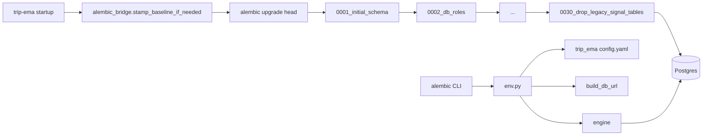

# `alembic_pkg/` — Alembic migrations

## 1. Role in the larger application

`alembic_pkg/` owns **the schema**. Every `CREATE TABLE`, every
`ALTER`, every `DROP` in the production database has a corresponding
Alembic revision here. Phase 12 made Alembic the **exclusive**
migration system; the legacy SQL runner in `migrations/legacy/` is
preserved for history only.

Two responsibilities:

1. **Source of truth for schema**. The current `alembic upgrade
   head` state on a fresh database represents the canonical
   schema. `trip_ema/persistence/tables.py` mirrors this for query
   construction, but Alembic is authoritative.
2. **Schema evolution**. Every breaking change to a table column,
   index, or constraint goes through a new revision file. CI
   verifies `0001 → head` is consistent.



## 2. Architecture and constraints

| Rule | Why |
|------|-----|
| **Alembic-only.** Legacy SQL runner preserved for history; not invoked at startup | Single source of truth for migration order |
| **Squashed baseline at 0001** | Pre-Phase-12 databases stamped to 0001 by the bridge; everyone post-Phase-12 starts from 0001 if fresh |
| **Reversible downgrades, even if best-effort** | Every revision implements `downgrade()`. `0030.downgrade()` cannot be `raise RuntimeError` — the migration chain walk in tests would fail |
| **`disable_existing_loggers=False`** in env.py's `fileConfig` | The Alembic-default `True` would silently disable every logger NOT in alembic.ini's `[loggers]` section, breaking app logging during stamped startup |
| **DB URL from trip_ema config**, not alembic.ini | Single password-resolution path; alembic.ini doesn't carry secrets |
| **target_metadata = None** | We use raw-SQL migrations rather than `autogenerate`-from-models. There's no single SQLAlchemy MetaData covering every table |
| **Revision IDs ≤ 32 characters** | `alembic_version.version_num` column has a 32-character limit. Auto-generated IDs can exceed; we use the `NNNN_short_slug` convention to stay safely under |
| **Idempotent DDL where possible** | `IF EXISTS` / `IF NOT EXISTS` on most CREATE/DROP statements; safer for re-runs after partial failures |
| **The current head is `0030_drop_legacy_signal_tables`** | Post-Step 15b. Next revisions queued for the lead/lag analytics workstream |

## 3. File inventory

```
alembic_pkg/
├── env.py                 The Alembic environment — config loading + connection
├── script.py.mako         Template for newly-generated revisions (alembic revision)
├── README.md              Per-step notes (currently Step 3's note for 0018)
├── sql/                   Raw-SQL fragments referenced by some revisions
└── versions/              The revisions themselves — one .py per migration
```

## 4. `env.py` — Alembic environment

### 4.1 Bridges Alembic to trip_ema config

```python
def _build_db_url() -> str:
    cfg_path = _resolve_config_path()
    cfg = load_config(cfg_path)
    return build_db_url(cfg)
```

Reuses `build_db_url` from `trip_ema.persistence.connection`. Single
place where the password is resolved (env var); never duplicated in
alembic.ini.

### 4.2 Config path resolution priority

```python
def _resolve_config_path() -> Path:
    # 1. -x config=<path> on the alembic command line
    # 2. TRIP_EMA_CONFIG env var
    # 3. ./config.yaml in CWD
```

`-x config=...` wins. CLI flags override env vars override CWD
defaults. Standard layered-configuration pattern.

### 4.3 Test mode

```python
def _is_test_mode() -> bool:
    return context.get_x_argument(as_dictionary=True).get("test_mode") == "1"
```

When `alembic -x test_mode=1 upgrade head`, env.py **skips** the
config.yaml load and uses whatever `sqlalchemy.url` is already set
on the Alembic config. Test fixtures set this directly via
`config.set_main_option("sqlalchemy.url", test_url)`.

Avoids tests having to materialize a fake config.yaml just to
satisfy the loader.

### 4.4 `disable_existing_loggers=False`

```python
if config.config_file_name is not None:
    fileConfig(config.config_file_name, disable_existing_loggers=False)
```

**Critical.** The `fileConfig` default is `True`, which silently
disables every logger NOT explicitly registered in alembic.ini's
`[loggers]` section. Two problems with that:

1. App code's `logger.info/.error` calls become invisible during
   `alembic upgrade` (the bridge-stamped startup case).
2. `pytest`'s caplog handler registered against the root logger is
   wiped out — tests asserting against caplog records fail.

`False` keeps Alembic loggers configured while leaving everyone
else intact.

### 4.5 Offline vs online mode

```python
def run_migrations_offline():
    # Emit SQL to stdout, don't connect
    ...

def run_migrations_online():
    # Actually execute against DB
    cfg_section = config.get_section(...)
    cfg_section["sqlalchemy.url"] = _build_db_url()
    connectable = engine_from_config(cfg_section, poolclass=pool.NullPool)
    ...
```

`alembic upgrade head --sql` runs offline (emits the SQL). `alembic
upgrade head` runs online. `NullPool` because we open exactly one
connection for the migration; we don't need pooling.

## 5. Revision catalog

| Revision | Slug | What it does |
|----------|------|--------------|
| 0001 | initial_schema | Squashed schema — every table the legacy migrator 001-010 produced, in one transaction. The baseline for the bridge stamp |
| 0002 | db_roles | Creates `trip_app_user`, `trip_etl_user`, `trip_gui_user` roles + GRANTS per the Phase-12 role design |
| 0003 | drop_tickers_source_timeframe | Drops the obsolete `tickers.source_timeframe` column |
| 0004 | exchange_state | Adds `exchange_state` table — one row per exchange, COALESCE-semantics writes |
| 0005 | signal_backtest_runs | Adds `signal_backtest_runs` — Phase 15a resume tracking per (exchange, ticker_id, timeframe) |
| 0006 | fundamentals_phase1 | Adds Phase 1 fundamentals tables: `instrument_industry`, `industry_overrides`, `fundamentals_runs` |
| 0007 | etf_classification | Adds ETF support to `instrument_industry` (etf_long_name column, INSTRUMENT_TYPE source) |
| 0008 | instrument_shares | Adds `instrument_shares` table — shares outstanding per ticker over time |
| 0009 | quarterly_financials | Adds `quarterly_financials` table |
| 0010 | daily_market_cap | Adds `daily_market_cap` table + `ohlcv_bars.adj_close` |
| 0011 | industry_index | Adds `industry_index` table — Laspeyres index metadata |
| 0012 | industry_index_constituent | Adds `industry_index_constituent` — top-N picker output |
| 0013 | industry_index_value | Adds `industry_index_value` — index value time series |
| 0014 | indicator_state | Adds the wide (38-column) `indicator_state` table — legacy, dropped in 0030 |
| 0015 | signal_event | Adds `signal_events` (singular) — pre-0016 plural unification |
| 0016 | unify_signal_events | Unifies signal_events into one table with `(ticker_id, industry_name)` polymorphic key |
| 0017 | benchmark_stats | Adds `stock_benchmark_stats` + `industry_benchmark_stats` for the BUY-rerank scores |
| 0018 | collapse_regime_columns | Drops `core_regime` column — unified classifier collapsed the core/display split |
| 0019 | drop_signal_industry | A3 of the industry signal-event demolition; drops `signal_events.industry_name` column + replaces it with stock-only schema |
| 0020 | clean_pipeline_tables | Adds the V1 clean-pipeline tables: `stock_indicator_state`, `industry_indicator_state`, `current_signals`, `historical_signals` |
| 0021 | indicator_enrichment_tables | Adds `stock_indicator_enrichment`, `industry_indicator_enrichment` — V1 enrichment tier |
| 0022 | v1_stock_state_phase | Adds `'v1_stock_indicator_state'` to `fundamentals_runs.phase` CHECK |
| 0023 | v1_stock_enrich_phase | Adds `'v1_stock_indicator_enrichment'` to CHECK |
| 0024 | v1_industry_idx_value_phase | Adds `'v1_industry_index_value'` to CHECK |
| 0025 | v1_industry_state_phase | Adds `'v1_industry_indicator_state'` to CHECK |
| 0026 | v1_industry_enrich_phase | Adds `'v1_industry_indicator_enrichment'` to CHECK |
| 0027 | notif_log_v1_cols | Adds V1-era columns (cycle_id, message_id) to `notification_log` |
| 0028 | backfill_runs | Adds `backfill_runs` table + the unique partial index on `(()) WHERE finished_at IS NULL` |
| 0029 | compute_runs_mkt_overview | Adds `compute_runs` (cycle audit log) + `market_overview_daily` |
| 0030 | drop_legacy_signal_tables | DROPs `signal_events` (the V1 cutover demolishes the legacy table) |
| 0034 | daily_grain_indicator_state | stock_indicator_state + enrichment → daily grain; PK (ticker_id, timeframe, date); FK re-pointed |
## 6. Revision file template

Every revision follows the template `script.py.mako` produces:

```python
"""<short description>

Revision ID: NNNN_short_slug
Revises:     PREV
Create Date: YYYY-MM-DD HH:MM
"""
from __future__ import annotations

from alembic import op
import sqlalchemy as sa

# revision identifiers, used by Alembic.
revision      = "NNNN_short_slug"
down_revision = "PREV_short_slug"
branch_labels = None
depends_on    = None


def upgrade() -> None:
    op.execute("CREATE TABLE ...")
    # ... or op.create_table, op.add_column, op.execute(raw SQL)


def downgrade() -> None:
    op.execute("DROP TABLE ...")
```

**`revision` and `down_revision` are the chain links.** Misorder
them and `alembic upgrade head` raises "no path from current to
head".

**`branch_labels` and `depends_on` are unused.** No revision
branches in this codebase; head is linear.

## 7. The squashed baseline (0001)

```python
def upgrade() -> None:
    op.execute("""
        CREATE TABLE tickers (
            ticker_id BIGSERIAL PRIMARY KEY,
            exchange TEXT NOT NULL,
            symbol TEXT NOT NULL,
            ...
        );
        CREATE TABLE ohlcv_bars (
            ticker_id BIGINT NOT NULL,
            timeframe TEXT NOT NULL,
            bar_timestamp TIMESTAMPTZ NOT NULL,
            ...
            PRIMARY KEY (ticker_id, timeframe, bar_timestamp)
        );
        -- ... every other table the legacy 001-010 SQL produced
    """)
```

Several thousand lines of DDL in one revision. Replays the entire
pre-Phase-12 schema state.

**Idempotency**: 0001 is NOT idempotent (it assumes a fresh DB). The
bridge stamps it WITHOUT running `upgrade()` on pre-Phase-12 DBs that
already have the legacy state.

**`downgrade()`** for 0001 drops every table. Only safe to run on a
DB that's been entirely produced by trip_ema migrations — never on
a shared cluster.

## 8. The role-creation revision (0002)

```python
def upgrade() -> None:
    # Three roles with minimum privileges
    op.execute("""
        DO $$ BEGIN
            IF NOT EXISTS (SELECT FROM pg_roles WHERE rolname = 'trip_app_user') THEN
                CREATE ROLE trip_app_user LOGIN PASSWORD 'placeholder';
            END IF;
        END $$;
    """)
    # GRANTs per role
    op.execute("""
        GRANT SELECT ON tickers, ohlcv_bars, ... TO trip_etl_user;
        GRANT INSERT, UPDATE ON ohlcv_bars TO trip_etl_user;
        GRANT SELECT ON ALL TABLES IN SCHEMA public TO trip_gui_user;
        ...
    """)
```

**Password placeholder, never the real password.** Real passwords
are set out-of-band:

```sql
-- After alembic upgrade head:
ALTER ROLE trip_etl_user PASSWORD '...';
ALTER ROLE trip_app_user PASSWORD '...';
ALTER ROLE trip_gui_user PASSWORD '...';
```

The migration is committed to git; passwords are not.

## 9. The destructive revisions (0019, 0030)

### 9.1 0019 — drop industry signal events

Part of the A3 industry signal-event demolition (the A1/A2/A3 pattern
documented in project memory):

```python
def upgrade() -> None:
    op.execute("""
        DROP INDEX IF EXISTS signal_events_industry_uniq;
        ALTER TABLE signal_events DROP COLUMN IF EXISTS industry_name;
        -- Drop the industry_name CHECK if present
    """)

def downgrade() -> None:
    op.execute("""
        ALTER TABLE signal_events ADD COLUMN industry_name TEXT;
        CREATE UNIQUE INDEX signal_events_industry_uniq ON ...;
    """)
```

Deployed after the last NSE tick of the day to minimise risk.

### 9.2 0030 — drop legacy signal tables

```python
def upgrade() -> None:
    op.execute("DROP TABLE IF EXISTS signal_events CASCADE")

def downgrade() -> None:
    # Best-effort restore: recreates the table shape but DOES NOT
    # restore the data. Returning data after a drop is impossible
    # without external backup.
    op.execute("""
        CREATE TABLE signal_events (
            signal_event_id BIGSERIAL PRIMARY KEY,
            ticker_id BIGINT NOT NULL,
            ...
        );
    """)
```

The Step-15b deployment. After 0030, the V1 cutover is complete —
all writers and readers go through `current_signals` /
`historical_signals`.

## 10. Adding a new revision

```bash
cd /path/to/repo
alembic revision -m "short description of what this does"
```

Alembic generates `versions/NNNN_short_description.py` based on
`script.py.mako`. Pre-populates `revision = ...` (random hex) and
`down_revision = <current head>`.

**Manual cleanups required:**

1. Rename the file from random-hex to `NNNN_short_slug` (matching
   the rest of the revisions for readability).
2. Update `revision = ...` to match the new filename slug. Keep
   under 32 characters.
3. Write `upgrade()` + `downgrade()` bodies.
4. Test:
   ```bash
   alembic -x test_mode=1 upgrade head
   alembic -x test_mode=1 downgrade -1
   alembic -x test_mode=1 upgrade head
   ```
5. Commit + push.

## 11. Operator workflow

### 11.1 Fresh DB

```bash
TRIP_EMA_DB_PASSWORD=... alembic upgrade head
```

Runs 0001 → 0030 in order. ~1-2 seconds on the NUC.

### 11.2 Existing DB (Phase 12+)

```bash
# Bridge runs at trip_ema startup; nothing to do manually.
# To apply pending migrations explicitly:
alembic upgrade head
```

### 11.3 Inspect what would run

```bash
# Show current revision
alembic current

# Show pending revisions
alembic history -i

# Emit SQL without running
alembic upgrade head --sql > pending.sql
less pending.sql
```

### 11.4 Roll back

```bash
alembic downgrade -1     # one revision back
alembic downgrade 0029   # to specific revision
alembic downgrade base   # all the way back (DESTRUCTIVE)
```

### 11.5 Stamp without running (for the bridge's job by hand)

```bash
alembic stamp 0001_initial_schema
```

Marks the DB as being at 0001 without executing any DDL. Used
exclusively for pre-Phase-12 → Phase-12 migration.

## 12. Failure modes

| Failure | Behaviour | Recovery |
|---------|-----------|----------|
| Pending revision raises during upgrade | Transaction rolls back; DB unchanged | Fix the migration; commit; rerun |
| `alembic_version` table corrupt | Subsequent operations fail with "no revision found" | `alembic stamp <known-good-rev>` manually |
| 0001 run on a DB that already has the legacy state | Tables collide; `relation already exists` | Don't do this. Bridge handles it correctly |
| `config.yaml` not found in env.py | RuntimeError with explanation | Set `TRIP_EMA_CONFIG`, use `-x config=...`, or `cd` to repo root |
| Bridge stamps but `alembic upgrade head` is never invoked | DB stays at stamped baseline; post-baseline migrations unapplied | Operator runs `alembic upgrade head` manually |
| Downgrade attempted from a state Alembic can't reach | "no path" error | Manual DB cleanup; resume from a sane state |
| 0030.downgrade attempted | Recreates shape but data is gone | Restore from backup if needed |

## 13. Testing

`tests/persistence/test_alembic.py`:

| Test | Coverage |
|------|----------|
| `test_full_chain_walk` | upgrade head; downgrade base; upgrade head — no errors at any step |
| `test_each_downgrade_is_reversible` | For each rev, upgrade to it; downgrade -1; upgrade to it again — DB state byte-equivalent |
| `test_alembic_version_fits_in_32_chars` | Every `revision = ...` string is ≤32 chars |
| `test_bridge_states_a_b_c` | Three startup states A/B/C handled correctly by the bridge |
| `test_tables_match_migrations` | `tables.py` Column definitions match the migrations' produced schema |

## 14. Common pitfalls

1. **Revision ID over 32 chars.** `alembic_version.version_num` is
   `VARCHAR(32)`. Auto-generated random IDs can be 32-char hashes,
   but combined with a slug + suffix they overflow. Use
   `NNNN_short_slug` and stay under.
2. **Forgetting `down_revision`.** New revision has
   `down_revision = "abc123"` referring to old format hash from
   alembic's autogeneration. Update to match the actual previous
   slug.
3. **`fileConfig(disable_existing_loggers=True)`.** Don't change
   this; tests + app logging break.
4. **`raise RuntimeError("downgrade not supported")`.** Tempting
   but breaks `test_downgrade_then_upgrade`. Implement a best-effort
   downgrade even if not lossless.
5. **DDL outside `IF EXISTS` / `IF NOT EXISTS`.** Re-running a
   partial migration after a failure raises. Use the guards.
6. **Mixing `op.execute(raw SQL)` and `op.create_table(SA model)`.**
   Pick one style per revision; CI tests the produced schema, not
   the source code.
7. **Forgetting to add the revision to `target_metadata=None`
   exclusion**. Since we don't use autogenerate, no exclusion
   needed.
8. **Running `alembic upgrade head` before app code stops
   referencing dropped columns/tables.** The app crashes on next
   write. README docstring for 0018 has the explicit sequence note.

## 15. Extension paths

- **A new schema change.** `alembic revision -m "..."`; write
  `upgrade()` + `downgrade()`; CI walks the chain.
- **A new role with new GRANTs.** New revision; reuse the 0002
  pattern; update `build_db_url` in `persistence/connection.py` to
  accept the new role.
- **Renaming an existing column.** Two-step pattern: (1) add new
  column + backfill from old; (2) update app code to use new
  column; (3) drop old column in a third revision. Don't try a
  single in-place rename — running services see the broken column
  between (1) and (2).
- **A breaking change**. Bump the schema version (already implicit
  in revision count). Coordinate with deploys.

## 16. Related packages

- `trip_ema/persistence/alembic_bridge.py` — calls into Alembic at
  startup; stamps pre-Phase-12 DBs.
- `trip_ema/persistence/connection.py` — provides `build_db_url`
  used by env.py.
- `trip_ema/persistence/tables.py` — declarative mirror; manual
  discipline to keep in sync with migrations.
- `trip_ema/config/` — provides the config file env.py reads.
- `migrations/legacy/` — historical SQL files preserved for
  reference; not applied at runtime.
- `alembic.ini` (at repo root) — Alembic config; references this
  directory.
