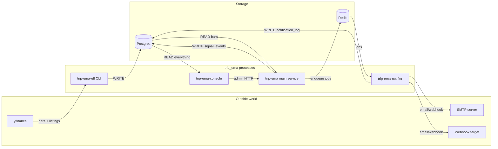

# Architecture overview

The canonical architecture document is
[`docs/ARCHITECTURE.md`](../ARCHITECTURE.md) at the repo root. The
MkDocs build includes it via the markdown-include extension on its
sub-pages.

If you're new to the codebase, read it in this order:

1. **Section 1** — what the system does, in one paragraph
2. **Section 2** — the actors (Engine, ETL, GUI, notifier)
3. **Section 3** — the 14 core invariants
4. **Section 4** — layer responsibilities
5. **Section 7** — where to look for what
6. **Section 8** — deployment and operational notes

The other sections are reference material that's most useful
when you need them.

## Diagram

The three "trip_ema processes" boxes correspond to three separate
OS processes with three different DB roles (Phase 12 — see
[DB role separation](../operator/db-roles.md)).
