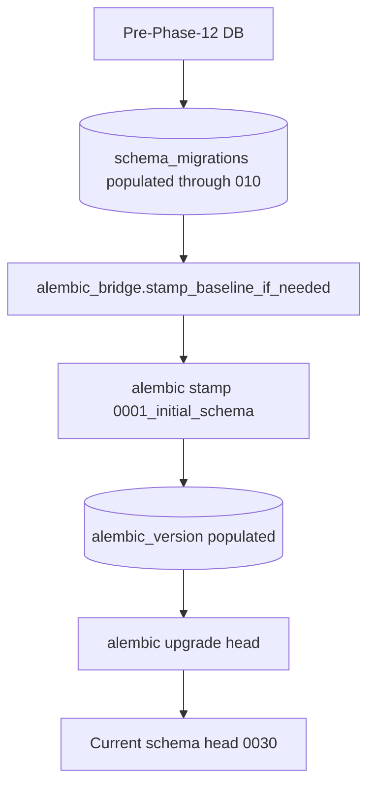

# `migrations/` — legacy SQL schema history

## 1. Role in the larger application

`migrations/` is the **historical archive** of the SQL-based schema
migration runner that drove the database from project inception
through pre-Phase-12. Phase 12 retired this runner and made
`alembic_pkg/` the exclusive migration system.

The files in this directory are **preserved for two reasons**:

1. **Historical reference.** Anyone studying how the schema
   evolved before the Alembic squash can read these files in
   numeric order.
2. **Pre-Phase-12 DB compatibility.** A database that ran the
   legacy runner through version `010` and stopped before Phase 12
   has its `schema_migrations` table populated through `010`. The
   `alembic_bridge` reads from `schema_migrations`, detects this
   state, and stamps the Alembic baseline (`0001_initial_schema`)
   without re-running the DDL. The legacy SQL files don't need to
   exist for the bridge to work, but operators investigating "what
   does my pre-Phase-12 DB look like?" find them here.

**They are not applied at runtime.** `app.py` invokes
`alembic_bridge.run_alembic_upgrade_head` exclusively. The legacy
`trip_ema.persistence.migrator.apply_pending` function still
exists for the regression tests, but it's no longer wired into
service startup.



## 2. Architecture and constraints

| Rule | Why |
|------|-----|
| **Not applied at runtime.** Service startup runs Alembic exclusively | Single source of truth for migration order |
| **Numbered `001`-`010`** | Stable historical record. New numbered files would be confusing — use Alembic for new schema changes |
| **`migrations/legacy/` mirrors the top level** | Identical files in two paths. The top-level path was the runtime location; `migrations/legacy/` is the explicit-archive location. Phase 12 introduced the duplication as a transition aid; either path can be deleted now without affecting runtime |
| **Each file ends with `INSERT INTO schema_migrations (version) VALUES ('NNN') ON CONFLICT DO NOTHING`** | Self-recording version tracker, identifier-keyed |
| **Idempotent DDL via `IF EXISTS` / `IF NOT EXISTS`** | Re-runs after partial failure don't fail. Same property the Alembic revisions inherit |

## 3. File inventory

```
migrations/
├── README.md                                  Operator-facing note
│
├── 001_initial_schema.sql                     tickers + ohlcv_bars
├── 002_signal_state.sql                       signal_events (pre-unification) + ticker_signal_state
├── 003_subscribers.sql                        subscribers + subscriptions + notification_log
├── 004_partitions_seed.sql                    Monthly partition function + initial partitions
├── 005_drop_ticker_signal_state.sql           Drops the unused audit table
├── 006_bars_updated_at.sql                    Adds ohlcv_bars.updated_at for revision detection
├── 007_ticker_tz_source_timeframe.sql         Adds tickers.tz, source_timeframe
├── 008_drop_notification_log_dedup_index.sql  Drops overly-restrictive dedup index
├── 010_etl_schema.sql                         The biggest legacy file — ETL run audit tables
│
└── legacy/
    ├── 001_initial_schema.sql                 (identical to top-level)
    ├── ...
    ├── 010_etl_schema.sql
    │
    └── 011_exchange_state.sql                 Phase 14.6 — exchange_state table
    └── 012_signal_backtest_runs.sql           Phase 15a — signal_backtest_runs
    └── 013_fundamentals_phase1.sql            Fundamentals Phase 1
    └── 014_etf_classification.sql             ETF support in instrument_industry
    └── 015_instrument_shares.sql              Phase 2 — shares table
    └── 016_quarterly_financials.sql           Phase 3 — quarterly financials
    └── 017_daily_market_cap.sql               Phase 4 — daily market cap
    └── 018_industry_index.sql                 Phase 4B — industry index
    └── 019_industry_index_constituent.sql     Phase 4B-2 — index constituents
    └── 020_industry_index_value.sql           Phase 4B-3 — index values
    └── 021_indicator_state.sql                Phase 5 — wide indicator state
    └── ...
```

### 3.1 The numbering gap (009)

Version `009` was reserved during planning but never produced a SQL
file. The gap is preserved in the numbering for historical
accuracy — `010_etl_schema.sql` follows `008` directly.

The runner doesn't care about gaps; it processes whatever files
exist in numeric order.

### 3.2 `legacy/` extends beyond top-level

The top-level `migrations/` directory ends at `010`. The
`migrations/legacy/` directory extends to `021_indicator_state.sql`
and beyond — these are the migrations that **would have** been the
next legacy entries but were instead implemented as Alembic
revisions during the Phase-12 transition.

The duplication for `001`-`010` is transitional cruft. The
`legacy/` files past `010` are pure historical documentation —
they were never applied via the legacy runner.

## 4. The original schema_migrations contract

Every legacy file ends with:

```sql
INSERT INTO schema_migrations (version) VALUES ('NNN') ON CONFLICT DO NOTHING;
```

```sql
CREATE TABLE IF NOT EXISTS schema_migrations (
    version    VARCHAR(16) PRIMARY KEY,
    applied_at TIMESTAMPTZ NOT NULL DEFAULT NOW()
);
```

The runner (`trip_ema.persistence.migrator`) walked the directory,
read each SQL file, and applied any whose version wasn't already in
`schema_migrations`. The trailing INSERT recorded the version on
success.

`ON CONFLICT DO NOTHING` made re-runs safe: a second invocation
re-applies the SQL idempotently (most statements have `IF EXISTS`),
and the version-record INSERT is a no-op.

## 5. The bridge state-detection logic

`alembic_bridge._legacy_has_reached_baseline(engine)`:

```python
def _legacy_has_reached_baseline(engine) -> bool:
    """True iff schema_migrations contains version '010' or higher."""
    with engine.connect() as conn:
        try:
            result = conn.execute(text("SELECT version FROM schema_migrations"))
            versions = {row[0] for row in result}
        except ProgrammingError:
            return False    # table doesn't exist — never ran legacy migrator

    for v in versions:
        try:
            if int(v) >= int("010"):
                return True
        except ValueError:
            continue
    return False
```

Two interpretations of "reached baseline":

- **`schema_migrations` doesn't exist** → fresh DB. Run
  `alembic upgrade head` directly; bridge no-op.
- **`schema_migrations` contains `010` (or higher numeric)** →
  legacy migrator finished. Stamp `0001_initial_schema` WITHOUT
  running its DDL.

Why `010`? Because Phase 11 (the Phase-12-precursor) made `010` the
last legacy file. Anything `< 010` is "the legacy migrator stopped
mid-way" and is **not** a supported state — operators in that
position must manually apply the missing legacy files first.

## 6. Walking the schema evolution

The legacy files tell the story of the schema as it was when the
project was small.

### 6.1 `001_initial_schema.sql` — the start

```sql
CREATE TABLE schema_migrations (...);
CREATE TABLE tickers (...);
CREATE TABLE ohlcv_bars (...);
CREATE INDEX idx_bars_lookup ON ohlcv_bars (ticker_id, timeframe, bar_timestamp DESC);
```

Two tables. Tickers reference no other table. ohlcv_bars references
tickers. The system needed nothing else to be useful — bars in, bars
out.

### 6.2 `002_signal_state.sql` — signals and audit

```sql
CREATE TABLE signal_events (event_id, ticker_id, timeframe, bar_timestamp,
                            signal_type, price_at_signal, computed_at);
CREATE TABLE ticker_signal_state (ticker_id, timeframe,
                                  last_bar_timestamp, current_signal,
                                  state_json, updated_at);
```

The `signal_events` table was singular-named here. Migration 0016
(in Alembic) renamed/unified to the plural form. `ticker_signal_state`
was a per-(ticker, timeframe) live state cache that was later dropped
(005); engines now rebuild from raw bars on startup.

### 6.3 `003_subscribers.sql` — notification machinery

Adds `subscribers` + `subscriptions` + `notification_log`.
`notification_log` is partitioned by month from day one — the
operator anticipated long-term retention.

### 6.4 `004_partitions_seed.sql` — partition function

```sql
CREATE OR REPLACE FUNCTION ensure_notification_log_partition(p_month DATE)
RETURNS VOID AS $$
DECLARE ...
BEGIN
    EXECUTE FORMAT(
        'CREATE TABLE IF NOT EXISTS %I PARTITION OF notification_log
            FOR VALUES FROM (%L) TO (%L)',
        partition_name, start_ts, end_ts
    );
END;
$$ LANGUAGE plpgsql;
```

A `plpgsql` function the scheduler called periodically (or
operator from cron) to keep monthly partitions provisioned ahead.

### 6.5 `005` through `008` — small refinements

- `005_drop_ticker_signal_state.sql` — the audit table from 002.
- `006_bars_updated_at.sql` — adds `ohlcv_bars.updated_at` for
  ETL revision detection.
- `007_ticker_tz_source_timeframe.sql` — adds `tickers.tz` and
  `source_timeframe`.
- `008_drop_notification_log_dedup_index.sql` — drops an
  overly-restrictive dedup index that prevented re-sending the
  same notification to the same subscriber after enough time.

### 6.6 `010_etl_schema.sql` — the biggest legacy file

The Phase-11-precursor ETL infrastructure: `etl_runs`,
`etl_ticker_status`, `corporate_actions`, `symbol_history`,
`reconcile_window_days` columns on tickers, parked-ticker handling
columns.

Roughly 200 lines of DDL — the largest legacy file by far.

## 7. `migrations/legacy/` extension files (011-020+)

These mirror the Alembic revisions 0004-0017 but are preserved here
as standalone SQL files for reference. They were **never applied
via the legacy runner** — Phase 12 deployed them via Alembic
revisions instead.

| Legacy filename | Alembic equivalent |
|-----------------|---------------------|
| `011_exchange_state.sql` | `0004_exchange_state.py` |
| `012_signal_backtest_runs.sql` | `0005_signal_backtest_runs.py` |
| `013_fundamentals_phase1.sql` | `0006_fundamentals_phase1.py` |
| `014_etf_classification.sql` | `0007_etf_classification.py` |
| `015_instrument_shares.sql` | `0008_instrument_shares.py` |
| `016_quarterly_financials.sql` | `0009_quarterly_financials.py` |
| `017_daily_market_cap.sql` | `0010_daily_market_cap.py` |
| `018_industry_index.sql` | `0011_industry_index.py` |
| `019_industry_index_constituent.sql` | `0012_industry_index_constituent.py` |
| `020_industry_index_value.sql` | `0013_industry_index_value.py` |
| `021_indicator_state.sql` | `0014_indicator_state.py` |
| `022_signal_event.sql` | `0015_signal_event.py` |

The numbering is offset: legacy `011` ≅ Alembic `0004`, because the
Alembic squash collapses legacy `001`-`010` into `0001_initial_schema`,
and Phase-12-specific additions (`0002_db_roles`, `0003_drop_tickers_source_timeframe`)
slot in before the extended migrations resume.

## 8. The migration runner (`trip_ema/persistence/migrator.py`)

The runner that read these files:

```python
def apply_pending(engine: Engine, migrations_dir: Path) -> list[str]:
    """Apply any migrations whose version isn't in schema_migrations.
    Returns the list of versions applied."""

    files = sorted(migrations_dir.glob("*.sql"))
    with engine.connect() as conn:
        applied = {row[0] for row in conn.execute(text(
            "SELECT version FROM schema_migrations"
        ))}

    new_versions = []
    for f in files:
        version = f.stem.split("_", 1)[0]    # "001_initial_schema" → "001"
        if version in applied:
            continue
        with engine.begin() as conn:
            conn.execute(text(f.read_text()))
        new_versions.append(version)
    return new_versions
```

Simple. Walks the directory, applies each file in a transaction,
relies on the file's trailing INSERT to update `schema_migrations`.

**The runner is preserved in the tree** because tests import it for
regression coverage of the Phase-12 transition (state-B handling in
`alembic_bridge`). But it is **never called from `app.py`** in
Phase-12+ deployments.

## 9. Operator workflow on a pre-Phase-12 DB

If an operator finds themselves with a DB that ran the legacy
runner partway through:

| Scenario | Action |
|----------|--------|
| `schema_migrations` has `001` through `005`, nothing later | Manually apply `migrations/legacy/006*.sql` ... `010*.sql` in order via `psql -f`. Then start trip_ema — bridge stamps and continues |
| `schema_migrations` has `010` and no later versions | Just start trip_ema — bridge stamps `0001_initial_schema` and runs `alembic upgrade head` for any post-baseline revisions |
| `schema_migrations` has `010` plus some `011`/`012`/`013` from legacy file usage | Anomalous — operator must have applied legacy files directly. Manual recovery: clean up the `schema_migrations` rows past `010`, stamp Alembic baseline, run `alembic upgrade head` to apply the equivalent Alembic revisions in order. Diff before/after schemas to confirm equivalence |
| No `schema_migrations` table, no `alembic_version` table | Fresh DB. `alembic upgrade head` creates everything from `0001_initial_schema` |

## 10. Failure modes

| Failure | Behaviour |
|---------|-----------|
| Operator runs the legacy runner via `migrator.apply_pending` against a Phase-12+ DB | The runner sees no `schema_migrations` rows (they were stamped to Alembic state). Tries to apply `001` first → likely raises "relation already exists" since the Alembic head has all tables. Don't do this |
| Operator applies a legacy SQL file manually that conflicts with Alembic head | `psql -f` succeeds partially (if `IF EXISTS` guards); DB ends in inconsistent state | Recovery: roll back to backup; rerun `alembic upgrade head` from clean state |
| Bridge stamps based on legacy `schema_migrations` but no `alembic.ini` in CWD | Stamp succeeds (creates `alembic_version`); subsequent `alembic upgrade head` fails on the missing config | Set `TRIP_EMA_CONFIG` or `cd` to repo root |

## 11. Common pitfalls

1. **Don't manually apply files from this directory on a Phase-12+
   DB.** The Alembic head is the source of truth; bypassing it
   corrupts the migration chain.
2. **Don't add new SQL files here.** New schema changes go through
   Alembic revisions. The legacy runner isn't wired in anymore.
3. **The duplication between top-level `migrations/` and
   `migrations/legacy/` is harmless but confusing.** Phase 12 was
   the transition; both copies exist. Deleting the top-level
   versions would break the regression tests; deleting
   `migrations/legacy/` files past `010` would lose historical
   reference.
4. **The numbering jump from `008` to `010` is real.** Version
   `009` was reserved but never produced. Bridge code reads
   `>= '010'`; don't change to `== '010'`.
5. **`ensure_notification_log_partition` is plpgsql.** It survives
   the Phase-12 transition because Alembic's `0001_initial_schema`
   re-creates it. If you ever modify the function, do it in a new
   Alembic revision — never edit the legacy SQL file.

## 12. Extension paths

None. New schema changes go through `alembic_pkg/versions/`.

If a future requirement adds a "small SQL fragment library"
alongside the Alembic revisions (e.g. for declaring views or
functions outside the migration chain), consider a separate
directory like `sql_fragments/`. Don't reuse this path.

## 13. Related packages

- `alembic_pkg/` — the active migration system.
- `trip_ema/persistence/migrator.py` — the legacy runner. Preserved
  for regression-test imports; never called at runtime.
- `trip_ema/persistence/alembic_bridge.py` — reads `schema_migrations`
  to detect Phase-12-transition state.
- `trip_ema/persistence/tables.py` — SQLAlchemy Core mirrors of the
  current schema head.
- `tests/persistence/test_alembic_bridge.py` — covers the bridge's
  three-state logic against fixtures from this directory.
