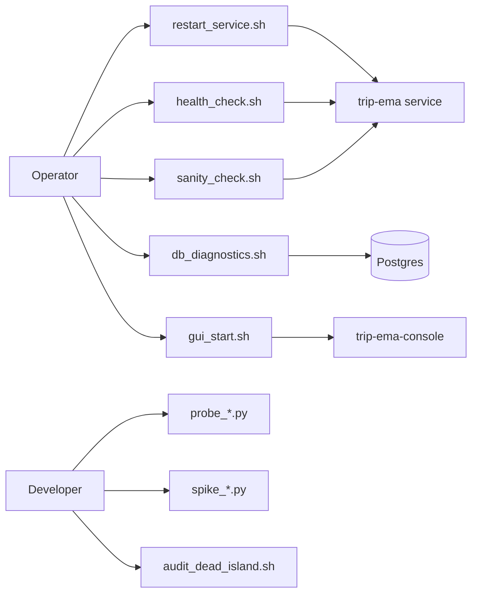

# `scripts/` — operator + developer scripts

## 1. Role in the larger application

`scripts/` is the **out-of-band toolbox** for running, monitoring,
and debugging the deployed `trip-ema` service. Three categories:

1. **Lifecycle scripts.** `restart_service.sh`, `gui_start.sh`,
   `setup_psql_access.sh` — the daily-driver scripts an operator
   uses to bring the service up and down.
2. **Diagnostic + smoke scripts.** `health_check.sh`,
   `smoke_test_fast.sh`, `db_diagnostics.sh`, `sanity_check.sh`,
   `scripts/diagnostics/*` — quick visibility into the running
   system.
3. **Operator + debug documentation.** `operator_commands.md`,
   `debug_recipes.md` — copy-paste reference for routine ops and
   diagnostic workflows.

Plus exploratory one-offs (`probe_*.py`, `spike_*.py`) — kept here
rather than the main package so they don't get imported by
production code.

Not part of the runtime tree. None of `trip_ema/` imports from
this directory; it's all operator-facing.



## 2. Architecture and constraints

| Rule | Why |
|------|-----|
| **None of `trip_ema/*` imports these scripts** | Production code stays isolated; ad-hoc probes don't get accidentally pulled into the runtime |
| **All shell scripts use bash, not sh** | We rely on bash-isms (arrays, `[[` syntax, `local` in functions, parameter expansion). `set -euo pipefail` at the top of every script |
| **Scripts read trip_ema config from `config.yaml` in CWD** | Operator runs them from the repo root; same place the service runs from |
| **Output is operator-friendly, not machine-parseable** | Color-coded PASS/FAIL, indented sections. For machine consumers, use the HTTP endpoints |
| **Lifecycle scripts are idempotent** | `restart_service.sh` can be re-run if the service is already up; `gui_start.sh` skips if a GUI is already running. Avoid "are you sure?" prompts that break automation |
| **Diagnostic scripts are read-only** | `db_diagnostics.sh`, `sanity_check.sh` run SELECT only. No UPDATE/DELETE/DDL — operators rely on read-only safety |
| **`sanity_check.sh` v3 patterns are load-bearing** | The script's body shape (env-var passthrough, no `ss`-port-check, `to_timestamp(epoch)` for time windows) prevents specific footguns documented in project memory |

## 3. File inventory

```
scripts/
├── README.md
│
├── restart_service.sh                Kill + restart trip-ema; poll /healthz
├── gui_start.sh                      Idempotent GUI launcher
├── setup_psql_access.sh              ~/.pgpass setup
│
├── health_check.sh                   Read-only one-shot dashboard
├── sanity_check.sh                   Full post-restart sanity (v3)
├── smoke_test_fast.sh                ~5s smoke test
├── smoke_test_full.sh                ~30s broader smoke
├── db_diagnostics.sh                 Common DB queries
├── audit_dead_island.sh              Run import-graph invariant
│
├── probe_etf_yfinance.py             yfinance ETF behaviour probe
├── probe_yfinance_hist_mcap.py       yfinance histMarketCap probe
├── spike_nse_xbrl.py                 NSE XBRL feed exploration
├── test_smtp.py                      Legacy SMTP transport test (obsolete)
│
├── operator_commands.md              Canonical operator reference
├── debug_recipes.md                  Diagnostic workflows
│
└── diagnostics/
    ├── email_despatch_diagnostic.py
    └── validate_if_full_compute_schedule_is_ok.py
```

## 4. Lifecycle scripts

### 4.1 `restart_service.sh`

The most-used script. Kills any running `trip-ema` process,
restarts it, polls `/healthz` until primed, prints the cache size.

```bash
#!/usr/bin/env bash
set -euo pipefail

CONFIG="${1:-config.yaml}"

# Step 0 — DB connectivity preflight
psql -d "$DB_NAME" -c "SELECT 1" > /dev/null || {
    echo "FAIL: DB unreachable"; exit 1
}

# Source ~/.bashrc if TRIP_EMA_* env vars unset
[[ -z "${TRIP_EMA_DB_PASSWORD:-}" ]] && source ~/.bashrc

# Kill existing
pkill -f "trip_ema.app" || true
sleep 2

# Restart in background
nohup python -m trip_ema.app --config "$CONFIG" > /tmp/trip-ema.log 2>&1 &
SERVICE_PID=$!

# Poll /healthz
for i in {1..60}; do
    if curl -s "http://localhost:8000/healthz" > /dev/null; then
        break
    fi
    sleep 1
done

# Print cache size
CACHE_SIZE=$(curl -s "http://localhost:8000/healthz" | jq -r '.cache_size // 0')
echo "Service restarted (pid=$SERVICE_PID, cache_size=$CACHE_SIZE)"
```

**Features:**

- Custom config path as `$1`.
- Step-0 DB connectivity preflight — fast-fail if DB is down.
- Auto-sources `~/.bashrc` when env vars (especially
  `TRIP_EMA_DB_PASSWORD`) are missing.
- `--force` flag to skip preflight (rare; for restoring after a
  DB outage).
- Polls `/healthz` for up to 60 seconds.
- Reports `cache_size` from the healthz response.

### 4.2 `gui_start.sh`

```bash
#!/usr/bin/env bash
set -euo pipefail

# Idempotent — skip if already running
if pgrep -f "trip-ema-console" > /dev/null; then
    echo "GUI already running (--force to restart)"
    [[ "${1:-}" == "--force" ]] || exit 0
    pkill -f "trip-ema-console"
fi

[[ -z "${DISPLAY:-}" ]] && { echo "DISPLAY not set"; exit 1; }

nohup python -m trip_ema.gui.console > /tmp/trip-ema-gui.log 2>&1 &
echo "GUI started (pid=$!)"
```

`--force` flag to override the "already running" skip.

### 4.3 `setup_psql_access.sh`

One-shot setup for `~/.pgpass`:

```
hostname:port:database:username:password
*:*:trip_ema:trip_etl_user:...
*:*:trip_ema:trip_app_user:...
*:*:trip_ema:trip_gui_user:...
```

After this, `psql -d trip_ema -U trip_etl_user` doesn't prompt for
a password. The file is `chmod 600` automatically.

## 5. Diagnostic scripts

### 5.1 `health_check.sh`

Read-only operator dashboard. Output sections:

```
=== Service ===
healthz: 200 OK
cache_size: 47
uptime: 18h 23m

=== Tickers ===
total: 2667
active: 2589
parked: 23

=== Bars ===
last EoD: 2026-06-29 (today)
total: 4,287,591

=== Recent runs ===
2026-06-29 17:00 NSE eod completed in 487s
2026-06-29 16:30 NSE intraday completed in 28s
...

=== Alerts ===
0 stale tickers
0 DLQ messages
```

Pulls from `/healthz`, `/v1/admin/health-snapshot`,
`/v1/admin/etl/runs?limit=5` and a few `psql` SELECTs. Read-only
across the board.

### 5.2 `sanity_check.sh` v3

Comprehensive post-restart sanity test. ~10 sections, each
prints PASS or FAIL.

**v3 patterns (load-bearing per project memory):**

1. **No `ss`-based port check.** `ss -ltn | grep 8000` format
   varies across distros. Rely on `/healthz` response code
   instead.

2. **SQL window filters use `to_timestamp(epoch)`** not unmarked
   timestamp strings. Postgres interprets unmarked strings in
   server TZ (Asia/Kolkata), causing 5.5h window widening that
   inflated counts. Marking via `to_timestamp` keeps the filter
   in UTC.

3. **Chart-endpoint integrity check uses `BODY=env-var` passthrough**
   to `python3` heredoc, not pipe + heredoc. Pipe+heredoc causes a
   stdin conflict + SIGPIPE + pipefail double-FAIL_PARSE.

   ```bash
   # WRONG:
   echo "$BODY" | python3 <<'EOF'
   import sys
   data = sys.stdin.read()
   ...
   EOF

   # RIGHT:
   BODY="$BODY" python3 <<'EOF'
   import os, json
   data = os.environ["BODY"]
   ...
   EOF
   ```

4. **Three env var overrides:** `SAMPLE_TICKER_EX` (NSE),
   `SAMPLE_TICKER_SYM` (BALAMINES), `SAMPLE_INDUSTRY` ('Specialty
   Chemicals'). Operators override per-deployment without editing
   the script.

```bash
SAMPLE_TICKER_EX=NSE SAMPLE_TICKER_SYM=RELIANCE \
    SAMPLE_INDUSTRY="Energy" ./scripts/sanity_check.sh
```

Section list:

1. Service /healthz
2. Recent compute_runs presence
3. Recent etl_runs presence  
4. current_signals row count
5. SignalCache size
6. Sample ticker history endpoint
7. Sample industry endpoint
8. Brevo secrets file mode (must be 0600)
9. Alembic version matches code's `_BASELINE_REVISION` + N migrations
10. No stale `backfill_runs` rows

### 5.3 `db_diagnostics.sh`

Six-section read-only diagnostic:

1. **Bars per day per exchange** for last 7 days
2. **Missing tickers** — `tickers.is_active=TRUE` with no bars in
   last 5 days
3. **Recent signals** — last 10 from `current_signals` + last 5
   from `historical_signals`
4. **Last EoD runs** — last 3 from `compute_runs WHERE kind='eod'`
5. **Last price-fetch timestamps** — `MAX(updated_at)` per
   exchange from `ohlcv_bars`
6. **Last ticker-list refresh** — last `etl_runs WHERE kind='refresh-listings'`

All SELECT-only.

### 5.4 `audit_dead_island.sh`

```bash
#!/usr/bin/env bash
set -euo pipefail
exec pytest tests/test_no_dead_island.py -v
```

Runs the import-graph invariant test. Catches:

- Circular imports.
- Layer-violating imports (e.g. `domain` importing from
  `transports`).
- "Dead islands" — modules nothing imports from.

Run before merging significant refactors.

## 6. Smoke tests

### 6.1 `smoke_test_fast.sh`

~5 seconds. Hits `/healthz` + a single ticker history endpoint.
Non-destructive. Cron-friendly.

```bash
#!/usr/bin/env bash
set -euo pipefail

curl -sf http://localhost:8000/healthz > /dev/null \
    || { echo "FAIL: healthz"; exit 1; }
curl -sf "http://localhost:8000/v1/signals/NSE/RELIANCE" > /dev/null \
    || { echo "FAIL: ticker read"; exit 1; }
echo "OK"
```

### 6.2 `smoke_test_full.sh`

~30 seconds. Adds:

- `/v1/signals/NSE/RELIANCE/history?range=1Y` (chart endpoint)
- `/v1/admin/health-snapshot` (auth-gated; requires token)
- A few `SELECT count(*)` queries
- Recent `compute_runs` count

Used after deploys.

## 7. `scripts/diagnostics/`

### 7.1 `validate_if_full_compute_schedule_is_ok.py`

624-line validation script. Pulls per-tick `compute_runs` rows for
a given exchange + date range; verifies:

- Each scheduled tick has a corresponding row.
- No tick has been skipped.
- Each row's duration is within expected bounds.
- No tick row has `status=FAILED`.

```bash
python scripts/diagnostics/validate_if_full_compute_schedule_is_ok.py \
    --exchange NSE \
    --from 2026-06-22 \
    --to 2026-06-29
```

Outputs a per-day status table:

```
Date         09:30  12:15  15:00  16:30
2026-06-22   OK     OK     OK     OK
2026-06-23   OK     OK     OK     OK
2026-06-24   OK     MISS   OK     OK    <-- investigate
2026-06-25   OK     OK     OK     FAIL  <-- investigate
2026-06-26   OK     OK     OK     OK
```

Used for end-of-week ops review.

### 7.2 `email_despatch_diagnostic.py`

Diagnoses why a specific subscriber didn't get an email. Pulls
their `subscriptions` rules, the cycle's `current_signals`, the
last `notification_log` row, the subscriber's `last_notified_at`,
and writes a step-by-step explanation:

```
Subscriber: alice@example.com
  cadence:           60 min
  last_notified_at:  2026-06-29 09:30
  rules:             {"signals": ["BUY", "SELL"]}

Current cycle:
  10 signals total
  Filtered by rules: 3 (3 BUYs, 0 SELLs, 7 EXITs dropped)

Cadence check:
  Current time:      2026-06-29 12:15
  Elapsed:           2h 45m
  Cadence threshold: 60 min
  → DUE for notification

Last notification_log entry:
  cycle_id:    20260629-1215
  ticker:      NSE:RELIANCE
  sent_at:     2026-06-29 12:15:32
  message_id:  <abc-...@brevo>
  → Successfully sent
```

## 8. Operator docs

### 8.1 `operator_commands.md`

The canonical day-to-day reference. Sections:

- Service lifecycle (start, stop, restart, status)
- Initial exchange bring-up sequence
- Daily updates (incremental EoD, intraday cadence)
- Fundamentals pipelines (quarterly refresh)
- Inventory queries (active tickers, recent activity)
- Alert counts (DLQ, parked, stale)
- ETL status checks
- The admin token (how to set, rotate)
- GUI-deferred endpoints (when the GUI's button isn't yet wired)

Copy-paste-ready. The first place to look for any routine ops
question.

### 8.2 `debug_recipes.md`

Less-common diagnostic workflows. Sections:

- Orchestrator ticks not firing
- Pulse stream not delivering
- Log digging (correlation_id grep patterns)
- Alembic operations (downgrade, stamp, manual recovery)
- When the service won't start
- Cache mismatch (DB has signals, cache doesn't)
- Brevo email delivery diagnosis

## 9. Probes and spikes

`probe_*.py` and `spike_*.py` are one-off investigation scripts.
Convention:

- **`probe_*`**: targeted investigation of a known behaviour
  (e.g. "how does yfinance respond for ETF tickers?").
- **`spike_*`**: exploratory investigation of a new data source
  or capability (e.g. "what's in NSE's XBRL feed?").

Keep them here so they don't accidentally get imported by
production code. Delete them only when the answer they captured is
either fully internalised in the main package or no longer
relevant.

### 9.1 `test_smtp.py` (obsolete)

Pre-Brevo SMTP transport test. Kept as a historical reference
showing what Microsoft + Google killed. Not currently usable —
SMTP AUTH is disabled on both providers.

## 10. Setting up a new dev environment

```bash
# 1. Clone + cd
git clone .../WeeklyStockSignals.git && cd WeeklyStockSignals

# 2. Postgres setup
createdb trip_ema
psql -d trip_ema -f scripts/setup_initial_roles.sql  # if present

# 3. ~/.pgpass setup
./scripts/setup_psql_access.sh

# 4. Apply migrations
TRIP_EMA_DB_PASSWORD=... alembic upgrade head

# 5. Start service
./scripts/restart_service.sh

# 6. Smoke test
./scripts/smoke_test_fast.sh
```

## 11. Common pitfalls

1. **Scripts have implicit CWD dependency.** All assume CWD = repo
   root. Calling them from elsewhere may fail or use stale config.
2. **`set -euo pipefail` is everywhere.** Modifying a script
   without preserving it changes failure behaviour. Keep it.
3. **`restart_service.sh` doesn't wait for cache prime.**
   `/healthz` returns 200 as soon as the HTTP server is up; the
   cache prime might still be running. For deploys that require
   primed cache, also check `/v1/admin/health-snapshot` for
   non-zero cache_size.
4. **`sanity_check.sh` env vars are positional in spirit.** Set
   them before invoking, not as flags.
5. **Probes use the same DB as the service.** Don't run
   destructive probes against production. Use a test DB.
6. **The diagnostic scripts assume `psql` is on PATH.** macOS
   homebrew installs to a non-PATH location by default.
7. **`gui_start.sh` requires `$DISPLAY`.** Won't work over SSH
   without X forwarding (`ssh -X`).

## 12. Extension paths

- **A new lifecycle script.** Follow the `restart_service.sh`
  template: `set -euo pipefail`, preflight check, `--force` flag,
  graceful skip-if-already-done.
- **A new diagnostic.** Read-only SELECT pattern. Output PASS/FAIL
  with clear sections. Document env-var overrides if any.
- **A new probe.** Single Python file; argparse for inputs;
  print-only output. Don't import from `trip_ema.app` (the runtime
  entry point); keep dependencies minimal.
- **A new alarm condition.** Add a section to `sanity_check.sh`.
  Add a section to `operator_commands.md` documenting the
  remediation.

## 13. Related packages

- `trip_ema/transports/http/routes/` — all the HTTP endpoints the
  scripts call.
- `trip_ema/persistence/` — the tables the SQL queries hit.
- `trip_ema/etl/cli.py` — `trip-ema-etl` subcommands the operator
  docs reference.
- `tests/test_no_dead_island.py` — invoked by `audit_dead_island.sh`.
- `alembic_pkg/` — the migrations the operator commands reference.
- `~/.config/Claude/claude_desktop_config.json` (out of tree) —
  Filesystem MCP that reads from these scripts when a Claude
  session needs ops context.
