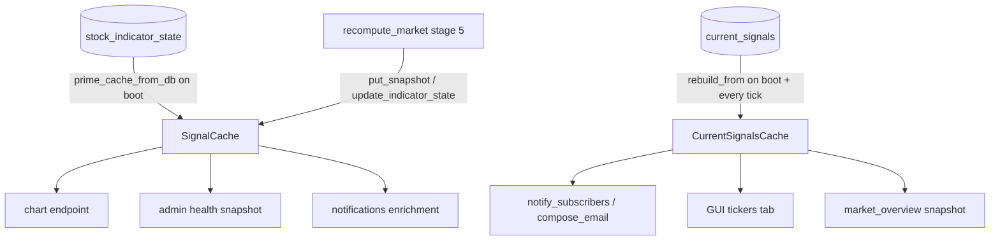

# `trip_ema/cache/` — in-process snapshot caches

## 1. Role in the larger application

`cache/` holds the **in-memory state** the live service consults
instead of hitting the DB on every request. Two caches sit
side-by-side because they answer different questions on different
update cadences:

| Cache | Question it answers | Update cadence | Key |
|-------|---------------------|----------------|-----|
| `SignalCache` | "What was the latest indicator state for ticker X?" | Every tick where a state row was written | `(ticker_id, timeframe)` |
| `CurrentSignalsCache` | "Did ticker X emit a signal in the current cycle?" | Every tick after `derive_signals` writes to `current_signals` | `(ticker_id, timeframe)` |

The split exists because the data has different update frequencies
and different read shapes — by-ticker indicator state on every
bar update vs by-ticker latest signal only when regime flips.
One unified cache would either bloat (carry signals + state in
every snapshot, most never consulted together) or contend (one
lock for two writers with different cadences).



## 2. Architecture and constraints

Common design rules across both caches:

- **Lock-free reads.** Readers acquire no lock. Dictionary lookups
  are GIL-atomic in CPython; reads either see the old snapshot or
  the new one, never a torn intermediate.
- **Immutable snapshots.** Every cached value is a `frozen=True,
  slots=True` dataclass. A reader that retains a snapshot reference
  past a write keeps a consistent view of the moment they read it.
- **Single writer per cache** in production. Writes hold a
  defensive `threading.Lock` for cross-writer safety, but
  contention is not expected because the single writer is the
  single-threaded orchestrator stage that owns this cache.
- **Atomic-swap rebuilds.** For full-cache rebuilds
  (`CurrentSignalsCache.rebuild_from`), the new dict is built
  locally and then assigned to the instance attribute in a single
  Python statement. The assignment itself is GIL-atomic — no
  in-place mutation that readers could observe partial.
- **No persistence.** Both caches are pure in-memory; on restart,
  startup wiring re-seeds them.

## 3. File inventory

```
trip_ema/cache/
├── __init__.py                 Re-exports CachedSnapshot, IndicatorStateSnapshot, SignalCache
├── signal_cache.py             SignalCache (the indicator-state cache)
└── current_signals_cache.py    CurrentSignalsCache (the current-signals mirror)
```

`CurrentSignalsCache` is not re-exported from `__init__.py`
intentionally — callers import it directly:

```python
from trip_ema.cache.current_signals_cache import CurrentSignalsCache
```

This keeps the two caches conceptually distinct at the import-name
level.

## 4. `SignalCache` — indicator-state cache

### 4.1 The snapshot types

```python
@dataclass(frozen=True, slots=True)
class IndicatorStateSnapshot:
    trade_date:        date
    med_ema:           float
    long_ema:          float
    longest_ema:       float
    atr:               float
    upper_inner_band:  float
    lower_inner_band:  float
    upper_mid_band:    float
    lower_mid_band:    float
    upper_outer_band:  float
    lower_outer_band:  float
    display_regime:    int       # -1 / 0 / +1
    computed_at:       datetime  # when Phase 7 wrote this row
```

Subset of the columns of one row from `indicator_state` (or, in
the V1 path, `stock_indicator_state`). Note: post-Step-15-B1, the
cache **no longer carries a latest signal-event component**. The
signal-event side moved to `CurrentSignalsCache`.

```python
@dataclass(frozen=True, slots=True)
class CachedSnapshot:
    ticker_id:                int
    ticker_ref:               TickerRef
    timeframe:                Timeframe
    latest_indicator_state:   IndicatorStateSnapshot | None
    snapshot_taken_at:        datetime
    stale_since:              datetime | None = None
```

One entry per `(ticker_id, timeframe)`. `ticker_ref` is denormalised
into the snapshot for read-endpoint convenience (saves a `tickers`
lookup on every chart-endpoint hit).

**Field semantics:**

| Field | Meaning |
|-------|---------|
| `latest_indicator_state` | `None` early in lifecycle (before Phase 7 wrote the first row) or after a cache `remove_snapshot` |
| `snapshot_taken_at` | When this cache entry was last refreshed end-to-end (lifecycle prime or `put_snapshot`). The component `computed_at` tells you when the DB writer produced the underlying state row |
| `stale_since` | When the compute scheduler last observed a data gap. `None` means no gap. Set by `mark_stale`, cleared by `clear_stale`. The cached state itself isn't touched — the snapshot keeps its last-known-good values |

### 4.2 The class API

**Reads (lock-free):**

```python
get_snapshot(ticker_id, timeframe) -> CachedSnapshot | None
has_snapshot(ticker_id, timeframe) -> bool
all_snapshots() -> list[CachedSnapshot]                    # atomic copy
all_stale_snapshots() -> list[CachedSnapshot]              # filter where stale_since is not None
snapshot_count() -> int                                    # named, not __len__
```

`snapshot_count` is deliberately a named method rather than
`__len__`. Any legacy `len(cache)` call from before Step 9a will
fail loudly rather than silently return zero from an empty
implementation.

**Writes (single-lock):**

```python
put_snapshot(snapshot: CachedSnapshot) -> None              # replace whole entry
update_indicator_state(ticker_id, ticker_ref, timeframe, state) -> None
mark_stale(ticker_id, timeframe, when) -> None
clear_stale(ticker_id, timeframe) -> None
remove_snapshot(ticker_id, timeframe) -> bool
clear() -> None                                             # test helper
```

`update_indicator_state` is the typical "incremental refresh" path:
the caller has a new indicator-state row for one ticker. The
method handles the first-write case (create a new
`CachedSnapshot`) and the update case (use `dataclasses.replace` to
build a new immutable snapshot with the refreshed state) within the
same lock-held window.

### 4.3 `mark_stale` semantics

```python
def mark_stale(self, ticker_id, timeframe, when):
    existing = self._snapshots.get((ticker_id, timeframe))
    if existing is None:
        return
    if existing.stale_since is not None:
        return  # don't overwrite first-detection time
    self._snapshots[(ticker_id, timeframe)] = replace(existing, stale_since=when)
```

Records the time of **first** detection, not the most recent
observation. Operators viewing the stale-tickers admin route see
"this ticker has been stale since…", which is more useful than "the
scheduler noticed again 5 minutes ago".

### 4.4 Writer responsibility split

| Component | Sole writer |
|-----------|-------------|
| `latest_indicator_state` | Phase 7 (wired via `update_indicator_state` from `recompute_market` stage 5) — and at startup, `prime_cache_from_db` |
| `stale_since` | Compute scheduler — `mark_stale` and `clear_stale` |

(Pre-V1, the cache also carried a `latest_signal_event` component
with its own writer. That field was demolished in Step 15-B1; the
signal side moved to `CurrentSignalsCache`.)

### 4.5 Lifecycle

```
service start  →  api.lifecycle.prime_cache_from_db(engine, cache)
                 ─ SELECT latest indicator_state per ticker
                 ─ SELECT tickers to resolve ticker_ref
                 ─ cache.put_snapshot(...) for each
                  
every tick     →  orchestrator.recompute_market stage 5
                 ─ for each updated ticker, build IndicatorStateSnapshot
                 ─ cache.update_indicator_state(...)
                 ─ for each ticker missing this tick's bar:
                     cache.mark_stale(...) if not already stale
                     cache.clear_stale(...) if previously stale and now caught up
```

## 5. `CurrentSignalsCache` — current_signals mirror

### 5.1 Class API

```python
class CurrentSignalsCache:
    def __init__(self) -> None:
        self._snapshots: dict[tuple[int, str], SignalEvent] = {}
        self._write_lock = threading.Lock()

    # reads (lock-free)
    def get_signal(ticker_id: int, timeframe: str) -> SignalEvent | None
    def all_signals() -> list[SignalEvent]
    def signal_count() -> int

    # writes
    def rebuild_from(signals: Sequence[SignalEvent]) -> None
```

Stores one V1 `SignalEvent` per `(ticker_id, timeframe)`. Empty
cache means "no signal this cycle for any ticker" or "cache not yet
built".

### 5.2 `rebuild_from` — the canonical write path

```python
def rebuild_from(self, signals: Sequence[SignalEvent]) -> None:
    new_snapshots = {(s.ticker_id, s.timeframe): s for s in signals}
    with self._write_lock:
        self._snapshots = new_snapshots
```

The cycle (`recompute_market` stage 5) reads
`current_signals` after stage 4 derived the cycle's flips and
calls `rebuild_from` with the freshly-derived rows.

**Atomic-swap mechanics:**

1. The dict comprehension builds a brand-new local dict. No
   mutation of `self._snapshots`.
2. The single assignment statement `self._snapshots = new_snapshots`
   is GIL-atomic — a concurrent reader sees either the old dict or
   the new dict, never a partial mix.
3. The `_write_lock` guards against a hypothetical second writer
   from interleaving its rebuild with this one. Single-writer in
   production, so the lock is essentially free.

**Drop semantics.** Tickers in the old cache but not in `signals`
are simply gone after the swap. The V1 model has no concept of
"stale current signal" — `current_signals` either has a row this
cycle or it doesn't; the cache mirrors that exactly.

### 5.3 Why not granular updates?

Why rebuild the whole dict instead of `put_signal(s)` / `remove_signal(t)`?

Because the data is small. After rotation (`current_signals` → `historical_signals`)
the table is empty. After derive, it has at most a few hundred new
rows. Building a few-hundred-element dict and swapping it in is
faster than holding a write lock through many individual updates
and contending with readers.

It also keeps the writer simple — the cycle says "here's the truth
right now" and the cache reflects it. No per-row reasoning about
whether to insert / update / delete.

### 5.4 Lifecycle

```
service start  →  CurrentSignalsCache instance is created in app.py
                  But empty until first cycle.

every tick     →  orchestrator.recompute_market stage 4 writes to current_signals
                  stage 5: SELECT * FROM current_signals → list[SignalEvent]
                  cache.rebuild_from(rows)
```

A read concurrent with the first cycle of the day may see an empty
cache for a few hundred milliseconds before the first
`rebuild_from`. Acceptable — readers handle the empty case (return
`[]` or `None`).

## 6. Data flow

### 6.1 Chart endpoint (reads `SignalCache` indirectly)

Today, the chart endpoint doesn't read `SignalCache` — it
recomputes from bars via `api.compute_full_verbose`. The cache is
used by:

- `/v1/admin/health-snapshot` for "how many tickers have a fresh
  snapshot"
- `/v1/admin/stale-tickers` for "list every ticker the scheduler
  marked stale"
- Notification enrichment for "what's this ticker's most recent
  computed display_regime"

### 6.2 Notification composition (reads `CurrentSignalsCache`)

```
notify_subscribers (every tick after recompute_market)
    │ for subscriber S due for notification:
    ▼
list_of_signals = current_signals_cache.all_signals()
    │ apply S's filter rules (per-ticker, per-signal-type)
    │ pass to benchmark_rerank for BUY ordering
    ▼
compose_email + send_email
```

The cache means the composer doesn't hit Postgres for every
subscriber — one cache read serves N subscribers in the same cycle.

### 6.3 GUI tickers tab (reads `CurrentSignalsCache` indirectly)

The GUI doesn't access the cache directly (it's in a different
process). It reads `current_signals` via SQL from a read-only
role. The cache exists to serve the in-process consumers; the GUI
is fine with the DB round-trip cost.

## 7. Concurrency model in detail

### 7.1 Read path (no lock)

```python
snapshot = cache.get_snapshot(ticker_id, Timeframe.WEEKLY)
if snapshot is None:
    return early
display_regime = snapshot.latest_indicator_state.display_regime
```

The `dict.get` is a single bytecode operation; CPython holds the
GIL through it. No torn read.

The `if snapshot is None` check + subsequent field access work on
the **reference** the reader pulled out. Even if a writer
immediately afterwards replaces the dict entry with a new snapshot,
the reader's local variable still points to the old (immutable)
snapshot. The reader sees a consistent state.

### 7.2 Write path (lock-held)

```python
with self._write_lock:
    existing = self._snapshots.get(key)
    new_value = (
        replace(existing, latest_indicator_state=state)
        if existing else CachedSnapshot(...)
    )
    self._snapshots[key] = new_value
```

The lock prevents two concurrent writers from racing on the
read-modify-write of a single key. The dict assignment itself is
GIL-atomic, but the read-modify-write across two statements is
not — without the lock, two writers could both read the old entry,
build different replacements, and the second write would clobber
the first.

In production this contention doesn't happen (one writer). The lock
is a cheap belt-and-braces.

### 7.3 What's NOT thread-safe

- Iterating `cache._snapshots` directly. **Don't** — use
  `all_snapshots()` which returns a copy.
- Holding a reference to the dict (e.g. `d = cache._snapshots`).
  The next `clear()` or large rebuild may invalidate your iteration.
  Always go through public accessors.

## 8. Failure modes

| Failure | Behaviour |
|---------|-----------|
| Reader calls `get_snapshot` before startup priming completed | Returns `None`. Caller treats as "not in cache yet" — typically returns 404 or falls back to DB |
| Writer crashes mid-update | Lock released by `with` block exit; cache state is whatever the last completed write left. No partial updates possible (immutable snapshots) |
| Cache holds stale data (ETL is hours behind) | `stale_since` flag set on `SignalCache` entries. Admin route surfaces it. The cache happily serves stale data — caller is responsible for checking `stale_since` if freshness matters |
| Process restart | Caches lost. Re-seeded at startup by `prime_cache_from_db` and the first cycle's `rebuild_from` |
| Memory pressure | Caches hold ~2,600 entries each, each ~few hundred bytes; total ~5 MB. Not a concern at this scale |

There is **no cache invalidation by external signal**. The cache
trusts its writers and the startup primer. If the DB is modified
out-of-band (e.g. by a manual SQL DELETE on `current_signals`), the
cache is stale until the next cycle rebuilds it.

## 9. Testing

`tests/cache/`:

- `test_signal_cache.py` — every method, including the
  `mark_stale` / `clear_stale` interaction.
- `test_signal_cache_concurrency.py` — reader during writer
  (with `threading.Barrier`), atomicity of the swap, no torn
  reads observed.
- `test_current_signals_cache.py` — `rebuild_from` correctness,
  empty input, repeated rebuilds.

The tests do not need Postgres — both caches are pure-Python.

## 10. Common pitfalls

1. **Don't keep references to snapshot fields across writes.** A
   `state = cache.get_snapshot(id, tf).latest_indicator_state`
   gives you a reference to the immutable snapshot's field, but
   if you then `cache.update_indicator_state(...)`, your `state`
   variable still points to the old value. Re-fetch if you need
   freshness.
2. **`SignalCache.snapshot_count()`, not `len(cache)`.** The
   loud-rename is intentional — pre-V1 `len()` is gone.
3. **`CurrentSignalsCache.rebuild_from` clears entries not in
   the input.** If you call it with an empty list, you get an
   empty cache. This is by design (the input is the full truth)
   but is a footgun if you confuse `rebuild_from` with `update`.
4. **The `SignalCache` no longer carries signal events.** Code
   that reads `snapshot.latest_signal_event` is pre-Step-15-B1
   and broken — the attribute is gone.
5. **`stale_since` is a wall-clock detection time, not a TTL.**
   The cache does not auto-expire entries. The compute scheduler
   sets it; nothing clears it except a subsequent `clear_stale`
   call.

## 11. Extension paths

- **TTL eviction.** Not implemented because the cache is bounded
  by the universe size. If the universe grew (e.g. supporting all
  10,000+ NSE ticker history), an LRU shell around the dict would
  be the standard add.
- **Per-key locks for higher write concurrency.** Not needed
  today (single writer); if multiple per-exchange writers ever
  appeared, a sharded lock (one lock per N keys) would keep
  contention low.
- **Persistence to disk for fast restart.** Not implemented;
  startup priming from Postgres takes < 1 second. Worth doing
  only if startup time becomes a constraint.

## 12. Related packages

- `trip_ema/api/lifecycle.py` — `prime_cache_from_db` seeds
  `SignalCache` at startup.
- `trip_ema/orchestrator/recompute_market.py` — stage 5 writes
  to both caches every tick.
- `trip_ema/persistence/current_signals_repo.py` — produces the
  `SignalEvent`s `CurrentSignalsCache.rebuild_from` consumes.
- `trip_ema/persistence/stock_indicator_state_repo.py` — produces
  the `IndicatorStateSnapshot`s `SignalCache.update_indicator_state`
  consumes.
- `trip_ema/notifications/compose_email.py` — reads
  `CurrentSignalsCache.all_signals()` for the per-subscriber
  digest.
- `trip_ema/transports/http/routes/admin_health.py` — reads
  `SignalCache.snapshot_count()` and `all_stale_snapshots()` for
  the dashboard.
- `trip_ema/scheduler/compute_scheduler.py` — formally the
  writer of `stale_since` flags. The class is constructed-but-
  never-started in V1; `recompute_market` does the equivalent work.
