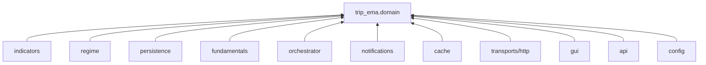
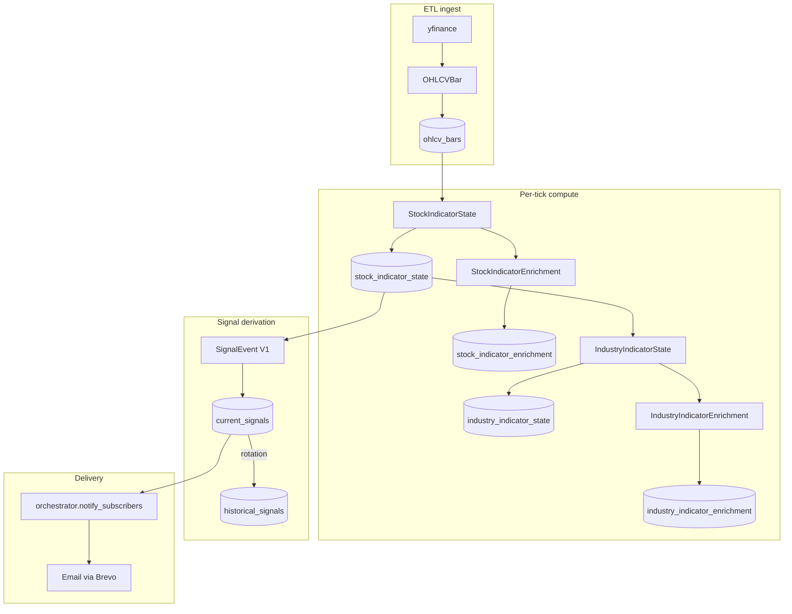

# `trip_ema/domain/` — Frozen domain types

## 1. Role in the larger application

`domain/` is the **lowest layer** in the dependency graph. It defines
every type that flows between layers — bars in, regime state through,
signals out. Everything else depends on `domain/`; `domain/` depends
on nothing inside `trip_ema/` (only on the standard library).

Concretely, this package answers four questions for the rest of the
codebase:

1. **What is a bar?** → `OHLCVBar`, `RawBar` (`ohlcv.py`).
2. **What is a ticker?** → `TickerRef` (`ohlcv.py`).
3. **What is the per-bar indicator state we computed for it?** →
   `BarState`, `StockIndicatorState`, `IndustryIndicatorState`,
   and the matching `*Enrichment` types (`state.py`,
   `stock_indicator_state.py`, etc.).
4. **What is a signal, what is a notification?** → `ChangeSignal`,
   `SignalEvent` (in two flavours during the V1 cutover),
   `NotificationBatch` (`signal_event.py`, `events.py`).

Layers above (`persistence`, `indicators`, `fundamentals`, `gui`,
`orchestrator`, `transports`, `notifications`) all import from here.
The acyclicity is enforced by `tests/test_no_dead_island.py` — any
import from `trip_ema.domain` into another `trip_ema.*` module is a
test failure.



## 2. Architecture and constraints

Three architectural rules govern every file in this package:

| # | Rule | Why |
|---|------|-----|
| **R1** | All types are `frozen=True, slots=True` dataclasses or `IntEnum/StrEnum` | Immutability eliminates a class of bugs (callers can't mutate a returned value behind another caller's back). `slots=True` reduces per-instance memory — relevant when 2,500 tickers × 250 history bars worth of `BarState` lives in memory. |
| **R2** | Zero imports from any other `trip_ema.*` module | Acyclic dependency root. Every other layer is allowed to import from `domain`; nothing here imports back. |
| **R3** | Zero I/O — no `yaml`, no `requests`, no `sqlalchemy`, no `redis`, no `psycopg`, no `holidays` | A `domain` type must be safe to construct in a test without spinning up any infrastructure. |

Two side effects of those rules worth knowing:

- **Pickle-safety.** Because there's no I/O and no live handles,
  every `domain` type pickles cleanly. Used by the
  `concurrent.futures` worker fan-out in `fundamentals/runners.py`
  and the (legacy) Redis-queued notifier pipeline.
- **Test substrate.** Unit tests in every layer can build whatever
  `BarState` / `SignalEvent` they need with no fixtures or DB.

## 3. File inventory

```
trip_ema/domain/
├── __init__.py                              Public re-exports
├── ohlcv.py                                 OHLCVBar, TickerRef
├── state.py                                 Timeframe, CoreRegime, ChangeSignal,
│                                            IndicatorParams, BarState
├── events.py                                Legacy SignalEvent (in-mem), NotificationBatch
├── signal_event.py                          V1 SignalEvent (DB row mirror)
├── stock_indicator_state.py                 StockIndicatorState
├── stock_indicator_enrichment.py            StockIndicatorEnrichment
├── industry_indicator_state.py              IndustryIndicatorState
└── industry_indicator_enrichment.py         IndustryIndicatorEnrichment
```

Three sub-groups by purpose:

| Group | Files | Lifecycle |
|-------|-------|-----------|
| **Wire / ETL inputs** | `ohlcv.py` | Stable. Used everywhere |
| **Pipeline state** | `state.py`, `stock_indicator_state.py`, `stock_indicator_enrichment.py`, `industry_indicator_state.py`, `industry_indicator_enrichment.py` | Active. The "state" type is what gets computed by `fundamentals/v1_runners.py` and persisted to `*_indicator_state` / `*_indicator_enrichment` tables |
| **Signals + notifications** | `signal_event.py`, `events.py` | Mid-cutover. `signal_event.py::SignalEvent` is the V1 type that maps to `current_signals` / `historical_signals`. `events.py::SignalEvent` is the legacy in-memory event that flowed through the deprecated `notifier_worker`. The two coexist; the legacy one is scheduled for removal once the last legacy consumer is retired |

## 4. Public re-exports (`__init__.py`)

```python
from .events            import NotificationBatch, SignalEvent  # legacy SignalEvent
from .ohlcv             import OHLCVBar, TickerRef
from .state             import BarState, ChangeSignal, CoreRegime, IndicatorParams, Timeframe

__all__ = [
    "BarState", "ChangeSignal", "CoreRegime", "IndicatorParams",
    "NotificationBatch", "OHLCVBar", "SignalEvent", "TickerRef", "Timeframe",
]
```

Note what is **not** re-exported:

- `StockIndicatorState`, `StockIndicatorEnrichment`,
  `IndustryIndicatorState`, `IndustryIndicatorEnrichment`
- `signal_event.SignalEvent` (the V1 one)

These have to be imported via their full module path:

```python
from trip_ema.domain.stock_indicator_state          import StockIndicatorState
from trip_ema.domain.stock_indicator_enrichment     import StockIndicatorEnrichment
from trip_ema.domain.industry_indicator_state       import IndustryIndicatorState
from trip_ema.domain.industry_indicator_enrichment  import IndustryIndicatorEnrichment
from trip_ema.domain.signal_event                   import SignalEvent  # V1
```

The reason: while the V1 and legacy `SignalEvent` coexist, doing
`from trip_ema.domain import SignalEvent` resolves to the **legacy**
type so that pre-V1 code paths keep working unmodified. V1 code is
explicit about which it wants. After the legacy type is retired, the
V1 one moves into `__init__.py` as the canonical `SignalEvent`.

## 5. Type-by-type reference

### 5.1 `TickerRef` (`ohlcv.py`)

```python
@dataclass(frozen=True, slots=True)
class TickerRef:
    exchange:   str
    symbol:     str
    instrument: str = "EQ"   # one of: EQ, INDEX, FUT
```

Identifies a tradeable instrument. `(exchange, symbol, instrument)`
must be unique across the universe. `__str__` returns
`"{exchange}:{symbol}"` (no instrument suffix — uniqueness within an
exchange is symbol-level for the EQ majority).

**Why `instrument`?** Because the same `symbol` can refer to three
different things on the same exchange: e.g. on NSE, `NIFTY` is an
INDEX, `NIFTYBEES` is an EQ (an ETF that tracks NIFTY), and there's
a futures product (`NIFTY` as FUT). The instrument column disambiguates.

**Note for V1 callers.** The legacy `TickerRef` in this module
predates the `ticker_id` PK in the DB. V1 code paths primarily key
on `ticker_id: int` and only build a `TickerRef` for display /
serialization. Most repository methods accept either.

### 5.2 `OHLCVBar` (`ohlcv.py`)

```python
@dataclass(frozen=True, slots=True)
class OHLCVBar:
    timestamp: datetime    # MUST be timezone-aware
    open:      float
    high:      float
    low:       float
    close:     float
    volume:    float

    def __post_init__(self) -> None:
        if self.timestamp.tzinfo is None:
            raise ValueError("OHLCVBar.timestamp must be timezone-aware; got a naive datetime")
```

The only dataclass in `domain/` with a `__post_init__` invariant. Naive datetimes are a footgun this codebase has decided to reject at the boundary — every bar that flows in carries explicit TZ info, every conversion happens at the display layer.

**Timezone convention.**
- Storage (`ohlcv_bars` table): `TIMESTAMPTZ` in UTC.
- In-memory: UTC-aware datetimes.
- Display / notification rendering: converted to exchange-local TZ
  at the boundary only (`scheduler/market_hours.py` knows which TZ
  each exchange uses; default for NSE is `Asia/Kolkata`).

`RawBar` is `OHLCVBar` under a different name in some legacy ETL
paths; they're structurally identical and interchangeable.

### 5.3 `Timeframe` (`state.py`)

```python
class Timeframe(StrEnum):
    MIN_15    = "15m"
    HOURLY    = "1h"
    HOURLY_2  = "2h"
    DAILY     = "1D"
    WEEKLY    = "1W"

    @property
    def total_seconds(self) -> int: ...
```

`StrEnum`, so `Timeframe.DAILY == "1D"` is `True` — the value is also
what gets stored in the `ohlcv_bars.timeframe` and
`stock_indicator_state.timeframe` columns.

**Important.** Despite the enum advertising 5 timeframes, **only
`"1D"` bars are stored** in `ohlcv_bars`. Weekly bars are aggregated
on demand by `indicators/aggregation.py::daily_to_weekly` because
storing them would duplicate information already in the daily bars
and create a consistency invariant to maintain. The 15m/1h/2h
timeframes are wired up architecturally but are not in production
use — defer those if/when intraday ETL ships.

`total_seconds` is consumed by aggregation logic ("is now still
inside this bucket?") and by the engine's stale-bar detection.

### 5.4 `CoreRegime` and `ChangeSignal` (`state.py`)

```python
class CoreRegime(IntEnum):     # alias: Regime = CoreRegime in some imports
    BEARISH = -1
    NEUTRAL =  0
    BULLISH =  1

class ChangeSignal(IntEnum):
    NO_CHANGE       =  0
    BUY             =  1
    SELL            = -1
    EXIT_FROM_BUY   =  2
    EXIT_FROM_SELL  = -2
```

**Encoding** matches the DB CHECK constraints on every regime column
(`indicator_state.display_regime`, `stock_indicator_state.display_regime`,
`industry_indicator_state.display_regime`, `signal_event.regime_before`,
`signal_event.regime_after`). The constants `REGIME_VALUES = (-1, 0, 1)`
in `stock_indicator_state.py` and `industry_indicator_state.py` and
`signal_event.py` exist for application-side validation that mirrors
the DB constraint.

**`ChangeSignal` derivation.** Given `(regime_before, regime_after)`,
the mapping is (per `orchestrator/derive_signals.py::_classify_regime_change`):

| `regime_after` | `regime_before` | `ChangeSignal` |
|----------------|-----------------|----------------|
| `BULLISH`      | any             | `BUY` |
| `BEARISH`      | any             | `SELL` |
| `NEUTRAL`      | `BULLISH`       | `EXIT_FROM_BUY` |
| `NEUTRAL`      | `BEARISH`       | `EXIT_FROM_SELL` |
| (no change)    | (no change)     | `NO_CHANGE` |

`BUY` and `SELL` take precedence over `EXIT_FROM_*` on a single-bar
reversal (e.g. `BEARISH → BULLISH` is `BUY`, not `EXIT_FROM_SELL`).

**`CoreRegime` vs the older `DisplayRegime`.** Older code in legacy
indicators referred to a `DisplayRegime`. After the regime-collapse
migration (`0018_collapse_regime_columns`), `display_regime` is the
**only** regime column on indicator-state tables and it carries the
same three values as `CoreRegime`. The two names are aliases; new
code should use `CoreRegime` (or simply `Regime`).

### 5.5 `IndicatorParams` (`state.py`)

```python
@dataclass(frozen=True, slots=True)
class IndicatorParams:
    # Medium EMA: 3 stages (base → s1 → s2), no final
    med_base:        int = 8
    med_s1:          int = 4
    med_s2:          int = 4
    med_final:       int | None = None

    # Long EMA: 4 stages
    long_base:       int = 15
    long_s1:         int = 4
    long_s2:         int = 4
    long_final:      int | None = 3

    # Longest EMA: 4 stages
    longest_base:    int = 28
    longest_s1:      int = 7
    longest_s2:      int = 5
    longest_final:   int | None = 3

    # ATR and bands
    atr_length:      int = 14
    inner_mult:      float = 0.2
    mid_mult:        float = 2.0
    outer_mult:      float = 4.0

    # Volume smoothing for VW-EMA numerator/denominator
    volume_sma_length: int = 2     # 1 = raw, 2 = matches Pine
    
    # Display-regime gating
    goldilocks_corridor_on_fresh_entry_only: bool = True
```

Loaded once from `config.yaml` (see `config/schema.py::EmaConfig` and
`AtrConfig`) at startup; the **same instance is used for every
ticker** in the live cycle. Phase-15 added per-exchange,
per-timeframe overrides (`config/exchange_overrides.py`) for the
backtest path only — the live cycle still uses the global instance.

**Three-stage EMA construction** (per the operator's Pine script):

1. **Base** — volume-weighted EMA of close (numerator `c*v`,
   denominator `v`, both smoothed by an EMA of length `<name>_base`).
2. **s1** — straight EMA of stage-1 output, length `<name>_s1`.
3. **s2** — Hull-style WMA polish, length `<name>_s2`.
4. **`final`** *(optional)* — extra EMA pass, length `<name>_final`.
   Used by `long` and `longest`; `med` skips it.

**`goldilocks_corridor_on_fresh_entry_only`**: when `True` (faithful
Pine port), a fresh entry from `NEUTRAL → BULLISH` requires the
close to be inside the "Goldilocks corridor" — past the inner band
but not yet past the outer band. When `False`, the outer-band check
is dropped so explosive breakout candles still paint. Affects only
the fresh-entry transitions; continuations and reversals are never
gated by the outer band.

### 5.6 `BarState` (`state.py`)

```python
@dataclass(frozen=True, slots=True)
class BarState:
    timestamp:    datetime

    # EMAs
    med_ema:      float
    long_ema:     float
    longest_ema:  float

    # ATR
    atr:          float

    # Bands
    upper_inner:  float
    lower_inner:  float
    upper_mid:    float
    lower_mid:    float
    upper_outer:  float
    lower_outer:  float

    # Pierce flags
    pierces_upper_mid: bool
    pierces_lower_mid: bool

    # Regime
    core_bg:    CoreRegime
    display_bg: CoreRegime

    @property
    def is_warmed_up(self) -> bool: ...
```

The complete derived per-bar state. Returned from the (legacy)
`TickerEngine.ingest(bar)` and consumed by the chart endpoint, the
GUI's `chart_widget.py`, and the legacy notification path.

**`is_warmed_up`**: `True` iff every indicator value is finite (none
are NaN). The Pine port faithfully reproduces Pine's warmup
semantics: `ta.ema(x, N)` returns NaN for the first N−1 bars,
`ta.atr` returns NaN until the first complete period, etc.
Downstream consumers — regime classifier, change detector, chart
endpoint — treat a not-yet-warmed-up state as "no signal yet" rather
than attempting to derive meaning from NaN-laced bands.

`is_warmed_up` checks the 3 EMAs and the ATR (the upstream sources);
if any one of those is NaN every band derived from them is also NaN
so checking the others is redundant. It does **not** inspect the
regimes — `CoreRegime` is an enum, always valid; the question is
whether the *numbers it was computed from* are real.

### 5.7 `StockIndicatorState` (`stock_indicator_state.py`)

```python
REGIME_VALUES = (-1, 0, 1)

@dataclass(frozen=True, slots=True)
class StockIndicatorState:
    ticker_id:           int
    timeframe:           str        # "1D" or "1W"
    bar_timestamp:       datetime

    med_ema:             float
    long_ema:            float
    longest_ema:         float

    atr:                 float
    upper_inner_band:    float
    lower_inner_band:    float
    upper_mid_band:      float
    lower_mid_band:      float
    upper_outer_band:    float
    lower_outer_band:    float

    display_regime:      int        # -1 / 0 / +1

    computed_at:         datetime
```

This is the **V1 per-ticker indicator state**, one-to-one with the
`stock_indicator_state` table. The dataclass intentionally carries
**only the 12 core fields** plus the 3-column PK and `computed_at`.
"Enrichment" fields (pattern labels, turn flags, etc.) live on the
separate `StockIndicatorEnrichment` dataclass.

**Schema split rationale** (Step 1 + Step 2 of the clean-pipeline
refactor):

```
   stock_indicator_state      ←  Stable core. 12 columns. Changes rarely.
   stock_indicator_enrichment ←  Evolving downstream metrics. 23 columns.
                                 Can change without touching the stable core.
```

The two tables share `(ticker_id, timeframe, bar_timestamp)`, with
the enrichment table holding a FK with `ON DELETE CASCADE`. Runner
sequencing is: state populator (Step 4) writes the state row first;
enrichment populator (Step 5) reads it back and writes its row
second.

**Contrast with the legacy `IndicatorState`** in
`trip_ema.fundamentals`: the legacy is a wide 38-field dataclass tied
to the (now-dropped) `indicator_state` table. The two coexisted
during V1 validation; the legacy table was dropped by migration
`0030_drop_legacy_signal_tables`.

**Validation rules** (enforced by the repository's upsert path; DB
CHECK constraints back them):

- `med_ema > 0`, `long_ema > 0`, `longest_ema > 0`
- `atr >= 0`
- `display_regime in REGIME_VALUES`
- `(ticker_id, timeframe, bar_timestamp)` is the PK — duplicate
  inserts UPSERT on `(ticker_id, timeframe, bar_timestamp)`

### 5.8 `StockIndicatorEnrichment` (`stock_indicator_enrichment.py`)

```python
from trip_ema.fundamentals import PATTERN_LABELS  # re-exported

@dataclass(frozen=True, slots=True)
class StockIndicatorEnrichment:
    # --- PK (same as state row) ---
    ticker_id:                       int
    timeframe:                       str
    bar_timestamp:                   datetime

    # --- band-pierce flags (2) ---
    pierces_upper_mid:               bool
    pierces_lower_mid:               bool

    # --- per-EMA distance in HL units (3, nullable) ---
    dist_to_med_in_hl_units:         float | None
    dist_to_long_in_hl_units:        float | None
    dist_to_longest_in_hl_units:     float | None

    # --- rolling mean of those distances (3, nullable) ---
    mean_dist_to_med_in_hl_units:    float | None
    mean_dist_to_long_in_hl_units:   float | None
    mean_dist_to_longest_in_hl_units: float | None

    # --- bars-since each EMA last turned (3, nullable) ---
    bars_since_med_turn:             int | None
    bars_since_long_turn:            int | None
    bars_since_longest_turn:         int | None

    # --- pct-change-since each EMA last turned (3, nullable) ---
    pct_change_since_med_turn:       float | None
    pct_change_since_long_turn:      float | None
    pct_change_since_longest_turn:   float | None

    # --- pattern labels per EMA (3, NOT NULL DEFAULT 'NA') ---
    med_pattern_label:               str
    long_pattern_label:              str
    longest_pattern_label:           str

    # --- turn flags per EMA (6, NOT NULL DEFAULT FALSE) ---
    med_turn_buy:    bool
    med_turn_sell:   bool
    long_turn_buy:   bool
    long_turn_sell:  bool
    longest_turn_buy:  bool
    longest_turn_sell: bool

    # --- audit ---
    computed_at:                     datetime
```

Field-by-field semantics:

| Group | Field(s) | Meaning |
|-------|----------|---------|
| Pierce flags | `pierces_upper_mid`, `pierces_lower_mid` | Did the bar's high/low cross the upper/lower mid band this bar (intra-bar straddle: `low ≤ mid ≤ high`)? Used as a momentum-confirmation tell |
| Distance to EMAs | `dist_to_{med,long,longest}_in_hl_units` | `(close − ema) / rolling_mean(high − low)`. Normalised distance — how many "typical bar ranges" is the close from this EMA? NULL during the EMA's warmup |
| Mean distance | `mean_dist_to_*_in_hl_units` | 52-period SMA of the above. Answer to "is the close unusually close to / far from this EMA right now?" |
| Bars since turn | `bars_since_{med,long,longest}_turn` | Bars elapsed since this EMA last changed slope direction. NULL before the first turn |
| Pct change since turn | `pct_change_since_*_turn` | Signed % change in close since this EMA's last turn |
| Pattern labels | `{med,long,longest}_pattern_label` | One of `PATTERN_LABELS` (re-exported from `fundamentals`). The operator's "higher valleys / lower tops" pattern detection per EMA. `'NA'` is the safe default |
| Turn flags | `{med,long,longest}_turn_{buy,sell}` | `turn_buy` = `True` on the exact bar where this EMA's slope flipped negative→positive. `turn_sell` = positive→negative. Both `False` otherwise |

**Architectural intent.** These fields are downstream of the core
indicator state and may evolve as modelling work progresses. Keeping
them in a separate dataclass + table from the stable core means they
can change without touching the stable schema or invalidating the
many tests that fix `StockIndicatorState`.

### 5.9 `IndustryIndicatorState` (`industry_indicator_state.py`)

```python
REGIME_VALUES = (-1, 0, 1)

@dataclass(frozen=True, slots=True)
class IndustryIndicatorState:
    industry_name:       str
    timeframe:           str
    bar_timestamp:       datetime

    med_ema:             float
    long_ema:            float
    longest_ema:         float

    atr:                 float
    upper_inner_band:    float
    lower_inner_band:    float
    upper_mid_band:      float
    lower_mid_band:      float
    upper_outer_band:    float
    lower_outer_band:    float

    display_regime:      int

    computed_at:         datetime
```

The **industry-side equivalent** of `StockIndicatorState`. Same 11
non-PK fields, same audit column, same validation. Two differences:

1. **PK** uses `industry_name: str` instead of `ticker_id: int`.
   Industries are referenced by name (e.g. `"Specialty Chemicals"`,
   `"IT - Software"`), not by integer ID.
2. **The math is computed on weekly bars aggregated from the
   per-industry index value** (IIV) daily rows. The aggregation
   path: `industry_index_value` daily rows → `daily_to_weekly` with
   `tz='Asia/Kolkata'` → walk through the same
   `compute_state_primitives` the stock path uses but with
   `synthetic_atr_for_index=False` (since IIV values *are* a price
   series with a real range; no synthetic ATR needed).

**Sequence note.** The runner *always* computes per-ticker state
**before** per-industry state — industries reference the per-ticker
constituents to compute IIV, and IIV is the input to the industry
indicator math. Reversing this is a non-trivial data-flow violation.

### 5.10 `IndustryIndicatorEnrichment` (`industry_indicator_enrichment.py`)

Industry-side mirror of `StockIndicatorEnrichment`. Identical 23
enrichment fields, identical semantics, only the PK differs
(`industry_name: str` instead of `ticker_id: int`).

1:1 with `industry_indicator_state` via composite PK; DB FK with
`ON DELETE CASCADE` enforces that no orphan enrichment row can
outlive its parent state row.

### 5.11 `SignalEvent` (V1) (`signal_event.py`)

```python
SIGNAL_TYPES   = ("BUY", "SELL", "EXIT_FROM_BUY", "EXIT_FROM_SELL")
REGIME_VALUES  = (-1, 0, 1)

@dataclass(frozen=True, slots=True)
class SignalEvent:
    ticker_id:        int
    timeframe:        str
    bar_timestamp:    datetime
    signal_type:      str          # one of SIGNAL_TYPES
    regime_before:    int          # one of REGIME_VALUES
    regime_after:     int          # one of REGIME_VALUES; must != regime_before
    price_at_signal:  float        # > 0
    computed_at:      datetime
```

One row from `current_signals` **or** `historical_signals` — same
shape, different PK semantics.

**Two-table model:**

| Table | PK | Cardinality | Meaning |
|-------|----|----|---------|
| `current_signals` | `(ticker_id)` | ≤ 1 row per ticker | The cycle's most recent unrotated signal for each ticker, if any |
| `historical_signals` | `signal_id BIGSERIAL` | append-only, many rows per ticker | Archive of every signal emitted across history |

The rotation primitive (`orchestrator/rotate_signals.py`) atomically
moves rows from `current_signals` to `historical_signals` once per
cycle. The atomic SQL is a single statement:

```sql
WITH moved AS (
    DELETE FROM current_signals RETURNING ...
)
INSERT INTO historical_signals (..., archived_at)
SELECT ..., NOW() FROM moved
```

Since `NOW()` returns `transaction_timestamp()`, every row archived
in one rotation shares the same `archived_at` — useful for audit
queries like "show me every signal archived in cycle 20260626-1500".

**The dataclass omits two columns** that exist on the tables:

- `signal_id` — persistence-internal to `historical_signals`; not
  part of the signal's domain identity.
- `archived_at` — `historical_signals` audit field; readers who
  need it query the table directly via the repo.

**Validation contract** (mirrored by DB CHECK):

- `signal_type in SIGNAL_TYPES`
- `regime_before in REGIME_VALUES`
- `regime_after in REGIME_VALUES`
- `regime_before != regime_after` — a signal **is** a regime change
  by definition
- `price_at_signal > 0`

### 5.12 `SignalEvent` (legacy) (`events.py`)

```python
@dataclass(frozen=True, slots=True)
class SignalEvent:
    ticker:           TickerRef
    timeframe:        Timeframe
    bar_timestamp:    datetime
    signal:           ChangeSignal
    price_at_signal:  float
    computed_at:      datetime
```

The **legacy** in-memory event type. Used by the (deprecated) Redis-
queued `notifier_worker` and the legacy `SubscriberDistributor`
batch composer.

Differences from the V1 type:

| | V1 (`signal_event.py`) | Legacy (`events.py`) |
|---|---|---|
| Lives on | Disk (`current_signals` / `historical_signals`) | In memory, then Redis |
| `ticker` representation | `ticker_id: int` | `TickerRef` (resolved) |
| `signal` type | `signal_type: str` ("BUY", …) | `signal: ChangeSignal` (IntEnum) |
| `timeframe` type | `str` | `Timeframe` enum |
| `regime_before` / `_after` | Present (DB columns) | Absent (the `ChangeSignal` already encodes the transition) |

New code should not reach for the legacy type. It is kept for the
legacy distributor path; once Phase-15-B14 retires that path, the
file is deleted and the V1 `SignalEvent` becomes the canonical
import.

### 5.13 `NotificationBatch` (`events.py`)

```python
@dataclass(frozen=True, slots=True)
class NotificationBatch:
    subscriber_id:  int
    events:         list[SignalEvent]    # legacy SignalEvent
    composed_at:    datetime
```

A bundle of events destined for a single subscriber in one message.
Composed by the legacy `SubscriberDistributor`; rendered at the
transport boundary (`notifications/batcher.py`) into one of three
formats:

| Transport | Rendering |
|-----------|-----------|
| Email (text) | One event per line |
| Email (HTML) | Rich, colour-coded, grouped by signal type, enriched with sector + last-5 |
| Webhook | JSON array |

The batch is intentionally per-subscriber, not per-event — it lets a
subscriber receive one digest message per cycle even if 20 of their
tickers fired signals.

**Status.** The V1 cycle's `orchestrator/notify_subscribers.py`
takes a different approach (composes emails one subscriber at a time
directly from `current_signals` rows, no batch object). The
`NotificationBatch` type lives on for the legacy queued path; it
goes away with the rest of the legacy notifier.

## 6. Data flow: where each type appears



| Type | Created by | Persisted to | Consumed by |
|------|-----------|--------------|------------|
| `OHLCVBar` | `etl/yfinance_source.py` | `ohlcv_bars` | indicators, fundamentals runners, GUI chart |
| `StockIndicatorState` | `fundamentals/v1_runners.py::populate_stock_indicator_state_for_*` | `stock_indicator_state` | `orchestrator/derive_signals.py`, `cache/signal_cache.py`, GUI chart, snapshots |
| `StockIndicatorEnrichment` | `fundamentals/v1_runners.py::populate_stock_indicator_enrichment_for_*` | `stock_indicator_enrichment` | notification enrichment, GUI |
| `IndustryIndicatorState` | `fundamentals/v1_runners.py::populate_industry_indicator_state_for_*` | `industry_indicator_state` | industry panel in GUI, sector-direction in enrichment |
| `IndustryIndicatorEnrichment` | `fundamentals/v1_runners.py::populate_industry_indicator_enrichment_for_*` | `industry_indicator_enrichment` | GUI |
| `SignalEvent` (V1) | `orchestrator/derive_signals.py` | `current_signals`, then `historical_signals` after rotation | `orchestrator/notify_subscribers.py`, GUI signals view, snapshots |
| `BarState` | (legacy) `indicators/ticker_engine.py` | not persisted as such | HTTP `/v1/signals/.../history`, GUI chart |

## 7. Pickling and multi-process safety

The fundamentals runners fan out per-ticker work via
`concurrent.futures.ThreadPoolExecutor` (or `ProcessPoolExecutor` in
the historical-shares backfill case). Process-pool fan-out requires
that arguments and return values pickle cleanly. All `domain` types
do, because:

- They are dataclasses (pickle's a known pattern for dataclasses).
- They contain no live handles (no DB connections, no file
  descriptors, no `threading.Lock` instances).
- They contain only stdlib types in their fields (`int`, `float`,
  `str`, `bool`, `datetime`, `None`, and enum members).

If you add a new type here, the test
`tests/domain/test_pickleability.py` will catch any field that
breaks this.

## 8. Common pitfalls

1. **Naive datetimes.** Construct `OHLCVBar` with a naive datetime
   and `__post_init__` raises. Any DB read that pulls
   `TIMESTAMPTZ` returns aware datetimes; any test fixture that
   builds bars by hand must include `tzinfo=UTC` (or another zone).
2. **`Timeframe` is a `StrEnum`.** `tf == "1D"` is True. But
   `tf in {"1D", "1W"}` is also True only because `StrEnum`
   members hash equal to their string values. Avoid relying on this
   in `dict` keys where you mix raw strings and enum members.
3. **`CoreRegime(0)` is `NEUTRAL`, not falsy.** `if regime:`
   evaluates to `False` for `NEUTRAL` because `IntEnum` inherits
   `__bool__`. Always compare explicitly: `if regime == CoreRegime.NEUTRAL`.
4. **`SignalEvent` ambiguity during cutover.** `from trip_ema.domain
   import SignalEvent` gives the **legacy** type. V1 code must
   import from `trip_ema.domain.signal_event` explicitly.
5. **`industry_name` is a free-form string.** No FK to a master
   industries table; whatever string the yfinance industry-info
   fetch returns flows through. Be aware when joining across
   `instrument_industry`, `industry_index_value`, and
   `industry_indicator_state` — they all use the same string;
   sanity-check spelling consistency periodically.

## 9. Extending this layer

When you add a new domain type:

1. **One file per type** (or per tight family of types — `ohlcv.py`
   bundles `TickerRef` + `OHLCVBar`, fine).
2. **Frozen + slots.** No exceptions.
3. **No imports from elsewhere in `trip_ema`.** If you need a constant
   that lives outside `domain` (like `PATTERN_LABELS` in
   `fundamentals`), import it at function scope or accept that the
   `domain` layer has a documented one-way exception (the
   enrichment files do this, with the import at module top + a
   comment explaining why).
4. **Re-export it from `__init__.py`** if it's a stable, broadly-used
   type. Niche types stay importable via full path.
5. **Match DB CHECK constraints with a module-level constant tuple**
   (see `REGIME_VALUES`, `SIGNAL_TYPES`). The repo's upsert path
   uses these for app-side validation that catches errors before
   the round-trip to the DB.
6. **Write a `tests/domain/test_<new_type>.py`** asserting
   constructor invariants, pickle round-trip, and any
   `__post_init__` rules.

## 10. Testing

`tests/domain/` covers:

- Constructor invariants (`OHLCVBar` rejects naive datetimes;
  `SignalEvent` rejects `regime_before == regime_after`, etc.)
- Enum value stability (the integer values of `CoreRegime` and
  `ChangeSignal` are part of the DB contract and must not change)
- Pickle round-trip for every dataclass
- `BarState.is_warmed_up` true/false truth table

Cross-cutting:

- `tests/test_no_dead_island.py` walks the import graph and asserts
  no module under `trip_ema.domain` imports from any sibling
  `trip_ema.*` package.

## 11. Related packages

- `trip_ema/regime/` — consumes `CoreRegime` + envelope inputs;
  emits `CoreRegime` back.
- `trip_ema/indicators/` — produces the EMA, ATR, and band values
  that populate `BarState` / `StockIndicatorState`.
- `trip_ema/fundamentals/v1_runners.py` — builds `StockIndicatorState`
  + `StockIndicatorEnrichment` + their industry-side counterparts.
- `trip_ema/persistence/` — every repo here takes `domain` types in
  and returns them out.
- `trip_ema/orchestrator/derive_signals.py` — reads
  `StockIndicatorState` pairs, emits `SignalEvent` (V1).
- `trip_ema/cache/signal_cache.py` — caches a projection of
  `StockIndicatorState` (`IndicatorStateSnapshot`).

## 12. Glossary used across these types

| Term | Meaning |
|------|---------|
| **Bar** | One OHLCV candle at some timeframe |
| **Timeframe** | Bar interval: `1D` or `1W` in production, `15m`/`1h`/`2h` reserved |
| **Tick** | One iteration of the live cycle (`recompute_market` invocation). Four per NSE trading day: 09:30, 12:15, 15:00, 16:30 IST |
| **Regime** | The +1 / 0 / −1 BULLISH / NEUTRAL / BEARISH classification of a bar's state |
| **Signal** | A regime *change* — BUY (now BULLISH), SELL (now BEARISH), EXIT_FROM_BUY (was BULLISH, now NEUTRAL), EXIT_FROM_SELL (was BEARISH, now NEUTRAL) |
| **Cycle** | One end-to-end run of `recompute_market` + `notify_subscribers` |
| **IIV** | Industry Index Value — the per-industry price-index proxy computed by `fundamentals/index_compute.py` |
| **Warmup** | The leading-N bars where an EMA / ATR doesn't have enough history yet — values are NaN |
| **Goldilocks corridor** | The region between the inner and outer bands where fresh-entry regimes are allowed to paint |
