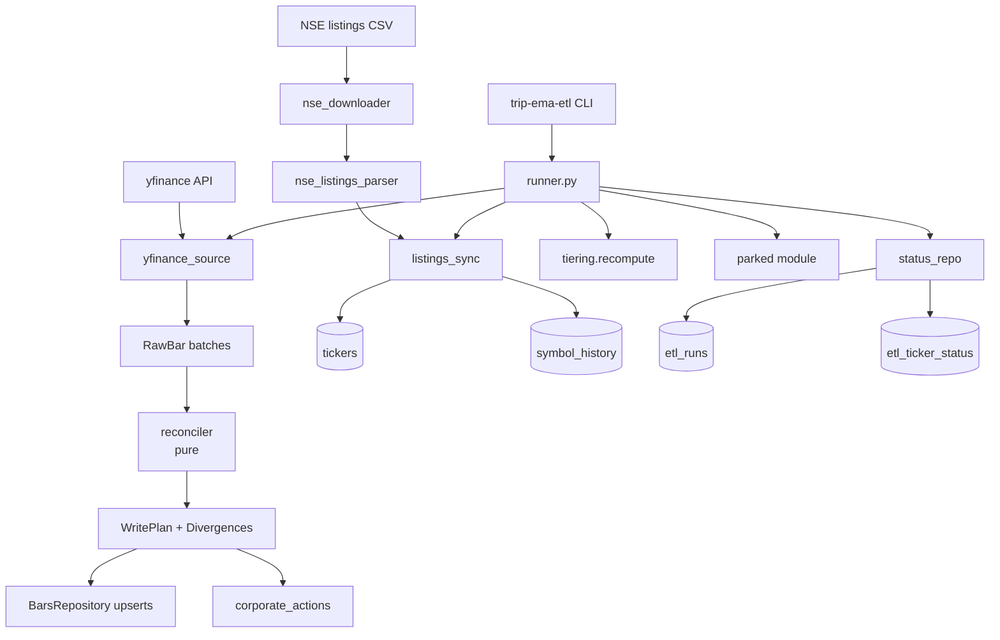

# `trip_ema/etl/` — OHLCV ingest + listings sync

## 1. Role in the larger application

`etl/` owns the **contract** between the outside world (yfinance,
NSE listings) and our database. Two responsibilities:

1. **Bars ETL.** Fetch daily OHLCV from yfinance, reconcile against
   existing rows, upsert into `ohlcv_bars`. This is the data the
   indicator pipeline consumes.
2. **Listings sync.** Pull NSE's published equity master CSV, parse
   it, sync into the `tickers` table. New symbols get inserted as
   active; missing symbols get marked inactive; symbol renames are
   detected by ISIN and recorded in `symbol_history`.

Plus supporting infrastructure: tier classification by ADV,
parked-ticker handling, NSE trading-day calendar with operator
overrides, and the audit trail in `etl_runs` / `etl_ticker_status`.

The **fundamentals stack** (industry / shares / financials / market
cap / indicator state / signal events) is a separate package
(`trip_ema/fundamentals/`); this package handles only bars +
listings.



## 2. Architecture and constraints

| Rule | Why |
|------|-----|
| **ETL owns truth for bars (invariant 3.1)** | When the ETL re-fetches a bar, the new value replaces the old. The engine accepts revisions; consumers re-derive |
| **Engine accepts revisions (invariant 3.6)** | After an ETL upsert, downstream indicator state for that bar must be recomputed. Cycles handle this naturally via `n_weeks_to_upsert` |
| **Weekly bars are NEVER stored** | Only `timeframe='1D'`. Weekly aggregation is on-demand in `indicators.aggregation.daily_to_weekly`. Storing both would invent a consistency invariant to maintain |
| **Reconciler is pure** | Bars in, plan out, no I/O. Testable without DB |
| **Per-batch yfinance with backoff** | yf.download supports batched symbols. Single-symbol calls would be rate-limit-bottlenecked |
| **Tiering by trailing 30-day ADV** | Liquid stocks refresh hourly intraday; illiquid only EoD. Tier recomputed weekly |
| **Parked tickers double-recorded** | `tickers.parked=True` is the queryable state; the dated CSV under `var/etl/parked/` is the audit trail |
| **CLI subcommands require `--exchange NAME`** | Phase 14.6a — explicit exchange selection prevents silent misroutes |
| **Exit codes mean something** | 0=success, 1=partial (some tickers failed but pipeline ran), 2=fatal (couldn't even start). Operators script on exit codes |

## 3. File inventory

```
trip_ema/etl/
├── __init__.py
├── cli.py                          trip-ema-etl entry point
├── runner.py                       run_incremental, run_backfill, fetch_bars_for_tickers,
│                                   recompute_tiers, ...
│
├── types.py                        FetchOutcome, RawBar, WritePlan, Divergence
├── yfinance_source.py              yf.download wrapper + batching + retry
├── reconciler.py                   Pure: new bars + existing → WritePlan + Divergences
│
├── exchanges.py                    Exchange ↔ yfinance-suffix; validate_exchange
├── holidays_calendar.py            NseTradingCalendar (legacy; superseded by scheduler.market_calendar)
├── nse_holidays_override.yaml      Operator overrides
├── nse_holidays_2026.yaml          2026 override file
│
├── nse_downloader.py               Pulls NSE equity master (anti-bot)
├── nse_listings_parser.py          Pure: CSV → NseListing records
├── listings_sync.py                NseListings → tickers table writes
│
├── status_repo.py                  etl_runs + etl_ticker_status lifecycle
├── corporate_actions_repo.py       corporate_actions table (mirror of persistence/)
├── symbol_history_repo.py          symbol_history (mirror of persistence/)
│
├── tiering.py                      Tier 1/2/3 classification by ADV
└── parked.py                       Parked-ticker handling
```

## 4. CLI surface (`cli.py`)

```bash
trip-ema-etl refresh-listings  --exchange NSE
trip-ema-etl backfill          --exchange NSE [--date_from YYYY-MM-DD]
trip-ema-etl incremental-eod   --exchange NSE
trip-ema-etl incremental-intraday --exchange NSE
trip-ema-etl recompute-tiers   --exchange NSE
trip-ema-etl status            [--exchange NSE]
trip-ema-etl unpark            --exchange NSE
trip-ema-etl approve-action    --action-id N
```

Plus the fundamentals subcommands registered from
`trip_ema/fundamentals/cli.py`:

```bash
trip-ema-etl refresh-industry  --exchange NSE
trip-ema-etl refresh-shares    --exchange NSE
trip-ema-etl refresh-financials --exchange NSE
trip-ema-etl compute-market-cap --exchange NSE
trip-ema-etl build-industry-indices --exchange NSE
trip-ema-etl compute-index-values --exchange NSE
trip-ema-etl compute-indicator-state --exchange NSE
trip-ema-etl compute-signals   --exchange NSE
trip-ema-etl eod-pipeline      --exchange NSE   # wires phases 1-8
```

### 4.1 Exit codes

| Code | Meaning |
|------|---------|
| `0` | All tickers succeeded |
| `1` | Pipeline ran but some tickers failed (partial) |
| `2` | Pipeline failed to start (config error, DB unreachable, exchange unknown, etc.) |

Operators script on these:

```bash
trip-ema-etl incremental-eod --exchange NSE
case $? in
  0) echo "OK" ;;
  1) echo "Partial — investigate parked tickers" ;;
  2) echo "FATAL — page on-call" ;;
esac
```

### 4.2 Phase 14.6a exchange validation

Every ticker-touching subcommand requires `--exchange NAME`. NAME
must pass two checks:

1. **Known to the codebase** — must appear in `_SUFFIX_MAP` in
   `exchanges.py` (NSE, BSE, NYSE, NASDAQ, TSE, HKSE, SSE, SZSE,
   LSE).
2. **Configured** — must appear in `config.market_hours[].exchange`.
   Operator has explicitly enabled it.

Failure of either prints one line to stderr (no traceback) and
exits 2:

```
trip-ema-etl: exchange 'XYZ' is not known to this codebase. Known: NSE BSE NYSE ...
```

```
trip-ema-etl: exchange 'NSE' is not configured. Add an entry to config.yaml market_hours:
```

## 5. `types.py` — frozen ETL dataclasses

```python
@dataclass(frozen=True, slots=True)
class RawBar:
    """One bar from yfinance, untouched. Pre-validation."""
    bar_date:   date
    open:       float
    high:       float
    low:        float
    close:      float
    volume:     int
    adj_close:  float

@dataclass(frozen=True, slots=True)
class FetchOutcome:
    """Per-symbol result from yfinance_source.fetch_bars(...)."""
    symbol:      str
    bars:        list[RawBar]
    error:       str | None = None
    rate_limited: bool = False

@dataclass(frozen=True, slots=True)
class WritePlan:
    """Reconciler's verdict for one (ticker, bar_date)."""
    ticker_id:    int
    bar_date:     date
    action:       Literal["INSERT", "UPDATE", "SKIP"]
    raw_bar:      RawBar
    existing_diff: float | None = None    # for UPDATE: |new_close - old_close|

@dataclass(frozen=True, slots=True)
class Divergence:
    """A bar that disagreed with an existing one; flagged for review."""
    ticker_id:        int
    bar_date:         date
    column:           str         # 'close', 'high', 'low', 'open', 'volume'
    old_value:        float
    new_value:        float
    ratio:            float       # new/old
    flagged_at:       datetime

class RunKind(StrEnum):
    INCREMENTAL = "incremental"
    BACKFILL    = "backfill"
    INTRADAY    = "intraday"
    RECOMPUTE_TIERS = "recompute_tiers"

class TickerStatus(StrEnum):
    OK       = "ok"
    FAILED   = "failed"
    PARKED   = "parked"
    SKIPPED  = "skipped"
```

## 6. `yfinance_source.py` — fetch with batching + backoff

```python
def fetch_bars_for_symbols(
    symbols:       list[str],
    *,
    start:         date,
    end:           date,
    batch_size:    int = 50,
    concurrency:   int = 4,
    request_delay: float = 0.5,
    max_retries:   int = 3,
) -> dict[str, FetchOutcome]: ...
```

**Algorithm:**

1. Split `symbols` into batches of `batch_size` (default 50).
2. Submit each batch to `yf.download(...)` via
   `ThreadPoolExecutor(max_workers=concurrency)`.
3. Per-batch `request_delay` between submissions.
4. On HTTP 429 or transient errors, exponential backoff + retry up
   to `max_retries`.
5. Per-symbol result extraction from the returned multi-index
   DataFrame.
6. Validate each row (no NaN OHLCV, positive volume); convert to
   `RawBar` list.
7. Build `FetchOutcome` per symbol; aggregate into
   `{symbol: FetchOutcome}`.

Returns even when some symbols fail — failures show up as
`FetchOutcome(symbol, bars=[], error="...")`.

**Symbol → yfinance suffix mapping** (via `exchanges.py`):
- NSE: `RELIANCE.NS`
- BSE: `RELIANCE.BO`
- NYSE / NASDAQ: bare `MSFT`
- LSE: `BARC.L`
- HKSE: `0700.HK`
- TSE: `7203.T`

## 7. `reconciler.py` — pure write planning

```python
def reconcile_bars(
    new_bars:      list[RawBar],
    existing_bars: list[ExistingBar],
    *,
    divergence_threshold: float = 0.05,    # 5% threshold for flagging
) -> ReconcileResult:
```

```python
@dataclass(frozen=True, slots=True)
class ReconcileResult:
    plans:        list[WritePlan]
    divergences:  list[Divergence]
```

**Logic** (per `bar_date`):

| Scenario | Action |
|----------|--------|
| `new_bar` exists, `existing_bar` doesn't | `INSERT`, no divergence |
| `new_bar` exists, `existing_bar` exists, values match exactly | `SKIP` |
| `new_bar` exists, `existing_bar` exists, close drift < threshold | `UPDATE`, no divergence (small revision, expected) |
| `new_bar` exists, `existing_bar` exists, close drift ≥ threshold | `UPDATE`, `Divergence` flagged (large revision, likely corporate action) |
| `new_bar` missing, `existing_bar` exists | (no plan — old row preserved) |

**Invariant 3.1 honoured.** ETL always wins on conflict: the new
value goes into the write plan; the old value goes into the
divergence record if it's large enough to be suspicious.

**Invariant 3.6 honoured.** Engine sees the new value next cycle;
re-derives state from it.

Divergences with ratio outside `[0.5, 2.0]` are typically
unannounced corporate actions (splits, bonuses). The reconciler
flags them as `candidate_revision` rows in `corporate_actions`
(status `pending_review`); operator approves or rejects via the
`approve-action` CLI subcommand.

## 8. `runner.py` — composes ETL passes

### 8.1 `run_incremental(db_engine, config, *, exchange, kind='eod')`

The daily / hourly incremental refresh:

```
1. Open etl_runs row (status=RUNNING)
2. List active tickers for exchange
   - kind='eod':       all active
   - kind='intraday':  tier=1 only (most liquid)
3. Fetch bars from (last_bar_date - 5) to today (window for revision)
4. Reconcile against existing bars
5. Apply WritePlan: UPSERT one bar at a time (with adj_close)
6. Append Divergences to corporate_actions
7. Per-ticker etl_ticker_status update (last_success_at, consecutive_failures, parked)
8. Close etl_runs row
```

The 5-day lookback window matches `reconcile_window_days` in
config. Captures small revisions that yfinance applies retroactively
for the prior few days.

### 8.2 `run_backfill(db_engine, config, *, exchange, start_date)`

Historical backfill for new deployments or after a long outage.
Same shape as incremental but with a wide date window (configurable
`start_date`, default 5 years ago). Single-pass — no intra-batch
reconciliation against existing bars.

Returns the `etl_runs.run_id` for cross-reference.

### 8.3 `fetch_bars_for_tickers(db_engine, config, *, ticker_ids, start_date, end_date)`

Targeted backfill for the V1 pipeline's stage 1 — only the listed
ticker_ids, only the specified date range. Used when the backfill
operator wants to re-fetch a specific scope.

### 8.4 `recompute_tiers(db_engine, *, exchange)`

Weekly maintenance:

1. Compute trailing 30-trading-day ADV for every active ticker.
2. Sort descending by ADV.
3. Top N₁ = tier 1; next N₂ = tier 2; rest = tier 3.
4. `UPDATE tickers SET tier = ...` for changed tickers.

N₁ and N₂ from config (`tier_1_size=200`, `tier_2_size=500` by
default — top 200 NSE tickers by ADV are tier 1).

## 9. `parked.py` — failure quarantine

```python
def consider_parking(
    db_engine, ticker_id, consecutive_failures, *,
    threshold: int = 3,
) -> bool:
    """If consecutive_failures >= threshold, mark parked + append CSV."""

def unpark_all(db_engine, exchange: str) -> int:
    """Clear parked flag for all parked tickers on exchange."""

def latest_parked_csv_path() -> Path | None:
    """Return path to today's (or most recent) parked CSV."""
```

**Two-channel recording**:

1. `tickers.parked = TRUE` in DB — queryable; the runner excludes
   parked rows from future fetches.
2. `var/etl/parked/<YYYY-MM-DD>.csv` on disk — audit. One row per
   parked event: `(timestamp, ticker_id, symbol, exchange,
   consecutive_failures, last_error)`.

The DB is the active state; the CSV is the forensics trail. After
a `--unpark` operation, the DB column is cleared but the CSV
remains.

Parking threshold defaults to 3 consecutive failures (3 days of
EoD failures or 3 hours of intraday failures, depending on
cadence).

## 10. `listings_sync.py` — NSE master sync

### 10.1 `sync_listings(db_engine, listings: list[NseListing])` flow

For each `NseListing(symbol, isin, company_name, ...)`:

1. **Look up by ISIN** in `tickers`. Three cases:

| Case | Match | Action |
|------|-------|--------|
| **A** | No row | INSERT new ticker (`tier=3`, `is_active=TRUE`) |
| **B** | Row found, same symbol | UPDATE enrichment (company_name, etc.) |
| **C** | Row found, different symbol | NSE renamed the symbol. Record `symbol_history` row, UPDATE the existing `tickers.symbol` in place. The ticker_id is preserved — downstream state, signals, subscriptions stay attached |

2. **Detect missing symbols.** Symbols in the DB but not in the
   new listings are marked inactive (`is_active=FALSE`,
   `delisted_at=NOW()`). Their ticker_id and historical data stay.

3. **Return summary**: counts of inserted / renamed / enriched /
   deactivated.

### 10.2 Why ISIN-keyed?

ISIN is the stable identifier across symbol renames. NSE renames
symbols (e.g. `BAJAJ-AUTO` → `BAJAJAUTOFL` → `BAJAJ-AUTO` again
over the years), but the ISIN persists. Keying ticker history by
ticker_id (immutable) and matching new listings by ISIN gives
seamless symbol-change handling: the historical bars, signals, and
subscriptions all stay attached to the same ticker_id; only the
display symbol updates.

## 11. `holidays_calendar.py` — NSE trading day calendar

`NseTradingCalendar` — the **legacy** calendar used by the ETL.
Phase-14 superseded by `scheduler/market_calendar.py::TradingCalendar`
which is exchange-generic. The legacy class is preserved here for
ETL backward compatibility.

```python
class NseTradingCalendar:
    def is_trading_day(d: date) -> bool
    def previous_trading_day(d: date) -> date
    def next_trading_day(d: date) -> date
    def trading_days_between(start, end) -> list[date]
```

Backed by:

1. **Python `holidays` package** — India calendar for federal
   holidays.
2. **`nse_holidays_<YYYY>.yaml`** — per-year operator overrides
   (Diwali muhurat trading, mid-week closures, etc.).
3. **Weekday filter** — Mon-Fri only.

Override format:

```yaml
extra_holidays:
  - 2026-01-26
  - 2026-08-15
special_trading_days:
  - 2026-11-12   # Muhurat Trading on Diwali Saturday
```

## 12. `status_repo.py` — audit trail

```python
class EtlRunsRepository:
    def start(kind: RunKind, exchange: str, notes: str = "") -> int
    def finish(run_id: int, *, succeeded, failed, parked, divergences) -> None
    def recent(n: int) -> list[EtlRun]
    def find_active() -> EtlRun | None    # for stale-run cleanup
```

```python
class EtlTickerStatusRepository:
    def get(ticker_id: int) -> EtlTickerStatus | None
    def record_success(ticker_id: int) -> None
    def record_failure(ticker_id: int, error: str) -> int   # returns new consecutive_failures
    def record_parked(ticker_id: int) -> None
    def list_parked(exchange: str) -> list[EtlTickerStatus]
    def reset_failure_count(ticker_id: int) -> None
```

The runner opens an `etl_runs` row at start, calls
`record_success` / `record_failure` per ticker, and closes the run
with aggregate counts on completion.

## 13. Data flow walkthrough — one incremental EoD pass

```
17:00 IST cron → trip-ema-etl incremental-eod --exchange NSE
    │
    ▼
cli.py parses args, validates exchange, builds engine with role='etl'
    │
    ▼
runner.run_incremental(db_engine, config, exchange='NSE', kind='eod')
    │
    │ etl_runs.start(kind='incremental', exchange='NSE') → run_id=42
    │
    │ list active NSE tickers (~2,500 ticker_ids; tier 1+2+3)
    │ compute fetch window: (today - reconcile_window_days, today)
    │
    │ yfinance_source.fetch_bars_for_symbols(symbols, start, end)
    │     - batch into 50-symbol calls
    │     - 4 concurrent threads
    │     - retry transient + 429 with backoff
    │ → {symbol: FetchOutcome}
    │
    │ for each ticker:
    │     existing_bars = BarsRepository.fetch_since(ticker_id, '1D', window_start)
    │     plan = reconciler.reconcile_bars(new_bars, existing_bars)
    │     for write_plan in plan.plans:
    │         BarsRepository.upsert_bar(write_plan.ticker_id, '1D',
    │                                   raw_bar, adj_close=raw_bar.adj_close)
    │     for div in plan.divergences:
    │         CorporateActionsRepository.mark_candidate_revision(div)
    │
    │     if fetch failed:
    │         EtlTickerStatusRepository.record_failure(ticker_id, error)
    │         consecutive = ... (returns new count)
    │         if consecutive >= 3:
    │             parked.consider_parking(db_engine, ticker_id, consecutive)
    │     else:
    │         EtlTickerStatusRepository.record_success(ticker_id)
    │
    │ etl_runs.finish(run_id, succeeded=2487, failed=8, parked=3, divergences=12)
    ▼
exit code 1 (partial — 8 failed)
```

Total wall: ~5-10 minutes for full NSE EoD pass. Rate-limit-bound
on yfinance.

## 14. Concurrency

- **Per batch**: `ThreadPoolExecutor(max_workers=4)` in
  `yfinance_source`. Each thread holds one yfinance HTTP
  connection.
- **Per ticker**: sequential within `run_incremental`. Could be
  parallelised; haven't been because DB-side is fast enough.
- **CLI subcommands single-process**: no two `trip-ema-etl`
  subcommands should run concurrently for the same exchange — they
  share the `etl_runs` table; concurrent active rows would confuse
  the GUI's "what's running" display.

## 15. Failure modes

| Failure | Behaviour |
|---------|-----------|
| yfinance rate-limit | Exponential backoff + retry; per-symbol failure recorded if exhausted |
| Symbol delisted (yfinance 404) | Per-symbol `FetchOutcome(error="...")`; ticker recorded as failed; eventual parking |
| All symbols fail (NSE outage) | Run completes with most tickers failed; etl_runs.status = 'PARTIAL'; operator investigates |
| DB unavailable mid-run | Exception propagates; etl_runs row left with status='RUNNING'; admin runs `--release-lock` or similar cleanup |
| NSE listings download blocked (anti-bot) | Downloader raises; sync-listings subcommand exits 2 |
| Listings CSV malformed | Parser raises `MalformedListingError`; sync exits 2; previous tickers row untouched |
| Reconciler detects large divergence | Row written via plan; divergence logged for review; doesn't break run |
| Parked CSV write fails | Logged; parking still succeeds in DB; audit trail loses today's row |

## 16. Logging and metrics

```
trip-ema-etl[NSE,eod,run_id=42] starting
trip-ema-etl[NSE,eod,run_id=42] fetched batch 1/50 (50 symbols, 0.4s)
trip-ema-etl[NSE,eod,run_id=42] divergence: NSE:RELIANCE 2026-06-25 close 2895.00 → 2853.40 (ratio 0.985)
trip-ema-etl[NSE,eod,run_id=42] parking ticker_id=12345 (3 consecutive failures)
trip-ema-etl[NSE,eod,run_id=42] finished: succeeded=2487 failed=8 parked=3 divergences=12 duration=487s
```

Metrics: `etl_runs_total{kind, outcome}`, `etl_tickers_fetched_total{tier, outcome}`,
`etl_bars_written_total`, `etl_run_duration_seconds{kind}`,
`etl_parked_tickers`, `etl_divergences_flagged_total`.

## 17. Testing

`tests/etl/`:

| File | Coverage |
|------|----------|
| `test_yfinance_source.py` | Batching, retry on 429, FetchOutcome shape, NaN row rejection |
| `test_reconciler.py` | All four cases (insert/skip/update-small/update-large), Divergence flag threshold |
| `test_listings_sync.py` | A/B/C cases for ISIN matching, deactivation of missing symbols, history row on rename |
| `test_nse_listings_parser.py` | Fixture CSVs (clean, mangled headers, extra columns) |
| `test_holidays_calendar.py` | Override file load, weekend skip, holidays package fallback |
| `test_status_repo.py` | start/finish lifecycle, record_success vs record_failure transitions |
| `test_tiering.py` | Top-N tie-break, edge case empty universe |
| `test_parked.py` | Threshold trigger, CSV append correctness, unpark all |
| `test_exchanges.py` | KNOWN vs CONFIGURED checks, UnsupportedExchangeError |
| `test_runner_eod.py` | End-to-end with stubbed yfinance source against `postgres_engine` |

## 18. Common pitfalls

1. **Bar storage is `1D` only.** Don't write weekly bars to
   `ohlcv_bars`. Aggregation is on-demand.
2. **`adj_close` is for backtests, not the engine.** The engine
   feeds `close` for Pine parity.
3. **5-day reconcile window is conservative.** Larger windows
   catch deeper revisions but cost proportionally more API calls.
4. **NSE downloader is brittle by nature.** NSE's anti-bot
   protections change; expect to update the UA string and session
   cookie priming periodically.
5. **Don't run two `trip-ema-etl` subcommands concurrently for
   same exchange.** Per-exchange single-active is convention, not
   enforced by DB. Concurrent runs corrupt `etl_runs` aggregation.
6. **Phase 14.6a `--exchange` is required.** Forgetting the flag
   exits 2 with a clear message; don't try to default it.
7. **`unpark` is operator-initiated.** No automatic unparking on
   success. Once parked, a ticker stays parked until manually
   cleared.
8. **Symbol renames preserve ticker_id.** Don't generate a new
   ticker_id on rename — that would orphan historical data.

## 19. Extension paths

- **A new exchange.** Add suffix mapping in `exchanges.py` (must
  match yfinance's convention). Add a downloader for its master
  listings if applicable. Add a `holidays_country` to config and a
  per-year override file.
- **A new data source.** New module mirroring `yfinance_source.py`
  shape (`fetch_bars_for_symbols(...) -> dict[str, FetchOutcome]`).
  Wire into `runner.py` per-exchange routing.
- **Intraday tier-0** for ultra-high-frequency tickers (e.g.
  NIFTY 50 index). Add tier=0 with a 15-minute cadence.
- **Real corporate-action ingestion** from a structured feed
  (Refinitiv, etc.) instead of divergence-flagging.

## 20. Related packages

- `trip_ema/persistence/bars_repo.py` and `tickers_repo.py` —
  primary write targets.
- `trip_ema/persistence/corporate_actions_repo.py` and
  `symbol_history_repo.py` — secondary write targets.
- `trip_ema/fundamentals/cli.py` — registers its phase handlers
  on this package's CLI.
- `trip_ema/scheduler/market_calendar.py` — Phase-14 generalised
  calendar; `etl/holidays_calendar.py` is the legacy precursor.
- `trip_ema/config/schema.py` — provides `ETLConfig` consumed by
  the runners (batch_size, concurrency, request_delay, etc.).
- `trip_ema/observability/metrics.py` — `etl_*` metric family.
- `trip_ema/backfill/pipeline.py` — calls `run_backfill` and
  `fetch_bars_for_tickers` as its stage 1.
