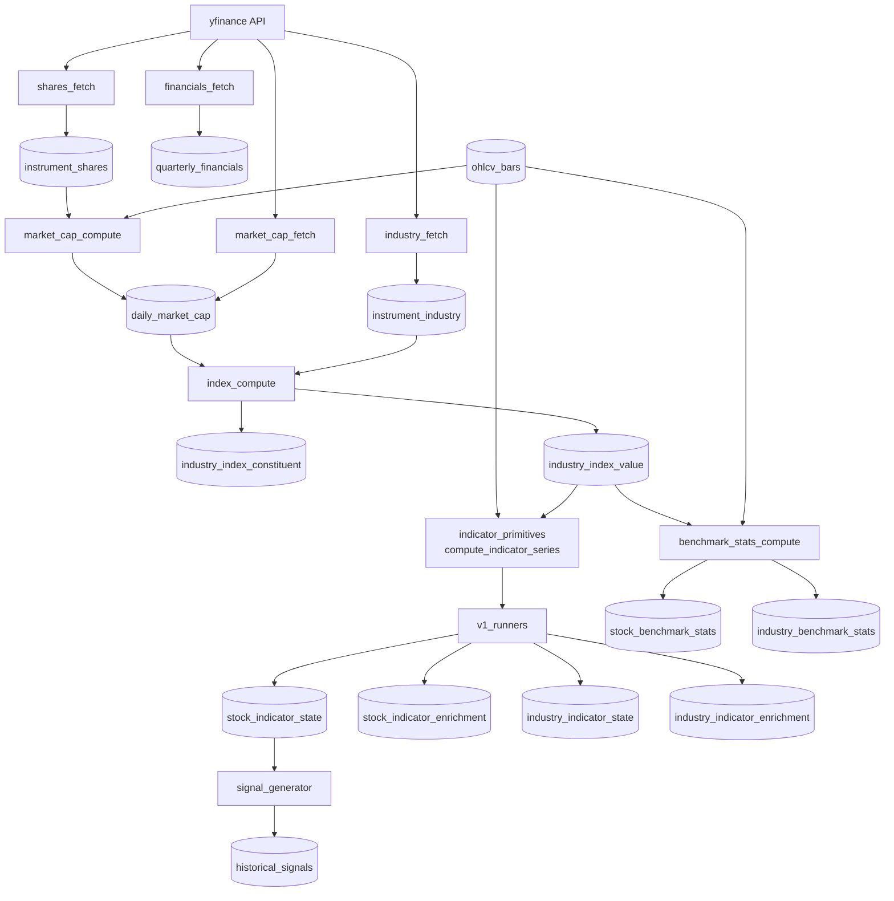

# `trip_ema/fundamentals/` — Phase 1-6 + V1 fundamentals stack

## 1. Role in the larger application

`fundamentals/` is the **biggest package** in the codebase — every
piece of work between raw OHLCV and emitted signal events lives
here:

1. **yfinance metadata fetches** — industry classification, shares
   outstanding, quarterly income statements.
2. **Computed derivative rows** — daily market cap (`shares ×
   close`), industry index values (modified-Laspeyres), benchmark
   stats (rolling α/β/RS/R²).
3. **Indicator state computation** — Pine-faithful EMA/ATR/band
   primitives that produce per-ticker and per-industry indicator
   state rows.
4. **V1 populators** — the unified bulk-write entry points for
   stock and industry state + enrichment tables, called by
   `orchestrator.recompute_market` and `backfill.pipeline`.
5. **Signal generation** — historical replay for the Phase-15
   backtest signal generator.
6. **Phase-6-3 benchmark stats** — rolling 26-week regression of
   each ticker / industry against the NIFTY benchmark; consumed by
   the email composer's BUY-rerank.



## 2. Architecture and constraints

| Rule | Why |
|------|-----|
| **Per-ticker BEFORE per-industry** | Industries reference per-ticker fundamentals (sector / industry classification, daily market cap as constituent weights). Reverse order would mean industries compute against stale per-ticker data |
| **Idempotent per stage** | All writes use UPSERT. Re-running a stage produces the same end-state regardless of how many times it ran |
| **`fundamentals_runs` audit row per phase** | Every runner opens a `RUNNING` row, updates progress, closes with `SUCCESS`/`PARTIAL`/`FAILED` |
| **Resumable via `progress_json`** | Per-ticker checkpointing means a kill -9 mid-run can resume from the last successful ticker, not restart from zero |
| **Yfinance error taxonomy** | Each fetcher distinguishes rate-limit / transient / permanent errors so the runner can apply differentiated retry policy |
| **Pure compute primitives** | `indicator_primitives.compute_indicator_series` takes pandas Series in, returns Series out. No DB, no clock, no I/O |
| **Audit-row phase strings are public-API** | Adding a new phase requires adding to `RUN_PHASES` tuple AND to the migration's CHECK constraint |

## 3. File inventory

```
trip_ema/fundamentals/
├── __init__.py                      Frozen domain dataclasses + constant tuples
├── cli.py                           CLI handlers (per phase) registered by etl/cli.py
├── runners.py                       Phase 1-6 runners (one per phase)
├── eod_pipeline.py                  Phase 4C orchestrator (wires 8 phases)
├── scheduler.py                     Quarterly fundamentals refresh thread
│
├── industry_fetch.py                yfinance → IndustryInfo
├── shares_fetch.py                  yfinance → SharesInfo (current scalar)
├── backfill_shares_fetch.py         yfinance → historical shares time series
├── financials_fetch.py              yfinance → list[QuarterlyFinancial]
├── market_cap_fetch.py              yfinance → historical daily_market_cap (FETCHED)
│
├── market_cap_compute.py            shares × close → daily_market_cap (COMPUTED)
├── index_compute.py                 Phase 4B-2 — constituent picker + value computer
│
├── indicator_primitives.py          Pure pandas Pine-equivalent primitives
├── v1_compute_primitives.py         Helpers wrapping primitives for V1 path
├── v1_runners.py                    V1 populators (populate_stock_*, populate_industry_*)
│
├── signal_compute.py                IndicatorState[] → SignalEvent[] (Phase 6-1)
├── signal_generator.py              Phase 15a historical replay
│
├── benchmark_stats_compute.py       Pure α/β/RS/R² regression
└── benchmark_stats_runners.py       Fetch → compute → write loop for benchmark tables
```

## 4. The `__init__.py` constant tuples and dataclasses

`__init__.py` is the typed surface of the package — frozen
dataclasses + constant tuples for source / status / phase
validation.

### 4.1 Source/status enums (as tuples)

```python
CLASSIFICATION_SOURCES = ("YFINANCE", "GROWW", "MANUAL_OVERRIDE",
                          "NSE_SECTORAL", "INSTRUMENT_TYPE")

SHARES_SOURCES = ("YFINANCE", "YFINANCE_IMPLIED",
                  "NSE_XBRL", "MANUAL_OVERRIDE")

FINANCIAL_SOURCES = ("YFINANCE", "YFINANCE_COMPUTED",
                     "NSE_XBRL", "MANUAL_OVERRIDE")

RUN_PHASES = (
    "industry", "shares", "financials", "market_cap",
    "index_build", "index_value", "index_indicators",
    # V1 clean-pipeline phases (Steps 4-8)
    "v1_stock_indicator_state",
    "v1_stock_indicator_enrichment",
    "v1_industry_index_value",
    "v1_industry_indicator_state",
    "v1_industry_indicator_enrichment",
)

RUN_STATUSES = ("RUNNING", "SUCCESS", "PARTIAL", "FAILED")
```

Why tuples not Enums: the underlying columns are `VARCHAR`, not
`ENUM` types in Postgres. A Python Enum would force translation
at every read/write. Tuples + DB `CHECK` constraints cover the
same ground with less ceremony.

### 4.2 Key dataclasses

| Dataclass | Mirrors table | Carries |
|-----------|---------------|---------|
| `IndustryClassification` | `instrument_industry` | sector, industry, classification_source, etf_long_name (for ETFs) |
| `IndustryOverride` | `industry_override` | Operator-asserted classification override |
| `FundamentalsRun` | `fundamentals_runs` | phase, status, succeeded/failed/skipped counts, progress_json |
| `SharesOutstanding` | `instrument_shares` | shares_outstanding, shares_source, effective_date |
| `QuarterlyFinancial` | `quarterly_financials` | period_end, revenue, operating_income, ebitda, eps, source |
| `DailyMarketCap` | `daily_market_cap` | trade_date, market_cap_rupees, source ('COMPUTED'/'FETCHED') |
| `IndustryIndex` + `IndustryIndexConstituent` | `industry_index*` | One row per (industry, rebalance_date); N constituent rows |
| `IndustryIndexValue` | `industry_index_value` | One row per (industry, trade_date); the index value time series |
| `IndicatorState` (legacy) | `indicator_state` (dropped by 0030) | 38-field wide indicator state — being demolished |
| `SignalEvent` (legacy) | `signal_events` (dropped by 0030) | 8-field signal event — being demolished |
| `PATTERN_LABELS` constant | — | Set of valid `*_pattern_label` strings |

## 5. yfinance fetchers (4 modules)

### 5.1 `industry_fetch.py`

```python
@dataclass(frozen=True, slots=True)
class IndustryInfo:
    sector:            str | None
    industry:          str | None
    instrument_type:   str         # "EQ" / "INDEX" / "ETF" / ...
    etf_long_name:     str | None

def fetch_industry(symbol: str) -> IndustryInfo: ...
```

Reads `yfinance.Ticker(symbol).info` and extracts sector + industry.
For ETFs, also extracts the `longName` field as `etf_long_name`.

**Error taxonomy** (raises one of these so the runner can decide
retry policy):

| Exception | Cause | Retry policy |
|-----------|-------|--------------|
| `YfinanceRateLimitError` | HTTP 429 | Backoff + retry (config `yfinance_request_delay_seconds × N`) |
| `YfinanceTransientError` | Network, 5xx, JSON parse | Retry once per the runner's retry budget |
| `YfinancePermanentError` | 404, delisted, malformed symbol | Mark ticker `parked`, don't retry |
| `YfinanceMissingDataError` | 200 but no `sector`/`industry` field | Caller decides (typically: record None, don't retry) |

### 5.2 `shares_fetch.py` and `backfill_shares_fetch.py`

```python
@dataclass(frozen=True, slots=True)
class SharesInfo:
    shares_outstanding:  int
    shares_source:       str       # "YFINANCE" / "YFINANCE_IMPLIED"
    effective_date:      date      # today (for current scalar)

def fetch_shares(symbol: str) -> SharesInfo
```

`fetch_shares` returns the **current scalar** shares outstanding.
Uses `sharesOutstanding` if present; falls back to
`impliedSharesOutstanding` (back-derived from market cap ÷ price)
with `shares_source="YFINANCE_IMPLIED"` and a lower trust level.

`backfill_shares_fetch.fetch_historical_shares(symbol, start) ->
list[SharesPoint]` returns the time series via
`yfinance.Ticker(symbol).get_shares_full(start=...)` — one row per
filing date. Distinct from `shares_fetch` because the time series
is needed for backfilling market cap before our local coverage
begins.

### 5.3 `financials_fetch.py`

```python
@dataclass(frozen=True, slots=True)
class QuarterlyFinancial:
    period_end:         date
    revenue:            int | None
    operating_income:   int | None
    ebitda:             int | None
    net_income:         int | None
    eps:                float | None
    source:             str       # "YFINANCE"

def fetch_financials(symbol: str) -> list[QuarterlyFinancial]: ...
```

Reads `yfinance.Ticker(symbol).quarterly_income_stmt`, parses the
DataFrame, and returns one dataclass per quarter (typically last 4
quarters from yfinance). Yields `[]` if quarterly data is not
available.

### 5.4 `market_cap_fetch.py`

For dates **before** our local `instrument_shares` coverage begins,
yfinance has historical market_cap data we can use. Fetches one
row per trade_date with `source="FETCHED"`.

For dates **within** our local coverage, `market_cap_compute.py`
does shares × close (more accurate, no API call).

## 6. Compute modules

### 6.1 `market_cap_compute.py`

```python
def populate_daily_market_cap_for_ticker(
    db_engine, ticker_id, *,
    from_date: date | None = None,
) -> dict:
```

For each daily bar in `ohlcv_bars` for `ticker_id`:

1. Find the `instrument_shares` row whose `effective_date` is on
   or before this bar's `bar_timestamp` (most recent applicable).
2. Compute `market_cap_rupees = close × shares_outstanding`.
3. UPSERT into `daily_market_cap` with `source='COMPUTED'`.

If `from_date` is set, only re-process dates from there onward —
incremental refresh.

Returns `{succeeded, failed, skipped}` counter dict.

### 6.2 `index_compute.py`

The two pure functions:

```python
def pick_constituents(
    industry_tickers: list[TickerWithCap],
    top_n: int = 50,
) -> list[ConstituentPick]:
    """Top-N by market cap; ties broken by ticker_id ascending."""

def compute_modified_laspeyres_value(
    constituents: list[ConstituentPick],
    bars_by_ticker: dict[int, list[BarSnapshot]],
    base_value: float = 100.0,
) -> list[IndexValueRow]:
    """Modified-Laspeyres: weight by (shares × base_price), price-ratio at each date."""
```

**Modified-Laspeyres** is the construction:

```
IIV(t) = base_value × sum_i(price_i(t) × shares_i(base) / sum_j(price_j(base) × shares_j(base)))
```

Captures total return at the index level. The runner wires these
two functions into:

- **Rebalance loop** — once per quarter, on a fixed `rebalance_date`,
  call `pick_constituents` to refresh the top-N list.
- **Value-backfill loop** — for each trade_date between rebalances,
  call `compute_modified_laspeyres_value` to write one
  `industry_index_value` row per industry.

### 6.3 `indicator_primitives.py`

The biggest pure-compute module in the package. Wraps
`indicators/vw_ema.py` and `indicators/atr.py` in a pandas-
vectorised pipeline.

```python
@dataclass(frozen=True, slots=True)
class EngineParams:
    """Pre-resolved EMA/ATR/band params for compute_indicator_series."""
    med:      VWEMAParams
    long:     VWEMAParams
    longest:  VWEMAParams
    atr_length:     int
    inner_mult:     float
    mid_mult:       float
    outer_mult:     float
    volume_sma_length: int

    @classmethod
    def from_domain(cls, params: IndicatorParams) -> EngineParams: ...

@dataclass(frozen=True, slots=True)
class IndicatorSeries:
    emas:   EMASeries   # .med, .long, .longest
    atr:    pd.Series
    bands:  BandSeries  # .upper_inner, .lower_inner, .upper_mid, .lower_mid, .upper_outer, .lower_outer

def compute_indicator_series(
    closes:   pd.Series,
    volumes:  pd.Series,
    highs:    pd.Series,
    lows:     pd.Series,
    *,
    params:   EngineParams,
    synthetic_atr_for_index: bool = False,
) -> IndicatorSeries: ...
```

**The vectorised pipeline:**

1. **EMAs.** Three calls to `VolumeWeightedTripleEMA.compute_series(...)`
   over the full close+volume vectors. Returns 3 NumPy arrays.
2. **ATR.** One call to `atr.compute_series(...)` over the
   high/low/close vectors. Returns a NumPy array.
   - `synthetic_atr_for_index=False` (default) — real TR using
     high/low/prev_close.
   - `synthetic_atr_for_index=True` — TR computed as the absolute
     daily change `|close - prev_close|`. Industry IIV doesn't have
     a real high/low, so we synthesize.
3. **Bands.** Vectorised `compute_bands` over the 4 series.
4. Wrap in `IndicatorSeries` and return.

Used by:

- `v1_runners.populate_stock_indicator_state_for_ticker` — per
  ticker, one full call per recompute.
- `signal_generator.py` — same shape for historical replay.

### 6.4 `signal_compute.py` (Phase 6-1)

```python
def emit_signal_events_from_states(
    states: list[IndicatorState],
) -> list[SignalEvent]:
    """Walk time-ordered states, emit one SignalEvent per regime change."""
```

Pure: takes a list of legacy `IndicatorState` rows (sorted by
`trade_date`), walks adjacent pairs, emits a `SignalEvent` for each
display_regime transition. Same precedence rules as
`orchestrator/derive_signals.py::_classify_regime_change`.

**Difference from V1 derive**: signal_compute walks the **full
history**; derive looks at the latest **two** state rows.
signal_compute is for backfill / backtest; derive is for live.

### 6.5 `signal_generator.py` (Phase 15a)

The Phase-15 backtest entry point. For one exchange and one
timeframe:

```python
def generate_signals_for_exchange(
    db_engine, config, exchange, timeframe, *,
    as_of: date | None = None,
) -> GenerateResult:
```

1. List active tickers for `exchange`.
2. For each ticker:
   - Pull all bars from `ohlcv_bars`.
   - Resolve params via `exchange_overrides.resolve_indicator_params(config, exchange, timeframe)`.
   - Replay through a fresh `TickerEngine` (legacy stateful) — every
     bar generates a `BarState`.
   - Detect signals via the legacy `generate_signal` (PositionState-
     threaded).
   - Collect non-`NO_CHANGE` events into a per-ticker list.
3. Merge per-ticker results into one JSON per exchange written to
   `var/backtest/{exchange}_{timeframe}_{as_of}.json`.

Used by operators for "would my new EMA tuning have produced fewer
false BUYs on the last 5 years of NSE data?" The output JSON is
diff-able against last run's output.

Resumable via `signal_backtest_runs`: per-(exchange, ticker_id,
timeframe) `computed_through_date` checkpoint.

## 7. V1 runners (`v1_runners.py`) — the production hot path

The V1 path **bypasses** the legacy `runners.py` for indicator
state. The orchestrator's recompute_market and the backfill
pipeline both call into `v1_runners.py` for the unified populators.

### 7.1 Per-ticker populators

```python
def populate_stock_indicator_state_for_ticker(
    db_engine, ticker_id, timeframe="1W", *,
    mode: Literal["incremental", "full"] = "incremental",
    n_weeks_to_upsert: int | None = None,
) -> dict
```

`mode="incremental"` (live cycle): rewrite the latest
`n_weeks_to_upsert` weekly bars.

`mode="full"` (backfill): rewrite every weekly bar from the ticker's
first daily bar through the most recent.

**Algorithm:**

1. Pull daily bars from `ohlcv_bars`.
2. `daily_to_weekly` aggregation with `tz='Asia/Kolkata'`.
3. `compute_indicator_series(closes, volumes, highs, lows,
   params)`.
4. Walk weekly bars; for each bar compute regime via
   `regime.compute_regime`; UPSERT into `stock_indicator_state`.
5. In `incremental` mode, also UPDATE the `SignalCache` (legacy
   wiring).

```python
def populate_stock_indicator_enrichment_for_ticker(...) -> dict
```

Reads the state rows this same cycle wrote; computes the 23
enrichment fields (pattern labels, turn flags, distances, mean
distances); UPSERT into `stock_indicator_enrichment`.

```python
def populate_industry_indicator_state_for_industry(...) -> dict
def populate_industry_indicator_enrichment_for_industry(...) -> dict
```

Industry-side mirrors. Read from `industry_index_value`, aggregate
IIV daily rows to weekly with `tz='Asia/Kolkata'`, compute state +
enrichment per industry.

`populate_industry_indicator_state_for_industry` passes
`synthetic_atr_for_index=True` to `compute_indicator_series`
because IIV doesn't have real high/low.

### 7.2 Exchange / all-industry bulk wrappers

```python
def populate_stock_indicator_state_for_exchange(
    db_engine, exchange, timeframe, *,
    mode, n_weeks_to_upsert,
) -> {succeeded, failed, skipped}

def populate_stock_indicator_enrichment_for_exchange(
    db_engine, exchange, timeframe, *,
    mode, n_weeks_to_upsert,
) -> {succeeded, failed, skipped}

def populate_industry_index_value_for_all(
    db_engine, *,
    from_date, to_date,
) -> {succeeded, failed, skipped}

def populate_industry_indicator_state_for_all(
    db_engine, *,
    mode, n_weeks_to_upsert,
) -> {succeeded, failed, skipped}

def populate_industry_indicator_enrichment_for_all(
    db_engine, *,
    mode, n_weeks_to_upsert,
) -> {succeeded, failed, skipped}
```

These are the entry points `recompute_market` calls per stage. Each
returns a report dict the orchestrator counts into its
`RecomputeMarketResult`.

**Per-ticker fan-out**: uses `ThreadPoolExecutor(max_workers=4)`
internally. Each worker holds its own connection from the pool.
With 2,500 tickers × ~5 ms per ticker, the wall clock is dominated
by the SQL round-trip, not the compute.

## 8. Phase 6-3 benchmark stats

Separately documented in `notifications/README.md` — the compute
module is `benchmark_stats_compute.py` but the table-writing
runner is `benchmark_stats_runners.py` here.

### 8.1 `benchmark_stats_runners.populate_stock_benchmark_stats_for_all(db_engine, *, as_of)`

For each active ticker:

1. Pull last 26+1 weekly closes via `daily_to_weekly`.
2. Pull NIFTY 50 (benchmark) closes for the same range.
3. `benchmark_stats_compute.regress(stock_returns, bench_returns)` →
   α, β, R²; `relative_strength(...)` → RS.
4. UPSERT into `stock_benchmark_stats`.

Industry side mirrors.

**Not in the live cycle.** Run as a daily/weekly cron from a
separate GUI button. The reranker reads what the last run wrote.

## 9. The legacy `runners.py` (Phase 1-6 EoD pipeline)

`runners.py` is the older per-phase runner registry used by the
**non-V1** EoD pipeline. Each function follows a common shape:

```python
def run_industry_refresh(
    db_engine, config, *,
    exchange,
    dry_run=False,
    progress_cb=None,
) -> RunResult:
    # 1. Open fundamentals_runs row with status='RUNNING'
    # 2. List active tickers
    # 3. For each ticker, with retry policy:
    #    - fetch_industry(symbol)
    #    - InstrumentIndustryRepository.upsert(row)
    #    - Update progress_json checkpoint
    # 4. Close fundamentals_runs row with final status
```

Eight runners exist:

| Phase | Runner | Per-ticker / Per-industry |
|-------|--------|---------------------------|
| 1 | `run_industry_refresh` | Per-ticker |
| 2 | `run_shares_refresh` | Per-ticker |
| 3 | `run_financials_refresh` | Per-ticker |
| 4 | `run_market_cap_compute` | Per-ticker |
| 5 | `run_index_build` | Per-industry |
| 6 | `run_index_values` | Per-industry |
| 7 | `run_indicator_state` | Per-ticker + per-industry |
| 8 | `run_signal_compute` | Per-ticker + per-industry |

The **`eod_pipeline.run_eod_pipeline(...)`** orchestrator wires all 8
together, enforcing the per-ticker-before-per-industry ordering.

V1 superseded phases 7 and 8 with `v1_runners.py`; phases 1-6 remain
in their legacy form because they cover fundamentals fetches that
V1 didn't touch.

## 10. CLI dispatch (`cli.py`)

`cli.py` holds the CLI command handlers, one per phase. They're
**imported and registered** by `trip_ema/etl/cli.py` (which stays a
thin dispatcher).

Convention: every handler is `(args, config) -> int` returning an
exit code (0 = success, 1 = partial, 2 = full failure).

```python
def cmd_refresh_industry(args, config) -> int:
    db_engine = create_engine_from_config(config, role="etl")
    result = run_industry_refresh(
        db_engine, config,
        exchange=args.exchange,
        dry_run=args.dry_run,
        progress_cb=_print_progress,
    )
    print(f"refresh-industry: succeeded={result.succeeded} failed={result.failed}")
    return 0 if result.failed == 0 else 1
```

Each handler:

- Builds an Engine with `role="etl"` (so DDL-less ETL credentials).
- Calls the matching runner.
- Prints a one-line summary.
- Maps the result's success/failure to an exit code.

## 11. The quarterly scheduler (`scheduler.py`)

```python
class FundamentalsScheduler:
    def start(self) -> None
    def stop(self, timeout: float = 5) -> None
```

A background thread that wakes once per day, checks the calendar,
and fires `run_industry_refresh()` when the filing window opens
**AND** the last SUCCESS row in `fundamentals_runs` is stale (older
than the configured threshold).

The check logic:

```python
now = datetime.now(_IST)
if not is_in_filing_window(now):
    return
last_run = FundamentalsRunRepository(conn).find_latest(
    phase="industry", exchange=exchange, status="SUCCESS",
)
if last_run and last_run.completed_at >= now - threshold:
    return  # recent enough
run_industry_refresh(...)
```

Filing windows for India:

| Quarter | Window opens | Window closes |
|---------|--------------|---------------|
| Q1 (Apr-Jun) | Aug 14 | Sep 14 |
| Q2 (Jul-Sep) | Nov 14 | Dec 14 |
| Q3 (Oct-Dec) | Feb 14 | Mar 14 |
| Q4 (Jan-Mar) | May 30 | Jun 30 |

Other fundamentals phases (shares, financials, market_cap) have
similar quarterly cadences; the scheduler handles each.

## 12. Resumability and checkpointing

Every runner writes `progress_json` to `fundamentals_runs` after
each successful per-ticker step:

```json
{
  "completed_ticker_ids": [1, 2, 3, ..., 1247],
  "current_position": 1248,
  "total": 2667
}
```

On startup, if the runner finds an unfinished `fundamentals_runs`
row (status `RUNNING`), it reads `completed_ticker_ids`, computes
the difference against the active set, and **resumes from where it
left off**. Net effect: a kill -9 mid-run loses at most the
in-flight ticker's work.

The V1 runners (`v1_runners.py`) don't use this mechanism — they're
fast enough that full re-run is acceptable (5-10 minutes vs.
fundamentals' multi-hour). V1 still writes a `fundamentals_run`
audit row but doesn't checkpoint mid-run.

## 13. Data flow walkthrough — one V1 cycle stage 1

```
orchestrator.recompute_market stage 1: stock_state
    │
    ▼
populate_stock_indicator_state_for_exchange(
    db_engine, exchange="NSE", timeframe="1W",
    mode="incremental", n_weeks_to_upsert=2,
)
    │
    │ list active NSE tickers → ~2,500 ticker_ids
    │ ThreadPoolExecutor(max_workers=4)
    │
    ▼ per ticker:
populate_stock_indicator_state_for_ticker(db_engine, tid, ...)
    │
    │ open transaction
    │ pull all daily bars from ohlcv_bars
    │ daily_to_weekly(bars, tz="Asia/Kolkata") → weekly bars
    │
    │ params = IndicatorParams.from_domain(config.to_indicator_params())
    │ series = compute_indicator_series(closes, volumes, highs, lows, params)
    │
    │ for each weekly bar (last n_weeks_to_upsert):
    │     - extract bar's emas, atr, bands
    │     - regime = compute_regime(prev_regime, prev_close, prev_lower_env,
    │                               prev_upper_env, BarInputs(...))
    │     - state = StockIndicatorState(
    │           ticker_id=tid, timeframe="1W",
    │           bar_timestamp=bar.timestamp,
    │           med_ema, long_ema, longest_ema,
    │           atr, upper_inner_band, lower_inner_band, ...,
    │           display_regime=int(regime),
    │           computed_at=NOW())
    │     - StockIndicatorStateRepository.upsert(state)
    │ commit transaction
    ▼
return {ticker_id: report}

orchestrator aggregates → stock_state = (succeeded, failed, skipped)
```

Total wall for 2,500 tickers, 2 weeks each: ~5-7 seconds on the
NUC.

## 14. Concurrency

| Layer | Concurrency |
|-------|-------------|
| `runners.py` per-ticker loop | Sequential within a phase; per-ticker retries with backoff for yfinance |
| `v1_runners.py` per-ticker | `ThreadPoolExecutor(max_workers=4)` per exchange-level entry |
| `index_compute` | Sequential per industry |
| `signal_generator.py` | Sequential per ticker (per-ticker engine state machine) |
| Pure compute primitives (`indicator_primitives`, `signal_compute`) | Lock-free; safe to call from any thread |

DB pool limit: 15 connections per engine. V1 max_workers=4 leaves
headroom for other consumers.

## 15. Failure modes

| Failure | Behaviour | Recovery |
|---------|-----------|----------|
| yfinance 429 (rate limit) | Fetcher raises `YfinanceRateLimitError`; runner sleeps + retries up to N times | Configured retry policy; runner falls through to next ticker if exhausted |
| yfinance 404 (delisted) | `YfinancePermanentError`; runner marks ticker `parked` | Ticker excluded from future runs until manual unpark |
| yfinance times out | `YfinanceTransientError`; one retry; then parked | Same |
| `instrument_shares` missing for a bar | `market_cap_compute` skips that bar | Later `compute-market-cap` re-run with full backfill |
| Industry constituent set drift | Old constituents stay until rebalance | Quarterly rebalance refreshes |
| V1 stage 1 per-ticker error (DB conflict etc.) | Ticker recorded in `failed` list; populator returns and orchestrator continues | Next tick retries |
| V1 stage 1 infrastructure error (pool exhausted) | Exception propagates → orchestrator catches at stage level → halts cycle | Operator investigates pool sizing |
| `compute_indicator_series` NaN sequence | Warmup; `compute_regime` returns `NEUTRAL`; persisted | None — by design |

## 16. Testing

`tests/fundamentals/`:

| File | Coverage |
|------|----------|
| `test_industry_fetch.py` | Error taxonomy (rate-limit, transient, permanent, missing), ETF path |
| `test_shares_fetch.py` | Both `sharesOutstanding` and `impliedSharesOutstanding` fallback |
| `test_market_cap_compute.py` | Shares × close arithmetic, gap handling, COMPUTED vs FETCHED |
| `test_index_compute.py` | Constituent picker (top-N, tie-break), Laspeyres value compute |
| `test_indicator_primitives.py` | Pine parity for synthetic + real series |
| `test_v1_runners.py` | populate_*_for_ticker happy + skipped, mode=full vs incremental, n_weeks_to_upsert clipping |
| `test_runners.py` | Phase 1-6 runners — full happy paths against `postgres_engine` |
| `test_eod_pipeline.py` | 8-phase wiring, per-ticker-before-per-industry ordering, --skip-tickers |
| `test_scheduler.py` | Filing-window detection, stale-check logic |
| `test_signal_generator.py` | Historical replay matches `generate_signal` bar-by-bar, JSON merge, resumability |
| `test_benchmark_stats_compute.py` | α/β/R² against numpy.polyfit reference |

## 17. Common pitfalls

1. **Per-ticker BEFORE per-industry.** Don't reorder stages.
   Industries reference per-ticker state (constituent picks
   need market cap; index values need constituent picks).
2. **`compute_indicator_series` returns NaN during warmup.**
   Don't compute regime on a NaN row — the regime classifier
   handles it (returns NEUTRAL) but emitting a state row with NaN
   bands is wasted I/O.
3. **`synthetic_atr_for_index=True` for industry IIV.** IIV is a
   single time series, no real high/low. Forgetting this gives
   garbage ATR.
4. **`mode='full'` rewrites the whole history.** Don't use it in
   the live cycle — `n_weeks_to_upsert=2` is the live cadence.
5. **`fundamentals_runs.phase` strings are part of the public API.**
   The CHECK constraint enforces; the constant tuples mirror it.
   Adding a phase requires both updates.
6. **The legacy `IndicatorState` (38-field) is being demolished.**
   The wide dataclass + repo live on but the table is gone (0030).
   V1 callers use `StockIndicatorState` / `IndustryIndicatorState`.
7. **yfinance `sharesOutstanding` is reset across `Ticker(...)`
   calls.** Don't rely on caching the value across cycles —
   it changes when companies file new ownership reports. The
   shares-fetch refresh runs quarterly.
8. **Market cap for ETFs is meaningless via shares × close.** ETFs
   don't have a fixed share count — the value updates throughout
   the day. `market_cap_compute` excludes `instrument_type='ETF'`.

## 18. Extension paths

- **A new fetcher.** Add `xxx_fetch.py` with the same error
  taxonomy. Add a runner in `runners.py`. Add a CLI handler in
  `cli.py`. Register in `etl/cli.py`. Add to `RUN_PHASES` tuple +
  Alembic CHECK constraint update.
- **A new computed table.** Add a `xxx_compute.py` if pure; a
  `xxx_runner.py` if it needs DB iteration. Wire into eod_pipeline.
- **A new indicator parameter.** Add to `IndicatorParams` in
  `domain.state`, add to `EngineParams.from_domain`, expose in
  `EMAConfig`/`ATRConfig`. The compute primitives consume via
  `EngineParams`.
- **NSE XBRL fundamentals.** Adapter that reads NSE-published XBRL
  filings → `SharesSource.NSE_XBRL` rows. Skips yfinance for
  Indian-listed equities. Higher-trust data source.

## 19. Related packages

- `trip_ema/domain/` — all the frozen dataclasses (`StockIndicatorState`,
  `IndustryIndicatorState`, `OHLCVBar`, `IndicatorParams`, etc.).
- `trip_ema/indicators/` — provides `VolumeWeightedTripleEMA`,
  `ATR`, `compute_bands`, `daily_to_weekly`.
- `trip_ema/regime/` — `compute_regime` consumed in V1 runners.
- `trip_ema/persistence/` — every repo this package reads/writes.
- `trip_ema/etl/cli.py` — thin dispatcher; imports + registers
  this package's CLI handlers.
- `trip_ema/etl/runner.py` — overlapping responsibility for
  bars-side ETL; this package handles fundamentals + indicator
  state.
- `trip_ema/orchestrator/recompute_market.py` — primary consumer
  of `v1_runners.py` in the live cycle.
- `trip_ema/backfill/pipeline.py` — primary consumer in backfill.
- `trip_ema/notifications/benchmark_rerank.py` — reads
  `stock_benchmark_stats` written by `benchmark_stats_runners`.
- `trip_ema/cache/signal_cache.py` — updated by `v1_runners` in
  incremental mode.
