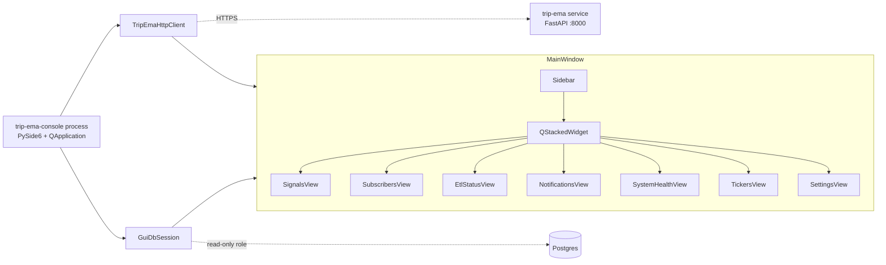

# `trip_ema/gui/` — PySide6 desktop operator console

## 1. Role in the larger application

`gui/` is the **`trip-ema-console` application** — a PySide6
desktop GUI that operators use to monitor and control the running
service. Two communication paths:

1. **HTTP → service.** Calls `trip-ema` HTTP endpoints (admin
   actions, signal reads, health checks) via `TripEmaHttpClient`.
2. **Read-only Postgres.** Direct DB connection (role: `gui`) for
   table-view panels that would be slow to round-trip via HTTP
   (subscribers list, signal history, ticker browse).

The GUI is a **separate process** from the service (ARCHITECTURE
invariant 3.14). Two reasons:

- The service must keep running if the GUI crashes.
- Operators can run the GUI on a workstation; the service runs on
  a NUC. Different machines, different lifecycles.



## 2. Architecture and constraints

| Rule | Why |
|------|-----|
| **Separate process from service** | ARCHITECTURE 3.14. Lifecycles must be independent |
| **All DB queries via `db.py` (role=gui)** | Read-only role minimises blast radius of any GUI bug. The role has `SELECT` everywhere; `INSERT/UPDATE/DELETE` only on `subscribers`/`subscriptions`/`industry_overrides` (operator data) |
| **All work off the Qt main thread** | `workers.submit(...)` runs callables on `QThreadPool` and emits signals back. GUI never blocks waiting for HTTP or SQL |
| **Pure helpers (no Qt) separated from view code** | `signals_helpers.py`, `csv_export.py`, etc. — unit-testable without `QApplication` |
| **Read-only mode auto-detected** | When `TRIP_EMA_ADMIN_TOKEN` env var is unset, every write button is disabled with a tooltip. Analyst seats. Ops seats set the token |
| **User preferences via `QSettings`** | Splitter sizes, last-selected exchange, last-selected ticker, etc. survive restarts |
| **Per-view worker drain on teardown** | `tests/gui/conftest.py` enforces deferred-deletion + queued worker drain — catches segfault-on-shutdown patterns that PySide6's C++ destructor order doesn't handle |
| **Deferred installer build** | `gui_installer.spec` (PyInstaller) builds a standalone Linux x86_64 binary. Windows + macOS deferred |

## 3. File inventory

```
trip_ema/gui/
├── __init__.py
├── console.py                       Entry point — QApplication + splash + main_window
├── main_window.py                   QMainWindow — sidebar + QStackedWidget
│
├── db.py                            GuiDbSession (role=gui)
├── queries.py                       Pure SQL functions returning typed records
├── http_client.py                   TripEmaHttpClient — requests wrapper
│
├── workers.py                       QThreadPool helpers + deferred-deletion
├── csv_export.py                    export_rows_to_csv + timestamped_filename
├── _format_mcap.py                  format_mcap_cr — Indian-numbering for market cap
│
├── about_dialog.py                  Help → About
├── chart_widget.py                  ChartWidget (MAIN / INDUSTRY / MINI modes)
├── backtest_engine.py               Phase 15c backtest harness
├── benchmark_rerank_client.py       Shim re-exporting from notifications/
├── signals_helpers.py               Pure helpers for SignalsView
│
└── views/
    ├── README.md
    ├── __init__.py
    │
    ├── signals.py                   Tab: Signals viewer
    ├── subscribers.py               Tab: Subscribers CRUD
    ├── etl_status.py                Tab: ETL Status + Backfill panel
    ├── notifications.py             Tab: Notification log + DLQ
    ├── system_health.py             Tab: 8-card health dashboard
    ├── tickers.py                   Tab: Ticker browser
    ├── settings.py                  Tab: Settings (token, base URL, exchange)
    │
    ├── industry_panel.py            Signals tab — left panel
    ├── exchange_state_panel.py      ETL Status — exchange status panel
    ├── signal_generation_panel.py   Signals tab — generation panel below chart
    │
    ├── backtest_dialog.py           Non-modal backtest comparator
    ├── market_trend_dialog.py       90-day trend chart popup
    │
    └── widgets/
        ├── README.md
        └── ...                      Reusable widgets (exchange_picker, backfill_dialog, ...)
```

## 4. `console.py` — entry point

```python
def main(argv=None) -> int:
    app = QApplication(sys.argv if argv is None else argv)
    app.setApplicationName("trip-ema-console")
    app.setOrganizationName("trip_ema")
    app.setStyle("Fusion")    # consistent look across platforms

    splash = QSplashScreen(...)
    splash.show()
    app.processEvents()

    settings = QSettings()
    http_client = TripEmaHttpClient(
        base_url=settings.value("http/base_url", "http://localhost:8000"),
        admin_token=os.environ.get("TRIP_EMA_ADMIN_TOKEN"),
    )
    db_session = GuiDbSession.from_config(load_config(...))

    main_window = MainWindow(http_client=http_client, db_session=db_session)
    main_window.show()
    splash.finish(main_window)

    return app.exec()
```

`QApplication` is built first so any subsequent `QWidget`
construction has a running event loop. `QSettings` persists splitter
sizes, last-selected tab, last-active exchange — restored on next
launch.

## 5. `main_window.py` — the shell

```python
class MainWindow(QMainWindow):
    def __init__(self, *, http_client, db_session):
        super().__init__()
        self._http = http_client
        self._db = db_session

        # Sidebar
        self._sidebar = QListWidget()
        self._sidebar.addItem("Signals")
        self._sidebar.addItem("Tickers")
        self._sidebar.addItem("ETL Status")
        self._sidebar.addItem("Notifications")
        self._sidebar.addItem("Subscribers")
        self._sidebar.addItem("System Health")
        self._sidebar.addItem("Settings")

        # Stacked view
        self._stack = QStackedWidget()
        self._stack.addWidget(SignalsView(http=http_client, db=db_session))
        self._stack.addWidget(TickersView(...))
        # ... 5 more views

        self._sidebar.currentRowChanged.connect(self._stack.setCurrentIndex)

        # Layout
        central = QWidget()
        central.setLayout(QHBoxLayout(...))
        central.layout().addWidget(self._sidebar, stretch=0)
        central.layout().addWidget(self._stack, stretch=1)
        self.setCentralWidget(central)

        # Menu
        self._build_menu()
```

7 tabs in fixed order. Sidebar selection drives the stacked-widget
index. Help → About menu opens the About dialog.

**State persistence:** `QSettings.setValue("ui/last_tab",
self._sidebar.currentRow())` is written on tab change; restored at
construction. Same pattern for window size, splitter positions,
last-selected exchange in the exchange-picker.

## 6. `http_client.py` — `TripEmaHttpClient`

```python
class TripEmaHttpClient:
    def __init__(self, base_url: str, admin_token: str | None = None):
        self._base_url = base_url.rstrip("/")
        self._admin_token = admin_token
        self._session = requests.Session()

    def get(self, path: str, **kw) -> dict | list:
        url = f"{self._base_url}{path}"
        resp = self._session.get(url, timeout=30, **kw)
        return self._handle(resp)

    def post(self, path: str, json: dict | None = None) -> dict:
        headers = {}
        if self._admin_token:
            headers["Authorization"] = f"Bearer {self._admin_token}"
        resp = self._session.post(...)
        return self._handle(resp)

    def _handle(self, resp):
        if resp.status_code == 401:
            raise UnauthorizedError("Bearer token missing or invalid")
        if resp.status_code == 503:
            raise ServiceUnavailableError(resp.json().get("detail"))
        if 400 <= resp.status_code < 500:
            raise ClientError(resp.json().get("detail"))
        if resp.status_code >= 500:
            raise ServerError(...)
        return resp.json()
```

**Typed exception hierarchy** — views catch `UnauthorizedError`
to show "admin token missing" banner, `ServerError` for generic
failure, etc. No raw `HTTPError` propagation.

**`is_admin_enabled` property** — `True` when `admin_token` is set.
Views consult this before enabling write buttons.

## 7. `db.py` — read-only Postgres for table views

```python
class GuiDbSession:
    @classmethod
    def from_config(cls, config: Config) -> GuiDbSession:
        engine = create_engine_from_config(config, role="gui")
        return cls(engine)

    def __init__(self, engine: Engine):
        self._engine = engine

    @contextmanager
    def connection(self) -> Iterator[Connection]:
        with self._engine.connect() as conn:
            yield conn
```

The `gui` role has `SELECT` on every read-eligible table. Writes
are explicitly granted only on `subscribers`, `subscriptions`,
`industry_overrides` (operator data) — and only when admin token
is set.

## 8. `queries.py` — pure SQL functions

```python
def fetch_recent_signals(
    conn: Connection,
    *,
    exchange: str | None,
    limit: int,
) -> list[RecentSignalRow]:
    """SELECT recent signals across current + historical, joined with tickers."""

def fetch_subscribers(conn) -> list[SubscriberRow]: ...

def fetch_signal_history_for_ticker(
    conn, ticker_id: int, *, limit: int,
) -> list[HistoricalSignalRow]: ...

def fetch_market_overview_trend(
    conn, *, exchange, from_date, to_date,
) -> list[MarketOverviewRow]: ...

def fetch_ticker_browse_rows(
    conn, *,
    exchange, signal_filter, regime_filter, search_query,
) -> list[TickerBrowseRow]: ...
```

All functions:
- Take a `Connection` (caller manages the lifecycle).
- Return frozen dataclasses (`@dataclass(frozen=True, slots=True)`).
- No Qt imports — pure Python + SQLAlchemy.

Frozen dataclasses are pickle-safe so they can be passed across the
Qt thread boundary in `workers.submit` callbacks.

## 9. `workers.py` — off-thread work

### 9.1 `submit(callable, *args, **kwargs) -> Worker`

```python
class Worker(QObject):
    finished = Signal(object)    # emitted with the callable's return value
    failed = Signal(Exception)   # emitted on raise

def submit(callable, *args, **kwargs) -> Worker:
    worker = Worker()
    runnable = WorkerRunnable(worker, callable, args, kwargs)
    QThreadPool.globalInstance().start(runnable)
    return worker

class WorkerRunnable(QRunnable):
    def run(self):
        try:
            result = self._callable(*self._args, **self._kwargs)
            self._worker.finished.emit(result)
        except Exception as e:
            self._worker.failed.emit(e)
```

**Pattern at view sites:**

```python
def _on_refresh_clicked(self):
    self._set_loading(True)
    worker = workers.submit(self._db.connection_call,
                            queries.fetch_recent_signals,
                            exchange=self._exchange,
                            limit=200)
    worker.finished.connect(self._on_rows_loaded)
    worker.failed.connect(self._on_load_failed)

@Slot(object)
def _on_rows_loaded(self, rows):
    self._set_loading(False)
    self._populate_table(rows)

@Slot(Exception)
def _on_load_failed(self, err):
    self._set_loading(False)
    self._show_error(str(err))
```

The `Signal.connect(...)` on the GUI main thread runs the slot on
the main thread (Qt's queued connection across threads). The
callable runs on the QThreadPool thread.

### 9.2 Deferred-deletion primitives

```python
def schedule_deferred_delete(obj: QObject) -> None:
    """Queue obj.deleteLater() on the next main-loop turn.
    Safer than direct deleteLater() when the caller might still be
    in a signal handler the object's children depend on."""

def drain_pending_deletions(timeout_ms: int = 500) -> None:
    """Spin the event loop until all scheduled deletions complete."""
```

`tests/gui/conftest.py` uses `drain_pending_deletions` between tests
to prevent C++ destructor race conditions. Production code uses
`schedule_deferred_delete` when destroying widgets that are still
emitting signals.

## 10. The 7 views

### 10.1 SignalsView (`views/signals.py`)

The headline view. Layout:

```
+--------------------------------------------------------+
| Top bar: Exchange picker + Ticker picker + Refresh    |
+--------------------------------------------------------+
| IndustryPanel (55%)        | Main ChartWidget (45%)   |
|                            |                          |
|  Industry list             |  Weekly bars             |
|  4x3 mini chart grid       |  EMA ribbon              |
|  Last-5-signals panel      |  Band envelope           |
|                            |  Signal markers          |
+--------------------------------------------------------+
| SignalGenerationPanel: Run backtest | Compare runs    |
+--------------------------------------------------------+
```

- **IndustryPanel** (left): industry list, 4×3 mini-chart grid for
  the top-12 by market cap in the selected industry, last-5-signals
  panel.
- **Main ChartWidget** (right): the full chart for the selected
  ticker, rendered via the same code path as the mini grid.
- **SignalGenerationPanel** (below): Phase 15c backtest controls.

NIFTY 50 fallback: when an industry has no constituent with
sufficient history, falls back to `NIFTYBEES` (NSE ETF tracking
NIFTY 50, 4300 bars from 2009).

### 10.2 TickersView (`views/tickers.py`)

Browsable table of all tickers. Filters: exchange, signal type,
regime. Search by symbol.

Row backgrounds (`Qt.BackgroundRole`):

| Signal | Background |
|--------|-----------|
| BUY | light green |
| SELL | light red |
| EXIT_FROM_BUY | light blue |
| EXIT_FROM_SELL | light blue |

`TickerSortFilterProxy` floats signalled rows to the top so the
operator's eye lands on actionable rows first.

Detail panel: most recent signal events for the selected ticker.
Timestamps shown as `computed_at` (IST) — NOT `bar_timestamp`. The
distinction matters for intra-week provisional bars: `bar_timestamp`
is Monday for the whole week; `computed_at` is the actual moment
the signal was derived (e.g. "Thursday 14:30 IST — fired this
tick").

### 10.3 EtlStatusView (`views/etl_status.py`)

Largest view by line count. Contains:

- **Action bar** — Refresh, Run EoD now, Run Intraday now, Backfill…
  buttons. Backfill opens a modal.
- **ExchangeStatePanel** — per-exchange status row from
  `exchange_state` table.
- **Recent runs table** — most recent `etl_runs` + `compute_runs`
  rows.
- **Parked list** — currently-parked tickers with last-failure
  reason.
- **Market overview footer** — `market_overview_daily` row for
  today. 90-day trend dialogs opened by clicking a count.
- **Backfill panel** (Step 13b/c/d) — QCompleter for ticker scope,
  From-date auto-fill, destructive-confirmation modal, live
  QProcess progress, Cancel via SIGTERM+5s+SIGKILL, success/failure
  dialogs.

Backfill paths the user can take:

1. **GUI Backfill panel** (preferred) — driven from this view.
2. **HTTP API**: `POST /v1/admin/etl/backfill`.
3. **CLI**: `python -m trip_ema.etl.cli backfill --exchange NSE --date_from YYYY-MM-DD`.

All three share `trip_ema.backfill.pipeline.backfill()`.

### 10.4 NotificationsView (`views/notifications.py`)

Recent `notification_log` rows. Filters: `Last [N] hours`,
subscriber dropdown. Export to CSV via `csv_export.export_rows_to_csv`.

DLQ section: rows from the (legacy) Redis-backed `trip_ema_notifications_dlq`
queue. Empty in V1 normally — the queued path isn't on the hot
path.

### 10.5 SubscribersView (`views/subscribers.py`)

CRUD over `subscribers` + child `subscriptions` rows.

- **List** — all subscribers with status, email, cadence,
  last_notified_at.
- **Edit dialog** — modify email, cadence, transports, rules JSON.
- **Subscriptions sub-table** — per-subscriber ticker subscriptions
  with per-ticker signal-type filters.
- **Send test email** button — calls the EmailTransport directly
  with a synthetic batch.

### 10.6 SystemHealthView (`views/system_health.py`)

8-card status dashboard, polled every 30 seconds:

1. Service uptime
2. Cache size (snapshots)
3. Stale-ticker count
4. Compute scheduler alive
5. Distributor alive
6. Redis reachable
7. Orchestrator pool alive
8. Last cycle timestamp + duration

Each card shows current value + a small history sparkline.

**Note from current state**: cards 4-7 show `null` until the
admin_health endpoint is fixed (see project's pending cosmetic
fixes). Cards 1-3 and 8 work.

### 10.7 SettingsView (`views/settings.py`)

Configuration knobs:

- **HTTP base URL** (default `http://localhost:8000`)
- **Admin bearer token** (read from `TRIP_EMA_ADMIN_TOKEN` env;
  this view shows the masked value)
- **Default exchange** (used by views' exchange-picker pre-fill)
- **Refresh cadence** for polled views

Saved via `QSettings`.

## 11. The chart widget

`chart_widget.py` — `ChartWidget` with three modes:

| Mode | Used by | Size |
|------|---------|------|
| `MAIN` | SignalsView main chart | ~700×500 |
| `INDUSTRY` | (reserved for IndustryPanel mini) | medium |
| `MINI` | IndustryPanel 4×3 grid | ~150×100 |

**Backing technology**: `pyqtgraph` (fast OpenGL-accelerated
plotting). One render pass per refresh; pyqtgraph handles
pan/zoom without redrawing.

**Rendering layers**:

1. Volume bars (grey, bottom 20% of plot)
2. Weekly OHLC bars
3. EMA ribbon (3 curves: med/long/longest)
4. Band envelope (inner/mid/outer × upper/lower)
5. Signal markers (▲ BUY green, ▼ SELL red, ◇ EXIT)
6. Regime backgrounds (BULLISH=green tint, BEARISH=red tint, NEUTRAL=clear)

Data source: HTTP GET `/v1/signals/{exchange}/{symbol}/history?range=5Y`
returns `VerboseResponse` with `bars: tuple[BarState, ...]`.

## 12. Read-only mode

When `TRIP_EMA_ADMIN_TOKEN` is unset:

```python
class SomeWriteButton(QPushButton):
    def __init__(self, *, http: TripEmaHttpClient):
        super().__init__("Save")
        if not http.is_admin_enabled:
            self.setEnabled(False)
            self.setToolTip(
                "Admin token not configured. Set TRIP_EMA_ADMIN_TOKEN to enable."
            )
```

Every write button across every view honours this pattern. Read
panels work normally.

**Recommended posture**:
- Analyst seats — no token, read-only.
- Ops / admin seats — token set, full write access.

## 13. Concurrency

- **Qt main thread**: GUI rendering + event loop. No blocking I/O
  here.
- **QThreadPool** (default size = `QThread.idealThreadCount()`,
  typically 4-8): runs `workers.submit` callables. HTTP requests
  and DB queries go here.
- **Signal/slot queued connections**: cross-thread signal
  emissions; Qt automatically queues across thread boundaries.

GUI never blocks. A slow HTTP request runs in the pool; the GUI
remains responsive; the result arrives via a `finished` signal.

## 14. Failure modes

| Failure | Behaviour |
|---------|-----------|
| HTTP 401 from any admin call | Status banner: "Bearer token invalid" |
| HTTP 503 from any call | Status banner: "Service unavailable: <detail>" |
| DB unreachable on view load | View shows "DB unreachable" placeholder; refresh button to retry |
| Worker callable raises | View's `_on_load_failed` slot shows an inline error label |
| `QApplication` not running (test bug) | `submit` raises; test fails loudly |
| QThreadPool exhausted | Tasks queue. Slow GUI but no hang |
| Qt object deleted during signal emission | Caught by deferred-deletion pattern in `workers` |

## 15. Logging and metrics

GUI logs to console (stderr) with the same `logging_config`
formatter as the service. No file logging by default — operators
typically run the GUI in a terminal and see output there.

No metrics — the GUI is a single-process desktop app. Metrics would
need a sidecar exporter; not worth the complexity.

## 16. Testing

`tests/gui/` (pytest-qt; needs `QT_QPA_PLATFORM=offscreen`):

| File | Coverage |
|------|----------|
| `test_signals.py` | SignalsView construction + signal-button interactions |
| `test_tickers.py` | TickersView filtering + row colouring + proxy sort |
| `test_etl_status.py` | EtlStatusView happy paths + Backfill panel modal |
| `test_subscribers.py` | CRUD round-trip |
| `test_notifications.py` | Recent log + CSV export |
| `test_chart_widget.py` | All three modes, NaN-bar handling |
| `test_industry_panel.py` | Mini grid layout, last-5 panel |
| `test_workers.py` | submit happy + failed paths, cross-thread signal delivery |

`tests/gui_pure/` (pure Python, no QApplication):

| File | Coverage |
|------|----------|
| `test_http_client.py` | All HTTP error mappings |
| `test_signals_helpers.py` | Partitioning, sorting, formatting |
| `test_csv_export.py` | CSV escaping, BOM handling |
| `test_format_mcap.py` | Indian-numbering edge cases |

`tests/gui/conftest.py` is the harness foundation:

- `managed_widget` factory — creates widgets that get
  `deleteLater()`'d via deferred-deletion at test teardown.
- `_drain_after_every_gui_test` autouse fixture — calls
  `drain_pending_deletions(timeout_ms=500)` between tests.
- These together took standalone clean-exit rate from ~3/5 to
  ~4-5/5.

**Known non-regressions**:
- Intermittent GUI teardown segfault on
  `test_run_eod_targets_picker_selection`. Tactical workaround:
  `--deselect "tests/gui/test_signals.py::TestRangeButton::test_range_button_click_updates_years"`.

## 17. Installer

`gui_installer.spec` at the repo root drives a PyInstaller build
producing a standalone Linux x86_64 binary:

```
trip-ema-console-vX.Y.Z-linux-x86_64.tar.gz
```

Triggered by tag push via the `release.yml` CI workflow. Windows
and macOS deferred.

## 18. Common pitfalls

1. **Don't call `requests.get` directly from a Qt slot.** It blocks
   the main thread. Always go through `workers.submit`.
2. **Don't update widget properties from worker threads.** Qt's
   thread affinity model raises (or worse, segfaults). Emit a
   signal; let the slot run on the main thread.
3. **`QSettings.value(key)` returns whatever the OS stored.** On
   Windows it might return a string when you set an int. Always
   coerce: `int(settings.value("key", 0))`.
4. **`pyqtgraph` is OpenGL-accelerated by default.** Some headless
   environments (CI) don't have OpenGL; the chart renders blank.
   The CI workflow uses `QT_QPA_PLATFORM=offscreen` which falls
   back to software rendering.
5. **Tabs are reconstructed on every show, not destroyed on hide.**
   Use lazy initialisation if a view holds expensive resources.
6. **Don't store references to dialog widgets that escape the
   slot.** They get garbage-collected mid-display. Either store on
   `self`, or use `dialog.deleteLater()` on close.
7. **`QListWidget.currentRow()` returns -1 when nothing is
   selected.** Don't assume non-negative; check before indexing.
8. **Read-only mode is auto-detected via
   `http.is_admin_enabled`.** Don't gate buttons on
   `os.environ` directly — that bypasses the HTTP client's view of
   the token's validity.

## 19. Extension paths

- **A new view tab.** Add a `views/new_thing.py` with a `class
  NewThingView(QWidget): ...` constructor that takes `http` + `db`.
  Add a sidebar entry + addWidget call in `main_window.py`.
- **A new widget.** Add to `views/widgets/` if reusable; inline in
  a view if not. Headless-testable code goes outside the widget.
- **A new column in TickersView.** Add to the SQL query in
  `queries.fetch_ticker_browse_rows` + the `TickerBrowseRow`
  dataclass + the model's `data(...)` method + the header.
- **A new write action.** Use `workers.submit(http_client.post,
  ...)`; on `finished`, refresh the relevant table; on `failed`,
  show error banner. Gate the button on
  `http.is_admin_enabled`.

## 20. Related packages

- `trip_ema/transports/http/routes/` — every HTTP endpoint the
  GUI calls.
- `trip_ema/persistence/connection.py` — provides the `gui`-role
  engine.
- `trip_ema/persistence/*_repo.py` — the GUI's `db.py` uses the
  same query patterns but via direct `Connection.execute` rather
  than the repos themselves (the repos return mutable internal
  models we don't want in the GUI process).
- `trip_ema/api/responses.py` — the wire types the chart endpoint
  returns.
- `trip_ema/notifications/benchmark_rerank.py` — `fetch_rank_scores`
  reused by `benchmark_rerank_client.py`.
- `trip_ema/scheduler/market_orchestrator.py` —
  `OrchestratorRunSummary` consumed by SystemHealthView via the
  pulse SSE.
- `trip_ema/config/` — config used for DB role resolution and
  feature flags.
