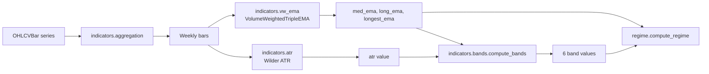

# `trip_ema/indicators/` — pure indicator math

## 1. Role in the larger application

`indicators/` is the **pure-math layer** that produces the
ingredients regime classification and signal derivation consume.
Three responsibilities:

1. **Aggregate bars** between timeframes (daily → weekly with
   timezone-correct anchoring).
2. **Compute the three EMAs** (med, long, longest) using the
   operator's Pine-faithful volume-weighted triple-stage
   construction.
3. **Compute the ATR + 6 bands** (inner, mid, outer × upper, lower)
   using Wilder smoothing and a max/min envelope of the three EMAs.

The package is stateless functions plus a small number of stateful
classes that exist only for O(1) streaming updates. Every function
is pure (no DB, no clock, no I/O) and deterministic — same input,
same output. Together they're the Python port of the operator's
TradingView Pine indicator.



## 2. Architecture and constraints

| Constraint | Rationale |
|------------|-----------|
| **Pure functions and pure stateful classes** — no I/O, no clock, no `random` | Determinism. Backfill and live cycle must produce byte-identical outputs from the same bars |
| **Pine fidelity** — every algorithmic decision matches the operator's TradingView indicator | Bar-by-bar parity tests pin the implementation to the reference |
| **Stateful for streaming, batch for tests** — every stateful class also has a `compute_series` batch helper | Streaming class is what the live engine used pre-V1; the batch helper is what tests use and what the V1 pipeline uses via pandas |
| **`_snapshot()` / `_restore()` on every stateful class** | Pre-V1 the engine needed to apply a provisional bar, observe results, then rewind. V1 no longer uses these but the surface is kept for the (legacy) chart endpoint |
| **NaN-during-warmup** — Pine returns NaN until the first complete period of a smoother; we match exactly | Downstream `is_warmed_up` checks rely on this |

## 3. File inventory

```
trip_ema/indicators/
├── __init__.py        Re-exports the public surface
├── aggregation.py     daily_to_weekly + bucket_end + gap detection
├── vw_ema.py          VolumeWeightedTripleEMA (the 4-stage VW-EMA)
├── atr.py             ATR (Wilder smoothing)
└── bands.py           compute_bands + pierce detection
```

## 4. `aggregation.py` — bar bucketing across timeframes

### 4.1 `_monday_of(d, tz='UTC') -> datetime`

```python
def _monday_of(d: datetime, tz: str = "UTC") -> datetime:
    if d.tzinfo is None:
        raise ValueError("requires tz-aware datetime")
    zone = ZoneInfo(tz)
    d_local = d.astimezone(zone)
    monday_date_local = d_local.date() - timedelta(days=d_local.weekday())
    monday_local = datetime.combine(monday_date_local, time.min, tzinfo=zone)
    return monday_local.astimezone(UTC)
```

Return the **UTC datetime of the local Monday 00:00** of the week
containing `d`. The week is anchored in the supplied timezone:

| tz | "Monday 00:00 local" → UTC representation |
|---|---|
| `Asia/Kolkata` | Sun 18:30 UTC |
| `America/New_York` | Mon 05:00 UTC (winter) / Mon 04:00 UTC (summer) |
| `Europe/London` | Mon 00:00 UTC (winter) / Sun 23:00 UTC (summer) |
| `UTC` | Mon 00:00 UTC |

Storage convention everywhere in the system: weekly bar
`bar_timestamp` is the UTC instant of the local-Monday-00:00. Two
weekly bars in the same calendar week never coexist.

Naive datetimes raise immediately — a class of bug the codebase
has decided to reject at the boundary.

### 4.2 `bucket_end(bar_timestamp, timeframe, tz='UTC') -> datetime`

Returns the **exclusive upper bound** of the bucket `bar_timestamp`
represents.

| Timeframe | Returns |
|-----------|---------|
| `WEEKLY` | Next local-Monday 00:00 (UTC) |
| `DAILY` | Next local-midnight (UTC) |
| Other | Raises `ValueError` |

**DST correctness.** In zones that observe DST (America/New_York,
Europe/London), a local week is 167 or 169 hours during transition
weeks. Adding `timedelta(days=7)` adds wall-clock UTC time, which
crosses DST boundaries incorrectly. The implementation does
calendar arithmetic on the naive *date* in the local zone, combines
with local midnight, then converts to UTC — so ZoneInfo applies the
correct local offset for the target date.

For UTC and `Asia/Kolkata` (no DST), this is the same as
`timedelta` arithmetic, so it's a no-op for the primary market.

### 4.3 `is_provisional(bar_timestamp, timeframe, now, tz='UTC') -> bool`

```python
def is_provisional(...) -> bool:
    return now < bucket_end(bar_timestamp, timeframe, tz=tz)
```

`True` if the bar's bucket is still open as of `now` — new OHLCV
ticks could still arrive that revise this bar. Used by the legacy
`ComputeScheduler` to decide "is this bar still a moving target?"
and refuse to treat it as final.

### 4.4 `daily_to_weekly(bars, *, include_partial_last_week=True, tz='UTC', min_bars_for_complete_week=None) -> list[OHLCVBar]`

The main aggregator. Despite the name, it accepts **any finer
timeframe** (15m, hourly, 2-hourly, daily) — week-boundary detection
just looks at `_monday_of(bar.timestamp, tz)`.

Per-week aggregation rules:

| Output field | Computation |
|--------------|-------------|
| `open` | First bar's open in the week |
| `high` | `max` of all bars' highs |
| `low` | `min` of all bars' lows |
| `close` | Last bar's close |
| `volume` | `sum` of all bars' volumes |
| `timestamp` | UTC of local-Monday-00:00 |

**`include_partial_last_week`**: when `True` (default), the trailing
week emits even if incomplete. When `False`, the trailing week
emits only if `bar_count >= min_bars_for_complete_week`.

**`min_bars_for_complete_week`**: defaults to 5 (right for daily
source). For hourly source, callers should pass
`recommended_min_bars_per_week(Timeframe.HOURLY) = 20`.

The threshold is intentionally conservative — better to miss a
complete week than emit a half-filled one. The next cycle will pick
up the genuine-complete week.

### 4.5 `recommended_min_bars_per_week(source_tf) -> int`

Heuristic threshold for "the source has enough bars to consider
this week complete":

| Source | Threshold | Expected per week |
|--------|-----------|-------------------|
| `MIN_15` | 80 | ~130 |
| `HOURLY` | 20 | ~32 |
| `HOURLY_2` | 10 | ~16 |
| `DAILY` | 5 | 5 |
| `WEEKLY` | 1 | trivially complete |

### 4.6 Gap detection helpers (`expected_closed_weekly_buckets`, `detect_weekly_gaps`)

Used by the legacy `ComputeScheduler` to decide "is the ETL behind
on this ticker?"

```python
def expected_closed_weekly_buckets(engine_last_ts, now, tz='UTC') -> list[datetime]:
    """List of weekly-Monday UTC timestamps for CLOSED weeks that the
    ETL should have written by now."""
```

Returns Monday timestamps from `_monday_of(engine_last_ts) + 1 week`
up to (exclusive) `_monday_of(now)`. The currently-open week is
**not** included — it may legitimately be empty mid-week.

```python
def detect_weekly_gaps(source_bar_timestamps, engine_last_ts, now, tz='UTC') -> list[datetime]:
    """Subset of expected_closed_weekly_buckets that have ZERO source bars."""
```

The scheduler iterates the result, marks affected snapshots stale
in the `SignalCache`, and waits for the ETL.

V1 uses a different mechanism (the orchestrator-pool ETL stage
fetches what's missing in-cycle), so these helpers are largely
unused in the current code path. They remain for the
ComputeScheduler-based code paths still in the tree.

## 5. `vw_ema.py` — the volume-weighted triple-stage EMA

### 5.1 The Pine construction (what we're porting)

```
vw1     = ema(close * volume, base) / ema(volume, base)
vw2     = ema(vw1, s1)
polished = wma(2*wma(vw2, floor(s2/2)) - wma(vw2, s2), floor(sqrt(s2)))
result   = ema(polished, final)  if final is not None else polished
```

Where `ema(x, n)` is standard exponential with `alpha = 2/(n+1)`,
seeded from the first value. `wma(x, n)` is weighted MA with
weights 1, 2, …, n.

Production parameters:

| EMA | base | s1 | s2 | final |
|-----|-----|----|----|-------|
| med | 8 | 4 | 4 | None |
| long | 15 | 4 | 4 | 3 |
| longest | 28 | 7 | 5 | 3 |

### 5.2 `VolumeWeightedTripleEMA` class

```python
@dataclass
class VolumeWeightedTripleEMA:
    base:              int       # ≥ 2
    s1:                int       # ≥ 2
    s2:                int       # ≥ 2
    final:             int | None = None    # ≥ 2 or None
    volume_sma_length: int = 1   # ≥ 1; 1 = raw, 2 = Pine convention

    def update(self, close: float, volume: float) -> float: ...
    def _snapshot(self) -> tuple: ...
    def _restore(self, snapshot: tuple) -> None: ...
```

Stateful. Each `update(close, volume)` returns the polished EMA
value or `NaN` during warmup.

**Carried state**:

| Field | Purpose |
|-------|---------|
| `_vw1_num`, `_vw1_den` | Two parallel EMA accumulators for the volume-weighted ratio |
| `_vw2` | EMA accumulator after the s1 smoothing |
| `_vw2_window: deque` (maxlen = `s2 + wma_outer_len - 1`) | Rolling history for the WMA-polish stage |
| `_final_ema` | EMA accumulator for the optional final stage |
| `_volume_window: deque` (maxlen = `volume_sma_length`) | For the volume SMA pre-smoothing |
| `_n_bars_seen` | Bar counter for warmup decisions |

### 5.3 Update walkthrough

For each new bar:

**Stage 0 — volume smoothing.** Append `volume` to the window; if
the window isn't full yet, return `NaN`. Pine's `ta.sma(volume, N)`
returns NaN until N samples are available; matching this exactly
shifts the entire EMA series by one bar relative to the previous
incorrect implementation that computed `sum/len` from the first
bar.

**Stage 1 — VW-EMA pair → vw1.** Two parallel EMA recurrences on
`close * smoothed_volume` (numerator) and `smoothed_volume`
(denominator). On the first bar, seed both from the current values.
Guard against zero-volume periods that would NaN out the chain via
a divide-by-zero check.

**Stage 2 — second EMA → vw2.** Seed from `vw1` on first call; then
standard EMA recurrence with `alpha = 2/(s1+1)`.

**Stage 3 — WMA polish.** Push `vw2` onto the rolling window. If
the window isn't yet large enough (`s2 + wma_outer_len - 1`
elements), return NaN. Else:

- Build a `diff` series of length `wma_outer_len`:
  ```
  diff[i] = 2 * wma(last (s2/2) vw2 values, s2/2)
                - wma(last s2 vw2 values, s2)
  ```
- Apply the outer WMA over those diffs:
  ```
  polished = wma(diff, wma_outer_len)
  ```

`wma_inner_len = max(1, s2 // 2)`,
`wma_outer_len = max(1, floor(sqrt(s2)))`.

For `s2 = 5`, `wma_inner_len = 2`, `wma_outer_len = 2` —
inner-WMA over 2 values, diff series of 2 values, outer-WMA over
those 2 diffs. The rolling window holds `5 + 2 - 1 = 6` `vw2`
values.

**Stage 4 — final EMA (optional).** When `final` is set, apply one
more EMA with `alpha = 2/(final+1)` over the polished stream.

### 5.4 Warmup duration

The number of bars before `update` first returns a finite value is
approximately:

```
volume_sma_length      (Stage 0 buffer fill)
  +  1                  (first vw1 seed at the first bar)
  +  1                  (first vw2 seed at the second bar)
  +  s2 + wma_outer_len - 1   (rolling window fill)
  +  final              (final-EMA seed, if any)
```

For longest with `base=28, s1=7, s2=5, final=3, volume_sma_length=2`:
`2 + 1 + 1 + (5 + 2 - 1) + 3 ≈ 13` bars. The actual warmup-to-stable
window is longer because the EMAs themselves take ~3-4× their alpha
period to settle (~28 × 3 = 84 bars for `longest` to fully stabilise).

In production, `prime_cache_from_db` and the V1 backfill start from
fixed historical Mondays with enough history that every EMA is
fully stable when we care about the output.

### 5.5 `compute_series(closes, volumes, base, s1, s2, final) -> list[float]`

Pure batch wrapper. Builds a fresh `VolumeWeightedTripleEMA` and
feeds the inputs through. Returns one value per input bar (NaN
during warmup). Used by tests and the V1 batch pipeline.

### 5.6 Snapshot / restore

```python
def _snapshot(self) -> tuple: ...
def _restore(self, snapshot: tuple) -> None: ...
```

Capture all mutable carrying state as an immutable tuple. The deques
are converted to tuples for true copy semantics. Pre-V1, the legacy
`TickerEngine` used these to apply a provisional bar, observe
intermediate results, then rewind. V1's batch pipeline doesn't use
them. Kept on the class API for the legacy chart endpoint.

## 6. `atr.py` — Wilder ATR

### 6.1 The Pine formulas

Pine's `ta.atr` uses Wilder's smoothing (alpha = 1/length), NOT
standard EMA alpha (2/(length+1)). The seed is the simple average
of the first `length` true-range values.

```
tr[i] = max(high[i] - low[i],
            |high[i] - close[i-1]|,
            |low[i]  - close[i-1]|)        // first bar: tr = high - low

atr[i] = ((length - 1) * atr[i-1] + tr[i]) / length
       = (1 - alpha) * atr[i-1] + alpha * tr[i]    with alpha = 1/length
```

### 6.2 `ATR` class

```python
@dataclass
class ATR:
    length: int

    def update(self, high: float, low: float, close: float) -> float: ...
    def _snapshot(self) -> tuple: ...
    def _restore(self, snapshot: tuple) -> None: ...
```

Carried state:

| Field | Purpose |
|-------|---------|
| `_prev_close` | Previous bar's close for the TR computation |
| `_atr` | Current ATR value (None during warmup) |
| `_tr_buffer` | Pre-warmup TR accumulator (released after seed) |

Update logic:

```python
if self._prev_close is None:
    tr = high - low
else:
    tr = max(high - low, abs(high - prev), abs(low - prev))
self._prev_close = close

if self._atr is None:
    self._tr_buffer.append(tr)
    if len(self._tr_buffer) < self.length:
        return NaN
    self._atr = sum(self._tr_buffer) / self.length
    self._tr_buffer = []                    # release; not needed again
    return self._atr

# steady state
self._atr = ((self.length - 1) * self._atr + tr) / self.length
return self._atr
```

Once seeded, the TR buffer is released (set to empty list) — no
memory growth across the bar history.

### 6.3 `compute_series(bars, length) -> list[float]`

Pure batch wrapper. One value per input bar, NaN during the first
`length - 1` bars.

## 7. `bands.py` — ATR-derived band envelope

### 7.1 `Bands` NamedTuple

```python
class Bands(NamedTuple):
    upper_inner: float
    lower_inner: float
    upper_mid:   float
    lower_mid:   float
    upper_outer: float
    lower_outer: float
```

Six band values: three above the EMA envelope, three below,
symmetric around the upper/lower envelopes.

### 7.2 `compute_bands(med_ema, long_ema, longest_ema, atr, params) -> Bands`

```python
highest = max(med, long, longest)
lowest  = min(med, long, longest)

upper_inner = highest + params.inner_mult * atr
lower_inner = lowest  - params.inner_mult * atr
upper_mid   = highest + params.mid_mult   * atr
lower_mid   = lowest  - params.mid_mult   * atr
upper_outer = highest + params.outer_mult * atr
lower_outer = lowest  - params.outer_mult * atr
```

Production multipliers: `inner=0.2, mid=2.0, outer=4.0`. Bands are
constructed against the **highest** / **lowest** of the three EMAs,
not the middle one — they hug the ribbon's outer extents.

NaN propagates: any NaN input yields all-NaN output.

### 7.3 `detects_upper_mid_pierce(high, low, upper_mid) -> bool` (and mirror)

```python
def detects_upper_mid_pierce(high, low, upper_mid):
    return high >= upper_mid and low <= upper_mid
```

Returns `True` iff the bar's range **straddles** the band — i.e.
the bar's high reached or exceeded the band AND the low touched or
fell below it. Geometric "the horizontal line touches the candle".

Pierces are an ornamental tell — they show up on the chart and on
the `pierces_upper_mid` / `pierces_lower_mid` columns of
`stock_indicator_enrichment` but the **regime classifier does not
use them** (the operator's regime spec was specifically rewritten
without pierce gates). Useful for visual debugging and for the
enrichment-table-driven email digests.

## 8. The full data flow (per bar)

```
OHLCVBar (open, high, low, close, volume, ts)
    │
    ├──► VolumeWeightedTripleEMA(med).update(close, volume)
    │       → med_ema
    │
    ├──► VolumeWeightedTripleEMA(long).update(close, volume)
    │       → long_ema
    │
    ├──► VolumeWeightedTripleEMA(longest).update(close, volume)
    │       → longest_ema
    │
    ├──► ATR(14).update(high, low, close)
    │       → atr
    │
    └──► detects_*_mid_pierce(high, low, mid_value)
            → pierces_upper_mid, pierces_lower_mid

compute_bands(med_ema, long_ema, longest_ema, atr, params)
    → Bands(upper_inner, lower_inner, upper_mid, lower_mid, upper_outer, lower_outer)

→ pass to regime.compute_regime + persist as StockIndicatorState row
```

## 9. V1 batch pipeline (`fundamentals/indicator_primitives.py`)

The V1 pipeline doesn't construct individual stateful EMA/ATR
objects. Instead, `compute_indicator_series` in
`fundamentals.indicator_primitives` wraps these primitives in a
pandas-vectorised pipeline that operates on full series at once.
For each ticker:

1. Pull all bars as DataFrame.
2. Vectorise through `compute_indicator_series(closes, volumes,
   highs, lows, params)` → returns `IndicatorSeries(emas, atr,
   bands)` with one value per bar.
3. Walk bar-by-bar with `compute_regime` and persist
   `StockIndicatorState` rows.

The stateful classes are still used by the (legacy)
`api.compute_full_*` chart endpoint — that path predates the
V1 batch pipeline and uses the classes directly.

## 10. Concurrency

Pure functions are trivially concurrent. The stateful classes are
**not** thread-safe — `_vw2_window` and `_tr_buffer` would race
under concurrent updates. Pre-V1, the engine enforced single-
threaded ingestion per ticker; V1's batch pipeline holds no shared
state per-ticker (one fresh class instance per ticker batch).

## 11. Failure modes

| Failure | Behaviour |
|---------|-----------|
| Naive datetime to `_monday_of` | `ValueError` |
| `length < 1` to `ATR` | `ValueError` |
| EMA stage lengths < 2 | `ValueError` |
| Zero-volume bar | VW-EMA returns NaN for that bar (divide-by-zero guard) |
| Out-of-order bars to `daily_to_weekly` | Not detected; caller's responsibility (the V1 callers always pre-sort by `bar_timestamp`) |
| NaN in any band-input | All bands NaN (propagation) |
| DST transition week | Handled — `bucket_end` does calendar-date arithmetic, not `timedelta(days=7)` |

## 12. Testing

`tests/indicators/`:

| File | Coverage |
|------|----------|
| `test_aggregation.py` | `_monday_of`, `bucket_end`, `is_provisional`, `daily_to_weekly` with various tz + partial-week scenarios |
| `test_aggregation_dst.py` | DST edge cases (spring forward / fall back weeks in America/New_York) |
| `test_atr.py` | Wilder warmup vs steady state, snapshot/restore round-trip |
| `test_vw_ema.py` | Volume-sma fidelity, EMA warmup match to Pine reference, snapshot/restore |
| `test_bands.py` | Boundary equality (`high == upper_mid` is a pierce), NaN propagation |
| `test_gap_detection.py` | `detect_weekly_gaps` truth table for various ETL-lag scenarios |

`tests/parity/test_pine_parity.py` is the cross-cutting harness —
seeded historical series fed through indicators + regime, compared
bar-by-bar against TradingView CSV exports. Any drift in this
package shows up there.

## 13. Common pitfalls

1. **Naive datetimes raise.** `OHLCVBar` already requires aware
   datetimes; aggregation tightens that to "explicit tz arg required
   for week-anchoring".
2. **Pine's `ta.sma(volume, N)` returns NaN until N samples.** The
   Python port matches that exactly (B3 fixup). Earlier code that
   computed `sum / len` from the first bar shifted the EMA series
   one bar earlier — caused parity test failures.
3. **`s2 = 5` is the smallest practical value.** Smaller and the
   `wma_outer_len = floor(sqrt(s2))` shrinks to 1, making the
   outer WMA degenerate.
4. **The bands are built against `max/min(emas)`, not the middle
   EMA.** Don't "fix" this to symmetric distance from `long_ema` —
   the ribbon-extent construction is the operator's intent.
5. **Wilder's ATR alpha is 1/length, not 2/(length+1).** This trips
   up anyone who's only seen the standard EMA-style alpha.
6. **DST.** Don't add `timedelta(days=7)` to step from one weekly
   bar to the next in `America/New_York`. Use `bucket_end` (calendar-
   date arithmetic).
7. **Stateful classes are not thread-safe.** Construct fresh per
   ticker for parallel work.

## 14. Extension paths

- **A new indicator.** Add a `new_indicator.py` with the same
  stateful-class + `compute_series` shape. Wire it into
  `fundamentals/indicator_primitives.py::compute_indicator_series`
  and into `IndicatorParams` in `domain/state.py`.
- **A new timeframe.** Add the enum value in `domain.Timeframe`,
  add a case in `aggregation.bucket_end`, and add a row to the
  `recommended_min_bars_per_week` table.
- **Faster aggregation.** `daily_to_weekly` is Python-loop;
  for large backfills the V1 pipeline already uses pandas
  resampling. The stateful path here is preserved for
  determinism — don't replace it unless tests guarantee bit-
  identical output.

## 15. Related packages

- `trip_ema/domain/` — `OHLCVBar`, `Timeframe`, `IndicatorParams`.
- `trip_ema/regime/` — consumes the EMAs + bands.
- `trip_ema/fundamentals/indicator_primitives.py` — wraps these
  primitives in a pandas-vectorised pipeline for V1 batch use.
- `trip_ema/api/stateless.py` — uses these via the V1 batch path
  for the chart endpoint.
- `trip_ema/scheduler/compute_scheduler.py` — uses
  `detect_weekly_gaps` for the legacy stale-ticker flagging.
- `tests/parity/test_pine_parity.py` — the cross-cutting parity
  harness.
