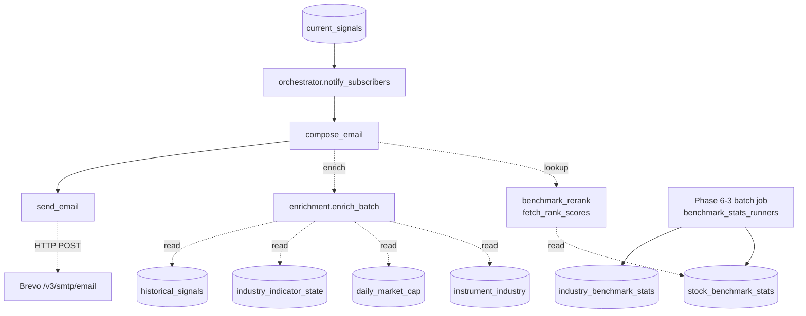

# `trip_ema/notifications/` — email composition + delivery + ranking

## 1. Role in the larger application

`notifications/` is the **delivery pipeline** between the `current_signals`
table and a subscriber's inbox. Five responsibilities:

1. **Compose** — build the email body + subject from the cycle's
   current signals and per-subscriber rules.
2. **Enrich** — for each ticker, look up market cap, sector,
   industry, sector-direction, last-5 signals, benchmark-rerank
   score. The HTML email body is built around this enrichment.
3. **Rank** — re-order BUY signals by a composite stock + industry
   relative-strength score (Phase 6-3 benchmark stats).
4. **Send** — transmit via Brevo HTTP API (the only viable
   transport after Outlook + Gmail killed SMTP AUTH for personal
   senders).
5. **Compute benchmark stats** — Phase 6-3 background job that
   builds the rolling 26-week α/β/RS/R² tables that the reranker
   consumes.

Plus legacy supporting infrastructure (transports interface,
batcher, Redis queue, circuit breaker) that survives V1 but is
not on the production hot path.



## 2. Architecture and constraints

| Rule | Why |
|------|-----|
| **Brevo HTTP API is the only viable email transport** | Microsoft disabled SMTP AUTH for personal Outlook accounts in 2025; Google made Gmail OAuth-only for new accounts in 2024. SMTP transport is dead |
| **Lazy transport init.** The Brevo `EmailSender` is built on first send, not at boot | Absence of an init log line right after startup is **not** a regression. Brevo connectivity probed on first cycle |
| **Per-subscriber error isolation** | One faulty subscriber (bad email, Brevo rejection) doesn't break the rest of the notify pass. Errors are recorded in `NotifyResult.errors`; loop continues |
| **Idempotent log writes via composite unique key.** `notification_log` is unique on `(subscriber_id, ticker_id, bar_timestamp, signal_type, cycle_id)` | A re-tried cycle doesn't duplicate log rows |
| **Inline CSS only for HTML emails** | Gmail strips `<style>` blocks aggressively; inline survives |
| **Indian numbering for market cap** (`₹19,84,302 Cr`) | Match the operator's spec; differs from Western locale formatting |
| **No raw SMTP code paths** | The legacy SMTP transport is kept conceptually in `base.py` Protocol but no live SMTP transport ships |

## 3. File inventory

```
trip_ema/notifications/
├── __init__.py                       Re-exports transport interface, factories, batcher
├── base.py                           NotificationTransport Protocol + NullTransport
├── batcher.py                        render_text + render_html + render_json
├── enrichment.py                     enrich_batch — per-ticker lookup pass
├── email_transport.py                Brevo HTTP API transport
├── webhook_transport.py              JSON POST transport
├── circuit_breaker.py                CLOSED → OPEN → HALF_OPEN wrapper
├── redis_queue.py                    Atomic-dedup work queue (legacy)
├── compose_email.py                  V1: build subject + html + text per subscriber
├── send_email.py                     V1: Brevo wrapper used by orchestrator.notify_subscribers
├── benchmark_rerank.py               BUY-ordering composite score
├── benchmark_rerank_client.py        Re-export for GUI (layering hygiene)
├── benchmark_stats_compute.py        α / β / RS / R² over rolling 26-week windows
└── benchmark_stats_runners.py        Fetch → compute → write loop for benchmark tables
```

## 4. V1 hot path: `compose_email` + `send_email`

These are the two functions the orchestrator calls directly. The
broader transport-interface machinery (`base.py`, `circuit_breaker.py`,
etc.) is supporting / legacy.

### 4.1 `compose_email(subscriber, signals, *, cycle_id, now, db_engine) -> EmailContent`

```python
@dataclass(frozen=True, slots=True)
class EmailContent:
    subject:   str
    html_body: str
    text_body: str
```

**Algorithm:**

1. **Filter by subscriber rules.** Apply the subscriber's per-ticker
   and per-signal-type filters from `subscribers.rules_json`. Drop
   signals that don't match.
2. **Re-rank BUYs.** Pass BUY signals through
   `benchmark_rerank.fetch_rank_scores` + sort descending by
   `rank_score`. Other signal types preserve cycle emission order.
3. **Enrich.** `enrichment.enrich_batch(db_engine, signals)` returns
   per-ticker enrichment for the whole batch in one DB pass.
4. **Render text.** Plain `[BUY] NSE:BALAMINES at 285.50` lines,
   grouped by signal type.
5. **Render HTML.** Tables per signal type, inline CSS, rich
   enrichment columns (Mkt Cap, Sector, Sector Zone, Sector
   Direction, Last 5 signals).
6. **Compose subject.** `WeeklyStockSignals [{cycle_id}] — N BUYs,
   M SELLs, K EXITs`.

### 4.2 `send_email(brevo_api_key, *, from_address, from_name, to, subject, html_body, text_body) -> SendResult`

```python
@dataclass(frozen=True, slots=True)
class SendResult:
    status:      Literal["sent", "failed"]
    message_id:  str | None    # set on sent
    error:       str | None    # set on failed
    http_status: int | None    # set on failed
```

POSTs to `https://api.brevo.com/v3/smtp/email` with the JSON shape
Brevo expects:

```json
{
  "sender":      { "email": "from_address", "name": "from_name" },
  "to":          [{ "email": "to" }],
  "subject":     "...",
  "htmlContent": "...",
  "textContent": "..."
}
```

Headers: `api-key: <brevo_api_key>`, `accept: application/json`,
`content-type: application/json`.

**Never raises.** All exceptions are caught and converted to
`SendResult(status="failed", ...)`. The orchestrator's per-subscriber
loop checks `result.status == "sent"` and writes log rows + updates
`last_notified_at` only on success.

**Retry logic:** none at the transport level. The next cycle is the
retry. A failed send leaves `last_notified_at` un-updated so the
subscriber stays "due" until success.

## 5. `enrichment.py` — per-batch lookup pass

### 5.1 `TickerEnrichment` dataclass

```python
@dataclass(frozen=True, slots=True)
class TickerEnrichment:
    market_cap_rupees:   int | None
    sector:              str | None
    industry:            str | None
    sector_zone:         int           # +1 / 0 / -1
    sector_direction:    int           # +1 / 0 / -1
    recent_signals:      tuple[HistoricalSignal, ...]   # last 5
```

Per-ticker data assembled from multiple tables.

### 5.2 `enrich_batch(db_engine, signals) -> BatchEnrichment`

```python
class BatchEnrichment:
    def get(self, ticker: TickerRef) -> TickerEnrichment | None
```

**Reads** (all in one connection):

| Table | Field used |
|-------|-----------|
| `instrument_industry` | sector, industry per ticker |
| `daily_market_cap` | most recent market_cap_rupees per ticker |
| `industry_indicator_state` | display_regime → `sector_zone` (per the ticker's industry) |
| `industry_index_value` | last 2 days for sector direction sign |
| `historical_signals` | last 5 signals per ticker |
| `current_signals` | might also contribute to the 5 if recent |

**One pass per table.** No N+1 queries — each table is hit once
with a `WHERE ticker_id = ANY(:tids)` or similar. Wall time for a
20-signal batch: ~200ms.

**Returns** `EMPTY_ENRICHMENT` for tickers with no enrichment data
available. The HTML renderer handles `None` gracefully (shows `—`).

### 5.3 Sector zone + direction semantics

| Field | Source | Meaning |
|-------|--------|---------|
| `sector_zone` | `industry_indicator_state.display_regime` for the ticker's industry | +1 (green) / 0 (neutral) / -1 (red): the macro regime of the sector |
| `sector_direction` | sign of `IIV_today - IIV_yesterday` | +1 (up) / 0 (flat) / -1 (down): is the sector moving today |

Together they answer "is this BUY signal aligned with sector flow?"
A BUY on a ticker whose sector_zone is green AND sector_direction is
up is more likely to be a follow-through; a BUY against a red,
falling sector is a counter-trend bet.

## 6. `benchmark_rerank.py` — BUY ordering

### 6.1 The composite score

```
rank_score = 0.5 · stock_RS_26w  +  0.3 · industry_RS_26w  +  0.2 · R²_26w
```

Where:

- `stock_RS_26w` — the ticker's 26-week **relative strength**
  vs benchmark (NIFTY 50). Computed by `benchmark_stats_compute`.
- `industry_RS_26w` — the same for the ticker's industry index.
- `R²_26w` — goodness-of-fit of the linear regression that
  produced `stock_RS_26w` over the same window. Higher R² means
  the relative-strength estimate is more reliable; lower R² means
  the stock has been noisy relative to the benchmark.

All three components are computed weekly and persisted; the
reranker only reads.

### 6.2 `fetch_rank_scores(db_engine, ticker_ids) -> dict[int, float]`

Single SELECT against `stock_benchmark_stats` + `industry_benchmark_stats`
(joined via `instrument_industry`), one row per ticker_id, returning
the latest weekly rank_score per ticker.

Tickers with no benchmark stats yet (insufficient history, just
listed) return `0.0` — they sort to the bottom of the BUY list.

### 6.3 Integration

```python
def compose_email(...):
    ...
    buy_signals = [s for s in signals if s.signal_type == "BUY"]
    if buy_signals:
        rank_scores = fetch_rank_scores(
            db_engine,
            [s.ticker_id for s in buy_signals],
        )
        buy_signals.sort(
            key=lambda s: rank_scores.get(s.ticker_id, 0.0),
            reverse=True,
        )
    ...
```

Higher rank_score → earlier in the email. SELL and EXIT signals
keep cycle emission order (alphabetical by symbol within
section, per the HTML renderer).

## 7. `benchmark_stats_compute.py` — pure regression math

### 7.1 The model

Standard CAPM-style linear regression on weekly log-returns over
a rolling 26-week window:

```
r_stock_w = α + β · r_benchmark_w + ε_w
```

Estimates:
- `α` — intercept (excess return per week vs benchmark, in log units)
- `β` — slope (sensitivity to benchmark)
- `R²` — coefficient of determination
- `RS = sum(r_stock - r_benchmark) over 26 weeks` — cumulative
  outperformance vs benchmark

### 7.2 Pure functions

```python
def compute_weekly_log_returns(weekly_closes: list[float]) -> list[float]
def regress(stock_returns, benchmark_returns) -> (alpha, beta, r_squared)
def relative_strength(stock_returns, benchmark_returns) -> float
def composite_score(stock_rs, industry_rs, r_squared) -> float
```

No DB I/O, no time. Idempotent.

### 7.3 The 26-week window

26 weeks ≈ 6 months. Long enough to smooth single-week noise; short
enough to capture genuine regime shifts. The window is rolling,
not anchored: each week's stats are computed from the 26 weeks
ending at that week.

## 8. `benchmark_stats_runners.py` — orchestration

```python
def populate_stock_benchmark_stats_for_all(db_engine, *, as_of) -> dict[str, int]
def populate_industry_benchmark_stats_for_all(db_engine, *, as_of) -> dict[str, int]
```

Fetch → compute → write loops. For each ticker (or industry):

1. Pull last 26+1 weekly closes from `ohlcv_bars` (with daily-to-
   weekly aggregation).
2. Pull benchmark closes for the same range.
3. Call the `benchmark_stats_compute` functions.
4. Upsert into `stock_benchmark_stats` / `industry_benchmark_stats`.

**Cadence:** weekly, run from a separate cron / GUI button.
Not in the live cycle's hot path because:
- 26-week rolling stats don't change meaningfully on intra-day
  ticks.
- Per-ticker regression × 2,500 tickers takes ~2-3 minutes —
  too slow for a 30-second cycle budget.

The reranker reads what the last weekly run wrote.

## 9. Legacy supporting modules (not on V1 hot path)

### 9.1 `base.py::NotificationTransport` Protocol

```python
class NotificationTransport(Protocol):
    def send(self, address: str, batch: NotificationBatch) -> bool: ...
```

Structural type. `True` = delivered, `False` = retryable failure.
Raises only on unrecoverable bugs.

V1 doesn't use this Protocol on the hot path — `send_email` is a
plain function, not a transport object. The Protocol lives on for
the legacy distributor + webhook path.

### 9.2 `batcher.py`

`render_text / render_html / render_json(batch) -> str`. Pre-V1,
the `SubscriberDistributor` produced `NotificationBatch` objects
and the batcher rendered them. V1's `compose_email` uses
batcher helpers directly (palette constants, formatting helpers)
but doesn't go through the full Batch → render flow.

### 9.3 `circuit_breaker.py::CircuitBreakingTransport`

Wraps any transport with a state machine:

| State | Behaviour | Transition |
|-------|-----------|------------|
| `CLOSED` (default) | All calls forwarded | After `failure_threshold` consecutive failures → `OPEN` |
| `OPEN` | All calls fast-fail without forwarding | After `reset_timeout_seconds` → `HALF_OPEN` |
| `HALF_OPEN` | Next `half_open_max_successes` calls forwarded as a probe | If they all succeed → `CLOSED`; any failure → `OPEN` |

Configured via `config.transports.circuit_breaker`. Used in the
legacy queued notifier path; V1's direct Brevo send doesn't wrap.

### 9.4 `redis_queue.py`

Two Redis structures:

- `LIST` (FIFO) — pending jobs (`LPUSH` enqueue, `BRPOP` dequeue
  with blocking timeout).
- `HASH` (`job_id` → enqueue timestamp) — dedup. `HSETNX` before
  pushing to the LIST atomically guarantees one enqueue per job_id.

Used by the legacy `SubscriberDistributor` + `NotifierWorker` path.
V1 deprecates this — `notify_subscribers` in-process is the live
route.

### 9.5 `email_transport.py::EmailTransport`

Class-based Brevo wrapper that conforms to `NotificationTransport`.
Pre-V1 the queued path used it; V1 calls `send_email` (the function
form) directly.

The class form is kept because the GUI's "send test email" button
in the Subscribers tab uses it.

## 10. Data flow walkthrough — one subscriber's email

```
notify_subscribers loop, subscriber S due for notification
    │
    │ signals = current_signals_cache.all_signals()  → list[SignalEvent]
    ▼
compose_email(S, signals, cycle_id="20260629-0930", now=...)
    │
    │ filter by S.rules_json → keep, say, 5 signals
    │
    │ split into buys, sells, exits
    │
    │ if buys:
    │     rank_scores = fetch_rank_scores(db_engine, [b.ticker_id for b in buys])
    │     buys.sort(key=score, reverse=True)
    │
    │ enrich_batch(db_engine, all 5 signals)
    │     → per-ticker {market_cap, sector, industry, sector_zone,
    │                   sector_direction, last 5 signals}
    │
    │ render_text(...)        → "BUY NSE:BALAMINES at 285.50\n..."
    │ render_html(...)        → "<table>...</table>"
    │ subject = "WeeklyStockSignals [20260629-0930] — 3 BUYs, 1 SELL, 1 EXIT"
    ▼
EmailContent(subject, html_body, text_body)
    │
    ▼
send_email(brevo_key, from_address, S.email, subject, html, text)
    │
    │ build JSON body
    │ POST https://api.brevo.com/v3/smtp/email
    │   api-key: xkeysib-...
    │ status 201 → message_id from response
    ▼
SendResult(status="sent", message_id="<...>")
    │
    │ orchestrator caller:
    │     for each signal in batch:
    │         NotificationLogRepository.insert(NotificationLogEntry(
    │             subscriber_id, ticker_id, bar_timestamp,
    │             signal_type, cycle_id, sent_at=now,
    │             message_id=result.message_id))
    │     SubscribersRepository.update_last_notified_at(S.subscriber_id, now)
```

Per-subscriber wall time: ~200-500 ms (Brevo network round-trip
dominates).

## 11. Concurrency

- **In V1:** `notify_subscribers` loops subscribers sequentially.
  Each `send_email` call is sync (uses `requests`); blocks for
  ~200-500 ms.
- **No fan-out across subscribers** in V1. With ~10s of subscribers
  per cycle, total ~5-10 seconds. Parallelisation would need Brevo
  rate-limit coordination; not worth the complexity at this scale.
- **Benchmark stats runners** can fan out per-ticker via
  ThreadPoolExecutor (read-only regression compute is CPU-bound;
  pool size 4 is a sweet spot).

## 12. Failure modes

| Failure | Behaviour |
|---------|-----------|
| Brevo down (5xx, timeout) | `send_email` catches, returns `SendResult(status="failed", error="...")`. Orchestrator records error, doesn't update `last_notified_at`. Next cycle retries |
| Brevo rate limit (429) | Same — failed result, next cycle retry |
| Bad recipient address (401/422) | Same — failed result. Operator notices in `NotifyResult.errors` list, must remove/fix subscriber |
| Malformed HTML (bad characters) | The `html.escape` step in `batcher.py` neutralises most. Brevo rejects malformed → 422 → failed result |
| Enrichment SQL fails | Caught at `enrich_batch` level; returns `EMPTY_ENRICHMENT`. HTML renders with `—` placeholders. Email still sends |
| Rerank stats missing (new ticker, no 26 weeks) | `rank_scores[tid] = 0.0`. BUY sorts to bottom of section. No error |
| Brevo secrets file removed at runtime | First send after removal raises file-not-found → caught, failed result. Subsequent cycles all fail until file restored |

## 13. Logging and metrics

```
notify_subscribers[20260629-0930] subscriber 1 composed: signals=5 (B=3 S=1 E=1)
notify_subscribers[20260629-0930] subscriber 1 sent: message_id=<...>
notify_subscribers[20260629-0930] subscriber 2 FAILED: HTTPError 429
```

Metrics:
- `notifier_jobs_processed_total{outcome, transport}` — sent / failed / dlq counts
- `notifier_dispatch_duration_seconds{transport}` — per-job histogram

## 14. Testing

`tests/notifications/`:

| File | Coverage |
|------|----------|
| `test_compose_email.py` | Rule filtering, BUY rerank application, enrichment merge, subject + html + text generation |
| `test_send_email.py` | Brevo JSON body shape, header set, success / failure result extraction (mocked `requests`) |
| `test_enrichment.py` | Per-table joins, missing-data fallbacks, `sector_zone` / `sector_direction` derivation |
| `test_benchmark_rerank.py` | Composite-score arithmetic, fetch_rank_scores SELECT shape |
| `test_benchmark_stats_compute.py` | α/β/R² regression accuracy against numpy.polyfit, RS arithmetic, 26-week window edge cases |
| `test_batcher_html.py` | HTML section ordering, alphabetical row order within section, palette match, Indian number formatting |
| `test_circuit_breaker.py` | State transitions CLOSED → OPEN → HALF_OPEN → CLOSED |
| `test_redis_queue.py` | Atomic dedup via HSETNX (uses fakeredis) |

## 15. Common pitfalls

1. **Don't add `<style>` blocks to HTML emails.** Gmail strips them.
   Always inline.
2. **Don't put `to:` plural in Brevo body.** Single recipient per
   request; Brevo's `to` is an array but BCC/multi-recipient
   semantics make per-subscriber tracking impossible.
3. **`secrets/brevo.yaml` mode 0600.** Loader rejects world/group-
   readable. Set with `chmod 600` after deploy.
4. **Lazy init means the first cycle is when Brevo fails fast if
   the key is bad.** The startup log won't show the Brevo init
   line until the first send happens. Don't conclude "init failed
   silently" from absence — wait for the first cycle.
5. **`benchmark_rerank` operates on BUYs only.** SELL/EXIT order is
   alphabetical by symbol within section. Don't rerank exits — the
   stats model isn't trained for it.
6. **`market_cap_rupees` is INR, not USD.** The Indian-numbering
   formatter (`_format_indian_crores`) assumes INR. NSE only;
   adding NYSE would need a per-exchange formatter.
7. **HTML and text body must both be present.** Brevo accepts
   only-HTML or only-text but some mail clients (older Outlook)
   show garbage when only HTML is provided. Always send both.

## 16. Extension paths

- **A new transport.** Implement `NotificationTransport` Protocol.
  Add a config block. Wire into `app.py` startup. The interface is
  ready; only the legacy distributor needs to know about it. V1
  hot path stays Brevo-only.
- **Per-subscriber language/locale.** Add a `locale` column to
  `subscribers`. Branch in `_format_indian_crores` accordingly.
- **A second sender domain.** Add a `from_address` column to
  `subscribers` so different subscribers receive from different
  senders. Brevo allows multiple verified senders per account.
- **Real benchmark-stats automation.** Hook the runners into the
  scheduler as a daily/weekly cron tick (16:30 IST after the EoD
  cycle). Currently runs on a manual GUI button.
- **Async sends** via `httpx.AsyncClient`. Would let the cycle
  fire N Brevo POSTs concurrently. Watch for Brevo rate limits.

## 17. Related packages

- `trip_ema/orchestrator/notify_subscribers.py` — the V1 caller
  of `compose_email` + `send_email`.
- `trip_ema/persistence/current_signals_repo.py` — read at the
  top of notify_subscribers.
- `trip_ema/persistence/subscribers_repo.py` and
  `notification_log_repo.py` — read + written per subscriber.
- `trip_ema/persistence/stock_benchmark_stats_repo.py` and
  `industry_benchmark_stats_repo.py` — written by the
  benchmark_stats_runners.
- `trip_ema/config/brevo_secrets.py` — provides the loaded
  Brevo API key.
- `trip_ema/cache/current_signals_cache.py` — alternative source
  for the per-cycle signals list (DB-free path).
- `trip_ema/gui/views/subscribers.py` — GUI for managing the
  subscribers table; uses `EmailTransport` for test-send button.
