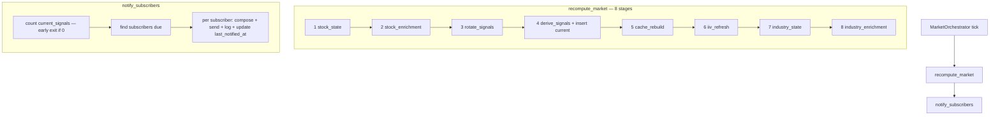

# `trip_ema/orchestrator/` — V1 cycle primitives

## 1. Role in the larger application

`orchestrator/` is **the V1 cycle**. Four small modules, four
verbs: **derive**, **rotate**, **recompute**, **notify**. They
compose into the one-pass pipeline the scheduler runs four times
per NSE trading day.

Each tick drives one full pass:

1. The scheduler (`MarketOrchestrator`) decides "it's tick time."
2. It calls `recompute_market(...)` — 8 stages produce
   `stock_indicator_state`, `stock_indicator_enrichment`,
   rotate / derive `current_signals`, rebuild the in-memory cache,
   refresh `industry_index_value`, then `industry_indicator_state`
   + `industry_indicator_enrichment`.
3. It calls `notify_subscribers(...)` — composes + sends emails
   to subscribers whose cadence elapsed; writes `notification_log`
   rows for audit.

That's the entire live V1 hot path. The pre-V1 codebase had this
logic scattered across `signals/persist_signals.py`,
`scheduler/compute_scheduler.py::run_once`, and the legacy
`SubscriberDistributor`. The V1 cutover consolidated all of it
here into four files that are easy to reason about in isolation.



## 2. Architecture and constraints

| Rule | Why |
|------|-----|
| **One file per verb, no shared mutable state** | Each primitive is independently testable. The cycle composes them; it doesn't share globals |
| **Each stage opens its own transaction** | Stage failures don't poison subsequent stages. A halted stage 1 still leaves stages 2-8 with a clean DB |
| **Per-subscriber isolation in `notify_subscribers`** | A single faulty subscriber can't fail the whole notify pass |
| **Per-stage halt-on-error in `recompute_market`** | Strict ordering: stages have data dependencies (stage 4 reads what stage 1 wrote). If stage 1 fails, downstream stages would derive bad signals — better to halt and surface the error |
| **Pluggable progress callback** | `progress_cb(stage_name, message)` lets the GUI / CLI render live cycle progress without coupling the cycle to a particular UI |
| **No retries inside the cycle** | The next scheduled tick is the retry. Backfill stage is what fills gaps left by a halted cycle |

## 3. File inventory

```
trip_ema/orchestrator/
├── __init__.py             Public re-exports
├── derive_signals.py       O(1) per-ticker signal derivation
├── rotate_signals.py       Atomic current → historical rotation
├── recompute_market.py     The 8-stage cycle
└── notify_subscribers.py   The notify stage
```

## 4. `derive_signals.py` — signal derivation primitive

### 4.1 `_classify_regime_change(regime_before, regime_after) -> str`

```python
def _classify_regime_change(regime_before: int, regime_after: int) -> str:
    if regime_after == 1:                 return "BUY"
    if regime_after == -1:                return "SELL"
    if regime_before == 1:                return "EXIT_FROM_BUY"
    if regime_before == -1:               return "EXIT_FROM_SELL"
    raise ValueError(...)                 # unreachable for valid inputs
```

**Precedence rules:**

| Transition | Result |
|-----------|--------|
| any → `BULLISH` (+1) | `BUY` |
| any → `BEARISH` (-1) | `SELL` |
| `BULLISH` → `NEUTRAL` | `EXIT_FROM_BUY` |
| `BEARISH` → `NEUTRAL` | `EXIT_FROM_SELL` |

`BUY` takes precedence over `EXIT_FROM_SELL` on a `BEARISH → BULLISH`
sharp reversal: regime_after=1 fires first. Same for SELL over
EXIT_FROM_BUY on the mirror reversal.

Callers must guarantee `regime_before != regime_after` — a signal
IS a regime change by definition.

### 4.2 `_latest_daily_close(conn, ticker_id, *, on_or_before=None) -> float | None`

```python
SELECT close FROM ohlcv_bars
 WHERE ticker_id = :tid AND timeframe = '1D'
   [AND bar_timestamp <= :on_or_before]
 ORDER BY bar_timestamp DESC LIMIT 1
```

**Weekly close gotcha.** `ohlcv_bars` stores **only daily bars**;
the weekly timeframe is synthesized in-memory by
`indicators.aggregation.daily_to_weekly`. So `price_at_signal` for
a weekly bar is the close of the most recent **daily** bar — which
is the right edge of the current weekly bucket. Correct semantically:
the price at which the signal "fired" is today's close.

`on_or_before` constrains the lookup for backfill mode (caller is
walking history; latest must be capped at the historical instant).
Live cycle leaves it `None`.

### 4.3 `derive_signal_for_ticker_this_cycle(conn, ticker_id, *, now, timeframe='1W', on_or_before=None, as_of=None) -> SignalEvent | None`

The O(1) per-ticker primitive. Returns:

- A `SignalEvent` if the latest two `stock_indicator_state` rows
  have different `display_regime`.
- `None` if any of:
  - Fewer than 2 state rows exist (warmup / new ticker).
  - The two latest rows have the same regime (no change).
  - No daily close available to source `price_at_signal` from.

**Algorithm:**

```python
states = repo.get_history_for_ticker(ticker_id, timeframe,
                                     to_dt=as_of, limit=2)
if len(states) < 2:
    return None
latest, previous = states[0], states[1]
if latest.display_regime == previous.display_regime:
    return None

price = _latest_daily_close(conn, ticker_id,
                            on_or_before=on_or_before or as_of)
if price is None or price <= 0:
    logger.warning("...skipping signal")
    return None

return SignalEvent(
    ticker_id, timeframe,
    bar_timestamp = latest.bar_timestamp,
    signal_type   = _classify_regime_change(previous.display_regime,
                                            latest.display_regime),
    regime_before = previous.display_regime,
    regime_after  = latest.display_regime,
    price_at_signal = price,
    computed_at   = now,
)
```

### 4.4 Same-bar re-detection by design

A regime change at bar B (an in-progress weekly bar mid-week) will
be detected by every cycle from the bar's first ingest until the
bar closes. Each cycle:

- Stage 3 rotates the prior cycle's `current_signals` row for this
  ticker into `historical_signals`.
- Stage 4 calls `derive_signal_for_ticker_this_cycle` which finds
  the same regime change at the same bar B and inserts a fresh row
  into `current_signals`.

Net effect: `historical_signals` accumulates one signal per cycle
for this ticker until the bar closes. By design — every cycle's
emission is an auditable record of "as of this tick, here was the
signal."

### 4.5 `derive_signals_for_all_active_stocks(conn, *, now, ...) -> list[SignalEvent]`

The bulk wrapper. Reads `tickers WHERE is_active AND NOT delisted`,
iterates per-ticker calling `derive_signal_for_ticker_this_cycle`,
returns the non-`None` results as a list ready for
`CurrentSignalsRepository.insert_many`.

## 5. `rotate_signals.py` — atomic rotation

### 5.1 The SQL

```sql
WITH moved AS (
    DELETE FROM current_signals
    RETURNING ticker_id, timeframe, bar_timestamp, signal_type,
              regime_before, regime_after, price_at_signal, computed_at
)
INSERT INTO historical_signals (
    ticker_id, timeframe, bar_timestamp, signal_type,
    regime_before, regime_after, price_at_signal,
    computed_at, archived_at
)
SELECT ticker_id, timeframe, bar_timestamp, signal_type,
       regime_before, regime_after, price_at_signal,
       computed_at, NOW()
  FROM moved
```

**One statement.** DELETE-RETURNING + INSERT-SELECT in a CTE.
Atomic at the SQL level — both halves land or neither does. No
partial-rotation failure mode.

### 5.2 `archived_at` semantics

`NOW()` in Postgres returns `transaction_timestamp()` — fixed for
the whole transaction. So every row inserted in this single
rotation statement shares the **same** `archived_at`. Useful for
audit queries like "show me every signal archived in cycle
20260626-1500":

```sql
SELECT * FROM historical_signals WHERE archived_at = $1
```

### 5.3 `rotate_current_to_historical(conn) -> int`

```python
def rotate_current_to_historical(conn: Connection) -> int:
    result = conn.execute(text(_ROTATE_SQL))
    return result.rowcount
```

Returns the number of rows moved. Zero if `current_signals` was
already empty (no error — just a no-op). Caller controls the
surrounding transaction; this function does not commit.

### 5.4 Ordering note

Rotation runs **before** derive in `recompute_market`. The order
matters: derive's insert into `current_signals` would conflict
with stale prior-cycle rows on the same PK (`ticker_id`); rotation
clears the table first.

If rotation fails uncaught (uncaught DB error mid-cycle), the
prior-cycle rows stay in `current_signals`. The next cycle's
derive would attempt to upsert on top of them — `CurrentSignalsRepository.insert_many`
uses `ON CONFLICT (ticker_id) DO UPDATE`, so it would overwrite,
not error. So a missed rotation doesn't corrupt state; it just
means a signal that should have been archived stayed in current
for one extra tick.

## 6. `recompute_market.py` — the 8-stage cycle

### 6.1 `RecomputeMarketResult` dataclass

```python
@dataclass(frozen=True, slots=True)
class RecomputeMarketResult:
    mode:                            Literal["live"]
    exchange:                        str
    as_of:                           datetime
    started_at:                      datetime
    finished_at:                     datetime

    # Stage 1
    stock_state_succeeded:           int
    stock_state_failed:              int
    stock_state_skipped:             int

    # Stage 2
    stock_enrichment_succeeded:      int
    stock_enrichment_failed:         int
    stock_enrichment_skipped:        int

    # Stages 3, 4, 5
    signals_rotated:                 int
    signals_emitted:                 int
    cache_rebuilt:                   bool

    # Stage 6
    iiv_succeeded:                   int
    iiv_failed:                      int
    iiv_skipped:                     int

    # Stages 7, 8
    industry_state_succeeded:        int
    industry_state_failed:           int
    industry_state_skipped:          int
    industry_enrichment_succeeded:   int
    industry_enrichment_failed:      int
    industry_enrichment_skipped:     int

    stage_errors:                    list[tuple[str, str]]   # (stage_name, error_message)
```

Per-stage counters plus a flat `stage_errors` list. `stage_errors`
is empty when all stages completed.

### 6.2 The 8 stages

| # | Stage | Reads | Writes | Notes |
|---|-------|-------|--------|-------|
| 1 | **stock_state** | `ohlcv_bars` (daily for all active tickers) | `stock_indicator_state` (1W rows) | Re-upserts last `n_weeks_to_upsert` weekly bars per ticker. Heavy stage — fans out per-ticker via fundamentals runner |
| 2 | **stock_enrichment** | `stock_indicator_state` | `stock_indicator_enrichment` | One row per stock_state row from this cycle |
| 3 | **rotate_signals** | `current_signals` | `historical_signals` | The single-statement CTE rotation |
| 4 | **derive_signals + insert** | `stock_indicator_state` (last 2 per ticker), `ohlcv_bars` (latest daily close per ticker) | `current_signals` | One row per ticker that flipped regime this cycle |
| 5 | **cache_rebuild** | `current_signals` (full SELECT) | In-memory `CurrentSignalsCache` | Atomic-swap of the cache's internal dict |
| 6 | **iiv_refresh** | `ohlcv_bars` daily + `instrument_industry` | `industry_index_value` | Daily IIV rows for the trailing window |
| 7 | **industry_state** | `industry_index_value` | `industry_indicator_state` | Aggregates IIV to weekly, computes the same EMA/ATR/band/regime as stocks |
| 8 | **industry_enrichment** | `industry_indicator_state` | `industry_indicator_enrichment` | Industry-side mirror of stage 2 |

`n_weeks_to_upsert=2` is the default — covers the in-progress
week + any late correction to the just-finalized prior week.

### 6.3 Stage execution pattern

Every stage follows the same template:

```python
if not stage_errors:                          # halt on prior error
    try:
        _emit_progress(progress_cb, stage_name, "running")
        result = _stage_<name>(...)
        logger.info(...)
        _emit_progress(progress_cb, stage_name, "done")
    except Exception as e:
        msg = f"<name> stage halted: {e}"
        logger.exception(...)
        stage_errors.append((stage_name, str(e)))
        _emit_progress(progress_cb, stage_name, f"failed: {e}")
```

Three key properties:

1. **Halt on first failure.** `if not stage_errors:` at every
   stage. The first uncaught exception stops the cycle; subsequent
   stages aren't attempted.
2. **`progress_cb` emits three message shapes per stage:**
   `"running"`, `"done"` (or `"done: <summary>"`), `"failed: <error>"`.
   The GUI parses these to drive the ETL status tab's per-stage
   indicators.
3. **Each stage opens its own transaction.** `_stage_rotate_signals`
   uses `with transaction(db_engine) as conn:`; the bulk
   populators (stock state, enrichment, IIV, industry) manage their
   own per-ticker transactions internally. No transaction spans
   stages — keeps each stage independently committable.

### 6.4 `recompute_market(...)` signature

```python
def recompute_market(
    db_engine:           Engine,
    *,
    mode:                Literal["live"] = "live",
    as_of:               datetime | None = None,
    n_weeks_to_upsert:   int = 2,
    cache:               CurrentSignalsCache | None = None,
    exchange:            str = "NSE",
    progress_cb:         Callable[[str, str], None] | None = None,
) -> RecomputeMarketResult:
```

| Arg | Meaning |
|-----|---------|
| `db_engine` | SQLAlchemy Engine. Each stage opens its own transaction |
| `mode` | Only `"live"` implemented. Backfill is a future Step-11 wire-up |
| `as_of` | Cycle's wall-clock instant. Defaults to `datetime.now(UTC)`. Stamped into derived signals' `computed_at` and used as the trailing-window anchor for IIV refresh |
| `n_weeks_to_upsert` | How many recent weekly bars each populator rewrites this cycle. Default 2 |
| `cache` | Optional `CurrentSignalsCache` to rebuild at stage 5. If `None`, stage 5 is skipped (DB state still correct) |
| `exchange` | Which exchange's active tickers to recompute. V1 = `"NSE"`. Industry side is always all-industries (no exchange filter) |
| `progress_cb` | Optional `(stage_name, message) -> None` for live progress reporting |

### 6.5 Determinism and re-runnability

Within a single tick, calling `recompute_market` twice is safe.
The populators use `INSERT ... ON CONFLICT DO UPDATE` on every
write target, so the second call overwrites stage 1+2's output
with the same values. Rotation on the second call moves zero rows
(current_signals was emptied + re-inserted by the first call;
derive at stage 4 then re-inserts the same rows). Net effect:
re-running a cycle produces no DB drift.

This is what the GUI's "Run cycle now" button relies on — operators
can fire it as many times as they like during validation.

## 7. `notify_subscribers.py` — the distribute stage

### 7.1 `NotifyResult` dataclass

```python
@dataclass(frozen=True, slots=True)
class NotifyResult:
    cycle_id:              str
    started_at:            datetime
    finished_at:           datetime
    signals_in_current:    int
    subscribers_due:       int
    emails_composed:       int
    emails_sent:           int
    emails_failed:         int
    log_rows_written:      int
    errors:                list[tuple[int, str]]    # (subscriber_id, error_message)
```

Aggregate counters plus per-subscriber error tuples. Per-success
detail lives in the `notification_log` table.

### 7.2 The high-level flow

```
notify_subscribers
    ├─ count current_signals
    │   └─ if 0: early-exit, return NotifyResult with zeros
    ├─ find subscribers due for notification (cadence-elapsed)
    │   └─ if []: early-exit
    ├─ snapshot current_signals once for stable logging
    └─ for each due subscriber:
            try:
                outcome = _process_one_subscriber(...)
                aggregate counters
            except:
                log; record error; loop continues
```

**Three sources of skipping:**

1. **No signals this cycle** → skip the whole distribute stage.
2. **No subscribers due** (everyone's cadence not yet elapsed) →
   skip the per-subscriber loop.
3. **Per-subscriber rule mismatch** (subscriber filters drop every
   signal) → no email composed, but the subscriber's
   `last_notified_at` IS updated so cadence advances.

### 7.3 Per-subscriber isolation

```python
for subscriber in subscribers:
    try:
        outcome = _process_one_subscriber(...)
        emails_composed += outcome["composed"]
        emails_sent += outcome["sent"]
        ...
        if outcome["error"] is not None:
            errors.append((subscriber.subscriber_id, outcome["error"]))
    except Exception as e:
        # Defensive: shouldn't happen, but if it does, loop continues
        emails_failed += 1
        errors.append((subscriber.subscriber_id, f"{type(e).__name__}: {e}"))
        logger.exception(...)
```

A faulty subscriber row, a Brevo 429, a transport timeout — every
failure stays scoped to that subscriber. The loop runs to
completion; the `NotifyResult.errors` list captures what went wrong
and for whom.

### 7.4 `_process_one_subscriber` (described, not shown above)

For each subscriber:

1. Apply per-subscriber rules JSON (filter signals to those the
   subscriber wants).
2. If filtered list is empty:
   - Skip compose + send.
   - Update `last_notified_at` so cadence advances.
   - Return outcome with 0 composed.
3. Else:
   - `compose_email(subscriber, signals, cycle_id, ...)` → HTML +
     text bodies + subject.
   - `send_email(brevo_api_key, ..., to=subscriber.email, ...)`
     → `SendResult` (`status`, `message_id` if success, error
     string if failure).
   - Write a `notification_log` row per signal (idempotent on
     `(subscriber_id, ticker_id, bar_timestamp, signal_type,
     cycle_id)`).
   - Update `last_notified_at` to `now`.
   - Return outcome.

`send_email` never raises (its errors come back as
`SendResult.status == "failed"`). The surrounding try/except
catches DB-write failures (notification_log insert, last_notified
update).

### 7.5 Hooks (mentioned in source for P2-A)

Two non-implemented hook points are explicit in the design:

- **ML ensemble filter** — between `current_signals` SELECT and
  the per-subscriber loop. Could reorder or drop signals based on
  a learned scoring model.
- **Per-subscriber rules JSON filter** — inside the per-subscriber
  loop, before `compose_email`. Already implemented for basic
  filters; more sophisticated rules engine queued.

## 8. Data flow walkthrough — one tick

```
09:30 IST — MarketOrchestrator fires post_open tick for NSE
    │
    │ mints correlation_id "abc-123"
    │ logs "Cycle starting"
    ▼
recompute_market(db_engine, as_of=now, cache=current_signals_cache, exchange="NSE")
    │
    │ Stage 1 (~5s): per-ticker compute updated stock_indicator_state for
    │              ~2,500 tickers, 2 weekly bars each. INSERT ON CONFLICT
    │              UPDATE. ~5,000 row writes.
    │
    │ Stage 2 (~5s): same shape, writes stock_indicator_enrichment.
    │
    │ Stage 3 (~10ms): atomic rotation. Moves N rows from current_signals
    │               to historical_signals (N = signals from last cycle).
    │
    │ Stage 4 (~3s): per-ticker derive. Reads latest 2 state rows + latest
    │              daily close. Emits SignalEvent for each ticker that
    │              flipped regime. insert_many into current_signals.
    │
    │ Stage 5 (~50ms): SELECT * FROM current_signals → list → cache.rebuild_from(...).
    │
    │ Stage 6 (~10s): industry_index_value refresh for last 2 weeks.
    │              ~60 industries × 14 daily rows = ~840 row writes.
    │
    │ Stage 7 (~2s): industry indicator state recompute. Aggregates IIV
    │              to weekly, runs same compute_indicator_series as stocks.
    │
    │ Stage 8 (~2s): industry indicator enrichment.
    │
    ▼
RecomputeMarketResult(succeeded=2500, failed=0, signals_emitted=15, ...)
    │
    │ MarketOrchestrator now calls notify_subscribers
    ▼
notify_subscribers(db_engine, brevo_api_key, cycle_id="20260629-0930", now=...)
    │
    │ count current_signals → 15
    │ find_due_for_notification(now) → 4 subscribers
    │ snapshot signals_snapshot for logging
    │
    │ for each subscriber:
    │   - apply filter rules
    │   - compose_email → HTML + text + subject
    │   - send_email via Brevo HTTP → SendResult(status="sent", message_id="...")
    │   - INSERT into notification_log (15 rows × 4 subscribers = 60 rows)
    │   - UPDATE subscribers SET last_notified_at = now
    ▼
NotifyResult(emails_sent=4, log_rows_written=60, errors=[])
    │
    ▼
MarketOrchestrator logs "Cycle complete in 30.5s" and returns to its sleep
```

Per-tick wall-clock typical: 30-60 seconds on the NUC at production
scale.

## 9. Concurrency

The cycle runs in **one MarketOrchestrator thread** per market.
Stages within a cycle are sequential. There is no parallelism
across stages.

**Within a stage**, the populators (stage 1, 2, 6, 7, 8) fan out
per-ticker via `ThreadPoolExecutor` internally — that's how stage 1
processes 2,500 tickers in ~5s. The fan-out is owned by
`fundamentals/runners.py`; the orchestrator just calls the
`populate_*_for_exchange` / `populate_*_for_all` entry points.

**Subscribers** in `notify_subscribers` are processed sequentially.
This is acceptable: subscribers are O(10s) per cycle, each takes
~100ms (network-bound on Brevo), total ~1-2s. Parallelisation would
need Brevo rate-limit coordination — not worth the complexity at
this scale.

## 10. Failure modes and recovery

| Stage | Failure | Behaviour | Recovery |
|-------|---------|-----------|----------|
| 1-2 (state/enrichment) | DB unavailable | Stage halts; `stage_errors` records it; cycle returns | Next tick retries from scratch |
| 1-2 | Per-ticker failure (e.g. yfinance bad data) | Populator catches per-ticker; `failed` counter increments; cycle continues | Next tick retries the failed ticker |
| 3 (rotation) | DB error | Stage halts; downstream stages skipped | Next tick's rotation is no-op if rotation succeeded; otherwise re-attempts |
| 4 (derive) | DB error | Stage halts | Next tick re-derives the same regime-change at the same bar; idempotent via UPSERT |
| 5 (cache rebuild) | Cache wrote partial state | Impossible — `rebuild_from` is atomic-swap | N/A |
| 6 (IIV) | yfinance/industry data missing | Per-industry populator catches; failed counter increments | Next tick retries |
| 7-8 (industry) | DB error | Stage halts | Next tick retries |
| `notify_subscribers` | No signals in current_signals | Early-exit, success result | N/A — by design |
| `notify_subscribers` | No subscribers due | Early-exit, success result | N/A |
| `notify_subscribers` | Brevo down for one subscriber | That subscriber's `error` recorded; `last_notified_at` NOT updated; loop continues | Next cycle retries that subscriber |
| `notify_subscribers` | Brevo down for everyone | All subscribers' errors recorded; loop completes | Operator investigates Brevo, restarts service if needed |

## 11. Logging and metrics

Every stage emits two log lines minimum: starting + finished
(or failure). All include the exchange name in brackets so log
output is grep-able by market.

```
recompute_market[NSE] starting: as_of=2026-06-29T09:30:00+00:00 n_weeks_to_upsert=2 cache=yes
recompute_market[NSE] stage 1 stock_state: succeeded=2500 failed=3 skipped=0
recompute_market[NSE] stage 2 stock_enrichment: succeeded=2500 failed=3 skipped=0
recompute_market[NSE] stage 3 rotation: rows_moved=12
recompute_market[NSE] stage 4 derive: emitted=15
recompute_market[NSE] stage 5 cache_rebuild: entries=15
recompute_market[NSE] stage 6 iiv: succeeded=60 failed=0 skipped=0
recompute_market[NSE] stage 7 industry_state: succeeded=60 failed=0 skipped=0
recompute_market[NSE] stage 8 industry_enrichment: succeeded=60 failed=0 skipped=0
recompute_market[NSE] finished in 30.45s (errors=0)
```

Notify stage similar:

```
notify_subscribers[20260629-0930] starting (now=2026-06-29T09:30:30+00:00)
notify_subscribers[20260629-0930] finished in 1.85s: sent=4 failed=0 log_rows=60 errors=0
```

Metrics emitted: `scheduler_runs_total{outcome}`,
`scheduler_run_duration_seconds`, `scheduler_signal_events_total{signal}`,
`scheduler_errors_total`, plus the ETL-side metrics from the
fundamentals populators.

## 12. Testing

`tests/orchestrator/`:

| File | Coverage |
|------|----------|
| `test_derive_signals.py` | Truth table for `_classify_regime_change`, full `derive_signal_for_ticker_this_cycle` against seeded state rows, no-price guard, `as_of` cap on backfill mode |
| `test_rotate_signals.py` | Atomicity (CTE single-statement), no-op on empty current, archived_at consistency across rows |
| `test_recompute_market.py` | All 8 stages happy path, halt-on-error at each stage, progress_cb emit pattern, cache-rebuild semantics |
| `test_notify_subscribers.py` | Early exits (no signals, no subscribers), per-subscriber isolation (one failure doesn't break others), log_row idempotency |

Tests use the `postgres_engine` fixture; some use a recorded Brevo
mock for the email path.

## 13. Common pitfalls

1. **`recompute_market` is currently `live` only.** Calling with
   `mode='backfill'` raises `NotImplementedError`. Backfill goes
   through `backfill/pipeline.py` instead.
2. **Stage 5 is skipped without `cache=...` passed.** The DB stays
   consistent (`current_signals` is freshly written), but
   in-process consumers will see stale cache until the cache is
   manually rebuilt. The live wiring always passes `cache`; only
   one-off scripts skip it.
3. **`progress_cb` exceptions are swallowed and logged.** A bad
   callback can't break the cycle. But it also can't be relied on
   for hard guarantees — use it for UI, not for audit.
4. **Per-stage transaction boundaries.** Don't try to "make stages
   atomic together" by wrapping the cycle in one transaction —
   stage 1 already writes thousands of rows and would hold
   too-long-running locks.
5. **`n_weeks_to_upsert` is per stage.** A value of 5 means stages
   1, 2, 6, 7, 8 each rewrite the trailing 5 weeks. That's a lot
   more I/O than 2; only increase if you're chasing a specific
   correction.
6. **Don't add a 9th stage casually.** Each stage adds 2-10s of
   per-tick latency. Stages are added when there's a downstream
   consumer that needs the data; otherwise, push the work to a
   nightly job.

## 14. Extension paths

- **Backfill mode for `recompute_market`.** Change the `mode`
  signature to accept `"backfill"`; in backfill mode, replace
  stage 1/2 with bulk-historical population from a starting
  Monday; skip the cache rebuild stage (offline).
- **New stage.** Add a `_stage_X` helper, hook into the cycle
  template in the right ordering position, add fields to
  `RecomputeMarketResult`, add a progress emit.
- **Per-cycle correlation ID.** Already wired — the orchestrator
  mints one with `new_correlation_id()` and pushes it via
  `with correlation_id(...)` around the `recompute_market` +
  `notify_subscribers` calls.

## 15. Related packages

- `trip_ema/domain/signal_event.py` — the `SignalEvent` produced
  by derive.
- `trip_ema/persistence/stock_indicator_state_repo.py` — read by
  derive (latest 2 state rows per ticker).
- `trip_ema/persistence/current_signals_repo.py` — written by
  derive + read by cache rebuild and `notify_subscribers`.
- `trip_ema/persistence/historical_signals_repo.py` — written by
  rotate (only the rotate function inserts here in V1 live).
- `trip_ema/persistence/subscribers_repo.py` and
  `notification_log_repo.py` — read + written by `notify_subscribers`.
- `trip_ema/cache/current_signals_cache.py` — rebuilt by stage 5.
- `trip_ema/fundamentals/v1_runners.py` — provides
  `populate_*_for_exchange` and `populate_*_for_all` (the
  bulk-populator entry points).
- `trip_ema/notifications/compose_email.py` and `send_email.py` —
  called per subscriber by `notify_subscribers`.
- `trip_ema/scheduler/market_orchestrator.py` — the caller of
  both `recompute_market` and `notify_subscribers`.
- `trip_ema/backfill/pipeline.py` — backfill counterpart;
  populates state + emits signals directly into
  `historical_signals`.
