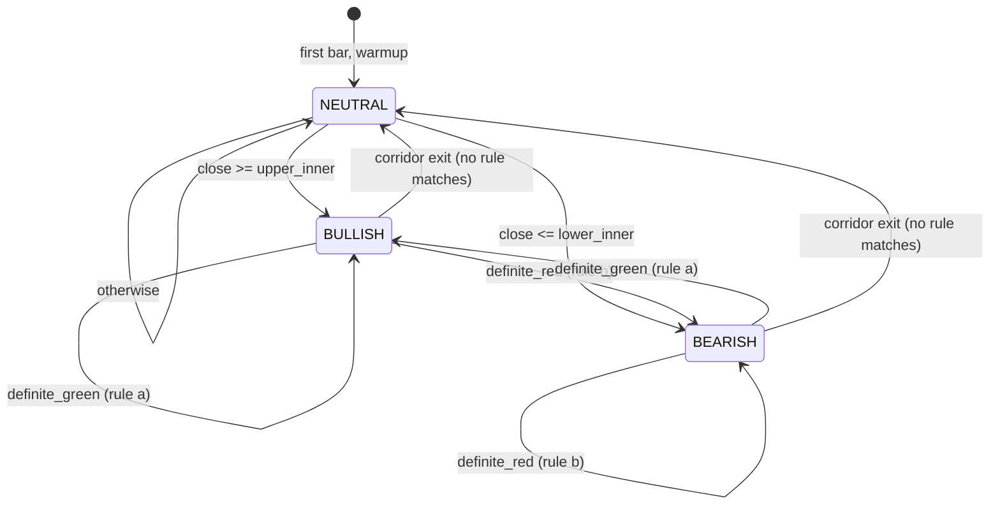

# `trip_ema/regime/` — pure regime classifier

## 1. Role in the larger application

`regime/` owns **one function**: given a previous regime, the
previous bar's close + envelope, and the current bar's bands +
envelope, return the current bar's regime as one of
`BULLISH` / `BEARISH` / `NEUTRAL`.

Single canonical implementation. **Every** consumer in the codebase
that needs to classify a bar's regime calls this function — never
inlines its own rules, never reads the rules from a config table,
never relies on a per-engine snapshot of "what we used to think the
rules were". This is enforced by code review and (negatively) by
`tests/regime/`: any deviation produces a parity-test failure.

The regime classifier is downstream of `indicators/` (which produces
the EMA / ATR / band values it consumes) and upstream of
`fundamentals/v1_runners.py` (which writes the result to
`stock_indicator_state.display_regime` and
`industry_indicator_state.display_regime`).

```mermaid
flowchart LR
    bars[OHLCV bars] --> ind[indicators]
    ind --> bands[upper_inner / lower_inner / upper_outer / lower_outer]
    ind --> env[upper_envelope = max(emas), lower_envelope = min(emas)]
    bands --> reg[regime.compute_regime]
    env --> reg
    prev[previous_regime, prev_close, prev_*_envelope] --> reg
    reg --> regime_value[Regime ∈ BULLISH, BEARISH, NEUTRAL]
    regime_value --> sis[stock_indicator_state.display_regime]
    regime_value --> iis[industry_indicator_state.display_regime]
    sis --> derive[orchestrator/derive_signals]
    derive --> sig[SignalEvent]
```

## 2. Architecture and constraints

`regime/` follows the same purity rules as `domain/`:

- **No I/O.** No DB, no network, no filesystem.
- **No state.** Function inputs only — no module-level globals
  modified by the call.
- **Imports limited to `trip_ema.domain` and stdlib.** Specifically
  imports `CoreRegime` (aliased as `Regime`) from `trip_ema.domain`.

The function is stateless and idempotent. Safe to call concurrently
from any thread or process.

## 3. File inventory

```
trip_ema/regime/
├── __init__.py            Public surface: compute_regime, BarInputs, Regime
└── compute_regime.py      The classifier
```

That is the whole package.

## 4. Public API

```python
from trip_ema.regime import compute_regime, BarInputs, Regime
```

### 4.1 `Regime`

```python
Regime = trip_ema.domain.CoreRegime
# Members: BULLISH (+1), NEUTRAL (0), BEARISH (-1)
```

Alias, not a separate enum. Using `Regime` makes intent clearer at
call sites; using `CoreRegime` makes the underlying type explicit.

### 4.2 `BarInputs`

```python
@dataclass(frozen=True, slots=True)
class BarInputs:
    close:           float

    # The four ATR-band values for this bar (from indicators/bands.py)
    upper_inner:     float
    lower_inner:     float
    upper_outer:     float
    lower_outer:     float

    # Envelope = max/min of (med_ema, long_ema, longest_ema)
    upper_envelope:  float
    lower_envelope:  float
```

Why pass `upper_envelope` / `lower_envelope` rather than the three
EMAs? Because the regime package stays free of indicator-math
dependencies — `indicators/` already computes max/min of the three
EMAs for its band logic, and we just take the result. If you have
the EMAs handy, compute the envelopes with `max(med, long, longest)`
and `min(...)` and pass them in.

### 4.3 `compute_regime`

```python
def compute_regime(
    previous_regime:         Regime,
    previous_close:          float | None,
    previous_lower_envelope: float | None,
    previous_upper_envelope: float | None,
    bar:                     BarInputs,
) -> Regime:
    ...
```

`previous_*` are `None` on the first bar of a `(ticker, timeframe)`
series. The continuation rules cannot fire when any of them is
`None`; the function falls through to the neutral default.

## 5. The rules

Evaluated top-to-bottom; **first match wins**.

| # | Name | Condition | Result |
|---|------|-----------|--------|
| (a) | `definite_green` | `close >= upper_inner` | `BULLISH` |
| (b) | `definite_red`   | `close <= lower_inner` | `BEARISH` |
| (c) | `green_continuation` | `previous_regime == BULLISH` AND (`close >= lower_envelope` OR (`close >= lower_inner` AND `prev_close >= prev_lower_envelope`)) | `BULLISH` |
| (d) | `red_continuation`   | `previous_regime == BEARISH` AND (`close <= upper_envelope` OR (`close <= upper_inner` AND `prev_close <= prev_upper_envelope`)) | `BEARISH` |
| (e) | `neutral` | otherwise | `NEUTRAL` |

### 5.1 Priority on a "both" tie

A bar satisfying BOTH (a) and (d) returns `BULLISH` because (a) is
evaluated first. A bar satisfying BOTH (b) and (c) returns `BEARISH`.
This is exactly what makes a sharp reversal paint immediately rather
than continuing the prior colour:

| Scenario | Result | Why |
|----------|--------|-----|
| Yesterday BEARISH; today close way above upper_inner | `BULLISH` | (a) fires before (d) — sharp BULLISH reversal |
| Yesterday BULLISH; today close way below lower_inner | `BEARISH` | (b) fires before (c) — sharp BEARISH reversal |
| Yesterday BULLISH; today inside corridor, still above lower_envelope | `BULLISH` | (a) skips, (b) skips, (c) fires — continuation |
| Yesterday BEARISH; today inside corridor, dipped below upper_envelope earlier but holding inner | `BEARISH` | (d)'s second leg fires |

### 5.2 The two continuation legs

Continuations check TWO conditions and OR them:

**Leg 1** (`close >= lower_envelope` for green):
"Did the close hold above the ribbon's bottom edge?" This is the
common path — most continuations.

**Leg 2** (`close >= lower_inner AND prev_close >= prev_lower_envelope`):
"Did today close above the lower inner band, AND was yesterday's
close above yesterday's lower envelope?" Captures the case where
the ribbon dipped between yesterday and today but the price held the
inner band. Requires both previous values to be finite — guarded
explicitly.

The mirror legs for red continuation use `upper_envelope` and
`upper_inner` with `<=`.

### 5.3 Boundary equality

A bar sitting **exactly** on `upper_inner` is `definite_green` —
rule (a) uses `>=`. Mirror for the lower side. Boundary cases hit
the rule they fall on the closed side of.

### 5.4 Warmup and NaN handling

The very first lines of `compute_regime`:

```python
if not _is_finite(
    bar.close,
    bar.upper_inner, bar.lower_inner,
    bar.upper_envelope, bar.lower_envelope,
):
    return Regime.NEUTRAL
```

`_is_finite` returns `True` iff every passed value is a real, finite
float — rules out `None`, `NaN`, `+inf`, `-inf`.

The guard is **explicit** rather than relying on Python's NaN
comparison semantics. Why explicit? Two reasons:

1. **Readability.** "If you don't have good numbers, you get
   `NEUTRAL`" is more self-evident than "`NaN >= x` is `False`, so
   rule (a) fails, then (b), (c), (d), and we end up at (e)".
2. **Robustness to `None`.** Pine's `ta.ema` returns `NaN` during
   warmup, but a Python translation layer might surface `None`
   instead. `_is_finite` handles both.

The continuation rules (c) and (d) **additionally** require the
`previous_*` values to be finite (else they don't fire). This is the
`leg2 = (_is_finite(previous_close, previous_lower_envelope) and ...)`
pattern in the source.

**Note on the regime input.** `previous_regime` is an `IntEnum`, not
a float, so it cannot be `NaN`. The very first bar passes
`Regime.NEUTRAL` (the implicit "before bar 1, the regime was
neutral") and lets the rules play out from there.

## 6. Determinism and idempotency

```python
compute_regime(prev_regime, prev_close, prev_le, prev_ue, bar)
```

For the same input tuple, returns the same output tuple. Always.
Across processes, across thread interleavings, across re-runs.

This matters because:

- **Backfills** re-derive history. The regime stamped on
  `stock_indicator_state` rows during a backfill must be
  byte-identical to what the live cycle stamped on the same bars
  originally.
- **Tests** use seeded fixture series and compare against a golden
  expected sequence. Any non-determinism breaks the golden harness.
- **Forensics.** "Why did this ticker flip BULLISH on this date?"
  is answerable by replaying inputs and getting the same output.

The function is intentionally implemented with no random sources,
no clock reads, no env-var reads, no module-level mutable state.

## 7. State machine view



Note three properties:

- The transitions `BULLISH → NEUTRAL` and `BEARISH → NEUTRAL` exist
  but **only as fallthrough** — no rule explicitly says "exit
  current regime"; you get there by every continuation leg failing.
- The same-state transitions (e.g. `BULLISH → BULLISH`) are the
  common case — most bars in a trending regime hit (a) or (c).
- The diagonals (`BULLISH → BEARISH` or `BEARISH → BULLISH`) are
  the sharp reversals; they require (a) or (b) to fire, both of
  which override continuation.

## 8. Sticky-on-NaN: a non-issue here

Some legacy code paths use "sticky-on-NaN" semantics — carry the
prior regime forward when inputs are NaN rather than dropping to
neutral. `compute_regime` does NOT do this. It returns `NEUTRAL` for
NaN inputs.

Where "sticky" semantics matter, the caller layers it on top:

```python
new_regime = compute_regime(prev_regime, ...)
if not bar_is_warmed_up:
    new_regime = prev_regime    # carry forward
```

This split puts the policy at the call site where it belongs and
keeps `compute_regime` honest about what its inputs mean.

In current production:

- **Live cycle** (`fundamentals/v1_runners.py`) does NOT carry
  forward — a warmup-laced bar simply gets `display_regime = 0`
  written. This is a small number of bars at series start; not a
  practical issue.
- **Backfill** (`backfill/pipeline.py`) does the same. Backfills
  start from a fixed historical Monday and let warmup play out
  naturally on each ticker's first ~36 weekly bars.
- **Backtest signal generator** (`fundamentals/signal_generator.py`)
  walks from priming index 250 (about 5 years of daily history) so
  that by the time it cares about emitting signals, every input is
  warmed up.

## 9. Performance characteristics

The function is `O(1)`:

- One `_is_finite(5 floats)` call: 5 `isfinite` checks.
- A handful of float comparisons.
- One enum equality check and at most two more `_is_finite(2 floats)`
  calls for the continuation legs.

No allocations beyond the return value (which is an enum member — a
small fixed pool, no allocation). On modern Python this is ~50ns
per call. Calling it 2,500 × 250 = 625K times during a full backfill
takes well under a second of pure CPU.

## 10. Testing

`tests/regime/test_compute_regime.py` covers:

| Scenario | Test fixture |
|----------|-------------|
| All 5 rules — single-bar truth tables | Hand-built `BarInputs` |
| Priority — (a) over (d), (b) over (c) | Sharp-reversal cases |
| Boundary equality — `close == upper_inner` is BULLISH | Exact-boundary fixtures |
| Warmup — NaN in any band → NEUTRAL | `float('nan')` in inputs |
| First-bar — `prev_*` all `None` → no continuation possible | `None` previous values |
| Continuation leg 2 — ribbon dipped, price held inner | Two-bar fixture |
| Stability under reordering of float comparisons | Property-based test |

There's also `tests/parity/test_pine_parity.py` which runs full
historical series through the pipeline and compares regimes
bar-by-bar against TradingView output. Any divergence at this layer
shows up there first.

## 11. Why this is its own package

Historical context: the regime rules used to live inside the
stateful `TickerEngine` class in `indicators/`. They were threaded
through three call sites (live ingest, backfill replay, chart
endpoint) with three subtly different implementations that drifted
apart over time. The V1 cutover extracted them into this single
pure function so:

1. Backfill and live now use the **exact** same classifier — any
   divergence becomes impossible because they are the same function.
2. The persisted `display_regime` column has one authoritative
   producer.
3. Any future caller (a backtester, a parity harness, a ad-hoc
   "what regime would this bar have been" probe) calls the function
   rather than reimplementing.
4. The function is trivially testable — pure inputs, pure output,
   no fixtures.

## 12. Common pitfalls

1. **Don't carry forward `regime` inside `compute_regime`.** That's
   policy, not classification. If you need sticky-on-NaN, do it at
   the call site.
2. **Don't add a 6th rule without an accompanying parity test
   update.** The classifier is the contract; new rules must match
   the operator's Pine indicator. Adding "case (f)" without proving
   parity to the Pine source is a footgun.
3. **Don't peek at `prev_regime` in (a) / (b).** Definite rules
   override continuation; they don't care what the prior regime was.
   A `BEARISH → BULLISH` reversal must fire if (a) is satisfied, not
   wait for "continuation said no first".
4. **`leg2 = (_is_finite(...) and bar.close >= bar.lower_inner and
   previous_close >= previous_lower_envelope)`** — the AND is
   important. Comparing a finite `previous_close` against a `None`
   `previous_lower_envelope` raises `TypeError`, not returns
   `False`. The `_is_finite` short-circuit guard handles it.

## 13. Extending this layer

If you need to add a new regime category (e.g. a `CHOPPY` regime
between BULLISH and BEARISH), the steps are:

1. Add the enum value to `domain.CoreRegime` (with a fixed integer
   encoding — the DB CHECK constraint cares).
2. Add the SQL CHECK update via a new Alembic migration.
3. Add the classification rule to `compute_regime` in the
   right priority slot.
4. Update `tests/regime/` truth tables.
5. Update `tests/parity/test_pine_parity.py` if the Pine source has
   a matching concept; otherwise document the deviation.
6. Update every downstream consumer that switches on regime values:
   `notifications/enrichment.py`, GUI chart rendering colours, etc.

This is a deliberately heavy lift — it should be.

## 14. Related packages

- `trip_ema/domain/` — provides `CoreRegime`. `Regime` here is an
  alias.
- `trip_ema/indicators/` — produces the band and envelope values
  that feed `BarInputs`.
- `trip_ema/fundamentals/v1_runners.py` — calls `compute_regime`
  per bar during state-row computation.
- `trip_ema/orchestrator/derive_signals.py` — reads the persisted
  `display_regime` from two consecutive `stock_indicator_state`
  rows and emits a `SignalEvent` if they differ.
- `tests/parity/` — Pine parity harness that exercises this
  function indirectly via the full pipeline.
