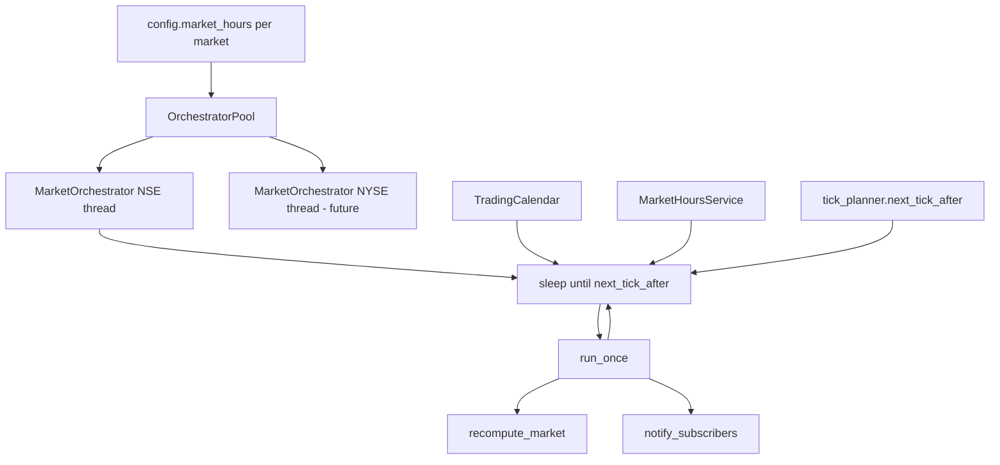

# `trip_ema/scheduler/` — periodic loops + market orchestration

## 1. Role in the larger application

`scheduler/` is the **wall-clock-driven side** of the service. Where
the orchestrator package (`trip_ema/orchestrator/`) defines **what**
runs each cycle, this package defines **when** cycles run.

Two responsibilities:

1. **Per-market orchestrators** (`MarketOrchestrator`) — one thread
   per exchange, anchored to that exchange's trading hours.
   Each tick runs the
   `orchestrator.recompute_market` + `orchestrator.notify_subscribers`
   pipeline for that market.
2. **Calendar + tick-planning primitives** — given an exchange's
   trading hours, weekdays, holidays, and tick schedule, compute
   "when is the next tick I should fire?" The orchestrator's
   sleep loop just sleeps until that instant.

The legacy `ComputeScheduler` and `SubscriberDistributor` classes
still live in this package, but are **not started** in V1 —
`MarketOrchestrator` does their work. They're constructed at boot
(for health-snapshot compatibility) but `.start()` is never called.



## 2. Architecture and constraints

| Rule | Why |
|------|-----|
| **One thread per market** | Markets have different calendars, hours, and rate-limit budgets. A single shared loop would have to move at the slowest pace |
| **All sleeps in 1-second chunks** | Shutdown is graceful — the pool's `stop_all()` sets stop events on every loop, and each loop checks the event each second |
| **Tick math is pure** | `tick_planner.next_tick_after`, `_wall_clock.seconds_until_next_tick` — no I/O, no globals, no clock reads. Caller passes `now` so tests can fix it |
| **Calendar reads are thread-safe** | `TradingCalendar` caches per-year holiday lookups via `dict.setdefault`-style atomic insert. Multiple `MarketOrchestrator` threads can share one calendar instance per market |
| **Legacy ComputeScheduler + SubscriberDistributor constructed but not started** | They satisfy admin health snapshot lookups (`compute_scheduler_alive: false` is the correct off-state for V1) and stay in the tree for the few diagnostic paths that read them. Production work routes through `MarketOrchestrator` |
| **Wall-clock ticks anchored to local-midnight, not UTC-epoch** | A "top of hour" tick must line up with `09:00 IST`, not `09:00 UTC` (= `14:30 IST`). `seconds_until_next_local_tick` exists specifically for this |

## 3. File inventory

```
trip_ema/scheduler/
├── __init__.py                  Re-exports (MarketOrchestrator, OrchestratorPool, …)
├── _wall_clock.py               seconds_until_next_tick + _local_tick helpers
├── market_calendar.py           TradingCalendar + TradingCalendarConfig
├── market_hours.py              MarketHoursService — is exchange X open at T?
├── tick_planner.py              next_tick_after(now, market, cal) -> UTC instant
├── market_orchestrator.py       MarketOrchestrator class (the per-market thread)
├── orchestrator_pool.py         OrchestratorPool + build_pool_from_configs
├── compute_scheduler.py         (legacy, unstarted in V1)
└── subscriber_distributor.py    (legacy, unstarted in V1)
```

## 4. `_wall_clock.py` — tick math primitives

### 4.1 `seconds_until_next_tick(now, cadence) -> float`

```python
def seconds_until_next_tick(now: datetime, cadence: timedelta) -> float:
    if now.tzinfo is None:
        raise ValueError("`now` must be timezone-aware")
    cadence_seconds = cadence.total_seconds()
    epoch_seconds = now.timestamp()
    elapsed_in_window = epoch_seconds % cadence_seconds
    remaining = cadence_seconds - elapsed_in_window
    if remaining <= 0:
        remaining = cadence_seconds
    return remaining
```

UTC-epoch-anchored. With `cadence=1h`, returns seconds to the next
top of UTC hour. With `cadence=15m`, to the next `:00`/`:15`/`:30`/`:45`
UTC minute.

**Half-open range `(0, cadence_seconds]`.** Never returns zero —
if `now` lands exactly on a boundary, we wait one full cadence to
the next one. This matches the loop pattern `sleep(...); run_once()`
— landing on a boundary doesn't mean fire twice.

Naive datetimes raise.

### 4.2 `seconds_until_next_local_tick(now, cadence, tz) -> float`

Same shape, but anchored relative to **local midnight** in `tz`
rather than UTC epoch. With `tz='Asia/Kolkata', cadence=1h`, ticks
line up with `00:00`, `01:00`, …, `23:00` IST — which corresponds
to UTC `18:30` (previous day), `19:30`, … rather than the
straight-UTC `00:00`, `01:00`, … UTC alignments.

Important for market-hours orchestration: a "post-open + hourly"
schedule for NSE wants ticks at `09:15`, `10:15`, … IST. The
hourly part of that lines up with **IST hour boundaries**, not UTC.

## 5. `market_calendar.py` — TradingCalendar

### 5.1 `TradingCalendarConfig`

```python
@dataclass(frozen=True, slots=True)
class TradingCalendarConfig:
    exchange:                str
    weekdays:                frozenset[int]      # ISO 1..7
    holidays_country:        str | None = None   # python-holidays code
    holidays_override_file:  Path | None = None  # YAML overrides
```

Minimal viable config: `(exchange="X", weekdays=[1,2,3,4,5])`
yields Mon-Fri-only with no holiday awareness — useful for tests
and exchanges without a published holiday calendar.

### 5.2 `TradingCalendar` decision order

For `is_trading_day(d)`:

1. **Override: special trading day.** Wins over everything.
   (Diwali Muhurat Trading on a Saturday at NSE → set in the YAML
   override file → calendar returns `True` even though Saturday
   is excluded by weekdays.)
2. **Weekday filter.** `d.isoweekday() not in weekdays` → `False`.
3. **Override: explicit holiday.** A YAML entry in `extra_holidays`
   → `False`.
4. **Algorithmic holiday lookup** via `python-holidays` for the
   year's holiday calendar of `holidays_country`.

The first three short-circuit; only if none produce a verdict do
we consult the package.

### 5.3 Override file format

`configs/nse_holidays_2026.yaml`:

```yaml
extra_holidays:
  - 2026-01-26    # Republic Day
  - 2026-08-15    # Independence Day
special_trading_days:
  - 2026-11-12    # Muhurat Trading on Diwali
```

### 5.4 `previous_trading_day(d) -> date` and `next_trading_day(d) -> date`

Walk backwards / forwards from `d` (exclusive of `d` itself) until
`is_trading_day` returns True. Hard-capped at `_MAX_LOOKBACK_DAYS = 60`
— a string of 60 consecutive non-trading days is impossible in any
real market (longest historical NSE closure is ~5 days for Diwali
week). 60-day overshoot raises `RuntimeError` — strong signal of
misconfiguration, not a real closure.

### 5.5 Caching

Per-year holidays are populated lazily on first query for that
year and cached. The cache uses `dict.setdefault`-style population,
which is GIL-atomic for individual key insertions in CPython. Safe
for concurrent reads across orchestrator threads.

### 5.6 Override-file load is best-effort

```python
try:
    data = yaml.safe_load(path.read_text())
    ...
except Exception:
    logger.exception("Failed to load holiday override file ...; ignoring")
```

Malformed YAML, missing PyYAML, unparseable dates — all logged
and ignored. The calendar still functions correctly from the
weekday filter and algorithmic holidays. Raising would prevent
startup; that's worse than degraded overrides.

## 6. `market_hours.py` — MarketHoursService

```python
class MarketHoursService:
    def is_open(exchange: str, t: datetime) -> bool
    def any_open(t: datetime) -> bool
    def configured_exchanges() -> list[str]
```

Stateless, thread-safe. Configured from `Config.market_hours`.
Open/close in exchange-local TZ + ISO weekday list. Callers pass
UTC; internal conversion to each exchange's local TZ via `zoneinfo`.

Doesn't consult holidays — that's `TradingCalendar`'s job. This
service answers "given the hours alone, would the market be open
now?" Holiday-aware "should the market be open today" goes through
`TradingCalendar.is_trading_day(d) AND MarketHoursService.is_open(t)`
together.

## 7. `tick_planner.py` — when does the next tick fire?

### 7.1 `MarketTickConfig` runtime dataclass

```python
@dataclass(frozen=True, slots=True)
class MarketTickConfig:
    exchange:           str
    tz:                 ZoneInfo
    open:               time
    close:              time
    post_open_offset:   timedelta
    pre_close_offset:   timedelta
    intraday_cadence:   timedelta
    tick_schedule:      tuple[ResolvedTickEntry, ...] | None
```

Runtime form of `MarketHoursConfig.to_tick_config()`. Either uses
the legacy 3-field cadence (`post_open_offset`, `pre_close_offset`,
`intraday_cadence`) or the explicit `tick_schedule`.

### 7.2 `compute_tick_times_for_day(market, d) -> list[datetime]`

Compute the **list of UTC instants** at which ticks should fire on
a given trading day, anchored to that day's open/close.

**Legacy mode** (when `tick_schedule is None`):

```
ticks = [open + post_open_offset,
         open + post_open_offset + intraday_cadence,
         open + post_open_offset + 2*intraday_cadence,
         ...,
         close - pre_close_offset]
```

So a 09:15-15:30 IST schedule with `post_open=5m`, `pre_close=15m`,
`cadence=60m` yields `[09:20, 10:20, 11:20, 12:20, 13:20, 14:20, 15:15]`
— 7 ticks per day.

**Phase-16 explicit mode** (when `tick_schedule` is set):

For each `ResolvedTickEntry`:

- `anchor='open'` → `open + offset_minutes`
- `anchor='close'` → `close + offset_minutes`
- `anchor='midpoint'` → midpoint between the latest open-anchored
  and earliest close-anchored entries

Production NSE V1 schedule: 09:30, 12:15, 15:00, 16:30 IST (the
four-tick schedule).

**Early-close days** (NYSE half days at 13:00 ET): every instant
slides automatically because they're all relative to that day's
close. No half-day branching in code paths.

### 7.3 `next_tick_after(now, market, cal) -> datetime`

Composed primitive:

```python
def next_tick_after(now, market, cal):
    today = now.astimezone(market.tz).date()
    
    # If today is a trading day, find first tick after now
    if cal.is_trading_day(today):
        for tick_utc in compute_tick_times_for_day(market, today):
            if tick_utc > now:
                return tick_utc
    
    # No more ticks today (or today not a trading day) → go to next trading day
    next_d = cal.next_trading_day(today)
    return compute_tick_times_for_day(market, next_d)[0]
```

Returns the UTC instant the orchestrator should sleep until.

## 8. `market_orchestrator.py` — the per-market thread

### 8.1 Lifecycle

```
__init__(...)                — stores config, dependencies, builds state
    │
    │ start() — spawns thread running _loop
    ▼
_loop() runs:
    │
    │ while not stop_event.is_set():
    │     compute next_tick_after(now, ...)
    │     sleep in 1-second chunks until tick_time or stop_event
    │     if stop_event: break
    │     run_once() — fetch → recompute → notify
    │     publish summary to PulsePublisher
    │     update last_tick_at
    ▼
stop(timeout) — sets stop_event, joins thread within timeout
```

### 8.2 `OrchestratorSettings` and `OrchestratorRunSummary`

```python
@dataclass(frozen=True, slots=True)
class OrchestratorSettings:
    catch_up_on_startup:            bool
    catch_up_skip_if_recent_minutes: int
    fetch_timeout_seconds:          int
    fetch_retry_delay_minutes:      int

@dataclass(frozen=True, slots=True)
class OrchestratorRunSummary:
    exchange:        str
    tick_at:         datetime
    started_at:      datetime
    finished_at:     datetime
    recompute_result: RecomputeMarketResult
    notify_result:   NotifyResult
    error:           str | None = None
```

The `OrchestratorRunSummary` is published to the
`PulsePublisher` for the GUI's live status display.

### 8.3 `run_once` — single tick

```python
def run_once(self, tick_at):
    started_at = datetime.now(UTC)
    cid = new_correlation_id()
    with correlation_id(cid):
        try:
            recompute_result = recompute_market(
                db_engine=self._db_engine,
                cache=self._cache,
                exchange=self._market.exchange,
                as_of=tick_at,
                progress_cb=self._progress_cb,
            )
            notify_result = notify_subscribers(
                db_engine=self._db_engine,
                brevo_api_key=self._brevo_key,
                brevo_from_address=self._brevo_from,
                cycle_id=self._format_cycle_id(tick_at),
                now=tick_at,
            )
            summary = OrchestratorRunSummary(
                exchange=self._market.exchange,
                tick_at=tick_at,
                started_at=started_at,
                finished_at=datetime.now(UTC),
                recompute_result=recompute_result,
                notify_result=notify_result,
            )
        except Exception as e:
            summary = OrchestratorRunSummary(
                exchange=self._market.exchange,
                tick_at=tick_at,
                started_at=started_at,
                finished_at=datetime.now(UTC),
                recompute_result=None,
                notify_result=None,
                error=f"{type(e).__name__}: {e}",
            )
            logger.exception(...)
    self._publisher.publish(summary)
    self._last_tick_at = tick_at
    return summary
```

**Two top-level try/except.** Any exception bubbling out of
`recompute_market` or `notify_subscribers` is caught here, recorded
in the summary's `error` field, and the summary is still published.
The orchestrator continues to its next tick.

A genuinely catastrophic error (DB completely unreachable for
hours) shows up in the GUI as a series of error-summaries, one per
tick. The service stays alive; operator intervenes.

### 8.4 Catch-up on startup

If `catch_up_on_startup=True` and the service starts up after one
or more scheduled ticks have already passed today, fire one
**immediate** catch-up `run_once` with `tick_at` set to the most
recent missed tick. Skip the catch-up if the orchestrator's
`last_tick_at` (read from `compute_runs` table at startup) is
within `catch_up_skip_if_recent_minutes` of now — avoids firing on
a normal restart that happened shortly after a successful tick.

When `catch_up_on_startup=False` (default), missed ticks are simply
skipped. The natural next-tick loop catches up at the next firing.

### 8.5 PulsePublisher

```python
class PulsePublisher:
    def publish(summary: OrchestratorRunSummary) -> None
    def get_latest(exchange: str) -> OrchestratorRunSummary | None
    def get_history(exchange: str, n: int = 100) -> list[OrchestratorRunSummary]
```

Bounded ring buffer per exchange. The GUI reads from it via the
admin route to render the cycle history table.

## 9. `orchestrator_pool.py` — OrchestratorPool

### 9.1 Lifecycle

```python
class OrchestratorPool:
    def __init__(self, orchestrators: dict[str, MarketOrchestrator]): ...
    def start_all() -> None
    def stop_all(timeout: float = 30) -> None
    def get(exchange: str) -> MarketOrchestrator
    def alive_count() -> int
    def configured_exchanges() -> list[str]

def build_pool_from_configs(config, db_engine, cache, ...) -> OrchestratorPool:
    """Build one MarketOrchestrator per entry in config.market_hours."""
```

The pool is built at startup by `app.py`. `start_all()` spawns
every orchestrator's thread; `stop_all()` is wired into the
service-shutdown hook.

### 9.2 Production setup

Production NSE-only: `config.market_hours` has one entry
(NSE), so the pool has one `MarketOrchestrator`. The system
scales to multiple markets by adding entries to `market_hours` —
no code change required (each gets its own thread, calendar, tick
schedule).

## 10. Data flow — one tick from sleep to publish

```
sleep loop in MarketOrchestrator thread
    │ now = datetime.now(UTC)
    │ next_tick = next_tick_after(now, market_config, calendar)
    ▼
sleep in 1-sec chunks until now ≥ next_tick OR stop_event set
    │ (stop_event short-circuits — exit cleanly)
    ▼
run_once(tick_at=next_tick)
    │
    │ with correlation_id(new_correlation_id()):
    │
    ├─► recompute_market(db_engine, cache, exchange, as_of=next_tick)
    │     8 stages, ~30s wall
    │
    ├─► notify_subscribers(db_engine, brevo_key, cycle_id, now=next_tick)
    │     compose + send + log, ~2s wall
    │
    │ build OrchestratorRunSummary
    ▼
publisher.publish(summary)
    │ GUI subscribers see new entry
    ▼
self._last_tick_at = tick_at
    │
    ▼
back to sleep loop, next_tick_after recomputes for the next firing
```

Per-tick total wall: ~30-60 seconds. Idle between ticks at NSE
cadence (4/day): ~2 hours of sleep between firings.

## 11. Concurrency

- One thread per market.
- Within a tick, `recompute_market` and `notify_subscribers` are
  sequential.
- Inside `recompute_market`, stages 1/2/6/7/8 fan out per-ticker
  via `ThreadPoolExecutor` (owned by `fundamentals/runners.py`).
- The pool's `stop_all()` sets every orchestrator's `stop_event`
  in parallel, then joins each thread sequentially within
  `timeout`.

## 12. Failure modes

| Failure | Behaviour | Recovery |
|---------|-----------|----------|
| `recompute_market` raises mid-stage | Caught by `run_once`; summary records error; tick continues to publish | Next tick retries |
| `notify_subscribers` raises | Same — caught, summary records, continues | Next tick retries |
| `next_tick_after` raises (corrupt calendar config) | Caught at `_loop` level; logged; sleep 60s; retry computing next_tick | Operator fixes config, restart |
| Catch-up tick fires but DB is down | Catch-up summary records error; loop returns to natural-schedule mode | Next tick retries |
| `stop_event` set during tick execution | Tick completes fully; loop exits on next iteration check | Graceful shutdown |
| Thread dies unexpectedly | `OrchestratorPool.alive_count` reflects loss. No automatic respawn in V1; operator restart needed | Manual intervention |

## 13. Logging and metrics

Each tick emits:

```
MarketOrchestrator[NSE] sleeping until 2026-06-29 12:15:00+05:30 (8995s)
MarketOrchestrator[NSE] tick at 2026-06-29 12:15:00+00:00
recompute_market[NSE] starting: ...
[stages]
notify_subscribers[20260629-1215] starting: ...
[notify logs]
MarketOrchestrator[NSE] tick completed in 31.2s
```

Metrics: `scheduler_runs_total{outcome}`, `scheduler_run_duration_seconds`.

## 14. Testing

`tests/scheduler/`:

| File | Coverage |
|------|----------|
| `test_wall_clock.py` | `seconds_until_next_tick` truth table including boundary-landing case (returns full cadence, not 0) |
| `test_market_calendar.py` | Decision order (special-trading > weekday > explicit holiday > algorithmic), override-file load failures (silent) |
| `test_market_calendar_dst.py` | DST transition handling for NYSE/America/New_York |
| `test_market_hours.py` | `is_open`, `any_open`, configured_exchanges |
| `test_tick_planner.py` | Legacy + explicit schedule modes, NYSE early-close-day behavior |
| `test_market_orchestrator.py` | run_once happy path, error catching, catch-up logic, sleep + stop_event interaction |
| `test_orchestrator_pool.py` | Build from config, start_all/stop_all, alive_count |

## 15. Common pitfalls

1. **UTC vs IST anchoring.** `seconds_until_next_tick(now, 1h)`
   fires at UTC top-of-hour. For market-aligned schedules, use
   `seconds_until_next_local_tick(now, 1h, 'Asia/Kolkata')`.
2. **Naive datetimes raise.** Both wall-clock helpers reject them.
3. **Sleep loops must check stop_event every second.** A
   30-minute `time.sleep(1800)` would mean shutdown takes up to
   30 minutes. Always loop with 1-second sleeps.
4. **Pool members don't restart on crash.** `stop_all()` cleans up;
   if an orchestrator's thread dies of an uncaught exception, the
   pool's `alive_count` drops. Detect via the GUI health route;
   manual restart needed.
5. **`MarketTickConfig.tz` is a `ZoneInfo` object, not a string.**
   The config layer parses strings via `ZoneInfo()` once;
   downstream code passes the parsed instance around.
6. **`previous_trading_day(d)` is exclusive of `d`.** Even if `d`
   itself is a trading day, the function returns the *previous*
   one. Same for `next_trading_day`.

## 16. Extension paths

- **Add a new market.** Add an entry to `config.market_hours`,
  ensure the holidays_country has python-holidays support, restart.
  Pool auto-spawns a new thread.
- **Per-tick custom payload.** Extend `OrchestratorRunSummary` with
  a new field, populate in `run_once`, surface in GUI.
- **A nightly housekeeping tick.** Add a `tick_schedule` entry
  with `anchor: close, offset_minutes: 360` (six hours after
  close) — a non-trading-hours tick. The orchestrator fires it
  same as any other. The recompute stages skip work for closed
  markets, so the cost is low if your stage handlers respect that.

## 17. Related packages

- `trip_ema/orchestrator/recompute_market.py` and
  `notify_subscribers.py` — called by `MarketOrchestrator.run_once`.
- `trip_ema/config/schema.py` — provides `MarketHoursConfig` which
  this package consumes.
- `trip_ema/observability/correlation.py` — used by `run_once` to
  push a per-tick correlation ID.
- `trip_ema/observability/metrics.py` — the
  `scheduler_*` family of counters / histograms.
- `trip_ema/persistence/compute_runs_repo.py` — read at startup
  for `last_tick_at` (catch-up decision).
- `trip_ema/cache/current_signals_cache.py` — passed by reference
  into `recompute_market` for stage 5 rebuilds.
- `trip_ema/fundamentals/runners.py` — bulk populators called per
  cycle.
