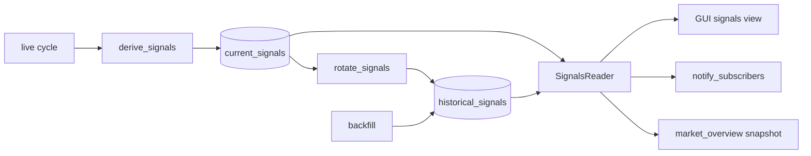

# `trip_ema/signals/` — V1 signal read path

## 1. Role in the larger application

`signals/` is the **read side** of the V1 signal pipeline. One
class: `SignalsReader`. Two methods: `last_n_for_ticker(ticker_id,
n)` and `latest_for_ticker(ticker_id)`. That is the entire public
surface.

What's *not* here matters as much. The pre-V1 codebase put both the
classification rules (BUY / SELL / EXIT / NO_CHANGE precedence) and
the write path in this package. The V1 cutover demolished both,
moving:

- Classification → `orchestrator/derive_signals.py`
  (`_classify_regime_change`)
- Writes → `orchestrator/derive_signals.py` →
  `persistence/current_signals_repo.py` (live cycle), or
  `backfill/pipeline.py` → `persistence/historical_signals_repo.py`
  directly (backfill)
- Rotation → `orchestrator/rotate_signals.py`

So `signals/` is now exactly what its name suggests: how the rest of
the system **reads** signals. The GUI's signals view, the
notification composer, the chart endpoint, the snapshotter — all of
them go through `SignalsReader` for last-N queries.



## 2. Architecture and constraints

Three constraints inherited from the larger V1 design that this
module respects literally:

| # | Constraint | Where enforced |
|---|------------|----------------|
| **N4** | Two-table model: `current_signals` (≤ 1 row per ticker, current cycle's pending signal) and `historical_signals` (append-only audit log) | The schema + this reader |
| **N6** | **No UNION** between the two tables. Read paths must compose them in Python | Explicit in `SignalsReader.last_n_for_ticker` — two separate `.get_for_ticker(...)` calls, list concatenation in Python |
| **N7** | No write code lives in this package | `__init__.py` exports nothing public; only `SignalsReader` is importable, and it has no write methods |

**Why no UNION?** Two reasons:

1. **Planner stability.** `current_signals` has at most ~2,500 rows
   (one per active ticker) and is constantly being mutated by the
   live cycle. `historical_signals` is ~100K+ rows and grows
   monotonically. Asking the planner to UNION the two consistently
   is asking for a query-plan flip when statistics drift. Two
   targeted queries with their own clean plans is faster and
   simpler.
2. **Cache cutover path.** Step 5 of the V1 plan replaces the
   `current_signals` lookup with a `SignalCache` lookup. With a
   UNION, that cutover would require rewriting a join. With the
   two-query composition, you swap one line — `self._current.get_for_ticker(...)`
   becomes `self._cache.get_for_ticker(...)` — and the rest of the
   method is unchanged.

## 3. File inventory

```
trip_ema/signals/
├── __init__.py            empty __all__, marker package
└── signals_reader.py      SignalsReader class
```

## 4. Public API

### 4.1 `__init__.py`

```python
# === STEP 15-B4: persist_signals demolished ===
# V1 pipeline uses trip_ema.orchestrator.derive_signals + recompute_market.

__all__: list[str] = []
```

`__all__` is intentionally empty. The pre-V1 surface (
`generate_signal`, `PositionState`, `SignalDecision`,
`persist_signal_events`, `walk_and_generate_events`,
`generate_live_signal_for_ticker`, `run_backfill_for_ticker`,
`SignalCacheWriter`, `BackfillResult`, `LiveTickResult`) is gone.

Callers import the reader directly:

```python
from trip_ema.signals.signals_reader import SignalsReader
```

### 4.2 `SignalsReader`

```python
class SignalsReader:
    def __init__(
        self,
        current_repo:    CurrentSignalsRepository,
        historical_repo: HistoricalSignalsRepository,
    ): ...

    def last_n_for_ticker(self, ticker_id: int, n: int) -> list[SignalEvent]: ...

    def latest_for_ticker(self, ticker_id: int) -> SignalEvent | None: ...
```

Stateless beyond its repo references. Construction is cheap; build
one per request handler if you want.

### 4.3 `last_n_for_ticker(ticker_id, n)`

```python
def last_n_for_ticker(self, ticker_id: int, n: int) -> list[SignalEvent]:
    if n < 0:
        raise ValueError(f"n must be >= 0, got {n}")
    if n == 0:
        return []

    current = self._current.get_for_ticker(ticker_id)

    if current is not None:
        if n == 1:
            return [current]
        historical = self._historical.get_for_ticker(ticker_id, limit=n - 1)
        return [current] + historical

    return self._historical.get_for_ticker(ticker_id, limit=n)
```

Returns up to `n` most-recent `SignalEvent`s for the ticker,
newest-first.

| Input | Behaviour | DB hits |
|-------|-----------|---------|
| `n == 0` | Returns `[]` | 0 |
| `n < 0` | Raises `ValueError` | 0 |
| `n == 1`, `current_signals` has a row | Returns `[current_row]` | 1 |
| `n == 1`, no `current_signals` row | Returns `[]` or `[hist_row]` | 2 |
| `n > 1`, `current_signals` has a row | Returns `[current_row, *up_to_(n-1)_historical]` | 2 |
| `n > 1`, no `current_signals` row | Returns up to `n` historical rows | 2 |
| Ticker has < `n` total signals | Returns whatever is available; no padding | 1 or 2 |

Ordering within the historical batch: `bar_timestamp DESC,
computed_at DESC`. The current_signals row (if present) is always
the newest in the returned list — by construction, `current_signals`
holds the cycle's most recent unrotated signal, which must be at
least as recent as anything in `historical_signals`.

### 4.4 `latest_for_ticker(ticker_id)`

```python
def latest_for_ticker(self, ticker_id: int) -> SignalEvent | None:
    current = self._current.get_for_ticker(ticker_id)
    if current is not None:
        return current

    results = self._historical.get_for_ticker(ticker_id, limit=1)
    return results[0] if results else None
```

Cheaper than `last_n_for_ticker(id, 1)` when `current_signals` has
no row: 1 DB hit instead of 2 (drops the historical query when the
current is non-None). Otherwise equivalent.

Returns `None` (not `[]`) when the ticker has no signals anywhere.

## 5. Data flow walkthrough

Consider the GUI's Tickers tab asking for the last 5 signals on
ticker_id 12345 (NSE:BALAMINES). The sequence:

```
GUI worker thread
    │
    │ tick_id=12345, n=5
    ▼
HTTP GET /v1/signals/NSE/BALAMINES/recent?limit=5
    │
    ▼
route handler in transports/http/routes/
    │
    │ open transaction(db_engine)
    ▼
SignalsReader(current_repo, historical_repo)
    │
    │ last_n_for_ticker(12345, 5)
    ▼
current_repo.get_for_ticker(12345)
    │
    │ SELECT * FROM current_signals WHERE ticker_id = 12345
    ▼
{single row or None}
    │
    ├─ if row: historical_repo.get_for_ticker(12345, limit=4)
    │           SELECT * FROM historical_signals
    │            WHERE ticker_id = 12345
    │            ORDER BY bar_timestamp DESC, computed_at DESC
    │            LIMIT 4
    │           → up to 4 rows
    │
    └─ else: historical_repo.get_for_ticker(12345, limit=5)
             → up to 5 rows
    │
    ▼
list[SignalEvent]  ← V1 SignalEvent (from trip_ema.domain.signal_event)
    │
    ▼
HTTP response (JSON, via Pydantic schemas in transports/http/schemas.py)
```

Per-call cost in production: two SELECTs on small indexed tables.
Sub-millisecond on warm planner.

## 6. Why current is always newer than historical

`SignalsReader` returns the current row at position 0, the
historicals afterwards. This relies on an invariant of the V1
write paths:

- The live cycle writes to `current_signals` only when it derives a
  fresh signal **this tick**. By construction, that signal's
  `bar_timestamp` is the latest bar fetched.
- Rotation runs at the start of every cycle. After rotation,
  `current_signals` is empty.
- The next derive can produce at most one row per ticker. So
  `current_signals.bar_timestamp` is always ≥ every
  `historical_signals.bar_timestamp` for that ticker.

If rotation fails (uncaught exception in the orchestrator before
derive runs), the previous cycle's row stays in `current_signals`
and the next cycle's derive sees it as the "current" and overwrites
it via the repo's upsert. No drift accumulates.

## 7. Concurrency and transactions

`SignalsReader` is read-only. It opens no transactions. Callers
provide a `Connection` (typically via `with transaction(engine) as
conn:` in `persistence/`) and the two repos issue their SELECTs on
that connection.

**Read consistency.** Both SELECTs run on the same connection, so
they see the same transaction snapshot (default `READ COMMITTED`).
A racing rotation that happens *between* the two reads is not a
correctness problem: the worst case is the current_signals row
appears at position 0 AND in the historical tail because rotation
moved it mid-call. The GUI shows it twice with the same data; the
notification composer would deduplicate by `bar_timestamp`. Not
ideal, but not silent corruption.

If strict read consistency matters, wrap in `REPEATABLE READ`:

```python
with transaction(engine, isolation_level="REPEATABLE READ") as conn:
    reader = SignalsReader(...)
    ...
```

## 8. The two underlying repos

The repos `SignalsReader` composes:

### 8.1 `CurrentSignalsRepository.get_for_ticker(ticker_id) -> SignalEvent | None`

Single-row lookup by PK. Query:

```sql
SELECT ticker_id, timeframe, bar_timestamp, signal_type,
       regime_before, regime_after, price_at_signal, computed_at
  FROM current_signals
 WHERE ticker_id = :ticker_id
```

PK is `ticker_id`, so this is an index lookup. Returns `None` if no
row.

### 8.2 `HistoricalSignalsRepository.get_for_ticker(ticker_id, limit) -> list[SignalEvent]`

Newest-first scan. Query:

```sql
SELECT ticker_id, timeframe, bar_timestamp, signal_type,
       regime_before, regime_after, price_at_signal, computed_at
  FROM historical_signals
 WHERE ticker_id = :ticker_id
 ORDER BY bar_timestamp DESC, computed_at DESC
 LIMIT :limit
```

Index: `(ticker_id, bar_timestamp DESC, computed_at DESC)` —
created as part of the `historical_signals` table DDL specifically
for this query shape.

## 9. Failure modes

| Failure | Symptom | Recovery |
|---------|---------|----------|
| `n < 0` | `ValueError` raised at call site | Caller validates input |
| DB connection lost mid-call | `SQLAlchemyError` propagates | Caller's transaction wrapper rolls back; client retries |
| `historical_signals.get_for_ticker` returns fewer than requested | Returned list is shorter than `n` | By design — the docstring says "no padding, no error" |
| Current and historical rows disagree on regime_before/after | No specific check | Theoretically possible if the writers diverge — falls into the "test for it" bucket. Not observed |

`SignalsReader` does not retry on transient failures; that's a
caller concern. The HTTP route layer handles retries via the request
middleware; the GUI worker layer catches exceptions and shows them
in a status banner.

## 10. Performance notes

- `last_n_for_ticker(id, 5)` with a current row: ~2 ms warm.
- Same call cold (planner): ~10–15 ms first call after restart.
- `latest_for_ticker` is half of that on the common-case
  (current present) path.

For the GUI's Tickers tab — 200 tickers × 5 signals each = 400 DB
hits — wrap calls in a batch repo method instead. The chart endpoint
does the right thing: one `last_n_for_ticker` call per ticker, sent
in parallel via the worker pool, throttled by connection-pool size.

## 11. Testing

`tests/signals/`:

- `test_signals_reader.py` — every branch of the fallback strategy.
  Both the "current row present" and "no current row" paths.
- Edge cases: `n=0`, `n<0` (raises), `n=1` with current (1 DB hit),
  `n=1` without current (2 DB hits but the second is small).
- Ordering: returned list newest-first, current at position 0.
- Idempotency: two consecutive calls return the same list.

The tests use real Postgres (via the `tests/persistence/`
`postgres_engine` fixture) — `SignalsReader` is too thin a layer to
mock meaningfully; the behaviour worth testing is the SQL ordering
and the no-UNION assertion.

## 12. Future cutover: SignalCache integration

Step 5 of the V1 plan:

```python
class SignalsReader:
    def __init__(
        self,
        cache:           CurrentSignalsCache,   # was: current_repo
        historical_repo: HistoricalSignalsRepository,
    ):
        self._cache = cache
        self._historical = historical_repo

    def last_n_for_ticker(self, ticker_id: int, n: int) -> list[SignalEvent]:
        # ...
        current = self._cache.get_for_ticker(ticker_id)   # in-memory, no DB
        # ... rest unchanged
```

`CurrentSignalsCache` is already populated by
`orchestrator/recompute_market.py` stage 5. The cutover saves the
`current_signals` SELECT (~200 µs per call) and reduces the GUI
load to one DB SELECT per ticker.

The public method signatures don't change.

## 13. Common pitfalls

1. **Don't write here.** Every method on `SignalsReader` is read.
   If you find yourself wanting to add a `write_*` method, you want
   `orchestrator/derive_signals.py` instead.
2. **Don't UNION.** The two-query composition is intentional. The
   parity test in `tests/signals/test_signals_reader_no_union.py`
   doesn't exist today but should — adding it is a one-hour task
   that prevents a regression.
3. **Don't sort the returned list.** The repos already sort. Adding
   a Python-side `sorted(...)` is wasted work.
4. **Don't import from `trip_ema.signals` at package level for the
   legacy types.** They're gone (Step 15-B4). `__all__` is empty
   and `from trip_ema.signals import generate_signal` raises
   `ImportError`.

## 14. Related packages

- `trip_ema/domain/signal_event.py` — the `SignalEvent` returned
  from these reads.
- `trip_ema/persistence/current_signals_repo.py` and
  `trip_ema/persistence/historical_signals_repo.py` — the two repos
  this reader composes.
- `trip_ema/orchestrator/derive_signals.py` — write side; emits the
  `SignalEvent`s this reader returns.
- `trip_ema/orchestrator/rotate_signals.py` — moves rows from
  `current_signals` to `historical_signals` between cycles.
- `trip_ema/cache/current_signals_cache.py` — eventual replacement
  for the `current_signals` SELECT in `SignalsReader`.
- `trip_ema/backfill/pipeline.py` — backfill writes directly to
  `historical_signals` (stage 8); after a backfill,
  `SignalsReader` shows those rows transparently.
