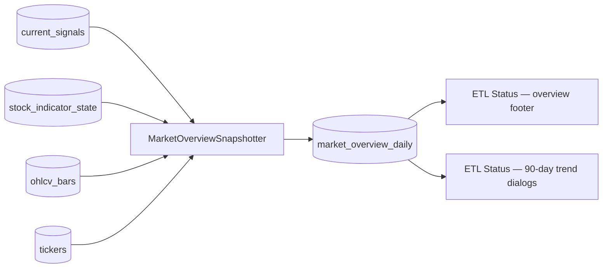

# `trip_ema/snapshots/` — aggregate-row snapshotters

## 1. Role in the larger application

`snapshots/` produces **per-day aggregate rows** that summarise "how
the universe looks as of a given date" — counts of how many
tickers are signalling, how many sit in each regime, how many are
above/below/inside the EMA ribbon.

The rows power two GUI surfaces:

- **Overall Market Overview footer** in the ETL Status tab — a
  one-row dashboard summarising today.
- **90-day trend dialogs** in the same tab — sparkline charts of
  signals / regimes / EMA-envelope counts over time.

One snapshotter today (`MarketOverviewSnapshotter`); the package is
laid out to accept more as new GUI surfaces need them (e.g. a
benchmark-rerank top-N tracker, a sector-rotation snapshotter, etc.).



## 2. Lifecycle and cadence

`snapshot_for_today(exchange)` runs **once per EoD tick** (16:30
IST). It is wired into the orchestrator's day-final stage; the
4-tick NSE schedule's last tick triggers it after all other
recompute stages complete.

Repeated calls on the same day are safe — `UPSERT (snapshot_date,
exchange)` semantics overwrite the row in place. Operators
sometimes re-run a snapshot mid-day after a backfill of recent
state to refresh the dashboard.

90-day trend dialogs accumulate naturally: after 90 calendar days
of operation, the dialog plots a full window. Earlier than that,
the chart simply starts at the first available snapshot.

**Backfill of past dates is deferred.** Filling 90 days of past
snapshots requires re-aggregating daily bars and re-running the
indicator pipeline as-of each historical day — ~3-4 hours for 90
days × ~2,667 tickers. Not implemented in Step 13a; future
stage 10 of the V1 backfill pipeline may add it.

## 3. File inventory

```
trip_ema/snapshots/
├── __init__.py             Re-exports MarketOverviewSnapshotter, MarketOverviewCounts
└── market_overview.py      The snapshotter and its counts dataclass
```

## 4. Public API

### 4.1 `MarketOverviewCounts`

```python
@dataclass(frozen=True, slots=True)
class MarketOverviewCounts:
    n_buys:               int
    n_sells:              int
    n_exit_buys:          int
    n_exit_sells:         int
    n_green_regime:       int     # display_regime = +1
    n_red_regime:         int     # display_regime = -1
    n_neutral_regime:     int     # display_regime =  0
    n_above_highest_ema:  int
    n_below_lowest_ema:   int
    n_between_emas:       int

    @property
    def total_signals(self) -> int:
        return (self.n_buys + self.n_sells +
                self.n_exit_buys + self.n_exit_sells)

    @property
    def total_regimes(self) -> int:
        """Sanity: should equal the active universe size when every
        ticker has a state row for the in-progress bar."""
        return (self.n_green_regime + self.n_red_regime +
                self.n_neutral_regime)
```

11 integer counts plus two computed properties for invariant
checks. `total_regimes` is the canary: if it does NOT equal the
active ticker count, some tickers are missing their in-progress
weekly indicator state row — usually a sign that stage 1 (stock
state recompute) failed silently or skipped them.

### 4.2 `MarketOverviewSnapshotter`

```python
class MarketOverviewSnapshotter:
    def __init__(self, db_engine: Engine) -> None: ...

    def snapshot_for_today(
        self,
        *,
        exchange:      str = "NSE",
        snapshot_date: date | None = None,
    ) -> MarketOverviewCounts: ...

    def delete_range(
        self,
        *,
        exchange:  str,
        date_from: date,
        date_to:   date,
    ) -> int: ...
```

Stateless aside from the `db_engine` handle. Instances are cheap to
construct and safe to share across threads — no shared mutable
state.

### 4.3 `snapshot_for_today(exchange, snapshot_date)`

Compute the 11 counts and `UPSERT` one row to
`market_overview_daily`. Returns the counts (for logging /
verification).

**`snapshot_date=None`** (the production default): uses today's IST
date interpreted from the server's wall clock. The SQL embeds
`(NOW() AT TIME ZONE 'Asia/Kolkata')::date` so the snapshot date is
correct regardless of the server's TZ setting.

**`snapshot_date=date(YYYY, M, D)`**: explicit override. Used for
tests and for filling recent gaps if a tick missed.

The function opens a single transaction (`db_engine.begin()`),
computes counts via one SQL pass, UPSERTs the row, commits.

### 4.4 `delete_range(exchange, date_from, date_to)`

Atomic DELETE over a closed-interval date range. Returns the
rowcount. Used by:

- Backfill stage 7 (extended in a future step) to clear snapshots
  before re-aggregating.
- Operator cleanup if a bad snapshot needs to be evicted.

## 5. The metric semantics

The 11 counts capture three orthogonal views of the universe:

### 5.1 Signal counts (4)

```
n_buys        — current_signals rows with signal_type='BUY'
n_sells       — current_signals rows with signal_type='SELL'
n_exit_buys   — current_signals rows with signal_type='EXIT_FROM_BUY'
n_exit_sells  — current_signals rows with signal_type='EXIT_FROM_SELL'
```

Sourced from `current_signals` rows whose `bar_timestamp` equals
the IST-Monday of `snapshot_date` (the in-progress weekly bar). On
EoD, this includes any signal that fired during today's cycles.
After rotation removes the row from `current_signals` (next
cycle's beginning), it stops contributing to today's signal counts;
but the **historical record persists in `market_overview_daily`**.
The trend chart still sees yesterday's BUYs because they were
captured in yesterday's row before rotation.

### 5.2 Regime counts (3)

```
n_green_regime    — stock_indicator_state.display_regime = +1
n_red_regime      — stock_indicator_state.display_regime = -1
n_neutral_regime  — stock_indicator_state.display_regime =  0
```

Sourced from `stock_indicator_state` for the in-progress weekly
bar (`timeframe='1W'`, `bar_timestamp = IST-Monday`).

Sum equals the active universe size when every active ticker has a
state row for the current bar. If a sizable gap, suspect a state-
compute failure for that subset.

### 5.3 EMA-envelope counts (3)

```
n_above_highest_ema  — close > max(med, long, longest)
n_below_lowest_ema   — close < min(med, long, longest)
n_between_emas       — min(emas) < close < max(emas)
```

Computed per-ticker:

```
highest_ema = max(med_ema, long_ema, longest_ema)   for this Monday's bar
lowest_ema  = min(med_ema, long_ema, longest_ema)
close       = ohlcv_bars close for snapshot_date    (daily bar)
```

The comparison crosses the daily close (today) against the weekly
EMA values (Monday's row). This captures "is the ticker breaking
out above the ribbon today, even though the weekly EMAs are still
catching up?" — a useful read of momentum vs trend.

Boundary cases (`close == highest_ema`) fall into `n_above` per the
`>=` in the SQL. The "between" count uses strict inequality on
both sides, so an exact boundary close shows up only in `n_above`
or `n_below`.

## 6. The aggregation SQL (annotated)

The core of `_compute_counts` is one SQL pass:

```sql
WITH
    week_anchor AS (
        SELECT
            today_d   :=  (NOW() AT TIME ZONE 'Asia/Kolkata')::date,
            monday_ts :=  (date_trunc('week', today_d::timestamp)::date)
                          ::timestamp AT TIME ZONE 'UTC'
    ),
    active AS (
        SELECT ticker_id FROM tickers
         WHERE exchange = :ex
           AND is_active = TRUE
           AND delisted_at IS NULL
    ),
    state AS (
        SELECT sis.ticker_id, sis.display_regime,
               GREATEST(sis.med_ema, sis.long_ema, sis.longest_ema)  AS highest_ema,
               LEAST   (sis.med_ema, sis.long_ema, sis.longest_ema)  AS lowest_ema
          FROM stock_indicator_state sis
          JOIN active     USING (ticker_id)
          JOIN week_anchor wa ON sis.bar_timestamp = wa.monday_ts
         WHERE sis.timeframe = '1W'
    ),
    close_today AS (
        SELECT o.ticker_id, o.close
          FROM ohlcv_bars o
          JOIN active     USING (ticker_id)
          JOIN week_anchor wa ON o.bar_timestamp::date = wa.today_d
         WHERE o.timeframe = '1D'
    ),
    sigs AS (
        SELECT cs.ticker_id, cs.signal_type
          FROM current_signals cs
          JOIN active     USING (ticker_id)
          JOIN week_anchor wa ON cs.bar_timestamp = wa.monday_ts
    ),
    per_ticker AS (
        SELECT a.ticker_id, s.display_regime, s.highest_ema, s.lowest_ema,
               ct.close, sg.signal_type
          FROM active a
          LEFT JOIN state       s  USING (ticker_id)
          LEFT JOIN close_today ct USING (ticker_id)
          LEFT JOIN sigs        sg USING (ticker_id)
    )
SELECT
    COUNT(*) FILTER (WHERE signal_type = 'BUY')            AS n_buys,
    COUNT(*) FILTER (WHERE signal_type = 'SELL')           AS n_sells,
    COUNT(*) FILTER (WHERE signal_type = 'EXIT_FROM_BUY')  AS n_exit_buys,
    COUNT(*) FILTER (WHERE signal_type = 'EXIT_FROM_SELL') AS n_exit_sells,
    COUNT(*) FILTER (WHERE display_regime =  1)            AS n_green_regime,
    COUNT(*) FILTER (WHERE display_regime = -1)            AS n_red_regime,
    COUNT(*) FILTER (WHERE display_regime =  0)            AS n_neutral_regime,
    COUNT(*) FILTER (WHERE close >= highest_ema)           AS n_above_highest_ema,
    COUNT(*) FILTER (WHERE close <= lowest_ema)            AS n_below_lowest_ema,
    COUNT(*) FILTER (WHERE close >  lowest_ema
                       AND close <  highest_ema)           AS n_between_emas
  FROM per_ticker
```

Key design choices in this query:

- **`LEFT JOIN`** to `active`: includes every active ticker even if
  they lack a state row or a close-today row. The `FILTER`s rely on
  the joined-column-IS-NOT-NULL precondition to discount those.
- **One pass** with `COUNT(*) FILTER (...)`: 11 counts from one
  scan of the ticker universe. Postgres can vectorise the FILTER
  predicates; this is the cheapest possible aggregation shape.
- **`week_anchor` CTE** computed once and joined in: makes the
  date-truncation logic explicit and reusable across the three
  joins.

### 6.1 The Monday-anchoring details (and why both `_compute_counts` and `_upsert` have a fixup comment)

Two subtle SQL quirks this code documents in comments and works
around:

**Fixup 1 — `CAST(... AS date)` instead of `... ::date`.**
SQLAlchemy's `text()` bind-substitution regex has a `(?!:)`
lookahead that **refuses to substitute** a bind parameter when it's
immediately followed by another colon (Postgres's cast operator).
So `:snap_date::date` silently fails; `CAST(:snap_date AS date)`
works. Both clauses in this file use the `CAST` form.

**Fixup 2 — explicit `AT TIME ZONE 'UTC'`.** The Postgres expression
`date_trunc('week', x::timestamp)` produces a `timestamp without time
zone` (just a Monday-00:00 wall-clock). The default conversion to
`timestamptz` interprets that wall-clock in the **session's**
timezone. The NUC's session TZ is `Asia/Kolkata`, so the default
would produce "Monday 00:00 IST = Sunday 18:30 UTC" — 5h30m off
from where every other write in the system anchors weekly bars
(Monday 00:00 UTC). Explicit `AT TIME ZONE 'UTC'` makes the
conversion deterministic and session-TZ-independent.

This is the kind of bug that only manifests after the service is
deployed onto a server with non-UTC session TZ; the fixup comment
in the source ensures nobody removes it without realising.

## 7. The `market_overview_daily` table

PK: `(snapshot_date, exchange)`.

Columns:

| Column | Type | Source |
|--------|------|--------|
| `snapshot_date` | `date` | The IST date this row summarises |
| `exchange` | `text` | `"NSE"`, `"BSE"`, … |
| `n_buys` … `n_between_emas` | `integer` | The 11 counts |
| `computed_at` | `timestamptz` | `NOW()` at write time |

Created by Alembic revision `0029_compute_runs_mkt_overview`.

UPSERT semantics: any re-run for the same `(snapshot_date,
exchange)` replaces all 11 counts and updates `computed_at`.

## 8. UPSERT logic (annotated)

```sql
INSERT INTO market_overview_daily (snapshot_date, exchange,
                                   n_buys, n_sells, ..., computed_at)
VALUES (CAST(:snap_date AS date), :ex, ..., NOW())
ON CONFLICT (snapshot_date, exchange) DO UPDATE SET
    n_buys              = EXCLUDED.n_buys,
    ...
    n_between_emas      = EXCLUDED.n_between_emas,
    computed_at         = NOW()
```

The `EXCLUDED` pseudo-table on the `DO UPDATE` branch refers to the
row Postgres just tried to INSERT. Copying every column from
`EXCLUDED` replaces the existing row in place.

`computed_at = NOW()` on UPDATE (not `EXCLUDED.computed_at`) makes
the field meaningful — when did this row LAST get refreshed, not
when was it first written.

## 9. Concurrency

The snapshotter is called once per EoD tick by a single
orchestrator. No parallelism within the call. If two orchestrators
somehow race (impossible in production — one orchestrator pool, one
EoD tick), the UPSERT semantics keep the table consistent: the
last writer wins on the row.

Reads from the GUI happen on a separate connection from
`gui/db.py` (read-only role). They see a consistent snapshot per
the default Postgres READ COMMITTED isolation.

## 10. Error handling

The snapshotter is **non-fatal for the surrounding cycle**:

- If `_compute_counts` raises (DB error, planner glitch), the
  cycle's outer try/except catches it, logs the error, and the
  cycle proceeds. The snapshot row for today simply doesn't get
  written — operator notices missing data in the GUI footer and
  re-runs.
- If the UPSERT fails (constraint violation — shouldn't happen
  given the schema), same handling. The compute succeeded, the
  write didn't, log + move on.

There is no automatic retry. Operators rerun manually via the GUI's
"Run EoD" button or a CLI invocation.

## 11. Logging and metrics

Each successful snapshot emits one INFO log line:

```
MarketOverview snapshot[NSE] for today (IST): 
  signals=47 (B12/S8/Eb15/Es12), 
  regimes G831/R412/N1224, 
  EMA envelope above=720/below=345/between=1402
```

Useful for grep-watching the live cycle. The numbers should sum to
`total_regimes ≈ active universe size` modulo any tickers missing
a current state row.

No Prometheus metrics today — the dashboard reads
`market_overview_daily` directly.

## 12. Testing

`tests/snapshots/test_market_overview.py` covers:

| Scenario | Fixture |
|----------|---------|
| Signal-count correctness | Seed current_signals with B/S/Eb/Es mix; verify counts |
| Regime-count correctness | Seed stock_indicator_state with +1/0/−1 mix |
| EMA-envelope correctness | Seed bars + state with closes above/below/inside ribbon |
| UPSERT idempotency | Snap, modify, snap again, assert second values |
| `delete_range` semantics | Seed N rows, delete inclusive range, assert N − affected |
| Monday anchoring across DST-style edge cases | (Not in NSE but exercise the logic) |
| Empty universe | Snap with zero active tickers, get all zeros |

The tests use the `postgres_engine` fixture and a clean
`market_overview_daily` table per test (the fixture truncates).

## 13. Common pitfalls

1. **Bar anchoring.** The in-progress weekly bar is **Monday 00:00
   UTC of the IST week containing `snapshot_date`**. If you query
   `stock_indicator_state` with the wrong anchor, you get an empty
   join and all counts become zero.
2. **`::date` cast on a bind param.** SQLAlchemy bind regex refuses
   `:param::date`; use `CAST(:param AS date)` instead. The
   workaround is in this file already; do not regress.
3. **Session TZ assumption.** The NUC defaults to `Asia/Kolkata`.
   The SQL uses explicit `AT TIME ZONE 'UTC'` so it doesn't depend
   on this — but operators sometimes "fix" perceived inefficiencies
   by removing the cast. Don't.
4. **Don't backfill past dates with this function.** It uses
   "current" data sources (current_signals, today's daily close). A
   past-date backfill would need re-aggregated state and historical
   closes — out of scope for the current snapshotter.

## 14. Extending the package

To add a new snapshotter (e.g. sector rotation):

1. Add a new dataclass `SectorRotationCounts` to the package.
2. Add a `SectorRotationSnapshotter` class with the same interface
   shape as `MarketOverviewSnapshotter`: `snapshot_for_today`,
   `delete_range`.
3. Add an Alembic migration creating `sector_rotation_daily` with
   PK `(snapshot_date, exchange)` and the relevant columns.
4. Wire it into the orchestrator's EoD stage to fire once after the
   existing market overview snapshot.
5. Re-export from `__init__.py`.
6. Add `tests/snapshots/test_sector_rotation.py`.

The pattern — one CTE pass with `COUNT(*) FILTER (...)`, UPSERT on
`(snapshot_date, exchange)`, fail-soft on errors — is portable.

## 15. Related packages

- `trip_ema/persistence/market_overview_repo.py` — alternative read
  surface for the table (used by the GUI rather than by the
  snapshotter itself).
- `trip_ema/orchestrator/recompute_market.py` — invokes
  `snapshot_for_today` at the end of the EoD tick.
- `trip_ema/gui/views/etl_status.py` — reads
  `market_overview_daily` to render the footer.
- `trip_ema/gui/views/market_trend_dialog.py` — reads the table
  for 90-day trend charts.
- Alembic revision `0029_compute_runs_mkt_overview.py` — creates
  the underlying table.
