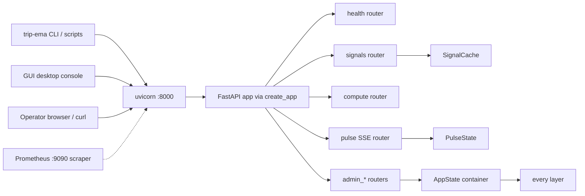

# `trip_ema/transports/` — HTTP transport layer

## 1. Role in the larger application

`transports/` is the **integration boundary** between the running
service and external clients — the GUI desktop console, operator
automation scripts, the `trip-ema-etl` CLI, monitoring probes, and
the GUI's chart-rendering AJAX. One subpackage today (`http/`) for
the FastAPI app; the layout accommodates SSE expansions, gRPC, or
a message-queue transport in the future.



## 2. Architecture and constraints

| Rule | Why |
|------|-----|
| **One FastAPI app**, mounted by `create_app()` | Single source of truth for routes + lifespan |
| **App doesn't own runtime state** | `create_app()` returns a stateless FastAPI instance. State (DB engine, caches, scheduler pool) is wired via `dependencies.set_state()`. Tests construct apps and inject fakes |
| **Routes go through `Depends(...)`** | Wiring is visible at the route signature; tests override via `app.dependency_overrides` |
| **Admin routes gated by bearer token** | `dependencies.require_admin_token` runs first; missing/wrong token → 401 |
| **Async-action pattern for long admin POSTs** | Heavy operations (backfill, signal generation) return 202 + `run_id` immediately; work runs in `etl_executor` |
| **Wire-format vs internal types** | `api.responses.TerseResponse` is the internal type; `schemas.TerseResponseOut` is the wire type. The mapping is thin but explicit — the two evolve independently |
| **PulseState lives in `transports/http/`** | The Protocol is declared in `scheduler/`; the concrete impl belongs to its only consumer family (HTTP SSE + snapshot endpoints) |
| **ASGI lifespan owns startup + shutdown** | OrchestratorPool's per-market threads need the asyncio loop to exist; `startup_callback` runs after FastAPI's startup. `shutdown_callback` runs on SIGTERM before process exit |

## 3. File inventory

```
trip_ema/transports/
├── __init__.py
└── http/
    ├── __init__.py                   create_app, set_state, clear_state, AppState
    ├── app.py                        create_app() factory + lifespan management
    ├── dependencies.py               AppState container + Depends providers
    ├── schemas.py                    Pydantic wire-format models
    ├── orchestrator_schemas.py       Phase 14 orchestrator payloads
    ├── pulse_state.py                PulseState pub/sub for SSE
    │
    └── routes/
        ├── __init__.py
        ├── health.py                 /healthz
        ├── signals.py                /v1/signals (read)
        ├── compute.py                /v1/compute (stateless)
        ├── signal_history.py         /v1/signals/{ex}/{sym}/history
        ├── pulse.py                  /v1/pulse SSE + /v1/pulse/snapshot
        ├── fundamentals.py           Phase 1-6 admin routes
        │
        ├── admin.py                  /v1/admin/reprime, /v1/admin/cb-status
        ├── admin_etl.py              /v1/admin/etl/* (backfill, intraday, eod, ...)
        ├── admin_exchange_state.py   /v1/admin/exchange-state
        ├── admin_exchanges.py        /v1/admin/exchanges
        ├── admin_health.py           /v1/admin/health-snapshot, /v1/admin/stale-tickers
        ├── admin_notifications.py    /v1/admin/notifications/*
        ├── admin_orchestrator.py     /v1/admin/orchestrator/*
        ├── admin_signals.py          /v1/admin/signals/* (Phase 15b backtest)
        ├── admin_subscribers.py      /v1/admin/subscribers/*
        └── admin_v1pipeline.py       /v1/admin/v1/* (Steps 4-8 V1 admin)
```

## 4. `app.py` — `create_app(...)`

```python
def create_app(
    shutdown_callback: Callable[[], None] | None = None,
    startup_callback:  Callable[[], None] | None = None,
) -> FastAPI: ...
```

Returns a configured FastAPI app with all 17 routers mounted. The
app **does not** initialize runtime state — `app.py` (the entry
point, separate from this file) calls `dependencies.set_state()`
after building the app.

### 4.1 ASGI lifespan integration

When either callback is set, `create_app` constructs the app with
an `@asynccontextmanager`-decorated lifespan:

```python
@asynccontextmanager
async def lifespan(app: FastAPI):
    # Startup
    if startup_callback is not None:
        try:
            startup_callback()
        except Exception:
            logger.exception("...; continuing with degraded functionality")
    yield
    # Shutdown — uvicorn calls this on SIGTERM/SIGINT
    if shutdown_callback is not None:
        try:
            shutdown_callback()
        except Exception:
            logger.exception("Error during ASGI lifespan shutdown")
```

**Soft-fail discipline.** Startup callback failures are logged but
don't abort startup. The app continues with degraded functionality
(pulse / orchestrator endpoints return 503). Hard-failing here
would mean a single misconfigured orchestrator entry would break
all HTTP including health checks.

### 4.2 Router mount order

The router include order is logically grouped but not
load-bearing:

1. Health (first — load balancers probe `/healthz`)
2. Read-side: signals, compute, signal_history
3. Admin: 9 admin_* routers + general admin
4. Pulse SSE (Phase 14)
5. Fundamentals
6. V1 pipeline admin

FastAPI processes routes in registration order for path-matching;
no path overlaps between routers, so order doesn't affect routing.

## 5. `dependencies.py` — the AppState container

```python
@dataclass
class AppState:
    config:                  Config
    db_engine:               Engine
    cache:                   SignalCache
    current_signals_cache:   CurrentSignalsCache | None
    etl_executor:            ThreadPoolExecutor | None
    orchestrator_pool:       OrchestratorPool | None
    pulse_state:             PulseState | None
    market_hours:            MarketHoursService
    # ... (more fields as the system grows)
```

### 5.1 The state lifecycle

```python
# At service startup (in app.py entry point, not here):
state = AppState(config=cfg, db_engine=eng, cache=c, ...)
dependencies.set_state(state)

# Now any Depends() in a route can pull from this state.
# At shutdown:
dependencies.clear_state()
```

`set_state()` is idempotent — re-calls overwrite. `clear_state()`
sets the module-level container to `None`; subsequent route
requests get 503 from `Depends()`-returning helpers.

### 5.2 The `Depends()` providers

```python
def get_config() -> Config: ...
def get_db_engine() -> Engine: ...
def get_signal_cache() -> SignalCache: ...
def get_current_signals_cache() -> CurrentSignalsCache: ...
def get_orchestrator_pool() -> OrchestratorPool: ...
def get_pulse_state() -> PulseState: ...
def get_etl_executor() -> ThreadPoolExecutor: ...

def require_admin_token(
    authorization: str = Header(...),
    config: Config = Depends(get_config),
) -> None: ...
```

Each helper reads from the module-level state container. If the
required field is `None`, raises `HTTPException(503, "...")`.

### 5.3 `require_admin_token`

```python
def require_admin_token(authorization, config):
    if config.http.admin_token_env is None:
        # Admin gating disabled (dev / test mode)
        return
    expected = os.environ.get(config.http.admin_token_env)
    if not expected:
        raise HTTPException(503, "admin_token_env not set; admin routes unavailable")
    if not authorization.startswith("Bearer "):
        raise HTTPException(401, "Missing Bearer token")
    token = authorization[len("Bearer "):]
    if not secrets.compare_digest(token, expected):
        raise HTTPException(401, "Invalid admin token")
```

`secrets.compare_digest` for timing-safe comparison. The env-var
name is configurable (`config.http.admin_token_env`, default
`TRIP_EMA_ADMIN_TOKEN`).

## 6. `schemas.py` — Pydantic wire models

The internal `api.responses.TerseResponse` is a frozen dataclass.
Its wire form is a Pydantic `TerseResponseOut`. The translation
layer is thin but explicit:

```python
class TerseResponseOut(BaseModel):
    ticker:               TickerRefOut       # "NSE:NIFTY" string form
    timeframe:            str                # "1W" instead of Timeframe.WEEKLY
    latest_bar_timestamp: datetime
    latest_change:        str                # "BUY" instead of ChangeSignal.BUY
    latest_price:         float
    computed_at:          datetime
    
    @classmethod
    def from_internal(cls, resp: TerseResponse) -> TerseResponseOut:
        return cls(
            ticker=TickerRefOut(exchange=resp.ticker.exchange, symbol=resp.ticker.symbol),
            timeframe=resp.timeframe.value,
            latest_bar_timestamp=resp.latest_bar_timestamp,
            latest_change=resp.latest_change.name,
            latest_price=resp.latest_price,
            computed_at=resp.computed_at,
        )
```

Internal enums become human-readable strings on the wire. Frozen
dataclasses become Pydantic models. The mapping is **handwritten**
(not auto-generated) so the wire schema can evolve without churning
the internal types — and vice versa.

## 7. `pulse_state.py` — SSE pub/sub

Concrete implementation of the `PulsePublisher` Protocol declared
in `scheduler.market_orchestrator`. The orchestrator publishes
`OrchestratorRunSummary` after every cycle; SSE subscribers
(typically the GUI) receive them in real-time.

```python
class PulseState:
    def __init__(self, history_capacity: int = 100): ...
    
    def bind_event_loop(self, loop: asyncio.AbstractEventLoop) -> None: ...
    """Called from startup_callback. Required before publish() works."""
    
    def publish(self, summary: OrchestratorRunSummary) -> None: ...
    """Called from orchestrator threads. Pushes onto every subscriber's queue
    via loop.call_soon_threadsafe()."""
    
    async def subscribe(self) -> AsyncIterator[OrchestratorRunSummary]: ...
    """SSE endpoints await this. One async-generator per subscriber."""
    
    def snapshot(self) -> list[OrchestratorRunSummary]: ...
    """The N most recent summaries for the snapshot endpoint."""
    
    def get_latest(self, exchange: str) -> OrchestratorRunSummary | None: ...
```

### 7.1 The bind dance

`publish()` is called from orchestrator background threads —
non-async. The Pulse needs to push onto subscriber queues that
live in the asyncio event loop. Solution: at lifespan startup,
`PulseState.bind_event_loop(asyncio.get_running_loop())`. Inside
`publish`, the implementation does
`self._loop.call_soon_threadsafe(self._fanout, summary)`.

Without the bind, `publish()` raises — it doesn't know which loop
to schedule against.

### 7.2 Subscriber lifecycle

Each SSE request creates a subscriber `asyncio.Queue`. On client
disconnect, FastAPI cancels the request task; the async-generator
deletes the queue from the subscribers list. No leaked queues.

History capacity = 100 (configurable). Snapshot endpoint returns
the most recent 100 summaries; SSE clients get them all on
connect, then live updates.

## 8. Routes catalog

### 8.1 Read-side (`signals`, `compute`, `signal_history`)

| Path | Method | Purpose |
|------|--------|---------|
| `/v1/signals/{exchange}/{symbol}` | GET | Latest computed snapshot for a ticker |
| `/v1/signals/{exchange}/{symbol}/recent?limit=N` | GET | Last N signals via SignalsReader |
| `/v1/signals/{exchange}/{symbol}/history?range=5Y` | GET | Full bar-by-bar BarState series for chart rendering |
| `/v1/compute` | POST | Stateless compute — caller provides bars, gets back BarState/ChangeSignal |
| `/healthz` | GET | Liveness probe; returns 200 + `{status, version}` |

### 8.2 Admin routes (gated by `require_admin_token`)

| Path | Method | Purpose |
|------|--------|---------|
| `/v1/admin/reprime` | POST | Reload SignalCache from DB (rare; e.g. after manual DB modification) |
| `/v1/admin/cb-status` | GET | Circuit breaker state for every wrapped transport |
| `/v1/admin/health-snapshot` | GET | Cache sizes, stale-ticker count, last-tick timestamps |
| `/v1/admin/stale-tickers` | GET | List tickers flagged stale by the compute scheduler |
| `/v1/admin/etl/backfill` | POST | Start V1 backfill (async-action pattern) |
| `/v1/admin/etl/incremental` | POST | Run incremental ETL pass |
| `/v1/admin/etl/recompute-tiers` | POST | Trigger tier reshuffle |
| `/v1/admin/etl/runs` | GET | Recent etl_runs rows |
| `/v1/admin/exchanges` | GET | List configured exchanges + their status |
| `/v1/admin/exchange-state/{exchange}` | GET/PATCH | Read or update exchange_state row |
| `/v1/admin/subscribers/*` | various | CRUD on subscribers + test-email |
| `/v1/admin/notifications/recent` | GET | Recent notification_log rows |
| `/v1/admin/orchestrator/status` | GET | Per-market orchestrator alive + last_tick_at |
| `/v1/admin/orchestrator/{exchange}/run-once` | POST | Force a tick now (skips scheduling) |
| `/v1/admin/signals/{exchange}/regenerate` | POST | Phase 15b backtest signal regenerate (async-action + advisory lock) |
| `/v1/admin/v1/pipeline/recompute` | POST | Full V1 recompute_market trigger |
| `/v1/admin/v1/pipeline/notify` | POST | Force notify_subscribers run |

### 8.3 Pulse (Phase 14)

| Path | Method | Purpose |
|------|--------|---------|
| `/v1/pulse` | GET (SSE) | Real-time stream of OrchestratorRunSummary events |
| `/v1/pulse/snapshot` | GET | Most recent N summaries per exchange |

### 8.4 Fundamentals admin (Phase 1-6)

| Path | Method | Purpose |
|------|--------|---------|
| `/v1/admin/fundamentals/refresh-industry` | POST | Trigger industry classification refresh |
| `/v1/admin/fundamentals/refresh-shares` | POST | Trigger shares-outstanding refresh |
| `/v1/admin/fundamentals/run-status` | GET | Recent fundamentals_runs rows |
| `/v1/admin/fundamentals/industries` | GET | List industries + constituent counts |
| `/v1/admin/fundamentals/industry-overrides/{ticker_id}` | GET/PUT/DELETE | Operator-asserted classifications |

## 9. The async-action pattern

Heavy admin POSTs follow this shape:

```python
@router.post("/v1/admin/some-action", status_code=202)
def admin_some_action(
    body:      SomeActionRequest,
    config:    Config = Depends(get_config),
    db_engine: Engine = Depends(get_db_engine),
    etl_executor: ThreadPoolExecutor = Depends(get_etl_executor),
    _:         None = Depends(require_admin_token),
) -> SomeActionResponse:
    # Validate
    validate_exchange(body.exchange, config)
    require_executor(etl_executor)

    # Open audit row in request thread (so the response has a run_id)
    with transaction(db_engine) as conn:
        run_id = EtlRunsRepository(conn).start(
            kind="some_action", exchange=body.exchange,
        )

    # Submit work to executor; return immediately
    etl_executor.submit(_run_some_action_safe, db_engine, run_id, body)

    return SomeActionResponse(run_id=run_id, status="started")
```

The client receives `202 Accepted` + `{run_id, status}` and can
poll `/v1/admin/etl/runs/{run_id}` for completion status.

**Failure isolation in the executor:**

```python
def _run_some_action_safe(db_engine, run_id, body):
    try:
        result = run_some_action(db_engine, body)
        with transaction(db_engine) as conn:
            EtlRunsRepository(conn).finish(run_id, status="SUCCESS",
                                           succeeded=result.succeeded,
                                           failed=result.failed)
    except Exception as e:
        logger.exception(...)
        with transaction(db_engine) as conn:
            EtlRunsRepository(conn).finish(
                run_id, status="FAILED",
                error_message=f"{type(e).__name__}: {e}",
            )
```

The `_safe` wrapper guarantees the etl_runs row gets closed even
on failure — leaked `RUNNING` rows would clutter the GUI's
activity panel.

## 10. Phase 15b — advisory lock pattern

`admin_signals.py::regenerate_signals` does extra work to prevent
concurrent regenerations for the same exchange clobbering each
other:

```python
@router.post("/v1/admin/signals/{exchange}/regenerate")
def regenerate_signals(exchange, ...):
    with transaction(db_engine) as conn:
        # Acquire per-exchange advisory lock for this txn
        conn.execute(text("SELECT pg_advisory_xact_lock(:key)"),
                     {"key": hash(exchange) % 2**31})
        
        # Now serialized for this exchange
        active = SignalBacktestRunsRepository(conn).find_active(exchange)
        if active:
            raise HTTPException(409, "another regenerate is running for this exchange")
        
        run_id = SignalBacktestRunsRepository(conn).start(exchange, ...)
    
    etl_executor.submit(_run_regenerate_safe, ...)
    return {"run_id": run_id}
```

The advisory lock is held until the transaction commits — by which
time the `find_active` SELECT and the `start` INSERT have both run.
Two concurrent requests serialize: the second blocks on the lock,
then sees the first's row and raises 409.

Cleaner than a unique partial index for this case because the lock
is **per-exchange** — concurrent regenerates for different
exchanges are allowed.

## 11. Wiring at the entry point (`app.py` at repo root)

```python
# Not in the transports/ package — in the top-level entry point
def main():
    config = load_config(...)
    db_engine = create_engine_from_config(config, role="engine")
    cache = SignalCache()
    current_cache = CurrentSignalsCache()
    pulse_state = PulseState()
    
    prime_cache_from_db(db_engine=db_engine, cache=cache)
    
    pool = build_pool_from_configs(
        config, db_engine, cache, current_cache, pulse_state, ...,
    )
    
    etl_executor = ThreadPoolExecutor(max_workers=4, thread_name_prefix="etl")
    
    # Set state container
    state = AppState(
        config=config, db_engine=db_engine,
        cache=cache, current_signals_cache=current_cache,
        etl_executor=etl_executor,
        orchestrator_pool=pool,
        pulse_state=pulse_state,
        ...,
    )
    set_state(state)
    
    # ASGI lifespan callbacks
    def startup():
        loop = asyncio.get_running_loop()
        pulse_state.bind_event_loop(loop)
        pool.start_all()
    
    def shutdown():
        pool.stop_all(timeout=30)
        etl_executor.shutdown(wait=True, cancel_futures=False)
        db_engine.dispose()
        clear_state()
    
    app = create_app(startup_callback=startup, shutdown_callback=shutdown)
    
    uvicorn.run(app, host=config.http.host, port=config.http.port)
```

## 12. Concurrency

- **FastAPI / uvicorn** runs an asyncio event loop. Route handlers
  are sync; FastAPI dispatches them to a threadpool.
- **`etl_executor`** is a separate ThreadPoolExecutor for long-running
  admin actions. Default `max_workers=4`.
- **`OrchestratorPool`** runs separate threads (not in
  uvicorn's pool).
- **`PulseState.publish`** is called from orchestrator threads; uses
  `loop.call_soon_threadsafe` to push onto async subscriber queues.

## 13. Failure modes

| Failure | Response |
|---------|----------|
| `dependencies.set_state` not called | Every route returns 503 from its `Depends()` chain |
| `config.http.admin_token_env` unset | Admin routes return 503 ("admin gating misconfigured"); read routes work |
| Missing bearer token | 401 |
| Wrong bearer token | 401 |
| Unknown exchange in URL | 400 with explanation |
| Body validation fails (Pydantic) | 422 with field errors |
| ETL executor None (config disabled it) | 503 from admin endpoints that need it |
| Long action raises in executor | etl_runs row closed with `status=FAILED`; client polling sees that |
| SSE client disconnects | Subscriber queue removed from PulseState; no leak |
| Lifespan startup callback raises | Logged; app continues; affected endpoints return 503 |
| Lifespan shutdown callback raises | Logged; process exits anyway |

## 14. Logging and metrics

- Per-request: standard FastAPI access log.
- Per-route: route handlers log at INFO/WARN per their concerns.
- Correlation IDs: middleware mints one per request, pushes onto
  the contextvar, returns it in `X-Correlation-Id` response header.

No HTTP-specific metrics yet; the `etl_runs` and `compute_runs`
tables serve as the "what happened" audit.

## 15. Testing

`tests/transports/` (DB-required):

| File | Coverage |
|------|----------|
| `test_app.py` | `create_app` happy path, lifespan startup+shutdown wiring |
| `test_health.py` | `/healthz` 200 + JSON shape |
| `test_signals.py` | Read endpoints against seeded DB |
| `test_compute.py` | Stateless compute happy path + edge cases |
| `test_admin_etl.py` | Async-action pattern: 202 + run_id + executor submit + run row lifecycle |
| `test_admin_signals.py` | Phase 15b advisory-lock concurrent regenerate behaviour |
| `test_pulse.py` | SSE subscribe, snapshot, bind_event_loop |
| `test_auth.py` | Bearer token round-trips: missing / wrong / right |

`tests/transports_pure/` (DB-free, mocked deps):

| File | Coverage |
|------|----------|
| `test_admin_signals.py` | 28 tests — full behaviour matrix via dependency_overrides |
| `test_admin_etl.py` | Validation + dispatch without spinning up DB |
| `test_admin_subscribers.py` | Subscriber CRUD without DB |

## 16. Common pitfalls

1. **Routes that read from the global `_state` directly bypass
   `Depends()`.** Tests can't override them. Always go through a
   `Depends()` helper.
2. **`dependencies.set_state` race with module reload in tests.**
   Use `clear_state()` in fixtures' teardown.
3. **`require_admin_token` with no env var set → 503, not 401.**
   The 503 says "admin gating misconfigured"; some operators
   expected 401. Read the response body.
4. **PulseState needs `bind_event_loop` BEFORE first publish.**
   The startup_callback handles this; running a test without the
   callback and calling `publish` raises.
5. **SSE keepalive.** Some proxies kill idle connections after
   60s. The pulse SSE sends a `:keepalive` comment every 30s to
   prevent this. Don't remove it.
6. **The async-action pattern returns 202, not 200.** Clients that
   only check `response.ok` see this as success; clients that
   check `response.status_code == 200` see this as failure. Make
   sure your client treats 2xx as success.
7. **Phase 15b advisory-lock uses `pg_advisory_xact_lock`, not
   `pg_advisory_lock`.** The xact variant auto-releases at
   transaction end; the non-xact variant must be explicitly
   released and can survive across requests. Don't conflate them.

## 17. Extension paths

- **A new route file.** Create `routes/new_thing.py`; export a
  `router = APIRouter()`. Mount it in `create_app()`.
- **A new dependency.** Add a field to `AppState`. Add a
  `get_new_thing()` helper in `dependencies.py`. Use as
  `Depends(get_new_thing)` in routes.
- **A new SSE channel.** Build a separate `PulseState`-like
  in-memory pub/sub; bind to event loop at startup; expose a new
  SSE route.
- **gRPC transport.** Add `transports/grpc/` peer to `http/`.
  Reuse `AppState` and the same dependency container. Routes
  become gRPC methods.

## 18. Related packages

- `trip_ema/api/` — `responses.py` provides the internal types
  that `schemas.py` wraps.
- `trip_ema/persistence/` — every admin route opens a `transaction()`
  and goes through repos.
- `trip_ema/orchestrator/` — recompute_market + notify_subscribers
  invoked by admin endpoints.
- `trip_ema/scheduler/` — `MarketOrchestrator` publishes summaries
  to `PulseState`; `OrchestratorPool` is in `AppState`.
- `trip_ema/cache/` — `SignalCache` and `CurrentSignalsCache` are
  in `AppState`.
- `trip_ema/observability/correlation.py` — middleware uses
  `correlation_id` context manager.
- `trip_ema/backfill/pipeline.py` — invoked by `admin_etl.py`
  backfill route via the async-action pattern.
- `trip_ema/etl/cli.py` — wraps `runner.py` functions for CLI use;
  some admin endpoints invoke the same `runner.py` functions
  directly without going through the CLI.
