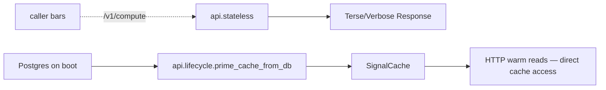

# `trip_ema/api/` — public compute surface

## 1. Role in the larger application

`api/` is the small set of entry points the HTTP layer + startup
orchestrator call into. Two purposes:

1. **Stateless compute** — accept bars from a caller, run the
   regime classifier over them, return per-bar `BarState` + the
   latest `ChangeSignal`. Used by the HTTP `POST /v1/compute`
   debug endpoint and the chart endpoint's `/v1/signals/{ex}/{sym}/history`.
2. **Cache priming at startup** — read latest `indicator_state`
   rows from Postgres and seed the in-process `SignalCache` so
   the warm-read paths have data immediately.

What used to be here:

- The `cached` module — a wrapper around `SignalCache.get(...)` for
  the warm read path. **Removed in Step 15-B3.** HTTP routes now
  query the cache directly via `AppState.cache`. The exported names
  `query_cached_verbose` / `query_cached_terse` are gone.
- The `prime_all_tickers` function — built a `TickerEngine` per
  ticker. **Removed in Step 9a** along with the entire
  `TickerEngine` / `TickerRegistry` layer. Replaced by
  `prime_cache_from_db` which reads pre-computed indicator state
  rows instead of recomputing.

What ships today is the (a) and (c) of the original spec; (b) is
fulfilled directly by `cache/signal_cache.py` reads from HTTP
routes.



## 2. Architecture and constraints

- **No long-lived state.** `api/` holds no module-level state.
  Every entry point is a function.
- **Owns no transactions.** `prime_cache_from_db` opens a read-only
  connection for its two SELECTs; `compute_full_*` is pure
  CPU/memory, no DB.
- **Imports only `domain`, `cache`, `regime`, and
  `fundamentals.indicator_primitives`** — never `persistence`
  directly (except in `lifecycle.py`, which is itself the bridge
  from DB to cache).
- **Frozen response types.** `TerseResponse` and `VerboseResponse`
  are immutable; the HTTP layer's Pydantic schemas wrap them
  before serialization.

## 3. File inventory

```
trip_ema/api/
├── __init__.py              Public surface re-exports
├── lifecycle.py             prime_cache_from_db — startup orchestrator
├── responses.py             TerseResponse, VerboseResponse, error types
└── stateless.py             compute_full_terse, compute_full_verbose
```

## 4. Public API

`__init__.py`:

```python
from .lifecycle  import prime_cache_from_db, PrimeCacheResult
from .responses  import (
    InsufficientHistoryError, TerseResponse,
    TickerNotPrimedError,    VerboseResponse,
)
from .stateless  import compute_full_terse, compute_full_verbose

__all__ = [
    "InsufficientHistoryError",
    "PrimeCacheResult",
    "TerseResponse",
    "TickerNotPrimedError",
    "VerboseResponse",
    "compute_full_terse",
    "compute_full_verbose",
    "prime_cache_from_db",
]
```

## 5. `responses.py` — public DTO surface

### 5.1 `TerseResponse`

```python
@dataclass(frozen=True, slots=True)
class TerseResponse:
    ticker:               TickerRef
    timeframe:            Timeframe
    latest_bar_timestamp: datetime
    latest_change:        ChangeSignal
    latest_price:         float
    computed_at:          datetime
```

The minimum-viable response. "What changed, when, at what price."
Returned from `/v1/compute?verbose=false` and from any warm-read
path that wants compact data.

### 5.2 `VerboseResponse`

```python
@dataclass(frozen=True, slots=True)
class VerboseResponse:
    ticker:        TickerRef
    timeframe:     Timeframe
    bars:          tuple[BarState, ...]   # oldest first; latest last
    latest_change: ChangeSignal
    computed_at:   datetime
```

Full per-bar state for the last N bars (default 200, configurable
via `state_history_retain`). Powers the GUI chart's bar overlay
and the HTTP history endpoint.

`bars` is a `tuple`, not a `list`, so the response is truly
immutable.

### 5.3 Error types

```python
class TickerNotPrimedError(Exception):
    """Caller targeted a ticker not in the warm cache. Prime via
    compute_full() or add to DB + restart."""

class InsufficientHistoryError(Exception):
    """Caller provided too few bars for the EMAs to warm up.
    Threshold ≈ longest_base + longest_s1 + longest_s2 + √longest_s2."""
```

Both map to HTTP 400 at the route layer. The threshold for
`InsufficientHistoryError` is informational — the function doesn't
strictly enforce it (it'll emit NaN-laced `BarState`s during
warmup); the error is for cases where the caller passed clearly
unusable input (e.g. 5 bars).

## 6. `stateless.py` — ad-hoc compute

### 6.1 `compute_full_verbose(...)`

```python
def compute_full_verbose(
    *,
    ticker:                TickerRef,
    history:               list[OHLCVBar],
    latest_bar:            OHLCVBar,
    timeframe:             Timeframe,
    params:                IndicatorParams,
    state_history_retain:  int = 200,
) -> VerboseResponse:
```

**Inputs.**

- `history` — the caller's pre-aggregated bars (caller responsibility
  to provide weekly bars if `timeframe=Timeframe.WEEKLY`).
- `latest_bar` — the bar to ingest "last".
- `params` — `IndicatorParams` from config; same instance used in
  production.
- `state_history_retain` — clip the returned `bars` tuple to at
  most N most-recent entries. Default 200.

**Algorithm.**

1. Concatenate `history + [latest_bar]` into one list.
2. Compute the full indicator series in one pandas pass:
   `compute_indicator_series(closes, volumes, highs, lows,
   params=engine_params)` from `fundamentals.indicator_primitives`.
3. Walk bar-by-bar. For each bar:
   - Extract EMAs, ATR, 6 bands from the pandas Series.
   - If any of (med_ema, long_ema, longest_ema, atr) is NaN →
     emit a warmup `BarState` with NaN values and `CoreRegime.NEUTRAL`.
   - Else compute `BarInputs`, call `regime.compute_regime(...)`,
     record the result. Compute pierce flags from the bar's
     `high` / `low` vs the mid bands.
4. After the walk, classify the latest change via
   `_classify_regime_transition(states)` — the simple delta
   between the last two states' `display_bg`.
5. Clip `bars` to `state_history_retain`, wrap in `VerboseResponse`,
   set `computed_at = datetime.now(UTC)`.

**Note on the simple classifier.** The route's `_classify_regime_transition`
maps regime deltas to ChangeSignals directly:

| Previous → current | Signal |
|--------------------|--------|
| same → same        | `NO_CHANGE` |
| any → BULLISH      | `BUY` |
| any → BEARISH      | `SELL` |
| BULLISH → NEUTRAL  | `EXIT_FROM_BUY` |
| BEARISH → NEUTRAL  | `EXIT_FROM_SELL` |

This is a **debug-grade** classifier. The production signal path
(`orchestrator/derive_signals.py`) compares two consecutive
`stock_indicator_state` rows from the DB and emits to
`current_signals`. The stateless endpoint can't access that — it
has no position state — so the simple delta is the right
semantic for it.

**Why not use the production classifier here too?** The production
classifier requires that you have already persisted `state_before`
and `state_after` rows. The stateless route is for ad-hoc compute
where the caller hasn't persisted anything. The semantic for "given
these bars, what would the regime look like" is exactly the regime
delta — not a position transition.

### 6.2 `compute_full_terse(...)`

Same args as verbose minus `state_history_retain`. Returns a
`TerseResponse`. Computes the full walk internally (need the
trajectory to classify the latest change) and discards everything
but the last state.

The walk overhead is negligible (~150 bars × ~50 µs/bar ≈ 7.5 ms
of pure CPU). The discarded states aren't worth optimising away.

### 6.3 Warmup handling

The walker emits a `BarState` for **every** bar — including warmup
bars. Warmup bars carry NaN indicator values and `CoreRegime.NEUTRAL`
for both `core_bg` and `display_bg`. Downstream consumers (chart
endpoint, GUI) can check `BarState.is_warmed_up` to skip them.

For Pine-faithful warmup behavior, the threshold is approximately:

```
longest_base + longest_s1 + longest_s2 + sqrt(longest_s2)
       28    +     7      +     5      +      2.2          ≈ 42 bars
```

Below ~36 weekly bars, `display_bg` will always be NEUTRAL.

## 7. `lifecycle.py` — startup cache seeding

### 7.1 `PrimeCacheResult`

```python
@dataclass(frozen=True, slots=True)
class PrimeCacheResult:
    tickers_seen:        int   # distinct ticker_ids in either SELECT
    snapshots_populated: int   # cache entries inserted via put_snapshot
    indicator_only:      int   # tickers with indicator_state but no signal_event
    signal_event_only:   int   # always 0 after Step 15-B2
    both:                int   # always 0 after Step 15-B2
```

The result of one `prime_cache_from_db` invocation. Logged at INFO
level by the startup sequence.

### 7.2 `prime_cache_from_db(...)`

```python
def prime_cache_from_db(
    *,
    db_engine: Engine,
    cache:     SignalCache,
    timeframe: Timeframe = Timeframe.WEEKLY,
) -> PrimeCacheResult:
```

Populates the cache from a single SELECT against the persisted
state.

**Algorithm.**

1. Open a read-only connection.
2. `_load_latest_indicator_states(conn, timeframe)`:
   ```sql
   SELECT DISTINCT ON (ticker_id)
          ticker_id, trade_date,
          med_ema, long_ema, longest_ema, atr,
          upper_inner_band, lower_inner_band,
          upper_mid_band, lower_mid_band,
          upper_outer_band, lower_outer_band,
          display_regime, computed_at
     FROM indicator_state
    WHERE ticker_id IS NOT NULL
      AND timeframe = :tf
    ORDER BY ticker_id, trade_date DESC
   ```
   `DISTINCT ON (ticker_id) ORDER BY trade_date DESC` gives the
   latest row per ticker — Postgres-specific construction that is
   simpler and faster than the equivalent `GROUP BY` + `MAX` +
   self-join.
3. `_load_ticker_refs(conn, ticker_ids)`:
   ```sql
   SELECT ticker_id, exchange, symbol, instrument
     FROM tickers
    WHERE ticker_id = ANY(:tids)
   ```
   Resolve ticker_ids → `TickerRef`s for the set we found.
4. For each ticker_id with an indicator-state row:
   - Build `CachedSnapshot(ticker_id, ticker_ref, timeframe,
     latest_indicator_state, snapshot_taken_at=now)`.
   - `cache.put_snapshot(snapshot)`.
   - If the ticker_id has no corresponding `tickers` row (orphan),
     log a warning and skip.
5. Return `PrimeCacheResult`.

**Step 15-B2 demolition.** Before B2, the function also loaded the
latest `signal_events` row per ticker and embedded it in the cached
snapshot. The signal_events read path was removed in 15-B2; the
cache no longer carries a "latest signal" component — it carries
only the indicator-state row. Consumers that need the latest signal
read from `current_signals` / `historical_signals` via
`SignalsReader`.

The fields `signal_event_only` and `both` in `PrimeCacheResult` are
relics: always 0 in the current code path. They stay in the
dataclass to keep the surface stable for tests and operator
dashboards that read the result.

**Performance.** Two SQL queries; production size (~2,600 tickers)
takes well under a second. Called once per startup.

### 7.3 Wiring at startup

The `app.py` startup sequence:

```python
result = prime_cache_from_db(
    db_engine=engine,
    cache=cache,
    timeframe=Timeframe.WEEKLY,  # WEEKLY is the only timeframe Steps 5/6/7 produce
)
logger.info("Prime: %d snapshots populated", result.snapshots_populated)
```

Subsequent updates to the cache come from `recompute_market` stage 5
(see `orchestrator/recompute_market.py`).

## 8. Data flow walkthrough — the chart endpoint

User opens the chart for NSE:BALAMINES, last 5 years. The route
calls `compute_full_verbose`:

```
HTTP route: GET /v1/signals/NSE/BALAMINES/history?range=5Y
    │
    ▼
route handler in transports/http/routes/signal_history.py
    │ resolve ticker_id, fetch DAILY bars for last 5 years
    │ aggregate to WEEKLY via indicators.aggregation.daily_to_weekly
    │ split into history + latest_bar
    ▼
api.compute_full_verbose(
    ticker=TickerRef(NSE, BALAMINES),
    history=[260 weekly bars],
    latest_bar=current weekly bar,
    timeframe=WEEKLY,
    params=config.indicator_params,
)
    │
    ▼
_walk_bars(history + [latest_bar], params, timeframe)
    │ pandas-vectorised compute_indicator_series (one pass)
    │ Python walk: for each bar, build BarInputs, call compute_regime
    ▼
states: list[BarState] (one per bar, ~261 entries)
    │
    │ _classify_regime_transition(states)
    ▼
ChangeSignal (BUY/SELL/EXIT_*/NO_CHANGE)
    │
    ▼
VerboseResponse(ticker, timeframe, bars=tuple(retained), latest_change, computed_at)
    │
    ▼
route serializes to JSON via Pydantic schema → client
```

Total per-call cost: ~30-50ms wall for 5Y of weekly bars.

## 9. Concurrency and thread safety

- `compute_full_*` functions are stateless — safe to call
  concurrently. The HTTP layer is async (FastAPI on uvicorn), but
  these functions are sync; the route handlers wrap them in a
  threadpool (`asyncio.to_thread(...)`) to avoid blocking the
  event loop.
- `prime_cache_from_db` is called once at startup, single-threaded.
- The `SignalCache.put_snapshot` it calls holds the cache's
  `threading.Lock` for the duration; safe even if (hypothetically)
  multiple primers ran concurrently.

## 10. Error handling

| Failure | Response |
|---------|---------|
| Caller passes 5 bars in `history` | Function emits warmup `BarState`s; doesn't raise. The route layer can check `BarState.is_warmed_up` if it cares |
| Caller passes 0 bars | Returns an empty `VerboseResponse` (empty `bars` tuple, `NO_CHANGE` latest); not an error |
| DB unreachable at startup | `prime_cache_from_db` raises `SQLAlchemyError`; startup fails fast |
| Ticker_id in indicator_state but not in tickers (orphan) | Logged at WARN; skipped. `PrimeCacheResult` shows fewer `snapshots_populated` than `tickers_seen` |
| Latest indicator state row is stale (last week) | No special handling; the cache happily serves the stale data. Acceptable — caller-side staleness check via `snapshot_taken_at` is theoretically possible but unused today |

## 11. Logging

Module-level logger `trip_ema.api`. Notable lines:

```
prime_cache_from_db: 2534 tickers seen, 2534 snapshots populated
```

```
ticker_id 12345 has snapshot rows but no tickers entry; skipping
```

`compute_full_*` does not log (it's a hot per-request path). The
route layer logs the request/response.

## 12. Testing

`tests/api/`:

- `test_lifecycle.py` — full prime round-trip against `postgres_engine`.
  Seeds `indicator_state` + `tickers`, runs `prime_cache_from_db`,
  asserts the cache is populated correctly.
- `test_stateless.py` — walks fixture bars through `compute_full_*`
  and asserts the response shape + regime trajectory.
- `test_responses.py` — frozen-dataclass invariants for the DTO
  types.

The stateless tests share fixture bars with `tests/regime/` — the
same bars produce the same regime sequence, end-to-end.

## 13. Common pitfalls

1. **`/v1/compute` is not the production signal path.** It uses a
   debug-grade classifier (`_classify_regime_transition`) that
   classifies by regime delta only. Don't compare its output to
   `current_signals` row-by-row for the same ticker — they will
   differ.
2. **`prime_cache_from_db` reads `indicator_state` (legacy table).**
   That table was dropped by migration `0030_drop_legacy_signal_tables`.
   **Update needed:** the lifecycle module needs to read
   `stock_indicator_state` instead, and the cache schema needs to
   reflect the V1 column set (no `core_regime`, etc.). This is the
   subject of the pending legacy `indicator_state` demolition
   listed in the project's pending work.
3. **`history` must already be aggregated to the desired timeframe.**
   The route layer is responsible for aggregating daily → weekly
   before calling `compute_full_*`. The function does not aggregate.
4. **`state_history_retain` cuts from the front, not the back.**
   `states[-state_history_retain:]` returns the **newest** N. Old
   bars are dropped.
5. **NaN propagation.** Warmup bars carry NaN in every indicator
   field. JSON serialization will emit `null` for NaN — make sure
   the wire schema allows that (`float | None`).

## 14. Extension paths

- **A real cached read function.** If the warm-read direct cache
  access becomes onerous (many call sites), reintroducing
  `api.cached` is straightforward — one function, takes a ticker
  ref + cache, returns a `TerseResponse` or `VerboseResponse`. The
  prior version was ~30 lines.
- **Per-exchange `IndicatorParams`.** The function already takes
  `params` as a kwarg; passing per-exchange resolved params (via
  `config/exchange_overrides.py`) is a one-line route-layer change.
  The function itself doesn't need to know.

## 15. Related packages

- `trip_ema/domain/` — provides `BarState`, `ChangeSignal`,
  `OHLCVBar`, `TickerRef`, `Timeframe`, `IndicatorParams`.
- `trip_ema/regime/` — `compute_regime` is the classification core.
- `trip_ema/fundamentals/indicator_primitives.py` — provides
  `compute_indicator_series` (vectorised pandas pipeline) and
  `EngineParams.from_domain`.
- `trip_ema/cache/signal_cache.py` — receives the snapshots
  populated by `prime_cache_from_db`.
- `trip_ema/persistence/connection.py` — provides the `Engine`
  `prime_cache_from_db` uses for its read connection.
- `trip_ema/transports/http/routes/compute.py` — primary caller
  of `compute_full_*`.
- `trip_ema/transports/http/routes/signal_history.py` — primary
  caller of `compute_full_verbose` for the chart endpoint.
- `trip_ema/transports/http/routes/admin.py` — exposes
  `/v1/admin/prime-all` which calls `prime_cache_from_db`.
