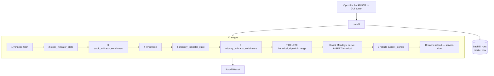

# `trip_ema/backfill/` — V1 backfill pipeline

## 1. Role in the larger application

`backfill/` is the operator-facing pipeline that rebuilds **state +
signals + industry indicators** for an arbitrary historical date
range. Used when:

- Onboarding a new market or exchange (initial data load).
- Recovering from a multi-day live-cycle outage.
- Re-deriving the V1 state after an indicator-parameter change.
- Filling a gap left by a halted cycle.
- Validating the pipeline on a different date window without
  affecting live cycle behaviour.

Where `orchestrator/recompute_market.py` is the **live cycle**
(small window, ~2 weeks back, runs every tick), `backfill/pipeline.py`
is the **historical full-rebuild** (large window, every Monday from
`date_from` to `date_to` inclusive, runs on operator command).



## 2. Architecture and constraints

| Rule | Why |
|------|-----|
| **Single-active enforcement.** `backfill_runs` table has a unique partial index on `WHERE finished_at IS NULL`; starting a second concurrent backfill raises `IntegrityError` | Two concurrent backfills would race on `historical_signals` DELETE / INSERT. The DB-level constraint makes the race impossible |
| **Marker always finishes.** `finish()` in a `finally` block so the live cycle's deferral check re-engages even on stage failure | Without this, a crashed backfill would leave the live cycle permanently deferred — manual `--release-lock` would be required |
| **Idempotent per stage.** State/enrichment use UPSERT; historical_signals uses DELETE+INSERT; current_signals uses UPSERT-on-flip / DELETE-on-no-flip | Clean re-run after a failure produces consistent end state |
| **Per-ticker isolation in stages 2/3.** A failure on ticker X doesn't abort stages 4-10 | One bad ticker shouldn't poison a 2,500-ticker rebuild |
| **Industry stages always run for ALL industries.** Regardless of which stocks are in scope | Targeted industry recompute would require maintaining the stock-to-industry mapping in scope-resolution logic. Cost of "always all" is ~30s; the simplification is worth it |
| **`date_from` rounds DOWN to its Monday** | Weekly bars are IST-Monday-anchored; passing `2026-06-25` (a Thursday) backfills the week of `2026-06-22` (Monday). Operators get what they expect |
| **In-progress week is INCLUDED in the walk** | `to_monday = monday_of(date_to)` (inclusive). The signal at the in-progress Monday is preliminary; the next live cycle overwrites it. Acceptable per spec |
| **Live cycle defers while backfill is active** | `recompute_market` checks `BackfillRunsRepository.is_active()` before running. Defer-on-active prevents the two paths from clobbering each other's writes |

## 3. File inventory

```
trip_ema/backfill/
├── __init__.py            Re-exports BackfillResult, backfill
└── pipeline.py            The 10-stage pipeline + result dataclass
```

## 4. The 10 stages in detail

### Stage 1 — yfinance bar refetch (optional)

```python
def _stage_fetch_bars(db_engine, config, *, exchange, scoped_tickers,
                     stocks, start_date, end_date) -> int:
    if stocks is None:
        # Full-exchange scope: use existing all-tickers entry point
        return run_backfill(db_engine, config, exchange, start_date)
    else:
        return fetch_bars_for_tickers(
            db_engine, config,
            ticker_ids=scoped_tickers,
            start_date=start_date, end_date=end_date,
        )
```

**Skipped** when `refetch_bars=False`. Used when the operator
knows the bars are already current (e.g. they just ran the ETL
hourly fetch).

Returns the `etl_runs.run_id` of the fetch pass for cross-reference.

### Stage 2 — `stock_indicator_state` per ticker

```python
def _stage_stock_state(db_engine, scoped_tickers) -> tuple[int, list[(int, str)]]:
    done = 0
    failed = []
    for tid in scoped_tickers:
        try:
            populate_stock_indicator_state_for_ticker(
                db_engine, tid, timeframe="1W", mode="full",
            )
            done += 1
        except Exception as e:
            failed.append((tid, f"{type(e).__name__}: {e}"))
    return done, failed
```

**Mode = `"full"`** (vs live cycle's `"incremental"`): the
populator drops and rewrites every weekly bar from the ticker's
first bar through the most recent. ~2,500 tickers × ~250 bars
each = ~625K row writes. Wall time on the NUC: ~5-10 minutes.

Per-ticker `try/except` so one bad ticker (e.g. yfinance returned
malformed data) doesn't abort the rest.

### Stage 3 — `stock_indicator_enrichment` per ticker

Same shape as stage 2 but populates the enrichment table. Reads
the `stock_indicator_state` rows written by stage 2 and computes
the 23 enrichment fields (pattern labels, turn flags, distances).
~5 minutes wall.

### Stage 4 — IIV refresh

```python
def _stage_iiv(db_engine, *, date_from, date_to) -> int:
    report = populate_industry_index_value_for_all(
        db_engine, from_date=date_from, to_date=date_to,
    )
    return len(report.get("succeeded", []))
```

Recomputes `industry_index_value` daily rows for the full range
**across all industries**. The IIV computation is downstream of
`stock_indicator_state` (stage 2 wrote new closing prices for
re-fetched bars, so IIV must reflect those). ~60 industries × ~250
daily rows = ~15K row writes.

### Stage 5 — `industry_indicator_state` (all industries)

Same per-industry compute as the live cycle's stage 7, but with
`mode="full"` so the full history is rewritten. Reads stage 4's
IIV; computes weekly aggregates; runs EMA/ATR/band/regime. ~60
industries × ~250 weekly bars = ~15K row writes.

### Stage 6 — `industry_indicator_enrichment` (all industries)

Same shape as stage 3 but for industries. ~15K row writes.

### Stage 7 — `historical_signals` purge in range

```sql
DELETE FROM historical_signals
 WHERE ticker_id = ANY(:scoped)
   AND bar_timestamp >= :from_monday
```

Clears the historical signals for the scoped tickers from
`from_monday` forward. About to be re-derived by stage 8.

**The DELETE is unconditional within scope.** Even if some
historical rows were "correct" before, they get rewritten with
freshly-derived values. This matters when the indicator parameters
changed — old rows are no longer authoritative.

### Stage 8 — Walk Mondays, derive, INSERT

The heart of the pipeline. For each Monday from `from_monday`
through `to_monday` (inclusive):

```python
for monday in mondays_in_range(from_monday, to_monday):
    as_of = datetime.combine(monday, time.min, tzinfo=_IST).astimezone(UTC)
    for tid in scoped_tickers:
        signal = derive_signal_for_ticker_this_cycle(
            conn, tid, now=as_of, timeframe="1W", as_of=as_of,
        )
        if signal is not None:
            HistoricalSignalsRepository(conn).insert(signal)
```

The crucial flag: **`as_of=as_of`** caps the state-row read inside
`derive_signal_for_ticker_this_cycle` so it sees the two most recent
state rows **as of that historical Monday** — not the absolute
latest. Without this, we'd attribute a regime change derived from
future data to a historical Monday.

The same `as_of` also caps `_latest_daily_close` so
`price_at_signal` reflects the historical close, not today's.

Walks are sequential within a Monday × per-ticker → can be O(weeks
× tickers) DB queries. For a 5-year backfill of 2,500 tickers:
~260 weeks × 2,500 = 650K derive calls. Wall time on the NUC:
~15-20 minutes.

### Stage 9 — Rebuild `current_signals` (latest-Monday flip semantics)

```python
def _stage_rebuild_current(db_engine, *, scoped_tickers, to_monday):
    as_of_latest = datetime.combine(to_monday, time.min, tzinfo=_IST).astimezone(UTC)
    upserted = 0
    deleted = 0
    with transaction(db_engine) as conn:
        for tid in scoped_tickers:
            signal = derive_signal_for_ticker_this_cycle(
                conn, tid, now=as_of_latest, timeframe="1W",
                as_of=as_of_latest,
            )
            if signal is not None:
                CurrentSignalsRepository(conn).upsert(signal)
                upserted += 1
            else:
                # No flip at the latest Monday → ensure no stale row remains
                if CurrentSignalsRepository(conn).delete_for_ticker(tid):
                    deleted += 1
    return upserted, deleted
```

For each scoped ticker, re-evaluate the regime change as of
`to_monday` (the latest Monday in scope):

- **If flipped this week** → UPSERT into `current_signals`.
- **If no flip** → DELETE any stale row (a previous live cycle
  might have written one before the backfill ran).

This makes the backfill's end state byte-identical to what the live
cycle would have produced on this Monday.

### Stage 10 — Cache reload (service-side, not in CLI)

The in-memory `CurrentSignalsCache` lives in the live service
process. A CLI-invoked backfill can't reach into the running
service to refresh it. The next service restart (or the next live
tick that runs stage 5 of `recompute_market`) picks up the new
state from the DB.

Operators running a critical backfill typically restart the service
afterward to ensure the cache reflects the freshly-derived state.

## 5. `BackfillResult` dataclass

```python
@dataclass(frozen=True, slots=True)
class BackfillResult:
    run_id:                          int
    started_at:                      datetime
    finished_at:                     datetime
    date_from:                       date
    date_to:                         date
    from_monday:                     date
    to_monday:                       date
    exchange:                        str
    ticker_scope_size:               int      # actual ticker_id count
    ticker_scope_label:              str      # 'ALL' or 'TICKER1,TICKER2,...'
    refetch_bars:                    bool

    bars_fetch_run_id:               int | None
    stock_state_tickers_done:        int
    stock_state_failed:              list[tuple[int, str]]
    stock_enrichment_tickers_done:   int
    stock_enrichment_failed:         list[tuple[int, str]]
    iiv_industries_done:             int
    industry_state_done:             int
    industry_enrichment_done:        int
    historical_signals_deleted:      int
    historical_signals_inserted:     int
    current_signals_upserted:        int
    current_signals_deleted:         int
    mondays_walked:                  int

    failed_stage:                    str | None
    error_message:                   str | None
```

Per-stage counters plus failure indicator. `failed_stage` is `None`
when the pipeline completed; otherwise it names the stage that
raised. `error_message` carries the exception's `str()`.

The CLI subcommand renders this into a multi-line summary table on
completion.

## 6. `backfill(...)` — the entry point

```python
def backfill(
    db_engine:    Engine,
    config:       Config,
    *,
    date_from:    date,
    date_to:      date | None = None,         # default: today
    exchange:     str = "NSE",
    stocks:       list[int] | None = None,    # None = all active
    refetch_bars: bool = True,
    progress_cb:  Callable[[str, str], None] | None = None,
) -> BackfillResult:
```

**Flow:**

1. **Validate args** — `date_from <= date_to`, etc. `ValueError`
   on bad input.
2. **Resolve ticker scope** — `stocks=None` queries the active
   non-delisted set for `exchange`; `stocks=[id1, id2, ...]` is
   used as-is.
3. **Round `date_from` down** to its containing Monday.
4. **`BackfillRunsRepository(conn).start(...)`** — inserts a
   marker row with `finished_at=NULL`. Unique partial index
   prevents concurrent starts; `IntegrityError` propagates.
5. **`try: ... finally: finish(run_id)`** — every stage executes
   inside the try; finish always runs.
6. **Per-stage execution** with `progress_cb` emits at each stage
   start.
7. **Catch exception** at the top of try block; record
   `failed_stage` + `error_message`; print to stderr.
8. **Return `BackfillResult`** with all populated fields.

## 7. The marker lifecycle

```sql
-- backfill_runs schema (excerpt):
CREATE TABLE backfill_runs (
    run_id           BIGSERIAL PRIMARY KEY,
    pid              INTEGER NOT NULL,
    exchange         TEXT NOT NULL,
    date_from        DATE NOT NULL,
    date_to          DATE NOT NULL,
    refetch_bars     BOOLEAN NOT NULL,
    ticker_scope     TEXT NOT NULL,
    started_at       TIMESTAMPTZ NOT NULL DEFAULT NOW(),
    finished_at      TIMESTAMPTZ                          -- NULL = active
);

-- Single-active enforcement
CREATE UNIQUE INDEX backfill_runs_active_uniq
    ON backfill_runs ((1)) WHERE finished_at IS NULL;
```

The unique partial index on `((1)) WHERE finished_at IS NULL` is
the single-active enforcement: a second `INSERT` with NULL
`finished_at` raises `IntegrityError`. Stale-lock recovery:
`--release-lock` runs `UPDATE backfill_runs SET finished_at = NOW()
WHERE finished_at IS NULL`.

## 8. The progress_cb pattern

```python
progress_cb("stage_1_fetch_bars",   "starting")
progress_cb("stage_2_stock_state",  "starting")
progress_cb("stage_3_stock_enrichment", "starting")
# ...
progress_cb("stage_10_cache",       "skipped (service-side)")
```

Stage names are stable identifiers; messages are free-form. The CLI
prints `[stage_2_stock_state] starting` followed by per-ticker
counters (logged internally by the populators) and a per-stage
completion summary on the next stage's start.

The GUI's backfill panel uses the same progress mechanism with a
custom callback that updates `QListWidget` items.

## 9. Failure modes

| Failure | Behaviour |
|---------|-----------|
| `IntegrityError` at `start()` (another backfill active) | Propagates to caller. CLI prints "use --release-lock if stale". Marker NOT inserted |
| Stage 1 fetch fails | Stages 2-10 still attempt to run with whatever bars are in `ohlcv_bars`. If bars are stale, downstream state will reflect the staleness |
| Stage 2/3 per-ticker failure | `stock_state_failed` / `stock_enrichment_failed` list grows; pipeline continues |
| Stage 2/3 infrastructure failure (DB connection) | `try` block catches; `failed_stage` set; finish called; result returned |
| Stage 7-9 raise | Same — caught, marker finished, result returned |
| `finish()` itself raises | Logged but not propagated. Operator must run `--release-lock` to clear the lock |
| Operator Ctrl-Cs the CLI | Python signal handling raises `KeyboardInterrupt` — caught by `try`; `finally` runs `finish()` → lock cleared; partial state visible in DB. Operator can re-run safely (idempotent stages) |

## 10. Idempotency

Critical property: **a clean re-run produces consistent end state**.

| Stage | Idempotency mechanism |
|-------|----------------------|
| 1 (fetch) | `ohlcv_bars` PK is `(ticker_id, bar_timestamp, timeframe)`; UPSERT on conflict |
| 2 (stock state) | `stock_indicator_state` PK; UPSERT on conflict |
| 3 (stock enrichment) | `stock_indicator_enrichment` PK; UPSERT |
| 4 (IIV) | `industry_index_value` PK; UPSERT |
| 5 (industry state) | `industry_indicator_state` PK; UPSERT |
| 6 (industry enrichment) | `industry_indicator_enrichment` PK; UPSERT |
| 7 (historical purge) | DELETE is unconditional → end state = no rows. Re-run still ends with no rows |
| 8 (walk + INSERT) | `historical_signals` has a `signal_id BIGSERIAL` PK with no other uniqueness, so a re-run after stage 7 (which clears) starts from scratch. **WARNING**: re-running stage 8 WITHOUT preceding stage 7 duplicates rows |
| 9 (current_signals rebuild) | UPSERT-on-flip / DELETE-on-no-flip |

The pipeline's idempotency relies on the strict stage order — stage
7 must precede stage 8. Don't skip stage 7 when re-running.

## 11. Data flow walkthrough — a 1-year backfill of all NSE tickers

```
operator: trip-ema-backfill --date-from 2025-06-30
    │
    ▼
backfill(date_from=2025-06-30, date_to=2026-06-29, exchange="NSE", stocks=None)
    │
    │ date_from rounds DOWN to Monday: from_monday = 2025-06-30 (already a Monday)
    │ to_monday = 2026-06-29 (Monday of week containing today)
    │ scoped_tickers = SELECT ticker_id FROM tickers WHERE exchange='NSE' AND active
    │ ticker_scope_label = 'ALL'
    │ scoped_tickers ≈ 2,500
    ▼
backfill_runs INSERT (pid=..., started_at=NOW(), finished_at=NULL)
    │ run_id = 17
    │
    ▼
Stage 1 (refetch_bars=True): yfinance fetch
    │ run_backfill(...)  for the full exchange
    │ ~6 GB pulled; ohlcv_bars upserted; ~10-15 min wall
    │ bars_fetch_run_id = 1234
    │
    ▼
Stage 2: stock_indicator_state per ticker
    │ populate_stock_indicator_state_for_ticker(tid, mode="full") × 2,500
    │ ~5-10 min wall
    │ stock_state_tickers_done = 2497; failed = 3 (e.g. yfinance returned empty)
    │
    ▼
Stage 3: stock_indicator_enrichment per ticker — similar; ~5 min
    │
    ▼
Stage 4: IIV refresh for all 60 industries
    │ populate_industry_index_value_for_all(from_date=..., to_date=...)
    │ ~30s
    │
    ▼
Stage 5: industry_indicator_state for all industries — ~2 min
    │
    ▼
Stage 6: industry_indicator_enrichment for all industries — ~2 min
    │
    ▼
Stage 7: DELETE historical_signals WHERE ticker_id = ANY(scoped) AND bar_timestamp >= '2025-06-30'
    │ historical_signals_deleted ≈ 8,500 (1y of weekly flips)
    │
    ▼
Stage 8: Walk Mondays from 2025-06-30 to 2026-06-29 (52 Mondays)
    │ for each Monday × each ticker: derive_signal_for_ticker_this_cycle(as_of=monday_utc)
    │ ~15-20 min wall for 52 × 2,500 = 130K derive calls
    │ historical_signals_inserted ≈ 8,500
    │
    ▼
Stage 9: rebuild current_signals
    │ derive at to_monday for each ticker, UPSERT or DELETE
    │ ~30s
    │ current_signals_upserted = 47; current_signals_deleted = 12 (cleanup of stale)
    │
    ▼
Stage 10: cache reload — skipped (service-side)
    │
    │ finally: BackfillRunsRepository(conn).finish(17)  → finished_at = NOW()
    ▼
return BackfillResult(stock_state_tickers_done=2497, ..., failed_stage=None)
```

Total wall time: ~40-50 min for a 1-year all-NSE backfill on the
NUC.

## 12. Concurrency

- **One backfill at a time** — enforced by `backfill_runs` partial
  unique index. Concurrent starts raise `IntegrityError`.
- **Within stages 2-3**, per-ticker is sequential (no parallel
  fan-out at the pipeline level). The populator internals may use
  thread pools, but the pipeline doesn't itself spawn workers.
- **Live cycle defers while backfill is active.** Checked by
  `recompute_market` at entry — sees `is_active()` and logs
  "deferring this cycle; backfill in progress". No DB writes from
  the live cycle while backfill runs.

## 13. Testing

`tests/backfill/`:

| File | Coverage |
|------|----------|
| `test_pipeline_happy_path.py` | End-to-end against `postgres_engine` — small fixture (10 tickers, 4 weeks), assert all stages complete and end state matches expected derivation |
| `test_pipeline_per_ticker_isolation.py` | Inject a broken ticker (no bars); stage 2 records it in `stock_state_failed` and continues |
| `test_pipeline_marker_lifecycle.py` | `start()` raises `IntegrityError` on concurrent run; `finish()` runs in `finally` even on stage failure |
| `test_pipeline_idempotency.py` | Run a full pipeline; run it again; assert DB state byte-identical |
| `test_pipeline_partial_scope.py` | `stocks=[tid1, tid2]` — only those tickers get their state recomputed; others untouched |
| `test_pipeline_failed_stage.py` | Inject a stage-mid failure; verify `failed_stage` set; marker finished; result returned correctly |

## 14. Common pitfalls

1. **Don't skip stage 7 when re-running stage 8.** Stage 7
   DELETEs in range; stage 8 INSERTs. Re-running 8 without 7
   doubles rows (`historical_signals` has no uniqueness beyond
   the BIGSERIAL PK).
2. **`date_from` rounds DOWN to its Monday.** Operators expecting
   "exact day" semantics will be surprised — pass an actual Monday
   or remember the round-down.
3. **`stocks` is `list[ticker_id: int]`, not symbols.** The CLI
   resolves symbols → ticker_ids before calling. Don't pass
   `['NSE:BALAMINES']`; pass `[12345]`.
4. **Industry stages always run for all industries.** Targeting
   `stocks=[1, 2, 3]` doesn't skip stages 4-6. This is by design;
   don't try to "fix" it.
5. **Backfill doesn't refresh the cache.** Restart the service or
   wait for the next live tick. The DB is correct; the in-process
   cache is stale until then.
6. **`--release-lock` is a fix for stale locks, not a normal
   operation.** Use only when the previous backfill crashed and
   left the marker as `finished_at=NULL`. Running it during an
   active backfill clears the marker, which would allow a
   concurrent backfill to start — corrupt outcomes likely.
7. **The in-progress week IS included in the walk.** The signal
   at `to_monday` is preliminary; the next live cycle overwrites
   it with `mode='incremental'` on the same Monday.

## 15. Extension paths

- **Parallel stage 8 walk.** The Monday loop is currently
  sequential. Could parallelise per-Monday with a `ProcessPoolExecutor`
  — careful with the DB pool sizing.
- **Resumable backfill.** Add a `(run_id, last_completed_stage)`
  column; on stage failure, allow `--resume-from=N` to skip
  completed stages.
- **Per-stage selective re-run.** Operators sometimes want "rerun
  stages 5-9 only without re-fetching bars". Add a `--stages=5:9`
  CLI flag.
- **Per-Monday progress in CLI.** Stage 8 currently logs every
  Monday but doesn't surface to the CLI's progress display. A
  more verbose `progress_cb` would help.

## 16. Related packages

- `trip_ema/persistence/backfill_runs_repo.py` — the marker
  table's repo. `start()` raises `IntegrityError` on concurrent
  use; `finish()` clears the active marker.
- `trip_ema/fundamentals/v1_runners.py` — provides
  `populate_*_for_ticker` and `populate_*_for_all` (per-ticker
  and per-industry bulk populators).
- `trip_ema/orchestrator/derive_signals.py` — provides
  `derive_signal_for_ticker_this_cycle` with the crucial `as_of`
  parameter for backfill walking.
- `trip_ema/persistence/historical_signals_repo.py` and
  `current_signals_repo.py` — the targets for stages 7-9.
- `trip_ema/etl/runner.py` — provides `run_backfill` and
  `fetch_bars_for_tickers` for stage 1.
- `trip_ema/etl/cli.py` — exposes `backfill` as the
  `trip-ema-etl backfill` subcommand.
- `trip_ema/orchestrator/recompute_market.py` — checks
  `is_active()` at entry and defers when a backfill is running.
- `trip_ema/gui/views/etl_status.py` — UI surface for triggering
  backfills.
